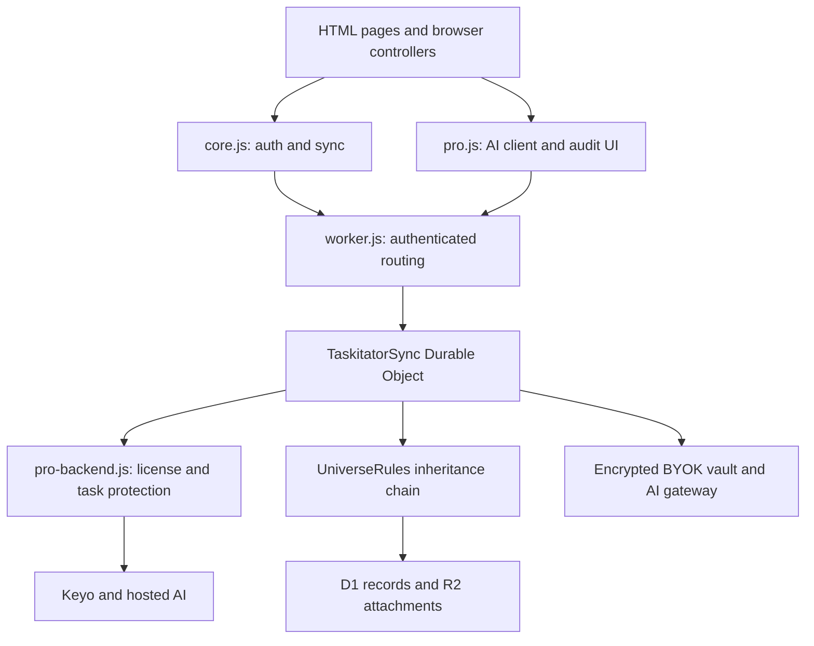
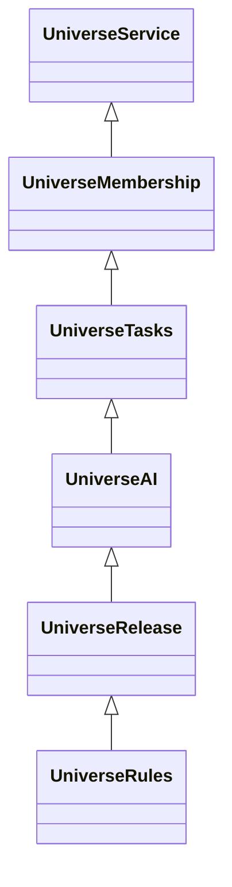
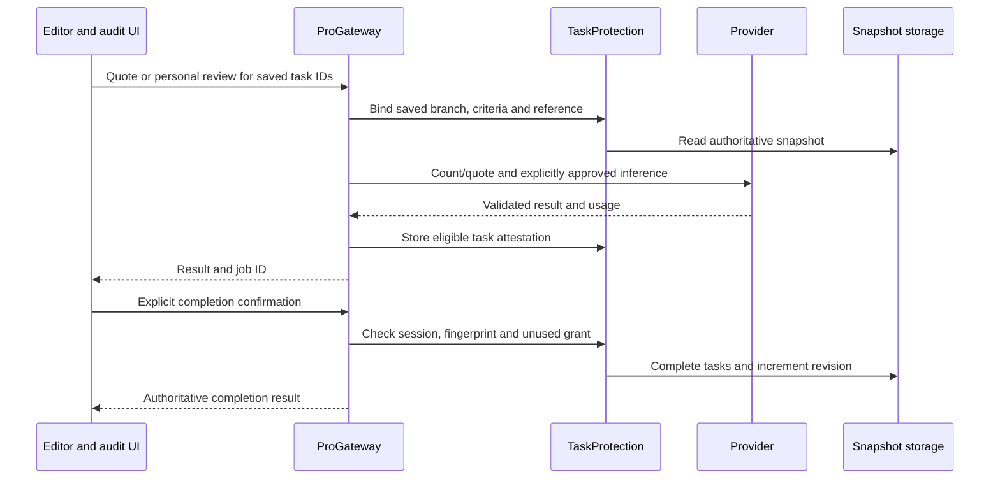

# Taskitator — code and architecture guide

Taskitator is a browser task manager with nested tasks, projects, scheduled and flexible breaks, offline personal editing, proof-based completion, a focus timer, an AI Copilot, cloud synchronization, phone-blocking integration, and collaborative workspaces called **Universes**. The frontend is static HTML/CSS/JavaScript. Its authenticated backend runs in a Cloudflare Worker and a Durable Object; Universe records use D1, and Universe attachments use R2.

This guide describes the source at [`99b4282`](https://github.com/spacexmzez-bit/Taskitator/tree/99b42829c17fb4a5921b1f51c85020556e70abab), inspected on **5 November 2026**. The catalogue covers all 106 tracked files: 82 text files and 24 PNG assets. The source describes the app's behavior. Live configuration, credentials and provider availability depend on the deployment.

## Contents

- [System structure](#system-structure)
- [Startup and browser contracts](#startup-and-browser-contracts)
- [Offline mode and reconnection](#offline-mode-and-reconnection)
- [Data ownership and storage](#data-ownership-and-storage)
- [Browser engines](#browser-engines)
- [Pages and inline code](#pages-and-inline-code)
- [Worker and backend engines](#worker-and-backend-engines)
- [Universe subsystem](#universe-subsystem)
- [Phone status and MacroDroid](#phone-status-and-macrodroid)
- [End-to-end flows](#end-to-end-flows)
- [API families](#api-families)
- [Styles, tutorials, data, and assets](#styles-tutorials-data-and-assets)
- [Build, configuration, and operations](#build-configuration-and-operations)
- [Tests and verification](#tests-and-verification)
- [Maintenance boundaries](#maintenance-boundaries)
- [Alphabetical file catalogue](#alphabetical-file-catalogue)
- [Source navigation index](#source-navigation-index)

## System structure



There are two different programming styles in this repository:

1. **Browser classic scripts** share objects on `window`. The pages declare their order and `core.js` activates them. Inline controllers use the same globals and custom events. Merely finding an identifier in another file does not mean there is an ES-module import.
2. **Worker ES modules** use explicit imports. `worker.js` imports the Pro gateway and the final Universe service. The Universe classes extend one another, adding and overriding behavior while retaining older schema fallbacks.

Several root files were consolidated from older files. Comments such as `MODULE_START: auth-client.js` identify internal sections; they do **not** mean that `auth-client.js` is still a separate tracked file. Test helpers extract these sections to keep older focused fixtures working.

## Startup and browser contracts

### Authentication before private UI

The main pages start with an `auth-pending` class and hide their contents. App scripts are declared with the inert type `text/taskitator-script`, rather than executing immediately. The regular deferred script is `core.js`.

Its bootstrap performs the following work:

1. If an older service worker controls the page, query it with `TASKITATOR_SECURITY_VERSION`. Wait for the expected cache release or show a recoverable update error. Reload after a controller upgrade because styles/scripts may already have arrived from the old cache.
2. Handle deletion-status and public comparison/legal views separately. Public legal/comparison views remove private navigation and inert private scripts rather than starting the workspace.
3. Initialize Clerk using the public configuration in `TASKITATOR_AUTH_CONFIG`, obtain the current authenticated account from `/auth/me`, and check local account ownership.
4. Redirect to `login.html` if sign-in/account connection is required. A network failure can instead open a cached workspace for its previously confirmed local owner. See [Offline mode and reconnection](#offline-mode-and-reconnection).
5. Activate the inert scripts **sequentially in document order**, preserving classic-script dependencies. Initialize the vault, dispatch `taskitator-auth-ready`, and reveal the page.
6. Watch Clerk session changes. A changed session clears in-memory vault state, archives the old local workspace, clears active local data, and returns to login.

On `index.html`, the script order is Pro suite, Smart Study, study plan, shared components, focus timer, app controller, and tutorials. `components.html` additionally declares the Universe browser helpers before the common scripts. Those helpers defer authenticated work through their own lifecycle/event checks. `settings.html` also contains a large inert inline settings controller.

### Shared browser interfaces

| Interface | Defined in | Main consumers and responsibility |
| --- | --- | --- |
| `TASKITATOR_AUTH_CONFIG` | `core.js` | Public Clerk publishable key and Worker URL; consumed by authentication and API clients. |
| `TaskitatorAuth` | `core.js` | Clerk session/token access, authenticated API calls, account connection, storage sanitation, sign-out. |
| `SyncEngine` | `core.js` | Used by all personal-workspace writers to mark changes, push/pull snapshots, and handle conflicts. |
| `TaskitatorSafety` | `pro.js` | Safe label rendering and task-tree deletion checks shared by controllers/editors. |
| `ExemplarStore` | `pro.js` | IndexedDB reference files used by editors and proof review. |
| `TaskitatorOffline`, `TaskitatorMerge` | `core.js` | Cached identity and connectivity gates, plus account-scoped sync bases and three-way merge. |
| `TaskitatorPriority` | `components.js` | Computes effective priority for personal task rendering and sorting from the current tree. |
| `TaskitatorMacro` | `macro-bridge.js` | Builds the tokenized MacroDroid bridge and offers both macro downloads from Settings. |
| `TaskitatorBreaks` | `pro.js`; equivalent server copy in `worker.js` | Deterministic break normalization, time calculations, validation, and merge rules. |
| `TaskitatorVault` | `pro.js` | Provider/key metadata, provider selection, legacy-key migration, and BYOK generation requests. |
| `TaskitatorEngine` | `pro.js` | Break, emergency, and audit engines. Copilot also attaches through the app suite. |
| `TaskitatorPro` / `ProClient` | `pro.js` | Status, activation, hosted quotes/reviews, personal reviews, confirmation, emergency and entitlement checks. |
| `ProUI`, `TaskitatorProfile`, `TaskitatorTier` | `pro.js` | Pro settings/review dialogs, display username, account-scoped tier presentation. |
| `TaskitatorRecurrence` / `TaskitatorRecurrenceUI` | `components.js` | Pure recurrence rules plus browser persistence/editor controls. |
| `TaskitatorComponents` | `components.js` | Creates shared task/editor/audit UI against a host adapter. |
| `TaskitatorToast`, `TaskitatorNotify`, `TaskitatorConfirm`, `TaskitatorBusy` | `components.js` | Feedback, asynchronous confirmation, and button state shared by the pages. |
| `TaskitatorApp` | `app.js` | Personal tasks, views, completion, selection, sorting, projects, editor entry points, storage/render coordination. |
| `TaskitatorAgent` | `app.js` | Page-scoped Copilot context, model requests, tool execution, reply display, note extraction. |
| `TaskitatorScratchpadBlocked` | `app.js` | Required-work gate reused by scratchpad-related actions. |
| `TaskitatorPomodoro` | `uni/focus-timer.js` | Persistent timer core and browser UI; supersedes the guarded legacy timer in `app.js`. |
| `TaskitatorSmartStudy`, `TaskitatorStudyCore`, `TaskitatorStudy` | `pro/*.js` | Shared schedule logic, task generation, preview and explicit confirmation. |
| `TaskitatorSpotlight`, `TaskitatorTutorials` | `tutorial-*.js` | Tour rendering, tour content, saved progress, and Universe onboarding. |
| `UniverseUX`, `UniverseDialog`, `UniverseShell`, `UniverseTasksUI`, `UniverseReleaseUI`, `UniverseArchive` | `uni/` browser scripts | Collaborative workspace presentation and API-driven interactions; no authority to grant server permissions. |

### Events connecting the modules

| Event or browser signal | Role |
| --- | --- |
| `taskitator-auth-ready` | Starts authenticated controllers after scripts and identity are ready. |
| `taskitator-tasks-updated` | Requests refreshed task views after local/AI changes. |
| `taskitator-synced`, `taskitator-sync-error` | Updates sync indicators and views; editors avoid replacing an active draft. |
| `taskitator-settings-changed`, `taskitator-breaks-changed` | Notifies dependent UI after local settings/break updates. |
| `taskitator-pro-status` | Publishes verified status responses to tier/Pro UI. |
| `taskitator-emergency-updated` | Refreshes bypass displays using the server-managed response. |
| `taskitator-timer-scratchpad` | Closes the focus panel and starts note capture; the scratchpad controller remembers to return to the timer. |
| `taskitator-refresh-safe`, `taskitator-study-closed` | Allows deferred refresh/work after guarded UI closes. |
| `universe-create-task`, `universe-discard` | Opens the Universe editor from the shell and explicitly discards dirty forms. |
| `taskitator-merged`, `taskitator-reconnected` | Notify controllers of a merged local snapshot or a validated return online. |
| `storage`, `online`, `focus`, `visibilitychange` | Coordinates tabs, sync recovery, view refresh, and timer reconstruction. These signals do not establish server authorization. |

## Data ownership and storage

### Personal workspace

Local browser data is a working copy. The connected account's cloud snapshot is stored in Durable Object storage, with revision checks protecting writes. `TaskitatorSync` is instantiated through a single named Durable Object, `taskitator-v1`; storage keys separate accounts inside that object. It is not one Durable Object per user.

| Data/key family | Content and connections |
| --- | --- |
| `taskitator_tasks` | Personal task array: IDs, `parent_id`, project, title/description, status, due dates, bonus flag, priority, tags, proof/lock/shield and optional recurrence/study metadata. |
| `taskitator_projects` | Personal project catalogue; `project_id` connects tasks to these records. |
| `taskitator_settings` | Preferences, tag/priority catalogues, schedule settings, tutorial progress and account connection metadata. Credentials are stripped from ordinary sync/export paths. |
| `taskitator_daily_breaks` | Read-only, server-written copy of date-keyed break records (system, planning window, pinned cycle bounds/timezone and intervals). The Worker preserves its own break records even if a snapshot payload carries a stale copy. |
| `taskitator_break_state` | Account-scoped cache of the last `/breaks` answer, used for display only. |
| `taskitator_audit_ledger` | Client productivity/completion history; not the authoritative hosted billing ledger. |
| `taskitator_saved_criteria` | Reusable proof requirements managed by the task editor. |
| `taskitator_recurrence_state` | Recurrence series/templates, history and reference associations. Must remain consistent with tasks. |
| `taskitator_collapsed_nodes` | Personal tree expansion state included in local backup/account handling. |
| `taskitator_sort_mode` | Locally saved sibling-sort choice, read by the task view. |
| Scratchpad keys | Live notes and `taskitator_archived_notes`; capture/extraction/archive paths use these separately from the ordinary task snapshot payload. |
| `taskitator_focus_v1:<account>` | Local per-account focus timer state; timestamp-based, separate from cloud phone-access authority. |
| IndexedDB sync bases | `TaskitatorMerge` stores the last accepted, versioned merge base by account so it can distinguish local edits from concurrent cloud edits. |
| Cached offline identity and Pro token | `TaskitatorOffline` tracks the last confirmed account/contact and validates signed offline Pro metadata for that Clerk identity. |
| Account cache/recovery keys | Archived workspaces and preserved conflicting legacy copies used on logout, account switching, and migration. |
| IndexedDB `TaskitatorExemplarDB` and account-scoped variants | Binary reference exemplars. `ExemplarStore` associates them with task IDs, controls legacy ownership, and supports account cleanup. Ordinary browser JSON exports do not automatically contain all these binaries. |

The task tree is built with `parent_id`, not display indentation. Moving or filtering a view is distinct from changing the stored parent. Several behaviors use the nearest dated ancestor for an undated child, but each gate has its own policy: phone blocking, scratchpad access, and Copilot progress must not be treated as identical predicates.

### Server records

| Storage | Main contents |
| --- | --- |
| Durable Object account/identity records | Clerk identity-to-workspace links, ownership, revisions, snapshot metadata, phone credentials and migration state. |
| `snapshot:<encoded user>:<index>` | Chunked personal snapshot strings; `loadSnapshot` and `saveSnapshot` reconstruct/store them. `CHUNK_CHARS` is 24,576. |
| `pro:entitlement:<account>` | Verified Keyo token, key/binding IDs, validity, status, stored policy and BYOK selection. |
| `credits:plan:<account>`, `credits:<account>:e<epoch>:…` | Verified plan and cycle anchor, plus separate Free BYOK and Pro hosted-audit usage/reservations. Legacy `pro:usage:` records can feed spend estimates. |
| `ai-hosted:<account>:<day>:…` | Daily general hosted AI request counters and provider-spend holds. |
| `breaks:day:`, `breaks:index:`, `breaks:strict:` | Authoritative logical-day records, retained day index, and revisioned break configuration. |
| `pro:spend:<account>:<month>` | Personal hosted-audit provider-spend safety accounting. |
| `pro:op:` and `pro:attestation:` families | Audit operation replay state, evidence/task bindings, and completion receipts. |
| `pro:study-validation:`, `pro:study-grant:` | Criteria validation and exact generated-plan authorization used during later sync. |
| Vault/staging/verification/deletion keys | Encrypted provider keys, pending recovery, one-use identity proofs, deletion jobs and receipts. |
| `sleep-lock:<account>`, `sleep-delay:<account>:<night>` | Authoritative Sleep Lock schedule/revision and a night's one-use delay. |
| D1 `universe_*` tables | Membership, shared tasks, reviews, attachment metadata, operation replay, discussion, portability and rules. |
| R2 `TASKITATOR_EVIDENCE` | Private Universe proof/reference bytes and staged export/import contents. |
| KV `TASKITATOR_KV` | Legacy-account migration input; current personal snapshot reads/writes use Durable Object storage. |

## Browser engines

### `core.js` — authentication, account lifecycle and synchronization

This file contains nine marked sections. The `offline.js` and `merge.js` markers are internal sections of `core.js`.

**`auth-config.js` section.** Defines the public Clerk key and Worker URL. These settings are read at runtime by clients; they are not license permissions or a place for private keys.

**`auth-client.js` section.** `cleanSettings` removes reusable credentials and optionally export-specific identity data. `cleanSnapshot`, `readSnapshot`, `recoveryCopies`, `preserveCopy`, and `snapshotTime` sanitize and preserve old local archives. `cleanLegacyStorage` migrates credential-bearing archive keys into safer account-scoped names while retaining differing copies instead of blindly merging task arrays. `loadScript` loads Clerk. `TaskitatorAuth.token` retrieves a Clerk token; `api` adds the bearer header, no-store and timeout handling, and readable Worker-version errors. `connect`, `init`, `manageAccount`, and `signOut` implement account connection, session startup/profile, and confirmed logout intent.

**`sync-engine.js` section.** `SyncEngine` tracks session ownership, dirty state, known remote revision, in-flight writes, and a fixed change-triggered synchronization window. Its functional groups are:

| Functions | How they work together |
| --- | --- |
| `getConfig`, `isConfigured`, `accountCacheKey`, `initializeSession`, `sessionMatches` | Resolve the current connected account and stop stale asynchronous work from another local session. |
| `archiveLocalAccount`, `clearLocalAccount`, `beginLogin`, `logout` | Preserve outgoing local data, isolate incoming workspaces, clear active state and coordinate Clerk logout. |
| `needsInitialPull`, `isDirty`, `markLocalModified`, `rememberRemoteVersion` | Distinguish unsent local edits from server versions and initial account startup. |
| `getPayload` | Serializes tasks, projects, sanitized settings, breaks, ledger, saved criteria and recurrence data with the revision/mutation metadata required by the Worker. |
| `push`, `performPush`, `request` | Serialize/retry authenticated writes, keep stable operation identity, accept returned revision and surface conflicts rather than silently replacing cloud data. |
| `readCloud`, `pull` | Fetch the remote snapshot, check account/session and local edits, then apply accepted data and notify views. |
| `scheduleAutoPush`, `queueAutoPush`, `startAutoWindow`, `armAutoSync`, `runAutoSync`, `cancelAutoWindow` | Batch changes without idle cloud polling. Storage events keep the deadline visible across tabs. |
| `flushIfDirty`, `forceImmediateSync`, `syncNow` | Perform explicit or lifecycle-triggered synchronization; manual sync includes both directions and conflict handling. |
| `registerRefreshGuard`, `isSafeToRefresh`, `autoRefreshEnabled`, `maybeRefreshPage` | Defer a page reload while editors or other guarded UI have work in progress. |
| `resolveConflict`, `reportConflict`, `openConflictDialog` | Try a three-way merge and retry against the new cloud revision. If there is no safe merge base or races repeat, offer an explicit copy choice and export. |
| `changePassword`, `resumePasswordChange`, `fetchMrStudyRules` | Compatibility entry points. Password management belongs to Clerk; the old rules bridge is not an active external rules service. |

**`deletion-client.js` section.** A deletion dialog obtains an action-bound verification, requires the blocker-disabled checkbox and manually typed phrase, confirms proof status immediately before deletion, and saves a random receipt before sending the destructive request. `cleanLocal` removes only the relevant account's local/cache/reference data. Lost responses can be checked using the retained receipt; a timeout alone does not prove deletion was accepted.

**`deletion-status.js` section.** Reads a receipt and polls the narrow deletion-status endpoint for progress and phone recovery information. It can activate without a normal workspace session.

**`login-page.js` section.** Mounts Clerk sign-in/sign-up, displays the signed-in account, connects a new empty workspace or migrates a legacy workspace, exposes recovered copies for download, performs the initial pull, and enters the app only after successful account/sync handling.

**`auth-bootstrap.js` section.** Implements the startup sequence documented above. Changes to script loading, authentication overlays or public/private page separation belong here.

#### Offline mode and reconnection

`TaskitatorOffline` distinguishes network failures from HTTP responses and probes Worker reachability after failures. It can restore a previously confirmed account only when that account owns the local workspace and no deliberate logout is pending. The personal task, project and note flows can continue against local data where their actions permit it. AI, protected reviews that require the server, Universe calls, server-owned breaks and bypass, phone credential changes and Sleep Lock setup require a connection. Cached break information is useful for display. It does not authorize a break.

`TaskitatorAuth.reconnect` loads Clerk, revalidates the account with `/auth/me`, and checks deletion or account changes before syncing. A gap over seven days from server-confirmed contact requires a fresh Clerk sign-in before resuming sync. Local edits stay available for the same account. The optional signed offline Pro token is issued by `signOfflineEntitlement` in `pro-backend.js` and verified in `core.js` with the configured public JWK. It is tied to the Clerk user and expires at the entitlement expiry or, for an entitlement without an expiry, after 30 days. A cached token does not authorize a Worker request.

`TaskitatorMerge.merge3` compares the IndexedDB base, the local snapshot and a fresh pull. It combines independent task/project edits, merges tags as sets and settings by key, and requests a choice for competing edits, including delete-versus-edit and orphaned children. Recurrence and saved criteria are handled as whole values. `SyncEngine.resolveConflict` checks the account and local revision again after a choice, stages the merged snapshot, and retries against the remote revision. Worker protection and graph validation still apply to the merged write. Without a usable base, the copy chooser preserves an export path.

### `components.js` — feedback, recurrence and shared task editing

**Feedback section.** `ensureHost`/`raiseHost` create a top-layer toast host; `inferType` chooses legacy message tone; `show`/`dismiss` manage bounded notifications, close buttons and optional actions. `parseLegacy` adapts old confirmation text. `confirmSheet` returns a promise for a themed confirmation. `setBusy` preserves button state while an action runs. These interfaces replace scattered native feedback where callers support them.

**Recurrence core.** Exposes the same deterministic API as the Worker copy:

| Function | Meaning |
| --- | --- |
| `validDate`, `today` | Validate date strings and calculate a logical Riyadh-offset task date using the configured day-start hour. |
| `schedule`, `nextDate` | Validate supported daily/weekday/monthly/specific-month-day/half-yearly/yearly schedules and find the next valid occurrence inside their bounds. |
| `subtree` | Traverse parent/child IDs without relying on UI rows. |
| `seriesFor`, `canStart` | Find the owning series and validate whether a branch can become a recurrence. |
| `cleanNode`, `start` | Capture allowed template fields, references and branch relationships, create series metadata and attach the initial occurrence. |
| `updateNode` | Keep series template fields in step with permitted task edits. |
| `validateState` | Reject malformed/inconsistent recurrence state before persistence or import. |
| `reconcile` | Reconcile snapshots as occurrences advance, respecting active branches, schedule bounds and history. Both browser and server need compatible rules. |

**Recurrence UI.** `state` and `tasks` read an active editor draft before live storage. `persist`/`save` validate and write a coordinated snapshot. `scheduleForm` renders schedule controls; `captureReferences`, `attachCreated`, `validCreate`, `bindTask`, `applyEdit`, `open`, and `overview` connect recurrence setup/editing to task dialogs and stored reference files. Canceling a task draft must not save its recurrence edits.

**Consecutive numbering.** The editor asks the Pro client for a numbering grant when needed. It shares the in-flight check, drops denials/errors, and stops using the grant at expiry or when the draft or account changes. The title editor uses the result when resolving numbering tokens.

**Dynamic Priority.** `TaskitatorPriority.effectiveMap` derives the display/sort priority when an active task has an allowed `dynamic_priority_target`, at least one unfinished bonus descendant, and no unfinished required descendant. `priority_id` stays as configured. `app.js` and the relevant inline views consume the derived map. `TaskProtection.guardDynamic` in `pro-backend.js` checks entitlement and target changes during snapshot writes.

**Shared component factory.** `TaskitatorComponents.create(host)` receives a host adapter for tasks, settings, projects, priorities, tags, rendering, persistence and completion. It returns shared editor/audit methods rather than owning a second independent task database. `app.js` and the consolidated workspace views use it.

The component responsibilities are:

- **Draft lifecycle:** `controls`, `dirty`, `discardDraft`, and `commitDraft` track control values, the original task/recurrence snapshot, account session and pending reference changes. Commit detects changes made elsewhere; discard does not mutate live tasks. The draft is exposed as `TaskitatorEditorDraft` for recurrence controls.
- **Catalogues:** saved-criteria helpers, project/tag/priority cloud renderers, quick tag addition, and `refreshConsecutive` coordinate actual user-configured catalogues and verified Pro numbering access.
- **Title input:** `upgradeInput`, input/click/keyboard/paste handlers and `extractCleanTitle` render/resolve supported title and numbering tokens while retaining raw title syntax separately from display text.
- **Create/edit dialogs:** `openTaskCreationModal`, `openTaskDetailModal`, `refreshDetailSubtaskList` and `init` bind parent relationships, bonus/priority/project selection, lock/shield rules, subtasks, saved requirements, numbering and recurrence to explicit saves.
- **Reference files:** base64/file conversion helpers stage exemplars and retain/remove them according to the draft's save result.
- **AI criteria and proof:** `runCriteriaValidation` performs preflight criteria checking; the templates/saved-criteria pickers populate requirements; `openAuditModal` and submit handlers use the audit engine and server-confirmed completion flow. A passing criteria score is not task completion.

### `app.js` — Copilot, personal task views, scratchpad and legacy timer

#### Copilot section (`TaskitatorAgent`)

`getPageContext` resolves consolidated routes and older route aliases. `getCopilotName` applies the user's display preference. `getSystemPrompt` loads `SYSTEM_PROMPT.md`, validates its marker/identity and size, caches it, and falls back to a built-in Taskitator prompt if needed. The tool schemas and runtime context are assembled according to the page; task mutation tools are not exposed on every page.

`executeModelCall` uses the selected vault provider/model. Conversation identity includes provider/key version; `resetConversation` drops old context on a change. `getTrimmedContents` limits history while preserving complete tool turns. `sendMessage` executes bounded model/tool exchanges, with supported provider fallback behavior, and only reports mutations after tool results.

`executeToolCall` reads fresh tasks and dispatches supported task reads, scoped progress, create/update/trash actions and study-plan proposals. It enforces the allowed fields and protected-task restrictions. `commitTasks` saves local results and schedules sync/refresh. Chat tools cannot manufacture an audit approval or authorize protected completion.

`todayProgress` returns only `{title, directory, status}` for its selected active/completed work. It follows nearest ancestor dates, includes relevant overdue work, and requires completed entries to have a completion timestamp in the current logical day. **That narrow tool is not a global privacy boundary:** other offered task context/tools and earlier conversation can contain additional information.

`scratchpadBlocked` detects active non-bonus tasks due today or overdue, including inherited dates, and fails closed on malformed task storage. It does not treat all standalone undated tasks the same way as phone blocking. `extractNotesBatch` gates access, sends captured notes for structured cleanup, and returns processed output. `initUI` renders chat safely through DOM text/limited structure, binds quick commands and sends input; `refreshSystemNames` updates personalized labels.

#### Personal controller (`TaskitatorApp`)

| Function group | Behavior and dependencies |
| --- | --- |
| `getComponents`, modal delegates | Constructs the shared host adapter and opens components-based create/detail/audit dialogs. |
| `getAppTodayStr`, catalogue helpers | Resolve logical day and real projects/tags/priorities; `saveProject` and `deleteProjectWithCascade` persist project changes and chosen task relocation/deletion behavior. |
| `SoundFX`, `UIFX` / `TaskitatorFX` | Audio, haptics and class/animation feedback; they do not authorize mutations. |
| `DistractionDumpEngine` | Reads/saves expiring captured notes, garbage-collects them, opens/closes timed capture, commits on expiry, and opens the saved-notes escrow dialog. Timer-origin capture can reopen the focus panel. |
| `loadStorage`, `saveStorageAndPush` | Reload local task state, reconcile applicable recurrence/study changes, persist it and request sync. |
| `initSyncIndicator`, `updateSyncDot` | Translate sync outcomes to the status UI. |
| `sortTasks` | Sort siblings using the chosen priority (the default), alphabetical, or required-first mode; recursive rendering preserves hierarchy. The sort menu saves `taskitator_sort_mode` and rerenders. |
| `getAllDescendants`, `hasUncompletedDescendant`, `getShieldedAncestor`, `isCompletionBlocked` | Traverse the actual tree and determine shield/prerequisite restrictions. |
| `cascadeProject`, `cascadeTaskStatus` | Propagate applicable project/status changes through descendants while checking the operation's constraints. |
| `handleTaskCompletion`, `startGraceCompletionTimer`, `undoTaskCompletion`, `finalizeTaskCompletion` | Coordinate ordinary completion, a reversible grace interval, actual status changes, ledger updates and protected audit entry points. |
| `deleteTask` | Checks protected descendants and marks the chosen branch as trash rather than immediately erasing records. |
| Filter/selection helpers | Keep draft filters separate until Apply; manage multiselect, select-all and batch-action state. |
| `BreakUI` | Displays planning/locked/active-break states and edits through `TaskitatorEngine.BreakEngine`. |
| `isTaskVisuallyActive`, `renderUnifiedTaskTree` | Resolve current view, filters, subtree visibility, priority styles, bonus/Smart Study appearances and recursive task rows. View inclusion is not a stored status mutation. |
| Completed-list helpers | Show completed work and permit reopening through the appropriate restrictions. |
| `renderUnifiedView`, `setView`, `handleHashRouting`, `init` | Coordinate route/view switching, event binding, menus, quick/bulk actions and safe refresh. |
| `updateEmergencyUI` | Reads server-managed bypass state and updates the emergency control/countdown. |

The sort menu uses a real button, `aria-expanded`, saved radio-style choices, outside-click and Escape dismissal. Header layout, visibility and animations involve `index.html`, `app.js`, and `style.css` together.

The final `pomodoro.js` section retains an older injected timer, oscillator bell, work/break transition loop, fullscreen controls and view listeners. Its guard returns when `TaskitatorPomodoro` already exists. Current pages load `uni/focus-timer.js` first, so that persistent implementation normally wins; deleting the old block or changing load order has different effects from editing the active timer.

#### Today visibility and batch edits

`renderUnifiedTaskTree` renders tasks due today or overdue as Today roots when they have no qualifying ancestor. Their descendants appear under those roots, so a dated child does not duplicate itself when its parent is already shown. A dated descendant of an undated branch can appear as a root with a directory label while unrelated ancestors and siblings stay outside the list. Undated chains have no Today root. Smart Study early appearances and the current view's filters also affect visibility. `todayProgress` and the scoped Copilot lookup apply the task-or-ancestor date check. Phone and scratchpad gates have their own date and protection rules.

Bulk delete in `app.js` enters a selection mode, confirms, then rechecks the same task protection rule as row deletion before trashing eligible subtrees. Batch Bonus State updates `is_bonus` under the edit dialog's shield rules and persists through the normal sync path. In the shared editor, a stored title token does not force the bonus checkbox back on.

### `pro.js` — safety, key management, audits, account presentation

| Internal section | Detailed role |
| --- | --- |
| `safety.js` | `escapeHtml` escapes user text; `setProjectLabel` builds icon/name DOM nodes; `collectSubtree` finds descendants; `deletionError` checks AI locks and pending shielded branches, with the explicit bypass input. |
| `exemplar-store.js` | `getDB` chooses the account-owned IndexedDB; `blobToBase64` serializes bytes. `saveExemplar`, `hasExemplar`, `getExemplar`, `deleteExemplar`, `clearAll`, `deleteAccountFiles` manage bounded local references and legacy ownership. |
| `pro/break-core.js` | `timezone`, `parts`, `time`, `wall`, `dayBounds`, `bounds`, `interval`, `validate`, `normalize`, `migrate`, `activeBreak`, `active`, `merge` form the shared date/break rules. They validate intervals, overlap and total duration, normalize legacy records, pin cycle data, and provide compatibility helpers for older records. Current break writes are handled by `BreakSystems`. |
| `vault-client.js` | Tracks viewed and active providers separately; renders saved-key metadata and recovered candidates; stages legacy browser keys only for their known owner; removes plaintext only after successful server staging. `selection` returns provider/model/version, and `generate` calls the Worker without embedding the saved provider secret in the request. Sensitive save/reveal/delete actions use password/Google confirmation dialogs and action-bound proof. |
| `audit-engine.js` | `TaskitatorEngine.BreakEngine` calls `/breaks`, caches the last account-scoped result and feeds the planning UI. `EmergencyManager` reads server-managed state and requests activation through the Pro client. `AuditEngine` handles selected provider, validation caching, proof/exemplar conversion, single reviews, hosted quote consent and personal review. |
| `pro/pro-client.js` | `ProClient.request` attaches authenticated headers and normalizes API errors. Other methods retrieve status, activate a license, toggle Pro BYOK, prepare stable audit/confirmation IDs, fetch quotes, approve reviews and apply completion confirmations. Pending maps retain operation identity for retry safety; entitlement checks reject stale account/session results. |
| `pro/pro-ui.js` | Renders the Pro Settings section, activation/BYOK controls, single/batch cost consent and result dialogs. File staging and result eligibility are separate from applying completion. Quote dialogs have cancellation/focus handling; confirmed completion refreshes local task state from the authoritative result. |
| `pro/profile-ui.js` | Fetches/paints the account's display username, provides availability/edit UI and ignores old-session results. The display label is distinct from the immutable login/account identity. |
| `pro/tier-ui.js` | Restores an account-scoped display cache, interprets status/expiry, renders tier cards, sets presentation classes, and refreshes from verified server status. A cached badge does not authorize a Worker operation. |

Breaks offer two systems per logical day, **Scheduled** and **Flexible**, sharing one daily allowance (3 hours by default; adjustable from 1 to 3 hours in 15-minute steps in Settings → Day & week, and each day keeps the maximum it was locked with). Choosing one (first Scheduled save, first Flexible start, or Lock for Today) locks it until the day resets. Scheduled planning has a ten-minute window from its start and closes six hours before the day ends; the shared validator permits one to three intervals, bounded total duration and no overlap. Flexible breaks (30/45/60 minutes, custom, or until the allowance ends) cannot be ended in their first ten minutes and are charged per started minute. Both systems are owned by the Worker (`break-systems.js`, `/breaks`); the browser `BreakEngine` only caches the last server answer. Optional strict modes (Settings → Day & week) are stored on the Worker too: Flexible Strict Mode raises the minimum to 30–60 minutes (never above the daily maximum) and requires the same gap between one break's end and the next start; Scheduled Strict Mode locks Scheduled at a deadline (1–18 hours after day start) with a default or weekday plan, or zero breaks on a covered day without one; weekdays can be excluded. The deadline is evaluated on each request, so it applies even if the app was closed. Break settings (daily maximum and strict modes) can't be changed while today's required non-bonus tasks are unfinished unless an Emergency Bypass is active (a break does not unlock them), and a change never rewrites a day that is already decided (it applies from the next day). Emergency Bypass is server-managed, with four uses per cycle and a fifteen-minute active window; its exact cycle is derived from account settings on the server. Timer breaks are not automatically scheduled phone-access breaks.

**Criteria test.** `components.js` previews draft criteria with the reference file that a save would use and accepts test proof. The UI requires a validation score of at least 7/10 when validation is enabled. Templates and saved criteria have predefined scores. `pro.js` sends a single-task audit marked as a test through the normal hosted quote/review or personal-key path. `TaskProtection.bindTest` checks existing task lock state and allows the emergency exception. The audit uses the normal prompt and billing but issues no completion attestation and does not save or lock the draft task.

**Additional UI sections.** `strict-breaks-ui.js` binds the settings controls to `/breaks` and renders the current and pending configuration. The `contact.js` section handles buttons marked with `data-contact-email` by offering clipboard and mail-client actions.

### `pro/smart-study.js` and `pro/study-plan.js`

These scripts execute in browser and Worker contexts through a `window`/`globalThis` wrapper.

- **Smart Study:** `normalize` checks modes, selected future units and earlier dates already present in the plan; `nextWeekend` finds the next configured weekend; `decorate` records original schedule metadata and links early appearances to the existing unit tasks. `apply` reacts once to a newly completed early opportunity and can move one eligible required unit into the freed original slot. It distinguishes unaudited completion from timely server-attested proof, rejects late/past rearrangement, and never creates a duplicate unit. `guard` prevents clients from arbitrarily changing `smart_*` fields on existing tasks.
- **Study plan core:** `normalize` validates plan title, units, days, start, weekdays, skips, counts and optional Smart Study configuration. `rows` distributes numbered units across allowed days; `coverage` formats covered-unit ranges; `build` creates shielded parent-day tasks and child units, optionally applying per-unit AI criteria; `defaultDays` derives weekdays from weekend settings.
- **Study plan UI:** `TaskitatorStudy.open` verifies Pro, opens an editable preview, supports skips/titles/daily counts and optional reusable-criteria validation. It checks session/view/storage stability and obtains a server grant before inserting the exact generated tasks locally. `propose` lets Copilot open a preview with a restricted set of planning fields; it cannot supply audit authorization or press the user's confirmation button.

### `uni/focus-timer.js`

Despite its folder, this timer is used by the personal pages as well as shared-workspace pages. `fresh` supplies initial state; `valid` rejects corrupt/out-of-range state; `advance` reconstructs elapsed work/rest/large-break phases from timestamps. `read`/`save` use the current account's local timer key. `exclusive` uses browser locks when available; `tick` and `action` reconstruct state before rendering or changing it.

`mount` creates the tag/dialog and settings, remounting on account changes. `render` updates digits, paused red styling, phase/counter and controls. `unlockAudio`/`notify` provide sound/vibration; `screen` requests/releases an optional wake lock with account/visibility checks. Optional picture-in-picture uses the browser capability when present. The scratchpad button dispatches the timer event. Page/storage/visibility listeners and a short interval recover state; the cloud `/status` endpoint does not read this timer.

## Pages and inline code

### `index.html`

Defines Today/Inbox/Upcoming task containers, shared navigation, the compact “Today's” header and username, multiselect/filter/sort controls, task dialogs, break/scratchpad/emergency/sync UI, Copilot and batch controls. Its IDs and data attributes are the bindings used by `app.js` and `components.js`; changing an ID can break behavior without a JavaScript syntax error. It declares authenticated scripts and CSP metadata rather than owning a separate task engine.

### `components.html`

Consolidates formerly separate pages into route-selected panes: projects, calendar, statistics, trash, blocker guide, comparison/legal, and Universe. Its inline controllers are substantial application code:

| Inline area | Functions and relationships |
| --- | --- |
| Projects | Workspace permission guard, `renderProjectStrip`, `renderProjectWorkspace`, recursive `buildNode`, `openProjectModal`, emoji/color pickers and Copilot drawer setup. Uses `TaskitatorApp` project/task operations and shared components. Exposes `refreshCurrentProjectView` for editor callbacks. |
| Calendar | `loadData`, `saveDataAndSync`, date/recurrence helpers, `renderCalendar`, `renderAgenda`, recursive agenda rows and unscheduled backlog. Converts selected dates into the task editor's create/edit actions. Exposes `renderCalendarView`. |
| Notes archive | Reads `taskitator_archived_notes`, renders archived entries and binds archive actions. This is a distinct access surface from capture on Today; a capture gate alone should not be described as a complete archive security boundary. |
| Statistics | `renderStats` reads task/ledger/break data and builds productivity summaries; the private-workspace guard prevents signed-out cached data from becoming a public view. |
| Trash | `loadTasks`, `saveTasksAndPush`, `renderTrash`, `restoreTask`, recursive child restore and permanent branch deletion. Restoration/permanent deletion remain subject to the applicable tree/protection checks and later server sync rules. |
| Blocker instructions | Phase-one/phase-two progress getters/setters, major/minor/substep toggles, rollup/auto-advance/reset functions and screenshot references. This is setup guidance/progress UI, not the server unlock evaluator. |
| View router | `isAuthenticatedWorkspace` and `activateComponentView` select panes from query/hash, update headings/navigation and invoke the relevant rendering hooks. Public routes are also isolated by the `core.js` bootstrap. |
| Universe | Supplies `#universeWorkspace`; loads the dedicated browser modules rather than routing collaborative tasks through personal localStorage. |

### `settings.html`

Contains general/schedule/AI/phone/Pro settings, import/export and account-deletion/verification markup. Its inline controller owns editable settings state and the save bar.

- `notify`, `ask`, `setBusy`, `replayClass`, `afterAnimation`, and `flashButton` adapt shared feedback and animation helpers.
- `markUnsaved`, `markSaved`, `setSaveBarVisible`, tab-indicator/activation/initial-tab helpers manage dirty state and route-to-tab navigation.
- `renderTags`/`handleAddTag` and `renderPriorities` manage user catalogues. `saveSettings` saves names/colors with ordered ranks, preference/schedule values and sanitized connection settings, dispatches a settings event and marks sync dirty.
- `loadSettings`, logical-day, dump-duration, emergency/break/workweek display helpers restore controls and explain the active schedule.
- Phone setup requests scoped phone credentials, handles copy/reveal/rotation UI and checks current task/protection conditions before changes. The Worker remains authoritative.
- Export constructs a versioned JSON backup with tasks/projects/settings/breaks/ledger/saved criteria/recurrence/collapse data and scrubbed secrets. `processImport` validates the file and recurrence state, supports merge or replace, and preserves current account credentials. It refuses unsafe recurrence merges.
- Sensitive key/deletion/account controls use `pro.js` and `core.js`; their DOM containers live here. Clearing browser data and deleting the cloud account are separate operations.

### `login.html`

Provides sign-in/sign-up mount points, signed-in account controls, legacy migration form, recovered-copy download area and Continue action. Behavior is in `core.js`. It also declares the Pro/components helpers needed for feedback, recurrence and key migration.

### `sleep.html`

A small authenticated page with inline controller for enabled state, bedtime, wake time and a revision number. `load` fetches `/sleep-lock`; `values`/baseline and dirty checks protect unsaved edits; `controls`/`run` serialize actions and disable unavailable controls; `showDelay` displays the night's delay state. Saving sends the current revision. Delay actions request 30 or 60 minutes; bypass uses the server-managed emergency flow. It is independent of the focus timer and ordinary task snapshot settings.

### `uni/setup.html`

A static operator setup/reference page describing the historical Universe phases, schema order, bindings, model/hosted-AI checks, patches and troubleshooting. It does not apply SQL or deploy the Worker. Some phase labels are historical; the latest effective behavior comes from the schema markers and final `UniverseRules` implementation.

## Worker and backend engines

### `worker.js`

The default export validates allowed origins, handles OPTIONS, forwards requests to `TASKITATOR_SYNC.idFromName('taskitator-v1')`, and wraps responses with CORS/security headers. `TaskitatorSync` creates `ActionVerification`, `AccountDeletion`, `KeyVault`, `AIGateway`, `TaskProtection`, `ProGateway`, and the final `UniverseRules` service.

#### `break-systems.js` and the shared date cores

The top of the file embeds server copies of recurrence and break rules. Their APIs correspond to the browser cores described earlier. Server reconciliation means a client cannot rely on editing only its local copy to change what sync accepts. The Worker also imports the Smart Study/study-plan scripts for their shared global cores.

`TaskitatorSync` constructs `BreakSystems`, which reuses the Worker's `TaskitatorBreaks` date helpers. `resolve` determines the logical day, pins bounds and timezone, and can import the legacy snapshot's Scheduled intervals. `settle` accounts for elapsed breaks and applies a Scheduled Strict deadline before conflicting actions. `state` returns a settled view. `act` and `saveStrict` validate and persist changes inside Durable Object transactions. `inBreak` feeds phone status, `overlay` projects server records into snapshots for reads, and `remove` clears records on account deletion. This links the index break dialog and the Settings strict controls to the same account state.

#### Identity and action verification

`SecurityError`, JSON/CORS helpers, origin parsing, hashing and random-secret helpers support request handling. `verifySession` verifies Clerk session identity, allowed issuer and session state; `clerkAPI`/`verifiedEmail` obtain trusted account information. `providerId` and `PROVIDERS` restrict provider and model selection.

`ActionVerification.start` creates an expiring proof bound to identity, session, action and optional key-stage/provider context. Password verification checks Clerk's verified session state; Google confirmation creates a nonce/state-bound OAuth round trip and `verifyGoogleToken` checks its result. `get` validates the current proof; `password` and `callback` advance it. Key mutation/reveal and account deletion consume proofs for the intended action rather than treating one reauthentication as unrestricted permission.

#### Account deletion

`AccountDeletion.accept` verifies identity/proof/confirmation, fences off the account, records a recoverable receipt and schedules cleanup. `marker` blocks later account access; `status` exposes a narrow receipt-based progress response. `page`, `legacy`, `deleteClerk`, and `run` perform bounded cleanup of current/legacy account records and external identity state, retrying unfinished work. Phone recovery credentials can temporarily return an unlocked status after deletion so an old macro does not leave the user blocked. Universe account tombstones are coordinated before group data cleanup.

#### Provider key vault

`KeyVault.configuration`, `ready`, and `cryptoKey` resolve the active encryption key and retained key versions. `prefix`, `recordKey`, and `stagePrefix` derive owner/provider-scoped storage names. `aad`, `seal`, and `unseal` authenticate encrypted records against owner/provider/kind/version using AES-GCM; ciphertext is not portable between accounts/providers.

`assertOwner` checks connected, live account ownership. `providerMetadata`, `metadata`, `selectedProvider`, and `select` expose metadata and explicit selection without returning a secret by default. `validateKey`/`recoveredKey` validate submitted/recovered material. `stage` and `recoverClaudeArchives` preserve migration candidates. `context` and `takeProof` check and consume action-specific verification. `save`, `remove`, and `reveal` recheck record/proof versions; `testKey`/`testSaved` test access; `cleanupLegacy` and `TaskitatorSync.migrateVault` remove legacy plaintext only after protected migration succeeds.

#### BYOK AI gateway and provider adapter

`validatePayload` restricts request shape, message parts, tools, supported output formats and generation limits. `toClaudeRequest` translates the Gemini-shaped client contract into Anthropic messages/tools/files/system blocks, preserving tool identifiers and refusing incomplete tool turns. `fromClaudeResponse` translates accepted Claude results and usage back into the common result shape. Output-schema validation rejects malformed or incomplete proof/criteria/notes responses. Bounded response reading avoids exposing provider credentials in forwarded errors.

`AIGateway.generate` validates provider/model, verifies account/key ownership and selected provider, rate-limits account requests, permits at most two in-flight requests per account in its current service instance, decrypts the saved key server-side and makes the provider call. After the response, it rechecks ownership, provider and key version before returning results. It supports Gemini and Claude; a provider switch does not silently use the other provider's secret. **This current gateway does not implement the proposed Free 10/220 credit quota.**

**Pro hosted AI.** For an active Pro account not in personal-key mode, `AIGateway.generate` routes Copilot, notes cleanup and criteria validation (including study-plan and Universe criteria) to Taskitator's hosted Claude key (`HOSTED_AI.model`), so no personal key is needed; `/ai/keys` reports `hosted: true` and the browser vault treats AI as available. Usage is limited by hidden per-account daily caps (`HOSTED_AI.daily`: 30 validations, 500 Copilot/notes requests, Asia/Riyadh day) plus a silent daily provider-spend backstop and a 30,000-token input cap; these are separate from credit allowances, are not exposed to clients, and a reached cap returns `503 Service unavailable temporarily.` The gateway holds worst-case spend before sending the request, settles to reported usage, releases the hold on definite provider refusal, and retains it on uncertain loss. A request that produced no usable response body can release its request slot even when estimated spend remains charged. Proof reviews use the separate hosted review service and its credit ledger.

#### Snapshot, phone and route helpers

| Functions | Responsibility |
| --- | --- |
| `readJson`, `validateUser`, `validateVersion`, `validateSnapshot` | Bound streamed request size and validate account/snapshot/revision/mutation input. |
| `scrubSettings`, `publicRecord` | Remove credentials and request-only mutation/rotation fields from normal snapshots. |
| `loadSnapshot`, `saveSnapshot`, chunk-key helpers | Store/reconstruct a potentially large personal snapshot in bounded chunks. |
| `readTaskSnapshot`, `writeTaskSnapshot` | Resolve the authenticated account and make authoritative task changes while incrementing its revision. |
| `importAccount`, `connectAccount`, `accountFor` | Connect Clerk identities to workspaces and migrate legacy KV accounts under configured migration restrictions. |
| `rateLimit`, `rateBucket` | Maintain request-rate buckets for API scopes and selected expensive/sensitive actions. |
| `ensureAlarm`, `alarm` | Schedule/resume deletion, vault, audit, study, sleep and Universe cleanup. |
| `phoneAccess` | Issue/read/rotate/revoke scoped phone access credentials, subject to server checks. |
| `evaluateStatus` | Compute task/break unlock state from the saved snapshot. Active undated tasks retain their blocking fallback; descendants inherit the nearest due date; future-dated work is excluded until relevant. It is not the scratchpad predicate. |
| `sleepWindow`, `sleepLockActive` | Calculate Riyadh bedtime/wake windows, including overnight periods and valid one-night delays. |
| `TaskitatorSync.fetch` | Classify routes, authenticate, dispatch services and transactionally process sync/status requests. |

Phone tokens matching the `tkp_` format are accepted only for status reads. Ordinary writes require Clerk authentication. Final `/status` reports two independent results. `device_unlocked` applies, in order: personal tasks, an active Scheduled or Flexible break (server state), eligible Universe assignment locks (skipped during a break), then an active server-managed Emergency Bypass. `sleep` is `true` while Sleep Lock is active (breaks do not lift it; a sleep delay or an active Emergency Bypass does) and never changes `device_unlocked`. `format=text` returns two lines, `device_unlocked = true/false` and `sleep = true/false`; macros must match the full line with a contains rule (a bare `true` matches both lines). Normal JSON carries the same fields plus `sleep_lock_active` and additional status fields.

### `pro-backend.js`

This module imports shared security/provider definitions from `worker.js`; the Worker imports its services in return. This circular module relationship is present in the current layout. Avoid moving code into top-level execution that needs an as-yet uninitialized imported binding.

#### Policy, parsing and accounting helpers

`liveAccount` checks identity/workspace ownership and deletion fences. `fail` supplies HTTP status/code errors; `digest` hashes canonical request data. `prepare` validates proof/exemplar files and builds bounded canonical provider payloads. `parseResult` rejects unsupported/truncated/malformed AI results. `newOperation`/`operationTime` create/validate bounded-age operation IDs. `calculateAuditCharge` implements the insufficient-proof adjustment.

Personal hosted audits use `hosted-credits-v5`: verified Keyo `d_allow` per Riyadh day and `m_allow` per activation-anchored 30-day cycle, plus a separate 2,000,000,000-nanodollar provider-spend ceiling per calendar month. Audit payload bounds include 20,000 input tokens, five proof files, five MiB per file, twenty MiB combined, and five-minute quotes.

`KeyoLicenses` verifies entitlement binding and allowances. Its configured fallback origin is for network failures. `CreditLedger` derives the current plan and period keys, reserves allowance before inference, and settles into the original reservation keys even if the plan changes while the request runs. Confirmed Free/Pro transitions open a new epoch. Routine verification, allowance edits, and network failure do not reset usage. Personal-key inference is unmetered for verified Pro. Free BYOK uses internal daily and calendar-month allowances (10/220), half-credit rounding, and provider token counting before the hold. The Free UI receives availability states without numeric balances. `worker.js` applies Free BYOK metering to its personal-key gateway, and `uni/universe-ai.js` integrates it for Free personal-key Universe reviews. Hosted Universe reviews use separate D1 limits.

`providerCost(I,O)` calculates `I × 100 + O × 500` in internal nanodollar accounting units. For each task in a batch of `N`, `charges` computes:

```text
taskCredits = cost × exemplarMultiplier × batchMultiplier / (1,500,000 × N)
exemplarMultiplier = 2 when that task has a reference, otherwise 1
batchMultiplier = 0.75 for a batch with at least two tasks, otherwise 1
```

`totalCredits` sums unrounded per-task charges. `calculateAuditCharge` halves an `incomplete` verdict before rounding the charged request total up to the next half-credit. These credits differ from provider token counts. `periods` supplies the Riyadh day and calendar month independently of the user's task day-start hour. The Pro allowance cycle is calculated separately.

#### `KeyoLicenses`

`keyoConfig` combines public defaults with Worker overrides and validates the endpoint/project/JWK. `verifyKeyoToken` validates the signed ES256 Keyo token, account/project, accepted tier and timing fields. The current verifier accepts `pro`/`max` names after its own normalization; Universe entitlement checks separately require `tier === 'pro'`. Keyo itself supplies no automatic tier hierarchy.

`request` calls activation/verification, rejects redirects and invalid responses, and verifies the returned token. `record` stores the verified license and the allowances parsed from `d_allow` and `m_allow`. Invalid parameters block activation or mark the stored license invalid until Keyo returns valid parameters. `resolve` deduplicates concurrent refreshes per account. `refresh` verifies stored signatures, uses the implemented freshness/cache policy, refreshes online as needed, handles denial/revocation, and can use still-valid signed state on specified availability errors. `updateIfCurrent` writes only if the stored token/status still matches, preserving concurrent BYOK selection.

#### `TaskProtection`

Before the protection guards run, `worker.js` rejects oversized task graphs, duplicate or malformed IDs, cycles, excessive nesting and oversized task text in `checkTaskGraph`. Legacy dangling parents can still be read. The deletion job also clears account-owned credit and general hosted-AI counters before continuing to later cleanup stages.

- `read` loads the authoritative task snapshot. `fingerprint` hashes the relevant branch and references in stable order.
- `bind` selects active AI-protected tasks and replaces client-supplied titles/criteria/references with saved server values before preparing an audit.
- `attest` stores an expiring account/session/operation-bound result naming eligible tasks and their fingerprints.
- `complete` validates and consumes the proof grant, checks current branch state and applies completion transactionally through `writeTaskSnapshot`; repeated confirmation uses stored operation state rather than duplicating completion.
- `guardSync` compares old/new tasks to prevent ordinary sync from changing protected criteria/lock state, fabricating protected completion, or removing shield-required work. Applicable server bypass behavior is evaluated explicitly.
- `bypass` checks authoritative expiry; `emergency` reads/activates the limited weekly bypass using the saved account settings.

#### `HostedAudits`

`headers` selects the hosted Anthropic credential. `entitled` rechecks live active verified entitlement and rejects hosted calls in selected personal-key mode. `balance` loads daily/monthly/spend records; `checkBalance` tests both credit limits and spend ceiling. Each reservation keeps the period keys that were current when it was created.

`handle` normalizes API errors; `run` binds canonical tasks and a request fingerprint, replays matching operations, counts the full provider input during a price preview and creates an expiring quote. It requires explicit maximum-price acceptance before inference. It reserves worst-case credit/spend atomically, calls inference outside that reservation transaction, and reconciles the reservation to actual validated usage/results. Audit results can create an attestation; they do not bypass explicit completion confirmation. Uncertain/interrupted operations are retained for safe recovery instead of automatically buying another inference. `previewSlot`/`releasePreview` bound preview work; `cleanup` expires or reconciles retained records.

#### `ProGateway`

`handleRequest`/`routeRequest` dispatch status, activation, BYOK selection, audit quote/review/confirmation, and username requests. `getStatus` returns the account's verified subscription state, presentation username, hosted policy and balances. The response includes numeric balances and reset times for Pro, or the Free BYOK availability state without numeric allowances. `toggleByok` changes Pro AI mode without resetting hosted usage. `activateLicense` verifies a Keyo key and saves the binding; it does not make browser Pro flags authoritative.

`personalReview` binds saved task requirements, checks session and operation replay, invokes the selected personal provider through `AIGateway`, parses the audit result and creates an attestation in a storage transaction. Personal batch review requires active Pro with BYOK mode. Free single-task personal reviews use the gateway's Free BYOK ledger. `checkUsername`, `setUsername`, `getUsernameProfile`, and `resolveUsername` manage the display-name registry and availability/ownership rules; username resolution is not an authentication endpoint.

`UniverseService` at the bottom is the foundation of the separate Universe class chain described next.

## Universe subsystem

### Server inheritance and effective behavior



`TaskitatorSync` instantiates **`UniverseRules`**. Reading only a base method can give the wrong result: overridden methods in later files take precedence, while `super` calls retain earlier capabilities and compatibility. `availability` methods inspect phase-marker rows and expose only the capabilities the database supports. Source presence alone does not prove a deployed schema has every phase installed.

| File/class | Functions and how the layer connects |
| --- | --- |
| `pro-backend.js` / `UniverseService` | `database` obtains D1 (primary-first session where supported); `availability`/`ready` check feature/schema; `active` fences deleted/blocked identities; `entitlement` resolves owner Pro; `project` projects account capacity; `authorize` checks membership/role. `input`, `operation`, `text` validate input. `mutate` combines replay record and writes in a D1 batch, maps trigger failures and rechecks access. `event` adds activity. `handle` provides group list/create, invitation/member operations. `blockAccount` writes irreversible account tombstones. |
| `uni/universe-membership.js` / `UniverseMembership` | Adds Phase 2 capability detection; `lifecycle`/`state` track owner entitlement lapses; `authorize` and `writable` apply lifecycle/deletion gates; `guard` creates an SQL write precondition. `change` implements edit/leave/delete/role/remove with revisions and role restrictions. `handle` extends routing and invitations. `blockAccount`/`cleanup` fence and clean owned groups. Later rules override the old blanket read-only lapse policy. |
| `uni/universe-tasks.js` / `UniverseTasks` | Adds projects, task records, assignments, evidence, human review and R2. `record`/`task` read group-scoped records; `access`, `manager`, `reviewer`, `submitter`, `checkRevision` enforce boundaries. `bucket` checks evidence storage. `commit`/`replay` combine guarded idempotent mutations. `taskData` validates baseline assignment settings; `handle` routes writes; `read` scopes work/evidence; `cleanup` removes expired evidence. |
| `uni/universe-ai.js` / `UniverseAI` | Adds dedicated Gemini audit quoting/inference and separate Universe ledgers. `configuration` validates model/rates/hosted switch/spend ceiling; `credentials` chooses hosted or saved Gemini key. `context` binds submission, task, assignment and membership epoch; `payload` reads/hash-checks R2 bytes; `provider` makes bounded calls. `totals` includes active/uncertain holds; `publicReview` converts milli-credit records for API output. `quote`, `approve`, `settle`, `cleanup`, `read`, and `handle` implement explicit consent, atomic budgets, receipts, recovery and human-after-AI rules. |
| `uni/universe-release.js` / `UniverseRelease` | Adds Phase 5 phone consent/lock eligibility, comments, exports/import foundations and transfers. `epoch` binds consent to a membership incarnation; `lockStatus` combines eligible assignments. `comments`/`commentWrite` enforce author/reviewer moderation. Transfer helpers read/store manifests and files, validate bounded archive data, preserve hashes and clean expired staging. `bytesHash` and `encode` support integrity/transport. |
| `uni/universe-rules.js` / `UniverseRules` | Final current policy for task trees, shields/bonus/audit modes, catalogues/project options, thresholds, assignee/reviewer privacy, owner overrides, invitation limits, solo lifecycle, Phase 9 ownership transfer and overwrite import. Overrides `handle`, `work`, `taskWrite`, `assignmentWrite`, `read`, `settle`, `lockStatus`, lifecycle and guards. `ancestors`, `requirements`, `finished`, `submissionOpen`, `normalized`, `validateCriteria` and `completionMet` coordinate the tree/review model. `catalog` merges persisted colors; `exportMetadata` includes rules data; `cleanup` handles expired validation/solo work. |

### Important Universe rules

`UniverseRules` checks unfinished protected or audited descendants before a non-owner can close a parent. This prevents parent closure from hiding lock-eligible work. For pending group deletions, `UniverseMembership.cleanup` checks which D1 tables are installed before scrubbing task, project, catalogue and submission content.

- `everyone` tasks maintain per-member assignments; `shared` tasks are satisfied by a shared approval. `completionMet` also handles all/count/specific-member requirements.
- Audit modes are `none`, `human`, `ai`, `either`, and `both`. `both` requires the applicable AI result before ordinary human approval; `either` retains the selected review path. Owner override privileges are explicit server policy, not inferred from a UI badge.
- Task state, parent links, ordering and closed/deleted flags are kept in separate rule tables. Required descendants and shields affect completion/deletion; bonus work has explicit treatment in those checks.
- Editing evidence-relevant task fields invalidates/supersedes pending proof as required. Revision guards prevent a stale review from silently approving changed work.
- The latest rules permit continued work in an existing Universe after owner Pro lapses; creating Universes, adding members and renaming have their own Pro conditions. Historical base-class grace/read-only rules must not be quoted as the complete current policy.
- A solo Universe has an explicit seven-day lifecycle handled by `expireSolo` and the `universe_solo` table.
- Membership epochs distinguish leave/rejoin from continuous membership; old proof grants and phone consent must not silently attach to the new membership.
- Phone locking requires member consent for the current epoch and eligible required assignment state with deadline/notice checks. Pending review is not an unfinished open assignment lock. Shared tasks are not simply treated as personal phone blockers.
- Read APIs remove assignee/reviewer data where the current role is not entitled to see it; evidence endpoints are narrower than general task listing.
- Phase 9 ownership transfer preserves the Universe identity/work while checking the recipient and current owner authority. Overwrite import replaces content in place with remapped IDs, preserves destination membership, validates references and current revisions, and resets submissions/proofs/completion rather than importing old approvals as live authority.

Universe hosted AI uses separate D1 accounting from the personal credit ledger. Free personal-key Universe reviews also reserve against the shared Free BYOK allowance. Current hosted balances are account 45/1,000 and shared-group 100/2,000 in display credits; stored values are milli-credits. Personal Universe review uses a saved Gemini key; Shared AI uses the group hosted path. Hosted mode also requires its explicit switch, credential and global ceiling. The checked-in Wrangler file disables Universe hosted AI.

### Browser modules

| File | Behavior and collaborators |
| --- | --- |
| `uni/universe-widgets.js` | `UniverseUX.layer` manages stacked overlays, focus trap/restore, scroll lock and mobile visual viewport. `toast`, `errorMessage`, `skeleton`, `pressFeedback` provide consistent feedback without committing data. |
| `uni/universe-shell.js` | `UniverseDialog.open/confirm/prompt` builds accessible action sheets. `UniverseShell.create` builds header, tabs, role-aware Controls/Settings, sidebar and exit actions. `connection`, `canLeave`, `reset` handle status/dirty forms. Keyboard navigation, resize and network listeners update presentation. |
| `uni/universe-ui.js` | Workspace entry/controller: `actor` and epoch checks reject old-session/view results; `api` uses `TaskitatorAuth`; `send` retains an operation ID for retry; `run` serializes actions and feedback. `list` builds Joined/Created/Join-or-create and member counts. `detail` loads role-aware group features, mounts task/release panels, controls people/invitations/labels/settings and exposes personal statistics. Refresh is explicit; offline changes are not silently queued as personal sync snapshots. |
| `uni/universe-tasks-ui.js` | `mount` loads work and builds project/dashboard/task views. Nested helpers provide filters/date groups/tree folding, assignment progress, property/detail panels, staged Save/Cancel editors, criteria validation, cached file uploads, proof/review actions and explicit AI quote approval. Requests go to `/universe/groups/<id>/work` or `/ai`, not personal task storage. |
| `uni/universe-release-ui.js` | `mount` adds per-member phone consent, discussion with author editing/reply and manager moderation, exports/backups, and Phase 9 ownership/import controls when advertised. Its `commentEditor`, `load`/pagination and export/import flows use shared API/send/run wrappers, hash bytes, and stage transfer files before confirmation. A failure in one feature is presented without erasing other settings actions. |
| `uni/universe-archive.js` | Implements a restricted flat ZIP writer/reader plus hash/base64 helpers. Checks stored-entry format, CRC, bounds, safe names and trailing content; rejects unsupported compressed/path-traversal archives. It is an application interchange format, not a general-purpose ZIP extractor. |

### SQL files and migration relationships

Apply only migrations required by the actual database, in dependency order. These files concern Universe tables; they are not the schema for personal snapshots or Keyo's separate database.

| File | Tables and rule contribution |
| --- | --- |
| `uni/universe-schema.sql` | Foundation/version markers, accounts, groups, members, seat reservations, invitations, operations, guard and events. Triggers enforce account tombstones, owner/member/capacity constraints, reservation/acceptance and operation guards. Phase 9-aware owner triggers preserve later transfer behavior when rerun. |
| `uni/universe-phase2.sql` | Lifecycle, deleted group state, cleanup queue and write guard. Triggers prevent resurrection and enforce invitation/join lifecycle state. |
| `uni/universe-phase3.sql` | Projects, tasks, assignments, submissions and file metadata, plus indexes for group/task/state/expiry access. R2 contains the bytes named by these rows. |
| `uni/universe-phase4.sql` | AI review operations, attestations, budget guard, safety state and membership epochs. Join/depart triggers invalidate an older membership incarnation. |
| `uni/universe-phase5.sql` | Lock consent/eligibility, comments, export permissions, transfers and transfer files. Departure removes stale consent. |
| `uni/universe-phase6-7.sql` | Phase markers, solo lifecycle, settings, project options, tag/priority catalogue, profile display names, criteria checks, task tree/state and catalogue colors. Triggers update solo/assignment behavior and default priorities. |
| `uni/universe-phase9.sql` | Transfer/import capability marker and owner-transfer protection; replaces earlier immutability restrictions with guarded ownership transitions. Includes catalogue-color compatibility table. |

The full table/trigger declaration index appears in [Source navigation index](#source-navigation-index). There is no separate tracked Phase 8 SQL file: catalogue styling compatibility is included in the current migrations.

## End-to-end flows

### Editing and normal synchronization

1. A page opens `TaskitatorComponents` through its host adapter. The editor builds a draft of tasks/recurrence and captures control/reference baselines.
2. Save checks draft/session consistency and applies permitted edits locally. The host persists tasks and tells `SyncEngine` they changed.
3. Sync sends a sanitized snapshot with `base_version`, a stable `mutation_id`, and recurrence schema metadata.
4. The Worker validates identity, account ownership and payload, then compares the base revision inside storage handling. Identical retries return the prior successful mutation; conflicting revisions return 409.
5. The server checks task graph limits and IDs, study grants, Smart Study metadata and task protection, reconciles recurrence, applies authorized Smart Study adjustments and retains the server-owned break state before storing the new revision.
6. Pull/response handlers update the accepted snapshot and merge base, then dispatch view events. Refresh guards protect dirty editor drafts. On revision conflict, the client uses the merge flow above.

### Protected proof and completion



Hosted counting, credit consent and reservation apply to the hosted branch; personal review uses the selected user's saved key. In both branches, an AI answer and a client checkbox are not substitutes for server-bound completion.

### Universe assignment and evidence

The browser uses the group API, not the personal sync array. A manager creates a task and assignments under a revision guard. A submitter reserves/uploads proof metadata/bytes and submits a bound assignment revision. Human/AI review uses the saved evidence and current permissions. The database atomically records decisions and operation receipts; stale role/membership/task changes prevent applying an outdated result. R2 cleanup follows file state/retention rather than deleting bytes merely because a dialog closed.

### Phone status and MacroDroid

Settings obtains a scoped phone token through `/auth/phone`. `macro-bridge.js` fetches the Cloud Bridge template and replaces the single empty token field in its raw text. This preserves MacroDroid's 64-bit IDs. The downloaded bridge sends the bearer token to the Worker's status compatibility route with `format=text`. The Worker evaluates personal tasks and server break state, then adds eligible Universe locks when the user is outside a break. Sleep Lock is reported on its own line. An active Emergency Bypass clears both locks. The bridge checks the complete `device_unlocked = true` and `sleep = true` lines and controls the separately imported App Blocker macro. The Worker never grants snapshot access with a phone token, and the browser focus timer has no part in this decision.

## API families

The exact allowed methods/fields are validated in their handlers; this table locates the contracts rather than promising arbitrary subroutes.

| Routes | Owner and purpose |
| --- | --- |
| `/auth/me`, `/auth/account` | Worker account status/connection/migration; DELETE account uses verified deletion flow. |
| `/auth/verification/start`, `/password`, `/status`, `/google/callback` | Action verification including OAuth callback. |
| `/auth/deletion/status` | Narrow receipt-based deletion recovery/status. |
| `/auth/phone` | Scoped phone credential management. |
| `/sync/pull`, `/sync/push`, root compatibility routes | Personal versioned snapshots. |
| `/status` and status query aliases | Phone-access JSON/text evaluation. |
| `/sync/bridge/mrstudy-rules` | Compatibility bridge returning no linked rules in this source. |
| `/ai/keys`, `/stage`, `/reveal`, `/test`, `/ai/provider` | Encrypted key metadata/actions/provider selection. Suffixes here belong under `/ai/keys` except `/ai/provider`. |
| `/ai/generate` | Authenticated AI gateway: Pro hosted AI by default, otherwise the selected personal-key provider. |
| `/pro/status`, `/pro/activate`, `/pro/byok` | License/status/mode through `ProGateway`. |
| `/pro/ai/quote`, `/review`, `/batch-review`, `/personal-review` | Under `/pro/ai`; audit quotes and inference. |
| `/pro/ai/batch-confirm` | Explicit protected completion confirmation, also used by personal single-review handling. |
| `/pro/username`, `/pro/username/check`, `/pro/username/profile`, `/pro/username/resolve` | Display profile and name registry. |
| `/emergency`, `/pro/emergency` | Server-managed bypass status/activation. |
| `/breaks` | Reads the server-owned day and strict settings. POST accepts system lock, planning, schedule, flexible-break and strict-settings actions. |
| `/sleep-lock` | Schedule status/save and one-night delay. |
| `/study-plan` | Reusable-criteria validation and exact generated-plan grant. |
| `/universe/capabilities`, `/universe/groups`, `/universe/invitations/accept` | Capability discovery, group creation/list, invitation acceptance. |
| `/universe/groups/<id>/…` | Membership/roles/activity, work/projects/tasks/assignments/files, AI, consent, discussion, transfers and later rules, routed through the Universe inheritance chain. |
| `/universe/imports…` | Staged import flows; later Phase 9 overwrite behavior is in `UniverseRules`. |

## Styles, tutorials, data, and assets

- **`style.css`:** Main theme tokens, typography, responsive layout, task rows/priority indicators, forms/modals, navigation, Copilot, settings, feedback/animations, timer and legacy Universe styling. Later rules can override earlier ones. Taskitator's active layout depends on CSS selectors matching the controller's classes/IDs.
- **`uni/universe.css`:** Collaborative-workspace theme, shell/tabs/cards, project/task/detail/editor panels, assignments, sheets, mobile layouts, skeleton/toast/status/feedback. It overrides applicable broad legacy Universe/mobile rules in `style.css`.
- **`tutorial-spotlight.js`:** `start`/`stop` own one active tour. `findTarget`, `rich`, `buildVisual`, positioning/render/step navigation and finish handlers handle optional/missing targets, safe bold/code fragments, keyboard navigation, asynchronous step preparation, reduced motion and focus restoration. It refuses to cover an existing modal/sign-in overlay.
- **`tutorial-integration.js`:** Defines account, breaks, AI, phone, Pro and role-aware Universe tours. `state`, `progress`, `mark` store progress in synced settings; tab helpers select/recover Settings context; onboarding and help-hub logic starts/replays tours while avoiding immediate restart loops. Universe tours switch panes and retain per-Universe completion keys.
- **`tutorial-spotlight.css`:** Tour veil/ring/arrow/card/step controls/visuals, responsive and reduced-motion rules; `.tt-universe` supplies the collaborative theme.
- **`SYSTEM_PROMPT.md`:** External Copilot identity and tool policy. Loaded/validated by `TaskitatorAgent`; task text/tool responses are untrusted data. It does not grant tools that the runtime withheld.
- **`CRITERIA_TEMPLATES.json`:** Eleven editable starter proof-criteria records (`id`, `category`, `label`, `template`) for notes, maps, questions, exams, recall and other work. The shared editor loads them; a template is not automatic validation or approval.
- **`manifest.json`:** PWA name, launch URL, standalone display, colors/orientation and two icon references.
- **`icon/icon-192.png`, `icon/icon-512.png`:** PWA/install branding assets referenced by the manifest and service-worker precache.
- **`image/phase1/Ph1_S1.png` through `Ph1_S5.png`:** Five blocker-setup instructional images used by the consolidated guide.
- **`image/phase2/Ph2_S1.png` through `Ph2_S17.png`:** Seventeen Cloud Bridge/setup instructional images used by that guide.

## Build, configuration, and operations

### Local commands

Use Node **22.13.0 or newer**, as declared in `package.json`. The package is private and ES-module based. Wrangler is pinned as a dev dependency in `package-lock.json`. The test suites use built-in Node facilities and local fakes, including SQLite support where used.

```bash
npm ci --ignore-scripts
npm test
npm run build
```

Serve the repository root using an HTTP static server for browser work; login, fetch, service workers and crypto are not intended to work by opening HTML through `file://`. Clerk/origin/backend configuration still needs to match the environment. Static hosting and Worker deployment are separate operations.

**`build.mjs` is a CSP generator, not a JS bundler.** `rebuildCsp` scans root HTML files, removes old CSP meta tags, hashes nonempty inline scripts, and writes a policy allowing the app's auth/API hosts. It forbids inline script attributes. The `--csp` spelling appears in the header, but the executable script currently calls the rebuild whenever run; it is not a separate compilation mode. It does not recursively rebuild `uni/setup.html`.

### Service worker

`sw.js` uses cache release `taskitator-hosted-ai-v1`. Installation precaches assets independently so one missing file does not abort installation; activation removes older caches and claims clients. It answers the bootstrap's security-version message. Authorized requests, API families and cross-origin requests are not cached as normal app assets.

HTML navigation is network-first with cached fallback. JavaScript/CSS and the external Copilot prompt refresh from the network with offline fallback. Other same-origin static resources use normalized pathname cache keys and cached/background refresh behavior. Query-string cache busting is therefore not a substitute for understanding service-worker normalization/versioning.

### Cloudflare deployment configuration

`wrangler.toml` points to `worker.js`, preserves configured variables, registers the SQLite-backed `TaskitatorSync` Durable Object migration, and declares KV/D1/R2 bindings.

| Binding/configuration | Relationship |
| --- | --- |
| `TASKITATOR_SYNC` | Required Durable Object binding for the API/router. |
| `TASKITATOR_KV` | Existing legacy data used during migration. |
| `TASKITATOR_DB` | D1 Universe relational database; SQL installation is separate from declaring the binding. |
| `TASKITATOR_EVIDENCE` | Private R2 evidence/transfer object storage. |
| `ALLOWED_ORIGINS` | Worker origin allowlist; not user authentication. |
| Clerk configuration | `CLERK_ISSUER`, `CLERK_JWT_KEY`, `CLERK_SECRET_KEY` as required by session/API verification paths. Browser publishable configuration is in `core.js`. |
| Google verification configuration | OAuth client ID/secret/redirect settings used for sensitive-action reauthentication. |
| `API_VAULT_KEYS`, `API_VAULT_ACTIVE_KEY_ID` | Server encryption key ring and active version; retain old versions until records are migrated. |
| `KEYO_API_ORIGIN`, `KEYO_FALLBACK_ORIGIN`, `KEYO_PROJECT_ID`, `KEYO_PUBLIC_JWK` | Public subscription-verification configuration; no owner/admin secret is needed by normal subscription integration. |
| `ANTHROPIC_API_KEY` / supported `CLAUDE_API_KEY` fallback | Hosted personal audit credential. Personal BYOK credentials live encrypted in the vault instead. |
| `UNIVERSE_FOUNDATION_ENABLED` | Enables the relational subsystem after required setup. |
| `UNIVERSE_GEMINI_MODEL`, verification flag and token-rate variables | Dedicated Universe audit model and accounting configuration. |
| `UNIVERSE_HOSTED_ENABLED`, hosted Gemini key and monthly ceiling | Additional safeguards required for hosted Universe inference; checked-in hosted switch is false. |
| Offline Pro signing | `OFFLINE_PRO_PRIVATE_JWK` is a Worker secret. Its matching public key is in the browser auth configuration. `tools/offline-pro-keygen.mjs` generates a matching pair for setup. |
| Legacy migration/deletion controls | Restrict importing legacy accounts and enable supported deletion behavior. Inspect the handlers before changing these values. |

Do not publish provider keys, encryption keys, Clerk secrets or OAuth secrets in frontend files. The binding IDs and public verification configuration already in the repository do not establish that a deployment is healthy or a schema migration has run.

`.github/workflows/deploy-worker-security.yml` runs on every push to `main` and on manual `workflow_dispatch`. It uses actions pinned to commit SHAs, Node 22, `npm ci --ignore-scripts` (exact Wrangler from `package-lock.json`), runs `npm test` (root and `uni/` suites), and deploys with GitHub secrets `CLOUDFLARE_API_TOKEN` and `CLOUDFLARE_ACCOUNT_ID`. `npm run deploy:worker` is the equivalent explicit CLI entry point; it performs a real deployment.

### Supporting files

- `docs/credit-limits.md` documents the credit-limit implementation and its open review items.
- `CNAME` records the static frontend custom hostname.
- `LICENSE` contains the repository's MIT terms.

## Tests and verification

Tests are source-level/fixture-based evidence, not a live browser or Cloudflare acceptance test. Root suites use fake storage, VM DOM/context fixtures, provider stubs and crypto fixtures. Universe suites additionally use in-memory SQLite/D1 adapters and small UI DOM doubles. These fixtures intentionally exercise server guards and concurrency, not only happy-path UI strings.

| Test file | Main behavior exercised |
| --- | --- |
| `break-systems.test.js` | Server day locking, planning, flexible allowance, strict rules, time zones and status integration. |
| `bulk-delete.test.js` | Shared deletion guards, bulk confirmation and subtree trashing. |
| `consecutive-grant.test.js` | Editor-scoped Pro numbering grant reuse, expiry and invalidation. |
| `credit-limits.test.js` | Verified Keyo allowances, credit periods and transitions, metering, reservations and settlement. |
| `criteria-test.test.js` | Single-task criteria test prompt, task lock and Emergency Bypass checks. |
| `dynamic-priority.test.js` | Derived task priority plus UI and server entitlement/target guards. |
| `hosted-ai.test.js` | General hosted AI routing, daily limits, spend holds, and refusal and timeout behavior. |
| `macro-bridge.test.js` | Template integrity, 64-bit identifiers and combined task/sleep blocking behavior. |
| `merge.test.js` | Three-way merge, conflict choices, orphan handling and sync fallback. |
| `offline.test.js` | Offline account ownership, signed Pro, seven-day reauthentication, connectivity gates and cache coverage. |
| `protected-date-regression.test.js` | Invalid inherited dates cannot unlock protected phone-blocking work. |
| `today-visibility.test.js` | Today root selection, subtree rendering and undated branches. |
| `client.test.js` | Auth/storage cleanup, account isolation/sync/conflict behavior, vault/provider UI/migration, Copilot tool loops/context, criteria/proof integration, study preview/confirmation and browser-side guards. |
| `copilot-today.test.js` | Scoped progress payload fields, logical-day filtering and overdue inclusion. It does not prove a system-wide privacy boundary. |
| `phone-access-date.test.js` | Parent/grandparent due-date inheritance, explicit dates, malformed ancestry and break/bypass exceptions in phone status. |
| `pro.test.js` | Hosted cost math/reservations/discounts/quotes, entitlement changes, idempotency/concurrency, task binding/attestation/completion, UI confirmation/focus, recurrence, Keyo behavior, consolidated pages and service-worker asset references. Universe suites also run directly via the package test command. |
| `scratchpad-plan-a.test.js` | Required today/overdue work gate and inherited dates. It does not by itself exercise every archive/read route. |
| `security.test.js` | Authentication, scoped credentials, encrypted vault/reverification/provider isolation, AI translation/output checks, deletion/recovery, sync tampering, protected completion and Universe backend fixture scenarios. |
| `smart-study.test.js` | Early appearances, slot movement, weekend/date choices, audited timing, replay/reopen behavior and metadata tampering. |
| `uni/universe-interface.test.js` | Picker/project/task UI behavior, editor retry safety, role shell and assignment-based dashboard progress. |
| `uni/universe-polish.test.js` | Editor Save/Cancel/layout, role-aware Settings, isolated feature failures, overlay focus/viewport behavior and asynchronous picker counts. |
| `uni/universe-release.test.js` | Flat archive round trip, integrity and rejection of unsafe/unsupported ZIP data. |
| `uni/universe-rules.test.js` | SQLite-backed latest rules: membership/Pro policies, review modes, shields/trees/privacy, stale writes, colors, transfer/import and schema repeatability. |
| `uni/universe-shell.test.js` | Navigation destinations/role controls, dirty-form handling, connection states and action-sheet results. |

The `npm test` script discovers both root and `uni/` suites. `.github/workflows/test.yml` runs that command on pull requests and non-main pushes. The deployment workflow runs it on main before Wrangler. GitHub recorded a successful [Worker workflow](https://github.com/spacexmzez-bit/Taskitator/actions/runs/42054114834) and [Pages workflow](https://github.com/spacexmzez-bit/Taskitator/actions/runs/42054112373) for the inspected commit. Those runs are separate from this documentation review.

## Maintenance boundaries

| Change | Files/relationships to inspect together |
| --- | --- |
| Header, sorting, filtering | `index.html`, `app.js`, `style.css`; classic-script initialization and cache behavior. |
| Task fields, editor saves, lock/shield semantics | `components.js`, `app.js`, relevant inline workspace controllers, `pro-backend.js` protection and `worker.js` snapshot validation. |
| Recurrence field changes | Both embedded recurrence cores, template allowlists/reference handling, sync schema and recurrence tests. |
| Smart Study / numbered study plans | Both `pro/` scripts, editor/Copilot preview entry, Worker grant/guard/apply paths, protection/completion timing. |
| AI provider or payload | `pro.js`, `app.js`, `worker.js` validation/translation/vault, protected audit parsing, criteria/output schemas and provider fixtures. |
| Credit policy | `pro-backend.js` entitlement/status/reservation/settlement, general BYOK gateway, UI and tests; Universe has its own D1 policy and must be considered explicitly. |
| Universe behavior | Final override chain, SQL markers/triggers, related browser module, D1/R2 retention and fixture tests. |
| Phone response | `evaluateStatus`, sleep/bypass, final Universe `lockStatus`, phone credential scope and settings/setup guidance. |
| Inline HTML script | Page controller plus `build.mjs` CSP hashes. |
| Asset/loading release | Page declarations, `sw.js`, bootstrap's expected cache version and referenced files. |

For break policy, inspect `break-systems.js`, the embedded date helpers, `pro.js`, the index break dialog and Settings together. For offline changes, inspect bootstrap, account cleanup, merge-base storage, the service worker cache contract and the authorization checks on replay.


## Alphabetical file catalogue

Paths are relative to the repository root. This is the complete inspected file list. PNG assets are catalogued by reference/use rather than treated as executable code.

| File | Role |
| --- | --- |
| [`.github/workflows/deploy-worker-security.yml`](.github/workflows/deploy-worker-security.yml) | Tests and deploys the Worker on pushes to `main` or manual dispatch. |
| [`.github/workflows/test.yml`](.github/workflows/test.yml) | Runs root and Universe regression suites on pull requests and non-main pushes. |
| [`.gitignore`](.gitignore) | Excludes installed `node_modules/` from tracking. |
| [`app.js`](app.js) | Copilot engine, personal views/tree/sorting/completion, scratchpad and guarded legacy timer. |
| [`break-systems.js`](break-systems.js) | Durable Object break state machine, strict settings, daily limits, phone access and cleanup. |
| [`break-systems.test.js`](break-systems.test.js) | Server day locking, planning, flexible allowance, strict rules, time zones and status integration. |
| [`build.mjs`](build.mjs) | Rebuilds root HTML CSP hashes; no JavaScript bundling. |
| [`bulk-delete.test.js`](bulk-delete.test.js) | Shared deletion guards, bulk confirmation and subtree trashing. |
| [`client.test.js`](client.test.js) | Browser/auth/sync/provider/Copilot/editor/study regression fixtures. |
| [`CNAME`](CNAME) | Static-host custom domain declaration. |
| [`components.html`](components.html) | Consolidated projects/calendar/stats/trash/guide/legal/Universe page with inline controllers. |
| [`components.js`](components.js) | Shared feedback, recurrence core/UI and draft-based task editor/audit components. |
| [`consecutive-grant.test.js`](consecutive-grant.test.js) | Editor-scoped Pro numbering grant reuse, expiry and invalidation. |
| [`copilot-today.test.js`](copilot-today.test.js) | Scoped progress fields and logical-day selection tests. |
| [`core.js`](core.js) | Public auth configuration, Clerk client, personal sync, deletion/login/bootstrap. |
| [`credit-limits.test.js`](credit-limits.test.js) | Verified Keyo allowances, credit periods and transitions, metering, reservations and settlement. |
| [`CRITERIA_TEMPLATES.json`](CRITERIA_TEMPLATES.json) | Eleven structured starter proof-criteria templates consumed by the editor. |
| [`criteria-test.test.js`](criteria-test.test.js) | Single-task criteria test prompt, task lock and Emergency Bypass checks. |
| [`docs/credit-limits.md`](docs/credit-limits.md) | Implementation notes, period behavior and historical merge review for the credit update. |
| [`dynamic-priority.test.js`](dynamic-priority.test.js) | Derived task priority plus UI and server entitlement/target guards. |
| [`hosted-ai.test.js`](hosted-ai.test.js) | General hosted AI routing, daily limits, spend holds, and refusal and timeout behavior. |
| [`icon/icon-192.png`](icon/icon-192.png) | PWA branding image referenced by manifest.json and service-worker precache. |
| [`icon/icon-512.png`](icon/icon-512.png) | PWA branding image referenced by manifest.json and service-worker precache. |
| [`image/phase1/Ph1_S1.png`](image/phase1/Ph1_S1.png) | Instructional screenshot referenced by the blocker/Cloud Bridge guide in components.html. |
| [`image/phase1/Ph1_S2.png`](image/phase1/Ph1_S2.png) | Instructional screenshot referenced by the blocker/Cloud Bridge guide in components.html. |
| [`image/phase1/Ph1_S3.png`](image/phase1/Ph1_S3.png) | Instructional screenshot referenced by the blocker/Cloud Bridge guide in components.html. |
| [`image/phase1/Ph1_S4.png`](image/phase1/Ph1_S4.png) | Instructional screenshot referenced by the blocker/Cloud Bridge guide in components.html. |
| [`image/phase1/Ph1_S5.png`](image/phase1/Ph1_S5.png) | Instructional screenshot referenced by the blocker/Cloud Bridge guide in components.html. |
| [`image/phase2/Ph2_S1.png`](image/phase2/Ph2_S1.png) | Instructional screenshot referenced by the blocker/Cloud Bridge guide in components.html. |
| [`image/phase2/Ph2_S10.png`](image/phase2/Ph2_S10.png) | Instructional screenshot referenced by the blocker/Cloud Bridge guide in components.html. |
| [`image/phase2/Ph2_S11.png`](image/phase2/Ph2_S11.png) | Instructional screenshot referenced by the blocker/Cloud Bridge guide in components.html. |
| [`image/phase2/Ph2_S12.png`](image/phase2/Ph2_S12.png) | Instructional screenshot referenced by the blocker/Cloud Bridge guide in components.html. |
| [`image/phase2/Ph2_S13.png`](image/phase2/Ph2_S13.png) | Instructional screenshot referenced by the blocker/Cloud Bridge guide in components.html. |
| [`image/phase2/Ph2_S14.png`](image/phase2/Ph2_S14.png) | Instructional screenshot referenced by the blocker/Cloud Bridge guide in components.html. |
| [`image/phase2/Ph2_S15.png`](image/phase2/Ph2_S15.png) | Instructional screenshot referenced by the blocker/Cloud Bridge guide in components.html. |
| [`image/phase2/Ph2_S16.png`](image/phase2/Ph2_S16.png) | Instructional screenshot referenced by the blocker/Cloud Bridge guide in components.html. |
| [`image/phase2/Ph2_S17.png`](image/phase2/Ph2_S17.png) | Instructional screenshot referenced by the blocker/Cloud Bridge guide in components.html. |
| [`image/phase2/Ph2_S2.png`](image/phase2/Ph2_S2.png) | Instructional screenshot referenced by the blocker/Cloud Bridge guide in components.html. |
| [`image/phase2/Ph2_S3.png`](image/phase2/Ph2_S3.png) | Instructional screenshot referenced by the blocker/Cloud Bridge guide in components.html. |
| [`image/phase2/Ph2_S4.png`](image/phase2/Ph2_S4.png) | Instructional screenshot referenced by the blocker/Cloud Bridge guide in components.html. |
| [`image/phase2/Ph2_S5.png`](image/phase2/Ph2_S5.png) | Instructional screenshot referenced by the blocker/Cloud Bridge guide in components.html. |
| [`image/phase2/Ph2_S6.png`](image/phase2/Ph2_S6.png) | Instructional screenshot referenced by the blocker/Cloud Bridge guide in components.html. |
| [`image/phase2/Ph2_S7.png`](image/phase2/Ph2_S7.png) | Instructional screenshot referenced by the blocker/Cloud Bridge guide in components.html. |
| [`image/phase2/Ph2_S8.png`](image/phase2/Ph2_S8.png) | Instructional screenshot referenced by the blocker/Cloud Bridge guide in components.html. |
| [`image/phase2/Ph2_S9.png`](image/phase2/Ph2_S9.png) | Instructional screenshot referenced by the blocker/Cloud Bridge guide in components.html. |
| [`index.html`](index.html) | Personal task shell, controls, dialogs and authenticated script declarations. |
| [`LICENSE`](LICENSE) | MIT license text. |
| [`login.html`](login.html) | Clerk sign-in/up and workspace connection/migration markup. |
| [`macro-bridge.js`](macro-bridge.js) | Settings download helper that inserts a scoped token into raw MacroDroid template text. |
| [`macro-bridge.test.js`](macro-bridge.test.js) | Template integrity, 64-bit identifiers and combined task/sleep blocking behavior. |
| [`macros/App_Blocker.macro`](macros/App_Blocker.macro) | MacroDroid app blocking actions controlled by the bridge. |
| [`macros/Taskitator_Cloud_Bridge.macro`](macros/Taskitator_Cloud_Bridge.macro) | Token template that polls text status and controls the App Blocker. |
| [`manifest.json`](manifest.json) | PWA installation metadata and icon references. |
| [`merge.test.js`](merge.test.js) | Three-way merge, conflict choices, orphan handling and sync fallback. |
| [`offline.test.js`](offline.test.js) | Offline account ownership, signed Pro, seven-day reauthentication, connectivity gates and cache coverage. |
| [`package-lock.json`](package-lock.json) | Exact Wrangler installation and transitive dependency graph for local and CI use. |
| [`package.json`](package.json) | ES-module/Node version declaration and test/build/deploy commands. |
| [`phone-access-date.test.js`](phone-access-date.test.js) | Phone-status inherited-date and exception tests. |
| [`pro-backend.js`](pro-backend.js) | Hosted policy, Keyo licenses, task protection/audits, Pro API and Universe foundation. |
| [`pro.js`](pro.js) | Browser safety, references, breaks, key vault client, audit/Pro/profile/tier interfaces. |
| [`pro.test.js`](pro.test.js) | Personal hosted/protection/UI/license regression tests and consolidated frontend checks. |
| [`pro/smart-study.js`](pro/smart-study.js) | Shared early-opportunity validation, decoration, completion adjustment and sync guard. |
| [`pro/study-plan.js`](pro/study-plan.js) | Shared finite study-plan generator and Pro browser preview/authorization. |
| [`protected-date-regression.test.js`](protected-date-regression.test.js) | Invalid inherited dates cannot unlock protected phone-blocking work. |
| [`README.md`](README.md) | Architecture, behavior, operations, tests and source navigation for Taskitator. |
| [`scratchpad-plan-a.test.js`](scratchpad-plan-a.test.js) | Required today/overdue and inherited-date scratchpad gate tests. |
| [`security.test.js`](security.test.js) | Worker security, vault/AI/deletion/sync/protection and backend integration fixtures. |
| [`settings.html`](settings.html) | Settings/backup/phone/Pro/account markup and inline preferences controller. |
| [`sleep.html`](sleep.html) | Authenticated revisioned Sleep Lock UI and one-night delay controls. |
| [`smart-study.test.js`](smart-study.test.js) | Smart Study schedule, audit timing, replay and tampering tests. |
| [`style.css`](style.css) | Shared theme/layout/components/motion and timer styling. |
| [`sw.js`](sw.js) | Versioned PWA cache and network/offline resource strategies. |
| [`SYSTEM_PROMPT.md`](SYSTEM_PROMPT.md) | Validated external Focus Copilot system prompt; consumed by app.js. |
| [`today-visibility.test.js`](today-visibility.test.js) | Today root selection, subtree rendering and undated branches. |
| [`tools/offline-pro-keygen.mjs`](tools/offline-pro-keygen.mjs) | Generates ES256 signing and verification JWKs for offline Pro setup. |
| [`tutorial-integration.js`](tutorial-integration.js) | Page/role-specific tour content, synced progress and help/replay integration. |
| [`tutorial-spotlight.css`](tutorial-spotlight.css) | Spotlight overlays/cards/visuals/responsive/motion styles. |
| [`tutorial-spotlight.js`](tutorial-spotlight.js) | Accessible step-based tutorial renderer and target positioning. |
| [`uni/focus-timer.js`](uni/focus-timer.js) | Active persistent per-account browser timer, wake/audio/PiP and scratchpad integration. |
| [`uni/setup.html`](uni/setup.html) | Static operator setup and historical phase guide; does not execute migrations. |
| [`uni/universe-ai.js`](uni/universe-ai.js) | UniverseAI server layer: Gemini quotes, consent, separate budgets and attestations. |
| [`uni/universe-archive.js`](uni/universe-archive.js) | Restricted flat ZIP, CRC, hash and byte encoding helpers in the browser. |
| [`uni/universe-interface.test.js`](uni/universe-interface.test.js) | Collaborative picker/task/project/dashboard interface regression fixtures. |
| [`uni/universe-membership.js`](uni/universe-membership.js) | UniverseMembership server layer: membership/lifecycle/role/deletion guards. |
| [`uni/universe-phase2.sql`](uni/universe-phase2.sql) | Lifecycle, group deletion/cleanup and guarded-write schema/triggers. |
| [`uni/universe-phase3.sql`](uni/universe-phase3.sql) | Projects/tasks/assignments/submissions/evidence metadata schema. |
| [`uni/universe-phase4.sql`](uni/universe-phase4.sql) | AI operations/attestations/budget/safety/membership-epoch schema. |
| [`uni/universe-phase5.sql`](uni/universe-phase5.sql) | Phone consent/eligibility, discussion and transfer schema. |
| [`uni/universe-phase6-7.sql`](uni/universe-phase6-7.sql) | Tree state, solo lifecycle, settings/catalogue/profile/criteria schema and colors. |
| [`uni/universe-phase9.sql`](uni/universe-phase9.sql) | Guarded owner-transfer and overwrite-import capability schema. |
| [`uni/universe-polish.test.js`](uni/universe-polish.test.js) | Editor/role-settings/overlay/async-picker behavior fixtures. |
| [`uni/universe-release-ui.js`](uni/universe-release-ui.js) | Browser consent/discussion/backup/transfer and ownership controls. |
| [`uni/universe-release.js`](uni/universe-release.js) | UniverseRelease server layer: locks, discussion, exports/import foundations and retention. |
| [`uni/universe-release.test.js`](uni/universe-release.test.js) | Archive round-trip and malformed/unsafe ZIP rejection tests. |
| [`uni/universe-rules.js`](uni/universe-rules.js) | Final server policy overrides: trees, audits, privacy, lifecycle, transfer and overwrite. |
| [`uni/universe-rules.test.js`](uni/universe-rules.test.js) | SQLite-backed final rules, migration, assignment and portability tests. |
| [`uni/universe-schema.sql`](uni/universe-schema.sql) | Foundational D1 tables, version markers, membership/capacity/operation triggers. |
| [`uni/universe-shell.js`](uni/universe-shell.js) | Universe navigation/tab/connection/dirty-form shell and confirmation dialogs. |
| [`uni/universe-shell.test.js`](uni/universe-shell.test.js) | Shell roles, connection labels, dirty navigation and dialog tests. |
| [`uni/universe-tasks-ui.js`](uni/universe-tasks-ui.js) | Collaborative project/task editor, tree/dashboard, assignments/proof/review UI. |
| [`uni/universe-tasks.js`](uni/universe-tasks.js) | UniverseTasks server layer: relational work/evidence/human review and R2 cleanup. |
| [`uni/universe-ui.js`](uni/universe-ui.js) | Universe browser entry: group picker, authenticated API/retry wrappers, feature mounting. |
| [`uni/universe-widgets.js`](uni/universe-widgets.js) | Shared Universe overlays/focus/viewport, feedback, skeletons and error messages. |
| [`uni/universe.css`](uni/universe.css) | Collaborative workspace theme, task/editor/shell/mobile/motion styling. |
| [`worker.js`](worker.js) | Cloudflare entry, auth/verification/deletion/vault/AI, personal sync/status/sleep/study router. |
| [`wrangler.toml`](wrangler.toml) | Worker entry, public variables, Durable Object migration and KV/D1/R2 bindings. |

## Source navigation index

The explanations above group related functions by responsibility. This index links named declarations and line-start methods to their definitions so readers can find the smaller helpers inside the consolidated files. It is navigation, not a claim that static naming analysis proves runtime behavior. Anonymous callbacks and embedded markup/styles are explained with their owning controllers. Line references target the inspected source revision and can move after later edits.


### `app.js`

[`isTaskitatorPrompt`](app.js#L49), [`aiSelection`](app.js#L60), [`selectionIdentity`](app.js#L61), [`resetConversation`](app.js#L62), [`getPageContext`](app.js#L67), [`getCopilotName`](app.js#L94), [`getSystemPrompt`](app.js#L106), [`getApiKey`](app.js#L281), [`executeModelCall`](app.js#L289), [`todayProgress`](app.js#L317), [`qualifies`](app.js#L320), [`inToday`](app.js#L324).

[`executeToolCall`](app.js#L348), [`commitTasks`](app.js#L484), [`getTrimmedContents`](app.js#L508), [`sendMessage`](app.js#L523), [`scratchpadBlocked`](app.js#L622), [`extractNotesBatch`](app.js#L639), [`refreshSystemNames`](app.js#L735), [`initUI`](app.js#L780), [`formatReply`](app.js#L799), [`inline`](app.js#L801), [`appendBubble`](app.js#L812), [`getComponents`](app.js#L925).

[`openTaskCreationModal`](app.js#L959), [`openTaskDetailModal`](app.js#L960), [`openAuditModal`](app.js#L961), [`renderModalTagCloud`](app.js#L962), [`getAppTodayStr`](app.js#L981), [`getAudioContext`](app.js#L994), [`isMuted`](app.js#L1004), [`playComplete`](app.js#L1012), [`playSuccessAudit`](app.js#L1029), [`playTimeoutAlert`](app.js#L1048), [`reducedMotion`](app.js#L1071), [`hapticsOn`](app.js#L1074).

[`vibrate`](app.js#L1082), [`tap`](app.js#L1086), [`success`](app.js#L1087), [`deny`](app.js#L1088), [`replay`](app.js#L1090), [`shake`](app.js#L1097), [`complete`](app.js#L1102), [`DistractionDumpEngine`](app.js#L1115), [`getNotes`](app.js#L1120), [`saveNotes`](app.js#L1128), [`garbageCollect`](app.js#L1133), [`updateTriggerIcon`](app.js#L1145).

[`formatRemainingTTL`](app.js#L1159), [`openModal`](app.js#L1171), [`forceCommitAndClose`](app.js#L1195), [`closeModal`](app.js#L1213), [`startHardTimer`](app.js#L1221), [`updateUI`](app.js#L1227), [`openEscrowModal`](app.js#L1256), [`getGlobalProjects`](app.js#L1349), [`saveProject`](app.js#L1369), [`deleteProjectWithCascade`](app.js#L1398), [`getGlobalTags`](app.js#L1435), [`getGlobalPriorities`](app.js#L1444).

[`saveGlobalTag`](app.js#L1453), [`getLowestPriorityId`](app.js#L1469), [`isStrictCriteriaModeEnabled`](app.js#L1475), [`isBypassActiveSafe`](app.js#L1487), [`getEmergencyStateSafe`](app.js#L1494), [`getTodayBreaksSafe`](app.js#L1501), [`loadStorage`](app.js#L1526), [`saveStorageAndPush`](app.js#L1553), [`updateSyncDot`](app.js#L1581), [`initSyncIndicator`](app.js#L1598), [`sortTasks`](app.js#L1610), [`getRank`](app.js#L1614).

[`getAllDescendants`](app.js#L1637), [`hasUncompletedDescendant`](app.js#L1651), [`getShieldedAncestor`](app.js#L1663), [`isCompletionBlocked`](app.js#L1677), [`cascadeProject`](app.js#L1695), [`cascadeTaskStatus`](app.js#L1705), [`cascadeChildren`](app.js#L1719), [`finalizeTaskCompletion`](app.js#L1737), [`pushToLedger`](app.js#L1753), [`startGraceCompletionTimer`](app.js#L1801), [`undoTaskCompletion`](app.js#L1832), [`handleTaskCompletion`](app.js#L1846).

[`deleteTask`](app.js#L1880), [`markTrash`](app.js#L1898), [`renderFilterClouds`](app.js#L1916), [`applyBulkDelete`](app.js#L1987), [`toggleSelectionMode`](app.js#L2022), [`toggleTaskSelection`](app.js#L2037), [`eligibleSelectionTasks`](app.js#L2054), [`refreshSelectAllLabel`](app.js#L2058), [`updateBatchBarUI`](app.js#L2064), [`resize`](app.js#L2072), [`init`](app.js#L2117), [`updateStatusPill`](app.js#L2192).

[`openModal`](app.js#L2240), [`closeModal`](app.js#L2250), [`captureDraft`](app.js#L2260), [`startCountdownTimer`](app.js#L2272), [`renderModal`](app.js#L2301), [`handleStartPlanning`](app.js#L2488), [`getCurrentRowsData`](app.js#L2500), [`addBreakRow`](app.js#L2505), [`saveBreaks`](app.js#L2523), [`showError`](app.js#L2567), [`hideError`](app.js#L2573), [`isTaskVisuallyActive`](app.js#L2594).

[`renderUnifiedTaskTree`](app.js#L2604), [`markEnter`](app.js#L2610), [`belongsToCurrentView`](app.js#L2656), [`hasVisibleDescendant`](app.js#L2665), [`checkDesc`](app.js#L2687), [`buildNodeElement`](app.js#L2724), [`done`](app.js#L2833), [`renderCompletedModalList`](app.js#L3052), [`uncompleteFromModal`](app.js#L3131), [`renderUnifiedView`](app.js#L3157), [`setView`](app.js#L3164), [`handleHashRouting`](app.js#L3185).

[`updateEmergencyUI`](app.js#L3193), [`init`](app.js#L3226), [`updateSortChecks`](app.js#L3235), [`closeSortMenu`](app.js#L3239), [`openBulkRescheduleModal`](app.js#L3492), [`closeReschedule`](app.js#L3519), [`openCopilot`](app.js#L3699), [`closeCopilot`](app.js#L3705), [`initAudio`](app.js#L3928), [`playBell`](app.js#L3938), [`startTimer`](app.js#L4197), [`pauseTimer`](app.js#L4207).

[`resetTimer`](app.js#L4215), [`tick`](app.js#L4223), [`handlePhaseTransition`](app.js#L4234), [`injectDOM`](app.js#L4265), [`renderDigits`](app.js#L4343), [`updateClockUI`](app.js#L4350), [`showSetup`](app.js#L4373), [`showClock`](app.js#L4378), [`toggleFullscreen`](app.js#L4387), [`checkViewVisibility`](app.js#L4417), [`bindEvents`](app.js#L4427).


### `build.mjs`

[`rebuildCsp`](build.mjs#L13).


### `components.html`

[`isProjectsWorkspaceAllowed`](components.html#L1330), [`renderProjectStrip`](components.html#L1338), [`renderProjectWorkspace`](components.html#L1368), [`buildNode`](components.html#L1425), [`openProjectModal`](components.html#L1501), [`renderEmojiGrid`](components.html#L1548), [`renderColorRow`](components.html#L1564), [`initAriCopilot`](components.html#L1580), [`open`](components.html#L1598), [`close`](components.html#L1604), [`isCalendarWorkspaceAllowed`](components.html#L1771), [`loadData`](components.html#L1779).

[`saveDataAndSync`](components.html#L1785), [`getNormalizedTaskDueDate`](components.html#L1793), [`isTaskRecurring`](components.html#L1801), [`renderCalendar`](components.html#L1805), [`renderAgenda`](components.html#L1894), [`checkDesc`](components.html#L1920), [`buildAgendaNode`](components.html#L1948), [`renderUnscheduledBacklog`](components.html#L2014), [`toggleUnscheduledCard`](components.html#L2066), [`getArchivedNotes`](components.html#L2162), [`saveArchivedNotes`](components.html#L2170), [`renderArchiveList`](components.html#L2175).

[`isPrivateWorkspaceAllowed`](components.html#L2232), [`renderStats`](components.html#L2240), [`isTrashWorkspaceAllowed`](components.html#L2469), [`loadTasks`](components.html#L2477), [`saveTasksAndPush`](components.html#L2486), [`renderTrash`](components.html#L2498), [`restoreTask`](components.html#L2544), [`recursiveRestoreChildren`](components.html#L2557), [`permanentlyDeleteTask`](components.html#L2569), [`collectIds`](components.html#L2573), [`getP1SavedState`](components.html#L2697), [`setP1SavedState`](components.html#L2705).

[`toggleP1Major`](components.html#L2709), [`toggleP1Minor`](components.html#L2714), [`openP1MinorAndMajor`](components.html#L2719), [`toggleP1Sub`](components.html#L2738), [`evaluateP1Rollups`](components.html#L2755), [`resetPhase1Progress`](components.html#L2804), [`getSavedState`](components.html#L2851), [`setSavedState`](components.html#L2859), [`toggleMajor`](components.html#L2863), [`toggleMinor`](components.html#L2868), [`openMinorAndMajor`](components.html#L2873), [`toggleSub`](components.html#L2885).

[`evaluateRollups`](components.html#L2902), [`resetPhase2Progress`](components.html#L2951), [`subId`](components.html#L2964), [`isAuthenticatedWorkspace`](components.html#L3110), [`activateComponentView`](components.html#L3121).


### `components.js`

[`fx`](components.js#L13), [`ensureHost`](components.js#L17), [`raiseHost`](components.js#L29), [`inferType`](components.js#L38), [`dismiss`](components.js#L47), [`remove`](components.js#L52), [`show`](components.js#L62), [`arm`](components.js#L112), [`parseLegacy`](components.js#L122), [`confirmSheet`](components.js#L135), [`finish`](components.js#L177), [`cleanup`](components.js#L182).

[`setBusy`](components.js#L204), [`copy`](components.js#L238), [`validDate`](components.js#L239), [`dateMs`](components.js#L243), [`dateString`](components.js#L244), [`today`](components.js#L245), [`schedule`](components.js#L248), [`nextDate`](components.js#L263), [`subtree`](components.js#L291), [`seriesFor`](components.js#L297), [`canStart`](components.js#L300), [`cleanNode`](components.js#L311).

[`start`](components.js#L316), [`updateNode`](components.js#L345), [`validateState`](components.js#L351), [`reconcile`](components.js#L377), [`depth`](components.js#L395), [`idFor`](components.js#L426), [`effectiveMap`](components.js#L457), [`effectiveId`](components.js#L486), [`empty`](components.js#L498), [`state`](components.js#L499), [`tasks`](components.js#L500), [`settings`](components.js#L501).

[`today`](components.js#L502), [`persist`](components.js#L503), [`save`](components.js#L517), [`element`](components.js#L525), [`button`](components.js#L529), [`input`](components.js#L532), [`dialog`](components.js#L536), [`scheduleForm`](components.js#L541), [`change`](components.js#L555), [`captureReferences`](components.js#L559), [`attachCreated`](components.js#L567), [`validCreate`](components.js#L575).

[`bindTask`](components.js#L582), [`applyEdit`](components.js#L601), [`open`](components.js#L618), [`overview`](components.js#L674), [`create`](components.js#L700), [`copy`](components.js#L750), [`controls`](components.js#L751), [`dirty`](components.js#L752), [`discardDraft`](components.js#L753), [`refreshConsecutive`](components.js#L808), [`commitDraft`](components.js#L809), [`getSavedCriteria`](components.js#L854).

[`saveSavedCriteriaList`](components.js#L863), [`updateSavedCriteriaBadge`](components.js#L873), [`fileToBase64Payload`](components.js#L881), [`base64PayloadToFile`](components.js#L898), [`parseTitle`](components.js#L919), [`resolveCriteria`](components.js#L935), [`validateCriteriaForSubmission`](components.js#L957), [`reverseSubstitute`](components.js#L967), [`incrementConsecutiveNum`](components.js#L979), [`updateMrStudyRuleDropdown`](components.js#L988), [`renderModalProjectCloud`](components.js#L1015), [`renderModalTagCloud`](components.js#L1048).

[`handleQuickAddTag`](components.js#L1068), [`renderModalPriorityCloud`](components.js#L1080), [`NLPEngine`](components.js#L1113), [`upgradeInput`](components.js#L1114), [`insertText`](components.js#L1126), [`handleInput`](components.js#L1151), [`handleClick`](components.js#L1273), [`handleKeydown`](components.js#L1336), [`handlePaste`](components.js#L1344), [`extractCleanTitle`](components.js#L1350), [`openAuditModal`](components.js#L1374), [`refreshDetailSubtaskList`](components.js#L1410).

[`openTaskDetailModal`](components.js#L1443), [`openTaskCreationModal`](components.js#L1684), [`init`](components.js#L1793), [`bindConsecutiveToggle`](components.js#L2029), [`runCriteriaValidation`](components.js#L2963), [`criteriaTestBlock`](components.js#L3208), [`openCriteriaTest`](components.js#L3222), [`switchTemplatesModalTab`](components.js#L3319), [`renderSavedCriteriaList`](components.js#L3342), [`applySavedCriteria`](components.js#L3399), [`openTemplatesPicker`](components.js#L3453).


### `core.js`

[`reauthRequired`](core.js#L123), [`canOpenOffline`](core.js#L136), [`verifyToken`](core.js#L157), [`token`](core.js#L181), [`readSnapshot`](core.js#L276), [`recoveryCopies`](core.js#L281), [`preserveCopy`](core.js#L288), [`snapshotTime`](core.js#L295), [`cleanSettings`](core.js#L299), [`cleanSnapshot`](core.js#L311), [`cleanLegacyStorage`](core.js#L319), [`loadScript`](core.js#L367).

[`api`](core.js#L397), [`connect`](core.js#L418), [`signOut`](core.js#L424), [`manageAccount`](core.js#L448), [`reconnect`](core.js#L474), [`init`](core.js#L497), [`byId`](core.js#L595), [`merge3`](core.js#L659), [`saveBase`](core.js#L703), [`loadBase`](core.js#L706), [`show`](core.js#L728), [`finish`](core.js#L778).

[`onStatusChange`](core.js#L848), [`notify`](core.js#L852), [`getConfig`](core.js#L867), [`isConfigured`](core.js#L879), [`accountCacheKey`](core.js#L883), [`archiveLocalAccount`](core.js#L887), [`clearLocalAccount`](core.js#L909), [`beginLogin`](core.js#L916), [`initializeSession`](core.js#L947), [`sessionMatches`](core.js#L964), [`needsInitialPull`](core.js#L972), [`isDirty`](core.js#L976).

[`markLocalModified`](core.js#L980), [`rememberRemoteVersion`](core.js#L988), [`getPayload`](core.js#L995), [`push`](core.js#L1038), [`run`](core.js#L1041), [`performPush`](core.js#L1049), [`readCloud`](core.js#L1113), [`request`](core.js#L1128), [`scheduleAutoPush`](core.js#L1147), [`queueAutoPush`](core.js#L1152), [`startAutoWindow`](core.js#L1157), [`armAutoSync`](core.js#L1165).

[`cancelAutoWindow`](core.js#L1184), [`runAutoSync`](core.js#L1190), [`run`](core.js#L1191), [`flushIfDirty`](core.js#L1209), [`forceImmediateSync`](core.js#L1214), [`syncNow`](core.js#L1219), [`run`](core.js#L1226), [`registerRefreshGuard`](core.js#L1270), [`isSafeToRefresh`](core.js#L1274), [`autoRefreshEnabled`](core.js#L1282), [`maybeRefreshPage`](core.js#L1287), [`changePassword`](core.js#L1303).

[`resumePasswordChange`](core.js#L1308), [`fetchMrStudyRules`](core.js#L1313), [`pull`](core.js#L1318), [`resolveConflict`](core.js#L1424), [`reportConflict`](core.js#L1484), [`openConflictDialog`](core.js#L1495), [`feedback`](core.js#L1511), [`addButton`](core.js#L1513), [`close`](core.js#L1518), [`downloadBackup`](core.js#L1519), [`choose`](core.js#L1541), [`run`](core.js#L1545).

[`logout`](core.js#L1577), [`resumePendingWork`](core.js#L1620), [`update`](core.js#L1652), [`cleanLocal`](core.js#L1659), [`start`](core.js#L1697), [`password`](core.js#L1705), [`googleAuthorizationUrl`](core.js#L1724), [`google`](core.js#L1736), [`confirmDeletion`](core.js#L1745), [`open`](core.js#L1778), [`check`](core.js#L1840), [`activate`](core.js#L1868).

[`runTaskitatorLoginPage`](core.js#L1895), [`showConnected`](core.js#L1903), [`enter`](core.js#L1937), [`render`](core.js#L1960), [`versionMatches`](core.js#L2042), [`check`](core.js#L2064), [`activatePublicView`](core.js#L2088), [`update`](core.js#L2201).


### `index.html`


### `login.html`

No named function declarations indexed. Behavior is in markup, configuration, or anonymous event/initialization handlers described in the file guide.


### `pro-backend.js`

[`liveAccount`](pro-backend.js#L8), [`periods`](pro-backend.js#L49), [`fail`](pro-backend.js#L53), [`digest`](pro-backend.js#L56), [`providerCost`](pro-backend.js#L60), [`charges`](pro-backend.js#L66), [`totalCredits`](pro-backend.js#L71), [`prepare`](pro-backend.js#L73), [`file`](pro-backend.js#L80), [`parseResult`](pro-backend.js#L122), [`newOperation`](pro-backend.js#L141), [`operationTime`](pro-backend.js#L142).

[`calculateAuditCharge`](pro-backend.js#L154), [`issue`](pro-backend.js#L175), [`decode`](pro-backend.js#L176), [`parse`](pro-backend.js#L180), [`keyoConfig`](pro-backend.js#L187), [`verifyKeyoToken`](pro-backend.js#L201), [`hostedAllowance`](pro-backend.js#L229), [`nextPlanState`](pro-backend.js#L253), [`ledgerFor`](pro-backend.js#L276), [`KeyoLicenses`](pro-backend.js#L301), [`request`](pro-backend.js#L303), [`report`](pro-backend.js#L304).

[`read`](pro-backend.js#L324), [`record`](pro-backend.js#L348), [`resolve`](pro-backend.js#L358), [`refresh`](pro-backend.js#L364), [`inactive`](pro-backend.js#L367), [`updateIfCurrent`](pro-backend.js#L400), [`CreditLedger`](pro-backend.js#L417), [`protectedTask`](pro-backend.js#L488), [`branch`](pro-backend.js#L493), [`stable`](pro-backend.js#L494), [`filePart`](pro-backend.js#L496), [`TaskProtection`](pro-backend.js#L497).

[`fingerprint`](pro-backend.js#L500), [`bind`](pro-backend.js#L505), [`bindTest`](pro-backend.js#L530), [`attest`](pro-backend.js#L540), [`complete`](pro-backend.js#L548), [`guardSync`](pro-backend.js#L596), [`bypass`](pro-backend.js#L598), [`guardDynamic`](pro-backend.js#L676), [`emergency`](pro-backend.js#L707), [`HostedAudits`](pro-backend.js#L727), [`headers`](pro-backend.js#L729), [`entitled`](pro-backend.js#L734).

[`balance`](pro-backend.js#L745), [`handle`](pro-backend.js#L759), [`run`](pro-backend.js#L763), [`operation`](pro-backend.js#L765), [`matches`](pro-backend.js#L773), [`previewSlot`](pro-backend.js#L914), [`releasePreview`](pro-backend.js#L929), [`cleanup`](pro-backend.js#L937), [`round`](pro-backend.js#L954), [`checkBalance`](pro-backend.js#L955), [`json`](pro-backend.js#L978), [`sha256`](pro-backend.js#L985).

[`getRiyadhDateStrings`](pro-backend.js#L992), [`readProJSON`](pro-backend.js#L999), [`signOfflineEntitlement`](pro-backend.js#L1015), [`ProGateway`](pro-backend.js#L1031), [`handleRequest`](pro-backend.js#L1042), [`routeRequest`](pro-backend.js#L1048), [`getStatus`](pro-backend.js#L1113), [`entitlement`](pro-backend.js#L1114), [`toggleByok`](pro-backend.js#L1177), [`activateLicense`](pro-backend.js#L1202), [`personalReview`](pro-backend.js#L1231), [`text`](pro-backend.js#L1257).

[`checkUsername`](pro-backend.js#L1280), [`setUsername`](pro-backend.js#L1300), [`getUsernameProfile`](pro-backend.js#L1332), [`resolveUsername`](pro-backend.js#L1341), [`universeError`](pro-backend.js#L1352), [`UniverseService`](pro-backend.js#L1353), [`database`](pro-backend.js#L1355), [`statement`](pro-backend.js#L1359), [`availability`](pro-backend.js#L1360), [`ready`](pro-backend.js#L1371), [`active`](pro-backend.js#L1376), [`project`](pro-backend.js#L1386).

[`authorize`](pro-backend.js#L1392), [`blockAccount`](pro-backend.js#L1402), [`input`](pro-backend.js#L1418), [`mutate`](pro-backend.js#L1432), [`event`](pro-backend.js#L1462), [`handle`](pro-backend.js#L1465).


### `pro.js`

[`escapeHtml`](pro.js#L14), [`setProjectLabel`](pro.js#L20), [`collectSubtree`](pro.js#L28), [`deletionError`](pro.js#L40), [`currentUser`](pro.js#L75), [`getDB`](pro.js#L89), [`blobToBase64`](pro.js#L125), [`deleteAccountFiles`](pro.js#L144), [`saveExemplar`](pro.js#L163), [`hasExemplar`](pro.js#L199), [`getExemplar`](pro.js#L218), [`deleteExemplar`](pro.js#L265).

[`clearAll`](pro.js#L287), [`validDate`](pro.js#L309), [`addDate`](pro.js#L310), [`timezone`](pro.js#L311), [`parts`](pro.js#L312), [`time`](pro.js#L316), [`wall`](pro.js#L317), [`dayBounds`](pro.js#L322), [`boundary`](pro.js#L324), [`bounds`](pro.js#L328), [`interval`](pro.js#L332), [`validate`](pro.js#L344).

[`clock`](pro.js#L353), [`normalize`](pro.js#L362), [`migrate`](pro.js#L372), [`activeBreak`](pro.js#L383), [`active`](pro.js#L396), [`merge`](pro.js#L397), [`auth`](pro.js#L422), [`byId`](pro.js#L423), [`api`](pro.js#L430), [`status`](pro.js#L431), [`acceptMetadata`](pro.js#L445), [`clearReveal`](pro.js#L461).

[`legacyEntries`](pro.js#L466), [`parseSettings`](pro.js#L468), [`render`](pro.js#L488), [`selection`](pro.js#L526), [`refresh`](pro.js#L527), [`initialize`](pro.js#L533), [`generate`](pro.js#L559), [`updateDialog`](pro.js#L568), [`dialogMessage`](pro.js#L576), [`open`](pro.js#L586), [`action`](pro.js#L599), [`start`](pro.js#L600).

[`password`](pro.js#L604), [`googleAuthorizationUrl`](pro.js#L617), [`google`](pro.js#L629), [`confirm`](pro.js#L640), [`byId`](pro.js#L695), [`core`](pro.js#L759), [`settings`](pro.js#L760), [`getDayStartHour`](pro.js#L763), [`getLogicalDayBounds`](pro.js#L803), [`getAllBreakData`](pro.js#L809), [`getBreakRecord`](pro.js#L813), [`getPlanningStatus`](pro.js#L815).

[`isSelectionWindowOpen`](pro.js#L824), [`getTodayBreaks`](pro.js#L825), [`getBreakTimestamps`](pro.js#L826), [`getActiveBreak`](pro.js#L835), [`isCurrentlyOnBreak`](pro.js#L841), [`getState`](pro.js#L848), [`getCycleIdentifier`](pro.js#L880), [`isBypassActive`](pro.js#L889), [`getRemainingWindowSeconds`](pro.js#L895), [`activateBypass`](pro.js#L902), [`selection`](pro.js#L912), [`validateFile`](pro.js#L913).

[`fileToBase64`](pro.js#L944), [`callGeminiWithParts`](pro.js#L965), [`callGemini`](pro.js#L988), [`callGeminiTextOnly`](pro.js#L992), [`validateCriteria`](pro.js#L996), [`verifyProof`](pro.js#L1125), [`ProClient`](pro.js#L1358), [`defaultTokenProvider`](pro.js#L1366), [`request`](pro.js#L1387), [`getStatus`](pro.js#L1432), [`checkConsecutiveEntitlement`](pro.js#L1452), [`activate`](pro.js#L1486).

[`setUseByok`](pro.js#L1499), [`reviewProof`](pro.js#L1509), [`batchReview`](pro.js#L1544), [`prepareAudit`](pro.js#L1560), [`personalReview`](pro.js#L1577), [`emergencyRequest`](pro.js#L1590), [`emergencyStatus`](pro.js#L1603), [`activateBypass`](pro.js#L1613), [`quotedReview`](pro.js#L1618), [`round1`](pro.js#L1639), [`credits`](pro.js#L1641), [`batchConfirm`](pro.js#L1679).

[`checkUsername`](pro.js#L1698), [`setUsername`](pro.js#L1708), [`getUsernameProfile`](pro.js#L1719), [`resolveUsername`](pro.js#L1726), [`getClient`](pro.js#L1760), [`escapeHtml`](pro.js#L1764), [`fileToBase64`](pro.js#L1773), [`openBatchReviewModal`](pro.js#L1787), [`close`](pro.js#L1891), [`renderStagedFiles`](pro.js#L1944), [`updateSubmitState`](pro.js#L1962), [`renderBatchResults`](pro.js#L2000).

[`renderProSection`](pro.js#L2064), [`bindProEvents`](pro.js#L2150), [`showMsg`](pro.js#L2201), [`refreshProStatus`](pro.js#L2252), [`autoInit`](pro.js#L2327), [`confirmReviewQuote`](pro.js#L2344), [`round1`](pro.js#L2357), [`getFocusableElements`](pro.js#L2446), [`handleKeydown`](pro.js#L2457), [`handleFocusIn`](pro.js#L2490), [`finish`](pro.js#L2498), [`cancelCurrent`](pro.js#L2519).

[`button`](pro.js#L2555), [`owner`](pro.js#L2556), [`nameFor`](pro.js#L2557), [`paint`](pro.js#L2558), [`refresh`](pro.js#L2564), [`open`](pro.js#L2577), [`close`](pro.js#L2610), [`initialize`](pro.js#L2641), [`userId`](pro.js#L2672), [`readCache`](pro.js#L2673), [`fromStatus`](pro.js#L2679), [`el`](pro.js#L2690).

[`renderCard`](pro.js#L2696), [`apply`](pro.js#L2721), [`handle`](pro.js#L2728), [`restore`](pro.js#L2737), [`refresh`](pro.js#L2743).


### `pro/smart-study.js`

[`date`](pro/smart-study.js#L4), [`nextWeekend`](pro/smart-study.js#L5), [`normalize`](pro/smart-study.js#L9), [`decorate`](pro/smart-study.js#L20), [`apply`](pro/smart-study.js#L27), [`guard`](pro/smart-study.js#L45).


### `pro/study-plan.js`

[`dateOK`](pro/study-plan.js#L4), [`int`](pro/study-plan.js#L5), [`normalize`](pro/study-plan.js#L6), [`rows`](pro/study-plan.js#L17), [`coverage`](pro/study-plan.js#L20), [`build`](pro/study-plan.js#L21), [`defaultDays`](pro/study-plan.js#L26), [`node`](pro/study-plan.js#L29), [`open`](pro/study-plan.js#L31), [`button`](pro/study-plan.js#L38), [`run`](pro/study-plan.js#L39), [`field`](pro/study-plan.js#L40).

[`renderSmart`](pro/study-plan.js#L47), [`skipOptions`](pro/study-plan.js#L63), [`render`](pro/study-plan.js#L68).


### `settings.html`

[`fx`](settings.html#L687), [`notify`](settings.html#L688), [`ask`](settings.html#L693), [`setBusy`](settings.html#L697), [`replayClass`](settings.html#L703), [`done`](settings.html#L709), [`afterAnimation`](settings.html#L717), [`run`](settings.html#L719), [`flashButton`](settings.html#L728), [`setSaveBarVisible`](settings.html#L741), [`markUnsaved`](settings.html#L750), [`markSaved`](settings.html#L757).

[`getAppTodayStr`](settings.html#L763), [`placeTabIndicator`](settings.html#L807), [`activateTab`](settings.html#L817), [`formatDumpDuration`](settings.html#L886), [`renderTags`](settings.html#L896), [`handleAddTag`](settings.html#L926), [`renderPriorities`](settings.html#L956), [`move`](settings.html#L967), [`loadSettings`](settings.html#L1073), [`saveSettings`](settings.html#L1138), [`updateEmergencyDisplay`](settings.html#L1185), [`updateBreakPlanningStatus`](settings.html#L1196).

[`formatHour`](settings.html#L1201), [`updateWorkweekNotice`](settings.html#L1238), [`copyText`](settings.html#L1276), [`phoneChangeAllowed`](settings.html#L1319), [`effectiveDue`](settings.html#L1325), [`setPhoneStatus`](settings.html#L1347), [`refreshPhoneStatus`](settings.html#L1356), [`showImportFeedback`](settings.html#L1441), [`syncImportButtons`](settings.html#L1450), [`processImport`](settings.html#L1502).


### `sleep.html`

[`showDelay`](sleep.html#L21), [`values`](sleep.html#L22), [`dirty`](sleep.html#L23), [`run`](sleep.html#L25), [`load`](sleep.html#L26).


### `sw.js`


### `tutorial-integration.js`

[`sleep`](tutorial-integration.js#L4), [`owner`](tutorial-integration.js#L5), [`onIndex`](tutorial-integration.js#L6), [`onSettings`](tutorial-integration.js#L7), [`state`](tutorial-integration.js#L10), [`progress`](tutorial-integration.js#L11), [`mark`](tutorial-integration.js#L12), [`tab`](tutorial-integration.js#L21), [`currentTab`](tutorial-integration.js#L26), [`tierName`](tutorial-integration.js#L27), [`uniTabBtn`](tutorial-integration.js#L110), [`uniTab`](tutorial-integration.js#L111).

[`uniCurrentTab`](tutorial-integration.js#L116), [`universeSteps`](tutorial-integration.js#L124), [`run`](tutorial-integration.js#L158), [`start`](tutorial-integration.js#L172), [`attempt`](tutorial-integration.js#L177), [`launch`](tutorial-integration.js#L179), [`renderHub`](tutorial-integration.js#L188), [`openUniverse`](tutorial-integration.js#L215), [`proActivated`](tutorial-integration.js#L232), [`init`](tutorial-integration.js#L235).


### `tutorial-spotlight.js`

[`reduced`](tutorial-spotlight.js#L10), [`visible`](tutorial-spotlight.js#L11), [`sleep`](tutorial-spotlight.js#L12), [`el`](tutorial-spotlight.js#L14), [`rich`](tutorial-spotlight.js#L21), [`findTarget`](tutorial-spotlight.js#L30), [`buildVisual`](tutorial-spotlight.js#L39), [`start`](tutorial-spotlight.js#L70), [`finish`](tutorial-spotlight.js#L88), [`render`](tutorial-spotlight.js#L98), [`place`](tutorial-spotlight.js#L130), [`onMove`](tutorial-spotlight.js#L174).

[`show`](tutorial-spotlight.js#L180), [`safe`](tutorial-spotlight.js#L199), [`go`](tutorial-spotlight.js#L200), [`onKey`](tutorial-spotlight.js#L205).


### `uni/focus-timer.js`

[`fresh`](uni/focus-timer.js#L4), [`valid`](uni/focus-timer.js#L5), [`advance`](uni/focus-timer.js#L6), [`user`](uni/focus-timer.js#L17), [`read`](uni/focus-timer.js#L18), [`ask`](uni/focus-timer.js#L19), [`el`](uni/focus-timer.js#L20), [`save`](uni/focus-timer.js#L21), [`exclusive`](uni/focus-timer.js#L22), [`run`](uni/focus-timer.js#L22), [`unlockAudio`](uni/focus-timer.js#L23), [`notify`](uni/focus-timer.js#L24).

[`screen`](uni/focus-timer.js#L27), [`render`](uni/focus-timer.js#L32), [`tick`](uni/focus-timer.js#L38), [`action`](uni/focus-timer.js#L39), [`mount`](uni/focus-timer.js#L40), [`button`](uni/focus-timer.js#L50).


### `uni/setup.html`

No named function declarations indexed. Behavior is in markup, configuration, or anonymous event/initialization handlers described in the file guide.


### `uni/universe-ai.js`

[`error`](uni/universe-ai.js#L3), [`creditUnits`](uni/universe-ai.js#L12), [`integer`](uni/universe-ai.js#L13), [`UniverseAI`](uni/universe-ai.js#L14), [`phase4`](uni/universe-ai.js#L15), [`configuration`](uni/universe-ai.js#L16), [`availability`](uni/universe-ai.js#L27), [`taskData`](uni/universe-ai.js#L31), [`credentials`](uni/universe-ai.js#L37), [`context`](uni/universe-ai.js#L43), [`payload`](uni/universe-ai.js#L53), [`provider`](uni/universe-ai.js#L69).

[`totals`](uni/universe-ai.js#L74), [`publicReview`](uni/universe-ai.js#L76), [`handle`](uni/universe-ai.js#L77), [`quote`](uni/universe-ai.js#L107), [`approve`](uni/universe-ai.js#L126), [`settle`](uni/universe-ai.js#L185), [`cleanup`](uni/universe-ai.js#L204), [`read`](uni/universe-ai.js#L211).


### `uni/universe-archive.js`

[`crc`](uni/universe-archive.js#L5), [`safe`](uni/universe-archive.js#L6), [`zip`](uni/universe-archive.js#L7), [`unzip`](uni/universe-archive.js#L12), [`hash`](uni/universe-archive.js#L22), [`base64`](uni/universe-archive.js#L23), [`decode`](uni/universe-archive.js#L24).


### `uni/universe-membership.js`

[`error`](uni/universe-membership.js#L2), [`UniverseMembership`](uni/universe-membership.js#L4), [`phase2`](uni/universe-membership.js#L5), [`availability`](uni/universe-membership.js#L6), [`lifecycle`](uni/universe-membership.js#L7), [`state`](uni/universe-membership.js#L18), [`authorize`](uni/universe-membership.js#L19), [`writable`](uni/universe-membership.js#L25), [`guard`](uni/universe-membership.js#L26), [`change`](uni/universe-membership.js#L31), [`handle`](uni/universe-membership.js#L54), [`blockAccount`](uni/universe-membership.js#L73).

[`cleanup`](uni/universe-membership.js#L78).


### `uni/universe-release-ui.js`

[`el`](uni/universe-release-ui.js#L2), [`ask`](uni/universe-release-ui.js#L3), [`askText`](uni/universe-release-ui.js#L4), [`download`](uni/universe-release-ui.js#L5), [`active`](uni/universe-release-ui.js#L8), [`button`](uni/universe-release-ui.js#L10), [`toast`](uni/universe-release-ui.js#L11), [`field`](uni/universe-release-ui.js#L12), [`loadPhone`](uni/universe-release-ui.js#L17), [`commentEditor`](uni/universe-release-ui.js#L26), [`load`](uni/universe-release-ui.js#L27), [`button`](uni/universe-release-ui.js#L48).


### `uni/universe-release.js`

[`err`](uni/universe-release.js#L4), [`uid`](uni/universe-release.js#L5), [`bytesHash`](uni/universe-release.js#L6), [`encode`](uni/universe-release.js#L7), [`decode`](uni/universe-release.js#L8), [`UniverseRelease`](uni/universe-release.js#L9), [`phase5`](uni/universe-release.js#L10), [`availability`](uni/universe-release.js#L11), [`epoch`](uni/universe-release.js#L12), [`lockStatus`](uni/universe-release.js#L13), [`handle`](uni/universe-release.js#L25), [`recordLock`](uni/universe-release.js#L70).

[`comments`](uni/universe-release.js#L71), [`commentWrite`](uni/universe-release.js#L76), [`transfer`](uni/universe-release.js#L85), [`manifest`](uni/universe-release.js#L86), [`exportRoute`](uni/universe-release.js#L87), [`exportRead`](uni/universe-release.js#L104), [`exportFile`](uni/universe-release.js#L105), [`importRoute`](uni/universe-release.js#L109), [`validateManifest`](uni/universe-release.js#L128), [`cleanup`](uni/universe-release.js#L139).


### `uni/universe-rules.js`

[`error`](uni/universe-rules.js#L4), [`uid`](uni/universe-rules.js#L5), [`manager`](uni/universe-rules.js#L6), [`equal`](uni/universe-rules.js#L7), [`completionMet`](uni/universe-rules.js#L9), [`UniverseRules`](uni/universe-rules.js#L17), [`phase67`](uni/universe-rules.js#L18), [`phase9`](uni/universe-rules.js#L19), [`availability`](uni/universe-rules.js#L20), [`state`](uni/universe-rules.js#L21), [`writable`](uni/universe-rules.js#L22), [`expireSolo`](uni/universe-rules.js#L23).

[`authorize`](uni/universe-rules.js#L29), [`guard`](uni/universe-rules.js#L33), [`profile`](uni/universe-rules.js#L34), [`task`](uni/universe-rules.js#L35), [`reviewer`](uni/universe-rules.js#L41), [`context`](uni/universe-rules.js#L42), [`options`](uni/universe-rules.js#L45), [`rows`](uni/universe-rules.js#L46), [`ancestors`](uni/universe-rules.js#L47), [`assignments`](uni/universe-rules.js#L48), [`finished`](uni/universe-rules.js#L49), [`requirements`](uni/universe-rules.js#L50).

[`submissionOpen`](uni/universe-rules.js#L51), [`assertMembers`](uni/universe-rules.js#L52), [`settings`](uni/universe-rules.js#L53), [`normalized`](uni/universe-rules.js#L54), [`jsonInsertStatements`](uni/universe-rules.js#L80), [`flush`](uni/universe-rules.js#L84), [`overwriteManifest`](uni/universe-rules.js#L88), [`overwriteImportRoute`](uni/universe-rules.js#L109), [`handle`](uni/universe-rules.js#L165), [`requireOwnerPro`](uni/universe-rules.js#L190), [`validateCriteria`](uni/universe-rules.js#L191), [`work`](uni/universe-rules.js#L201).

[`taskWrite`](uni/universe-rules.js#L226), [`assignmentWrite`](uni/universe-rules.js#L259), [`read`](uni/universe-rules.js#L288), [`settle`](uni/universe-rules.js#L303), [`lockStatus`](uni/universe-rules.js#L307), [`catalog`](uni/universe-rules.js#L315), [`exportMetadata`](uni/universe-rules.js#L316), [`cleanup`](uni/universe-rules.js#L317).


### `uni/universe-shell.js`

[`el`](uni/universe-shell.js#L2), [`link`](uni/universe-shell.js#L3), [`button`](uni/universe-shell.js#L4), [`icon`](uni/universe-shell.js#L5), [`dirty`](uni/universe-shell.js#L6), [`key`](uni/universe-shell.js#L13), [`connection`](uni/universe-shell.js#L17), [`canLeave`](uni/universe-shell.js#L18), [`reset`](uni/universe-shell.js#L19), [`create`](uni/universe-shell.js#L20), [`place`](uni/universe-shell.js#L28), [`show`](uni/universe-shell.js#L32).


### `uni/universe-tasks-ui.js`

[`ask`](uni/universe-tasks-ui.js#L2), [`node`](uni/universe-tasks-ui.js#L3), [`date`](uni/universe-tasks-ui.js#L4), [`active`](uni/universe-tasks-ui.js#L7), [`api`](uni/universe-tasks-ui.js#L8), [`button`](uni/universe-tasks-ui.js#L10), [`toast`](uni/universe-tasks-ui.js#L11), [`chevron`](uni/universe-tasks-ui.js#L12), [`stepper`](uni/universe-tasks-ui.js#L14), [`input`](uni/universe-tasks-ui.js#L15), [`select`](uni/universe-tasks-ui.js#L16), [`download`](uni/universe-tasks-ui.js#L17).

[`upload`](uni/universe-tasks-ui.js#L20), [`properties`](uni/universe-tasks-ui.js#L31), [`editor`](uni/universe-tasks-ui.js#L39), [`lateView`](uni/universe-tasks-ui.js#L49), [`priorities`](uni/universe-tasks-ui.js#L51), [`projectMembers`](uni/universe-tasks-ui.js#L55), [`ruleView`](uni/universe-tasks-ui.js#L59), [`auditView`](uni/universe-tasks-ui.js#L61), [`section`](uni/universe-tasks-ui.js#L62), [`wrap`](uni/universe-tasks-ui.js#L63), [`markDirty`](uni/universe-tasks-ui.js#L72), [`showDirty`](uni/universe-tasks-ui.js#L72).

[`unload`](uni/universe-tasks-ui.js#L72), [`assignment`](uni/universe-tasks-ui.js#L79), [`change`](uni/universe-tasks-ui.js#L113), [`list`](uni/universe-tasks-ui.js#L120), [`badges`](uni/universe-tasks-ui.js#L121), [`renderTask`](uni/universe-tasks-ui.js#L124), [`metaChip`](uni/universe-tasks-ui.js#L130), [`openDetail`](uni/universe-tasks-ui.js#L135), [`myDone`](uni/universe-tasks-ui.js#L140), [`effectiveDue`](uni/universe-tasks-ui.js#L141), [`dayOf`](uni/universe-tasks-ui.js#L142), [`bucket`](uni/universe-tasks-ui.js#L143).

[`filter`](uni/universe-tasks-ui.js#L150), [`drawProject`](uni/universe-tasks-ui.js#L160), [`items`](uni/universe-tasks-ui.js#L164), [`move`](uni/universe-tasks-ui.js#L164), [`create`](uni/universe-tasks-ui.js#L166).


### `uni/universe-tasks.js`

[`err`](uni/universe-tasks.js#L4), [`uuid`](uni/universe-tasks.js#L7), [`UniverseTasks`](uni/universe-tasks.js#L8), [`phase3`](uni/universe-tasks.js#L9), [`availability`](uni/universe-tasks.js#L10), [`record`](uni/universe-tasks.js#L11), [`task`](uni/universe-tasks.js#L12), [`access`](uni/universe-tasks.js#L13), [`manager`](uni/universe-tasks.js#L14), [`reviewer`](uni/universe-tasks.js#L15), [`submitter`](uni/universe-tasks.js#L16), [`checkRevision`](uni/universe-tasks.js#L17).

[`bucket`](uni/universe-tasks.js#L18), [`commit`](uni/universe-tasks.js#L19), [`replay`](uni/universe-tasks.js#L24), [`taskData`](uni/universe-tasks.js#L31), [`handle`](uni/universe-tasks.js#L43), [`read`](uni/universe-tasks.js#L135), [`cleanup`](uni/universe-tasks.js#L153).


### `uni/universe-ui.js`

[`ask`](uni/universe-ui.js#L2), [`actor`](uni/universe-ui.js#L6), [`node`](uni/universe-ui.js#L7), [`api`](uni/universe-ui.js#L10), [`send`](uni/universe-ui.js#L11), [`run`](uni/universe-ui.js#L13), [`clearSkeleton`](uni/universe-ui.js#L14), [`toast`](uni/universe-ui.js#L15), [`button`](uni/universe-ui.js#L16), [`field`](uni/universe-ui.js#L17), [`form`](uni/universe-ui.js#L18), [`start`](uni/universe-ui.js#L19).

[`list`](uni/universe-ui.js#L20), [`render`](uni/universe-ui.js#L26), [`detail`](uni/universe-ui.js#L40), [`current`](uni/universe-ui.js#L42), [`clearSkeleton`](uni/universe-ui.js#L44), [`section`](uni/universe-ui.js#L47), [`note`](uni/universe-ui.js#L48), [`feature`](uni/universe-ui.js#L49), [`load`](uni/universe-ui.js#L49), [`change`](uni/universe-ui.js#L50), [`copy`](uni/universe-ui.js#L63).


### `uni/universe-widgets.js`

[`element`](uni/universe-widgets.js#L5), [`focusable`](uni/universe-widgets.js#L6), [`layer`](uni/universe-widgets.js#L8), [`updateViewport`](uni/universe-widgets.js#L13), [`release`](uni/universe-widgets.js#L23), [`requestClose`](uni/universe-widgets.js#L35), [`key`](uni/universe-widgets.js#L40), [`focus`](uni/universe-widgets.js#L50), [`toast`](uni/universe-widgets.js#L59), [`skeleton`](uni/universe-widgets.js#L74), [`pressFeedback`](uni/universe-widgets.js#L80), [`settle`](uni/universe-widgets.js#L83).

[`errorMessage`](uni/universe-widgets.js#L92).


### `worker.js`

[`copy`](worker.js#L17), [`validDate`](worker.js#L18), [`dateMs`](worker.js#L22), [`dateString`](worker.js#L23), [`today`](worker.js#L24), [`schedule`](worker.js#L27), [`nextDate`](worker.js#L42), [`subtree`](worker.js#L70), [`seriesFor`](worker.js#L76), [`canStart`](worker.js#L79), [`cleanNode`](worker.js#L90), [`start`](worker.js#L95).

[`updateNode`](worker.js#L124), [`validateState`](worker.js#L130), [`reconcile`](worker.js#L156), [`depth`](worker.js#L174), [`idFor`](worker.js#L205), [`validDate`](worker.js#L232), [`addDate`](worker.js#L233), [`timezone`](worker.js#L234), [`parts`](worker.js#L235), [`time`](worker.js#L239), [`wall`](worker.js#L240), [`dayBounds`](worker.js#L245).

[`boundary`](worker.js#L247), [`bounds`](worker.js#L251), [`interval`](worker.js#L255), [`validate`](worker.js#L267), [`clock`](worker.js#L276), [`normalize`](worker.js#L285), [`migrate`](worker.js#L295), [`activeBreak`](worker.js#L306), [`active`](worker.js#L319), [`merge`](worker.js#L320), [`SecurityError`](worker.js#L345), [`allowedOrigins`](worker.js#L348).

[`decodeAuthB64`](worker.js#L350), [`sha256`](worker.js#L354), [`randomPhoneToken`](worker.js#L356), [`clerkAPI`](worker.js#L360), [`verifySession`](worker.js#L374), [`verifiedEmail`](worker.js#L414), [`providerId`](worker.js#L428), [`randomSecret`](worker.js#L435), [`base64url`](worker.js#L436), [`decodeVerifyB64`](worker.js#L437), [`verifyGoogleToken`](worker.js#L438), [`ActionVerification`](worker.js#L465).

[`get`](worker.js#L467), [`start`](worker.js#L476), [`password`](worker.js#L520), [`callback`](worker.js#L552), [`accountKey`](worker.js#L597), [`AccountDeletion`](worker.js#L598), [`marker`](worker.js#L600), [`status`](worker.js#L601), [`accept`](worker.js#L610), [`page`](worker.js#L661), [`legacy`](worker.js#L668), [`deleteClerk`](worker.js#L694).

[`run`](worker.js#L699), [`scrubSettings`](worker.js#L763), [`encodeVaultB64`](worker.js#L766), [`decodeVaultB64`](worker.js#L767), [`validId`](worker.js#L768), [`KeyVault`](worker.js#L769), [`configuration`](worker.js#L771), [`ready`](worker.js#L779), [`cryptoKey`](worker.js#L780), [`prefix`](worker.js#L788), [`recordKey`](worker.js#L789), [`stagePrefix`](worker.js#L790).

[`validateKey`](worker.js#L791), [`recoveredKey`](worker.js#L797), [`aad`](worker.js#L803), [`seal`](worker.js#L804), [`unseal`](worker.js#L811), [`assertOwner`](worker.js#L819), [`providerMetadata`](worker.js#L825), [`selectedProvider`](worker.js#L833), [`metadata`](worker.js#L838), [`select`](worker.js#L845), [`recoverClaudeArchives`](worker.js#L858), [`stage`](worker.js#L875).

[`context`](worker.js#L893), [`takeProof`](worker.js#L902), [`reveal`](worker.js#L916), [`testKey`](worker.js#L928), [`save`](worker.js#L944), [`remove`](worker.js#L963), [`testSaved`](worker.js#L973), [`cleanupLegacy`](worker.js#L979), [`validatePayload`](worker.js#L1012), [`inspect`](worker.js#L1021), [`jsonSchema`](worker.js#L1050), [`translateSchema`](worker.js#L1057).

[`toClaudeRequest`](worker.js#L1068), [`add`](worker.js#L1070), [`fromClaudeResponse`](worker.js#L1130), [`validateOutput`](worker.js#L1147), [`valid`](worker.js#L1153), [`responseJSON`](worker.js#L1158), [`countInputTokens`](worker.js#L1169), [`AIGateway`](worker.js#L1227), [`generateHosted`](worker.js#L1245), [`generate`](worker.js#L1297), [`object`](worker.js#L1380), [`json`](worker.js#L1381).

[`HTTPError`](worker.js#L1384), [`dayHour`](worker.js#L1387), [`logicalDate`](worker.js#L1391), [`validDate`](worker.js#L1394), [`timestamp`](worker.js#L1398), [`evaluateStatus`](worker.js#L1403), [`effectiveDue`](worker.js#L1412), [`statusText`](worker.js#L1437), [`sleepWindow`](worker.js#L1440), [`minutes`](worker.js#L1443), [`sleepLockActive`](worker.js#L1449), [`publicRecord`](worker.js#L1454).

[`tokenKey`](worker.js#L1472), [`chunkKey`](worker.js#L1473), [`cleanToken`](worker.js#L1475), [`readJson`](worker.js#L1477), [`validateUser`](worker.js#L1503), [`validateVersion`](worker.js#L1509), [`checkTaskGraph`](worker.js#L1518), [`validateSnapshot`](worker.js#L1549), [`loadSnapshot`](worker.js#L1571), [`saveSnapshot`](worker.js#L1586), [`conflict`](worker.js#L1602), [`fetch`](worker.js#L1608).

[`TaskitatorSync`](worker.js#L1628), [`readTaskSnapshot`](worker.js#L1643), [`writeTaskSnapshot`](worker.js#L1647), [`migrateVault`](worker.js#L1656), [`importAccount`](worker.js#L1692), [`rateLimit`](worker.js#L1742), [`rateBucket`](worker.js#L1747), [`ensureAlarm`](worker.js#L1759), [`alarm`](worker.js#L1765), [`accountFor`](worker.js#L1795), [`connectAccount`](worker.js#L1810), [`phoneAccess`](worker.js#L1869).

[`fetch`](worker.js#L1891).


### `break-systems.js`

[`migrateLegacy`](break-systems.js#L54), [`normalizeStrict`](break-systems.js#L113), [`requiredTasksToday`](break-systems.js#L141), [`settle`](break-systems.js#L168), [`mirror`](break-systems.js#L201), [`BreakSystems`](break-systems.js#L211), [`resolve`](break-systems.js#L217), [`state`](break-systems.js#L309), [`act`](break-systems.js#L318), [`saveStrict`](break-systems.js#L347), [`apply`](break-systems.js#L368), [`inBreak`](break-systems.js#L460).

[`overlay`](break-systems.js#L466), [`remove`](break-systems.js#L475).


### `macro-bridge.js`

[`injectToken`](macro-bridge.js#L14), [`fetchText`](macro-bridge.js#L27), [`save`](macro-bridge.js#L33), [`downloadBridge`](macro-bridge.js#L45), [`downloadBlocker`](macro-bridge.js#L50).


### D1 table and trigger declarations

Version/guard tables are part of the execution contract. A failed guard constraint aborts a batch; it is not equivalent to a successful zero-row mutation. Foreign keys and triggers complement the JavaScript checks.


#### `uni/universe-phase2.sql`

| Declaration | Kind | Referenced tables / trigger target |
| --- | --- | --- |
| [`universe_phase2`](uni/universe-phase2.sql#L1) | table | See declaration for constraints and use. |
| [`universe_lifecycle`](uni/universe-phase2.sql#L2) | table | `universe_accounts` |
| [`universe_group_state`](uni/universe-phase2.sql#L3) | table | `universe_groups` |
| [`universe_cleanup`](uni/universe-phase2.sql#L4) | table | `universe_groups` |
| [`universe_write_guard`](uni/universe-phase2.sql#L5) | table | See declaration for constraints and use. |
| [`universe_deleted_permanent`](uni/universe-phase2.sql#L6) | trigger | `universe_group_state` |
| [`universe_invite_lifecycle`](uni/universe-phase2.sql#L7) | trigger | `universe_invitations` |
| [`universe_join_lifecycle`](uni/universe-phase2.sql#L12) | trigger | `universe_members` |
| [`universe_lapse_initial`](uni/universe-phase2.sql#L17) | trigger | `universe_lifecycle` |
| [`universe_lapse_change`](uni/universe-phase2.sql#L20) | trigger | `universe_lifecycle` |

#### `uni/universe-phase3.sql`

| Declaration | Kind | Referenced tables / trigger target |
| --- | --- | --- |
| [`universe_phase3`](uni/universe-phase3.sql#L2) | table | See declaration for constraints and use. |
| [`universe_projects`](uni/universe-phase3.sql#L3) | table | `universe_groups` |
| [`universe_projects_group`](uni/universe-phase3.sql#L4) | index | `universe_projects` |
| [`universe_tasks`](uni/universe-phase3.sql#L5) | table | `universe_groups`, `universe_projects` |
| [`universe_tasks_group`](uni/universe-phase3.sql#L6) | index | `universe_tasks` |
| [`universe_assignments`](uni/universe-phase3.sql#L7) | table | `universe_groups`, `universe_tasks` |
| [`universe_assignments_task`](uni/universe-phase3.sql#L8) | index | `universe_assignments` |
| [`universe_submissions`](uni/universe-phase3.sql#L9) | table | `universe_assignments` |
| [`universe_submissions_assignment`](uni/universe-phase3.sql#L10) | index | `universe_submissions` |
| [`universe_files`](uni/universe-phase3.sql#L11) | table | See declaration for constraints and use. |
| [`universe_files_cleanup`](uni/universe-phase3.sql#L12) | index | `universe_files` |

#### `uni/universe-phase4.sql`

| Declaration | Kind | Referenced tables / trigger target |
| --- | --- | --- |
| [`universe_phase4`](uni/universe-phase4.sql#L2) | table | See declaration for constraints and use. |
| [`universe_ai_reviews`](uni/universe-phase4.sql#L3) | table | See declaration for constraints and use. |
| [`universe_ai_balance`](uni/universe-phase4.sql#L15) | index | `universe_ai_reviews` |
| [`universe_ai_submission`](uni/universe-phase4.sql#L16) | index | `universe_ai_reviews` |
| [`universe_ai_attestations`](uni/universe-phase4.sql#L18) | table | See declaration for constraints and use. |
| [`universe_ai_budget_guard`](uni/universe-phase4.sql#L22) | table | See declaration for constraints and use. |
| [`universe_ai_safety`](uni/universe-phase4.sql#L23) | table | See declaration for constraints and use. |
| [`universe_member_epochs`](uni/universe-phase4.sql#L25) | table | See declaration for constraints and use. |
| [`universe_ai_member_join`](uni/universe-phase4.sql#L27) | trigger | `universe_members` |
| [`universe_ai_member_depart`](uni/universe-phase4.sql#L30) | trigger | `universe_members` |

#### `uni/universe-phase5.sql`

| Declaration | Kind | Referenced tables / trigger target |
| --- | --- | --- |
| [`universe_phase5`](uni/universe-phase5.sql#L2) | table | See declaration for constraints and use. |
| [`universe_lock_consent`](uni/universe-phase5.sql#L3) | table | See declaration for constraints and use. |
| [`universe_lock_eligibility`](uni/universe-phase5.sql#L4) | table | See declaration for constraints and use. |
| [`universe_lock_group`](uni/universe-phase5.sql#L5) | index | `universe_lock_eligibility` |
| [`universe_comments`](uni/universe-phase5.sql#L6) | table | See declaration for constraints and use. |
| [`universe_comments_page`](uni/universe-phase5.sql#L7) | index | `universe_comments` |
| [`universe_export_permissions`](uni/universe-phase5.sql#L8) | table | See declaration for constraints and use. |
| [`universe_transfers`](uni/universe-phase5.sql#L9) | table | See declaration for constraints and use. |
| [`universe_transfers_cleanup`](uni/universe-phase5.sql#L10) | index | `universe_transfers` |
| [`universe_transfer_files`](uni/universe-phase5.sql#L11) | table | See declaration for constraints and use. |
| [`universe_consent_depart`](uni/universe-phase5.sql#L12) | trigger | `universe_members` |

#### `uni/universe-phase6-7.sql`

| Declaration | Kind | Referenced tables / trigger target |
| --- | --- | --- |
| [`universe_phase6`](uni/universe-phase6-7.sql#L3) | table | See declaration for constraints and use. |
| [`universe_phase7`](uni/universe-phase6-7.sql#L4) | table | See declaration for constraints and use. |
| [`universe_solo`](uni/universe-phase6-7.sql#L5) | table | See declaration for constraints and use. |
| [`universe_settings`](uni/universe-phase6-7.sql#L6) | table | See declaration for constraints and use. |
| [`universe_project_options`](uni/universe-phase6-7.sql#L7) | table | See declaration for constraints and use. |
| [`universe_catalog`](uni/universe-phase6-7.sql#L8) | table | See declaration for constraints and use. |
| [`universe_profiles`](uni/universe-phase6-7.sql#L9) | table | See declaration for constraints and use. |
| [`universe_criteria_checks`](uni/universe-phase6-7.sql#L10) | table | See declaration for constraints and use. |
| [`universe_task_state`](uni/universe-phase6-7.sql#L11) | table | See declaration for constraints and use. |
| [`universe_tree`](uni/universe-phase6-7.sql#L12) | index | `universe_task_state` |
| [`universe_solo_create`](uni/universe-phase6-7.sql#L15) | trigger | `universe_groups` |
| [`universe_solo_join`](uni/universe-phase6-7.sql#L16) | trigger | `universe_members` |
| [`universe_solo_depart`](uni/universe-phase6-7.sql#L17) | trigger | `universe_members` |
| [`universe_assignment_depart`](uni/universe-phase6-7.sql#L24) | trigger | `universe_members` |
| [`universe_default_priorities`](uni/universe-phase6-7.sql#L28) | trigger | `universe_groups` |
| [`universe_catalog_styles`](uni/universe-phase6-7.sql#L31) | table | See declaration for constraints and use. |

#### `uni/universe-phase9.sql`

| Declaration | Kind | Referenced tables / trigger target |
| --- | --- | --- |
| [`universe_phase9`](uni/universe-phase9.sql#L5) | table | See declaration for constraints and use. |
| [`universe_catalog_styles`](uni/universe-phase9.sql#L6) | table | See declaration for constraints and use. |
| [`universe_owner_transfer_guard`](uni/universe-phase9.sql#L14) | trigger | `universe_groups` |
| [`universe_member_owner_update`](uni/universe-phase9.sql#L36) | trigger | `universe_members` |
| [`universe_member_owner_delete`](uni/universe-phase9.sql#L46) | trigger | `universe_members` |

#### `uni/universe-schema.sql`

| Declaration | Kind | Referenced tables / trigger target |
| --- | --- | --- |
| [`universe_schema`](uni/universe-schema.sql#L3) | table | See declaration for constraints and use. |
| [`universe_phase9`](uni/universe-schema.sql#L5) | table | See declaration for constraints and use. |
| [`universe_accounts`](uni/universe-schema.sql#L6) | table | See declaration for constraints and use. |
| [`universe_account_no_unblock`](uni/universe-schema.sql#L10) | trigger | `universe_accounts` |
| [`universe_groups`](uni/universe-schema.sql#L12) | table | `universe_accounts` |
| [`universe_members`](uni/universe-schema.sql#L17) | table | `universe_accounts`, `universe_groups` |
| [`universe_members_account`](uni/universe-schema.sql#L22) | index | `universe_members` |
| [`universe_groups_owner`](uni/universe-schema.sql#L23) | index | `universe_groups` |
| [`universe_reservations`](uni/universe-schema.sql#L24) | table | `universe_accounts` |
| [`universe_reservations_account`](uni/universe-schema.sql#L28) | index | `universe_reservations` |
| [`universe_invitations`](uni/universe-schema.sql#L29) | table | `universe_accounts`, `universe_groups` |
| [`universe_invites_group`](uni/universe-schema.sql#L35) | index | `universe_invitations` |
| [`universe_operations`](uni/universe-schema.sql#L36) | table | `universe_accounts` |
| [`universe_guard`](uni/universe-schema.sql#L43) | table | See declaration for constraints and use. |
| [`universe_events`](uni/universe-schema.sql#L46) | table | `universe_groups` |
| [`universe_owner_immutable`](uni/universe-schema.sql#L51) | trigger | `universe_groups` |
| [`universe_create_guard`](uni/universe-schema.sql#L54) | trigger | `universe_groups` |
| [`universe_owner_membership`](uni/universe-schema.sql#L61) | trigger | `universe_groups` |
| [`universe_member_guard`](uni/universe-schema.sql#L64) | trigger | `universe_members` |
| [`universe_member_owner_update`](uni/universe-schema.sql#L75) | trigger | `universe_members` |
| [`universe_member_owner_delete`](uni/universe-schema.sql#L78) | trigger | `universe_members` |
| [`universe_reservation_guard`](uni/universe-schema.sql#L80) | trigger | `universe_reservations` |
| [`universe_invite_guard`](uni/universe-schema.sql#L89) | trigger | `universe_invitations` |
| [`universe_accept_guard`](uni/universe-schema.sql#L96) | trigger | `universe_invitations` |
| [`universe_accept_member`](uni/universe-schema.sql#L105) | trigger | `universe_invitations` |
| [`universe_operation_guard`](uni/universe-schema.sql#L108) | trigger | `universe_operations` |
