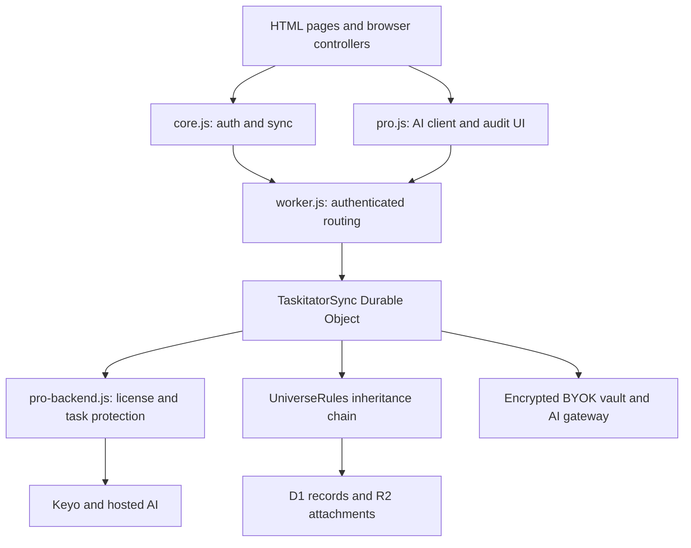
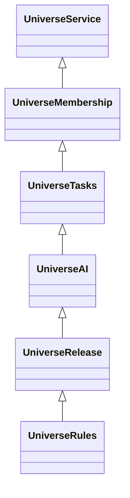
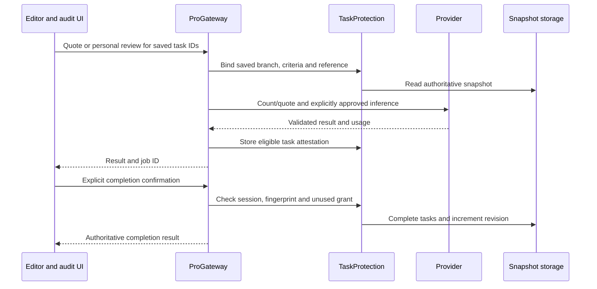

# Taskitator — complete guide (features A–Z, code and architecture)

Taskitator is a browser task manager with nested tasks, projects, scheduled and flexible breaks, offline personal editing, proof-based completion, a focus timer, an AI Copilot, cloud synchronization, phone-blocking integration, and collaborative workspaces called **Universes**. The frontend is static HTML/CSS/JavaScript. Its authenticated backend runs in a Cloudflare Worker and a Durable Object; Universe records use D1, and Universe attachments use R2.

This guide describes the source as of **Phase 7.0 (27 November 2026)**: 236 files, including 28 PNG assets. **Part 1** is the user guide: every feature of Taskitator on the web, where it is, how to use it step by step, and the rules and limits behind it. **Part 2** is the code and architecture guide. The source describes the app's behavior; live configuration, credentials and provider availability depend on the deployment. Older Part 2 sections describe the code as it was first inspected (commit `99b4282`, 5 November 2026) plus the phase notes that followed; where a statement and the current code differ, the code wins.

## Contents

**Part 1 — Taskitator web from A to Z**
- [Plans, limits and what needs a connection](#plans-limits-and-what-needs-a-connection)
- [Getting started](#getting-started)
- [The main screen](#the-main-screen)
- [Feature reference (A–Z)](#feature-reference-az)
- [Rules that apply across features](#rules-that-apply-across-features)

**Part 2 — Code and architecture**
- [System structure](#system-structure)
- [Startup and browser contracts](#startup-and-browser-contracts)
- [Offline mode and reconnection](#offline-mode-and-reconnection)
- [Data ownership and storage](#data-ownership-and-storage)
- [Browser engines](#browser-engines)
- [Pages and inline code](#pages-and-inline-code)
- [Worker and backend engines](#worker-and-backend-engines)
- [Universe subsystem](#universe-subsystem)
- [Phone status and MacroDroid](#phone-status-and-macrodroid)
- [End-to-end flows](#end-to-end-flows)
- [API families](#api-families)
- [Styles, tutorials, data, and assets](#styles-tutorials-data-and-assets)
- [Build, configuration, and operations](#build-configuration-and-operations)
- [Tests and verification](#tests-and-verification)
- [Maintenance boundaries](#maintenance-boundaries)
- [Alphabetical file catalogue](#alphabetical-file-catalogue)
- [Source navigation index](#source-navigation-index)

# Part 1 — Taskitator web from A to Z

This part describes what a person using Taskitator on the web can do, where each control is, the steps to use it, and the rules the app enforces. Part 2 explains how the code does it. Where the two disagree, the code is right; report the difference.

## Plans, limits and what needs a connection

### Free and Pro

Everything is free unless the table says otherwise. Pro comes from a Keyo license key (Settings → AI & Pro → **Activate Pro**). An Android "App Pro" source also exists for the app build; on the website it counts the same way.

| Feature | Free | Pro |
| --- | --- | --- |
| Tasks, subtasks, Shield, bonus tasks, Dynamic Priority, Dynamic Bonus, drafts, Early task | Yes | Yes |
| Projects, Calendar, Statistics, Trash, repeating tasks | Yes | Yes |
| Breaks, strict modes, Emergency Bypass, Scratchpad, Focus timer | Yes | Yes |
| Points, ranks and streak | Yes | Yes |
| Friends, leaderboard, cheers, duo streak | Yes | Yes |
| Collab (shared space with friends) | No | Yes, every member needs Pro |
| Phone lock (MacroDroid) and Sleep Lock | Yes, 3 phone devices | Yes, 12 phone devices |
| Backup, restore, sync, offline editing | Yes | Yes |
| AI with your own Gemini or Claude key (Copilot, criteria checks, proof reviews, note cleanup) | Yes, within 10 credits a day and 220 a calendar month (Riyadh time). Shown as Available / Caution / Critical, never as numbers | Yes, not limited or metered by Taskitator; your provider bills you |
| Hosted Taskitator AI (no key needed) | No | Yes, daily and 30-day allowance from the license |
| Test your criteria (single task) | Yes, costs AI usage | Yes, credit estimate first |
| Batch proof review (up to 20 tasks) | No | Yes |
| Consecutive subtasks `{num==X}` and Auto create ranges | No | Yes |
| Study plans (create, edit, re-plan, import, Soft reschedule, Early Appearance) | No (existing plans: view, finish, delete) | Yes |
| Pull from tomorrow | No | Yes |
| Test lab | No | Yes |
| Colour themes | Savannah only | Savannah, Desert, Jungle, Marina, Fictional, plus Icon mix |
| Saved criteria | 5, of which 4 may have a reference file | 100, of which 10 may have a reference file |
| Universe | Join up to 2 | Join up to 7; create Universes (own up to 2); Context files; images in Community posts; Universe AI credits |

**When Pro ends:** the theme returns to Savannah with a one-time toast ("Pro ended, theme set to Savannah.") and the Icon mix is ignored (both are kept for renewal). Study plans can still be viewed, finished and deleted, but not edited. Only the first 3 phone devices keep working; the rest show as revoked until you renew. Existing Universes keep working; renaming, adding members and Context need the owner's active Pro.

### Hard limits

| Item | Limit |
| --- | --- |
| Tasks per account (synced) | 10,000 |
| Nesting depth | 64 levels |
| Title, description, criteria text | 10,000 characters each (criteria edits on locked tasks and study criteria: 4,000) |
| New-task drafts | 50 |
| Study plan drafts | 10 |
| Reference exemplar on a task | 1 file, 5 MB, image or PDF |
| Proof per review | 1–5 files; 8 MB per photo, 30 MB per PDF; 40 MB in total including reference files |
| Phone devices | Free 3, Pro 12 |
| Study plan | 1–1,000 units, up to 365 study days, bonus 1–500; imported plans up to 500 units and 2 MB |
| Auto create | 100 subtasks per entry; asks first above 20 |
| Universe | 20 members besides the owner; own 2; join 2 (Free) or 7 (Pro); proof files up to 3 per submission, 5 MiB each |
| Username | 3–20 letters, numbers or underscores; unique, case does not matter |
| Copilot name | 20 characters |
| Friends | 50 friends; 20 waiting requests; 30 requests a day; requests expire after 30 days |

### Time rules

- **Your day** starts at the hour set in Settings → Day & week → **New day begins at** (00:00 to 04:00). Anything done before that hour counts toward the previous day, for tasks and breaks.
- Break days use your device's time zone, pinned for each day once the day is decided.
- **Riyadh time (UTC+3)** is used for: repeating-task dates, Sleep Lock schedules, Universe dates and deadlines, AI allowance resets (midnight), and the Free monthly allowance (1st of each month).
- **Weekend** (Settings → Day & week) decides when Emergency Bypass uses refill and the default study weekdays.

### What needs an internet connection

Works offline (saved on this device, synced later): creating, editing, completing and deleting ordinary tasks; projects; drafts; scratchpad notes; the focus timer.

Needs a connection: anything that uses AI (Copilot, criteria checks, proof reviews, tests, note cleanup); creating or changing AI-locked tasks; submitting proof; breaks; Emergency Bypass; phone devices and tokens; Sleep Lock settings; Pro activation; Universe (it never queues offline changes as personal sync); importing or creating study plans (they need a successful sync first). Tasks completed offline do not unlock your phone until this device syncs.

## Getting started

### Sign in and create an account

1. Open the site. The sign-in page shows **Sign in** and **Create account**. Use email and password or Google.
2. After the first sign-in you see **Set up your workspace**:
   - **Start with an empty workspace** for a new account.
   - **Import an older Taskitator account** if you used Taskitator before the secure sign-in update: enter the old username and password once (this is an import, not another login). Pause your phone's blocking macro first, because its old token is replaced.
3. **Use another login** switches to a different sign-in.
4. A new account starts the **Getting started** tour automatically.

### Loading screen

While Taskitator checks your sign-in you see **Loading . . .** (or **Updating secure app files…** after an update).

- After 10 seconds it adds **Taking longer than usual…**.
- **Skip and open offline** at the bottom opens the copy saved on this device immediately. It only appears on a device that already holds your account.
- After 45 seconds Taskitator stops waiting by itself. With a saved copy it opens offline with a notice and a **Reconnect** button (reloads the page). Without one it shows "Taskitator couldn't connect…" with **Try again**.
- If you skipped an update, Taskitator never reconnects in place; when the connection is back the notice asks you to press Reconnect.

### Username

Tap **Set username** under the page title (it then shows `@name`). Use 3–20 letters, numbers or underscores. Names are unique and case-insensitive. The username is a display name; you still sign in with your login.

### Install as an app

Taskitator is a web app with a manifest (`standalone` display). Use your browser's **Install** or **Add to Home screen**.

### Language

Settings → General → **Language**: English or العربية (Arabic). Changing it reloads the page.

- Arabic is right-to-left: the menu opens from the right, Copilot from the left.
- **Time format**: Automatic, 12-hour or 24-hour. Automatic uses 12-hour in Arabic.
- Dates are always Gregorian with Western digits.
- Your own text (task titles, tags, notes, project names, Copilot replies) is never translated.
- The Help page, Privacy Policy and Terms stay in English; Arabic shows a one-line notice.
- The language is saved on this device only.

## The main screen

**Header (left to right):** menu button, **Completed** (opens today's completed tasks; in General, all completed tasks), **Breaks** pill, **Scratchpad**, the sync dot (with an auto-sync countdown under it), **Emergency bypass**, a **Today** jump button (on views that need it), and **Copilot**.

**Menu:** Today, General Tasks, Calendar, Projects, Stats, Trash, Drafts, Universe, Sleep Lock, Study plans, Test lab, Help, Settings, and **Recurring tasks** (the history and list of repeating series). On wide screens (1,180 px and more) the menu becomes a permanent rail.

**Floating controls:** **+ New task**, and the **Focus timer** button (shows the running clock).

**Under the title:** **Multiselect**, **Pull from tomorrow** (only when it applies), **Filter**, and the sort button (⇅).

## Feature reference (A–Z)

### AI-locked tasks (proof verification)

A task that can only be completed by submitting proof that an AI accepts.

**Turn it on**
1. In **Create New Task** (or Task Details → **AI Audit**), tick **Require AI Proof Verification (Irrevocable)**.
2. Write **Proof Criteria**: what the proof must show. Make it visual and checkable ("photo of 2 handwritten pages showing the full outline", not "studied well").
3. Optional: **Recommended** opens templates and your saved criteria.
4. Optional: **Attach Reference Exemplar** (1 image or PDF, 5 MB). Say in the criteria how the proof relates to it.
5. Press **Validate Criteria**. The AI scores clarity out of 10 and suggests a rewrite. With **Check criteria before locking** on (Settings → Tasks) you need 7/10 to save.
6. Optional: **Test your criteria** (see below).
7. Press **Save Task** and confirm the warning.

**After it is locked**
- It cannot be un-ticked. The title cannot change and the task cannot be deleted without Emergency Bypass. Description and tags stay editable.
- Overdue AI-locked tasks are protected from being postponed. Removing the due date needs Emergency Bypass. An undated AI-locked task has **Assign to today** (no bypass needed).
- It can't be bonus work or Dynamic Bonus.
- It always counts toward the phone lock.
- It can't be created or changed offline.
- To change its criteria, use **Edit criteria** (see *Criteria editing on locked tasks*).

**Complete it**
1. Tap its completion circle. The **Submit AI Verification Proof** dialog opens.
2. Upload 1–5 files (JPG, PNG, WebP or PDF; 8 MB per photo, 30 MB per PDF). Claude does not accept HEIC photos; convert them or use Gemini.
3. Optional: add a note. The note is context only; the criteria stay binding.
4. Press **Submit Proof**. On Pro hosted AI you first see a credit estimate and approve it.
5. The AI scores the proof; **7/10 passes** and the task completes. "Insufficient proof" means the proof was genuine but incomplete (add a page, take a clearer photo).

**Rules**
- Every review uses AI usage, even when rejected. There are no refunds. Cancelling at the price preview costs nothing.
- A parent can't be completed while an AI-locked task under it is unfinished; submit those first.
- If the reference file is missing on this device, restore it before submitting.
- Proof can't be submitted offline.
- A completed AI-locked task can't be reopened without Emergency Bypass.

**Title variables.** Write `{name==value}` in a title and `{name}` in the criteria. The title shows the value; the criteria get it filled in. Example: title `Read chapter {ch==3}`, criteria "Photo of the summary of chapter {ch}". Validation refuses criteria with a variable the title doesn't define. Subtasks added in Task Details copy the parent's criteria and fill in their own variables (they are not locked).

### AI notice

Every screen that uses AI shows: "AI services are handled by {company}, a third-party company. AI can make mistakes, so check answers and results." The company is Google for Gemini and Anthropic for Claude or hosted Taskitator AI; Universe reviews show Google. When the provider is unknown it says "a third party".

### AI providers and keys (your own key)

Free accounts need their own key for any AI. Pro accounts can use one instead of hosted credits.

1. Settings → **AI & Pro** → **AI provider**.
2. Choose **Gemini** or **Claude**. Each keeps its own key; switching never erases one.
3. **Add or replace key**: confirm with your password or Google (one confirmation covers that action for five minutes), then paste a key from Google AI Studio or the Claude Console. Keys are encrypted on Taskitator's server.
4. **Test key** checks it works and uses none of your quota.
5. Press the button that makes this provider active ("Gemini is active").

Other buttons: **Show** (visible for 30 seconds), **Copy**, **Refresh**, **Delete key** (it still works elsewhere until you revoke it with the provider). Changes in this tab save immediately.

- Gemini: if it hits its quota or is unavailable, Taskitator retries with a lighter Gemini model. It never switches to Claude by itself.
- Claude: never falls back to Gemini. Accepts JPG, PNG, WebP and PDF.
- Changing provider starts a new Copilot conversation.

On Pro, hosted Taskitator AI runs on Claude by Anthropic, whichever provider is selected, unless you tick **Use my own API key instead of credits** in the Pro section. Switching does not reset hosted credits.

### Animations and effects

Settings → General → **Animations & effects** (last section, collapsed). Per device.

- **Static**: nothing moves. **Reduced**: only loading spinners and progress bars. **Normal**: everything (default). **Custom**: set automatically when you switch one effect off; switching all back on returns to Normal; choosing Custom again restores your last set.
- Effect switches (work in Normal and Custom only): Falling leaves, Clouds, Animals (off shows a plain tick), Bird, Parallax, Tap bubbles, Icon wipe.
- Low-memory devices and devices with the system "reduce motion" setting start in Reduced until you choose.
- Animations can make Taskitator slower on older devices; choose Reduced or Static if it feels slow.

### Auto create (Pro)

Creates a numbered range of subtasks at once.

1. In Create Task (Quick Subtasks) or Task Details (Subtasks Under This Task), tick **Consecutive {num==X}**, then **Auto create {num==1-15}**.
2. Type a title with a range, e.g. `Lesson {num==1-15}`, and press Enter or +.
3. Skips go after underscores: `{num==1-15_5_7}` leaves out 5 and 7. A skip outside the range, or equal to the first or last number, is ignored.

Up to 100 subtasks per entry; more than 20 asks first. The range must go up. Without Auto create ticked, a range creates nothing (you get a hint). Each subtask keeps the surrounding text, so variables, criteria and `$$` work as usual. The **?** next to the subtask heading explains it with an example.

### Backup and restore

Settings → Account & data → **Back up & restore**.

- **Download** saves one `.json` file with tasks, projects, settings, breaks, saved criteria and review history from this browser. Secrets are removed. Reference files kept only in this browser may not be included.
- **Restore from a backup**: pick a Taskitator `.json` file, then **Merge** (adds the backup's tasks; nothing is deleted) or **Replace everything** (wipes this browser's data and uses the backup). Invalid repeating-task data is refused.

### Batch proof review (Pro)

1. Tap **Multiselect** and tick AI-locked tasks (up to 20).
2. Tap **Batch review selected tasks**.
3. Attach 1–5 files that cover all of them (8 MB per photo, 30 MB per PDF) and submit.
4. Check the price preview and approve.

One combined review usually costs less than separate reviews; you pay its real cost, shared across the tasks. Works with hosted credits or, on Pro, with your own key.

### Bonus tasks

Optional work. A bonus task never blocks its parent, even under a Shield.

- Tick **Bonus Subtask (Excluded from Shield)** in the editor, or start a quick subtask's text with or include `$$` (removed from the title).
- Change many at once: Multiselect → **Bonus** → **Make bonus** or **Make required**. Tasks that can't change are skipped.
- An AI-audited task can't be bonus. Required work protected by a Shield can't become bonus.
- Phone lock: bonus tasks count only when **Count bonus tasks** is on (Harsh or Normal); never in Limited.

### Breaks

Tap the **Breaks** pill. You get one daily allowance (3 hours by default) shared by two systems. Each day uses only one system; choosing one locks the other until the day resets. While a break runs your tasks don't lock your phone; Sleep Lock is not lifted by breaks. A break never continues into the next day. Each system has a **?** help panel.

**Scheduled**
1. Press **Start planning**. You get a 10-minute planning window from that moment. It can be started until 6 hours before the day resets.
2. **+ Add Break**: up to 3 breaks with start and end times, not overlapping, within the allowance.
3. Press **Save schedule**. Saved minutes come off the allowance at once. You can edit and save again until the window ends; then the last save is final. Closing without saving cancels the window.
4. **Lock Scheduled for Today** commits the day to Scheduled without planning.

**Reserved breaks** (part of Scheduled): **+ Add Reserved** in the same planning window, at most 2 a day. Each has a length (10 minutes or more, in 5-minute steps) and a start window (at least 5 minutes wide, inside today, not over, not overlapping a scheduled break or another window). The full length is taken from the allowance when you save. When the window opens, **Start now** appears; the break then runs its full length and can't be ended early. If the window passes unused, that time is gone. A scheduled break that begins during it cuts it off; the rest is lost.

**Flexible**
1. Choose **30 min**, **45 min**, **1 hour**, **Custom** (whole minutes from 10 up to what is left) or **Until allowance ends**.
2. It starts immediately. You need at least 10 minutes of allowance and 10 minutes before the day resets. One break at a time.
3. It can't be ended in its first 10 minutes (or your strict minimum). After that press **End break**, or let it stop at its length, when the allowance runs out, or at the day reset.

Every started minute counts in full (30 min 1 s = 31 minutes).

**Break limits & strict modes** (Settings → Day & week)
- **Daily break maximum**: 1 to 3 hours in 15-minute steps.
- **Flexible Strict Mode**: minimum length 30–60 minutes (never above the maximum); shorter presets disappear; the same gap must pass between one break's end and the next start. A warning shows if this leaves very few breaks.
- **Scheduled Strict Mode**: if you haven't chosen a system by the **Deadline** (1 to 18 hours after day start, 15-minute steps), Scheduled locks with that weekday's plan: the **Default plan**, **Its own plan**, or **Not covered (normal rules)**. A covered day without a plan means zero breaks. The deadline applies even if the app is closed.
- These settings can only be changed when today's required (non-bonus) tasks are done or Emergency Bypass is on. If today's system is already chosen, changes apply from tomorrow. Press **Save break settings**.

The pill shows the state: Breaks, Plan (countdown), On break · minutes left, Next scheduled break at…, Scheduled Breaks locked for today. Its colour follows the remaining allowance (green above 35 %, yellow 10–35 %, red below).

### Calendar

Menu → Calendar.

- Month grid with ‹ › to change month and **Today** to jump back. Tap a date to list its tasks in **Agenda**.
- Tap a task to open it. Tasks **can't be completed** from the calendar; complete them in Today or General.
- Early tasks show **Early · due {date}**.
- **Unscheduled Tasks** lists undated tasks with **Assign to Today**.

### Collab (Pro)

A small shared space where friends work on tasks together, with the same proof checks and phone blocking a Universe has. Everyone in a collab needs Pro.

**Start one**
1. Menu → **Friends** → **Collabs** → **Start a collab**.
2. Name it and tick up to 5 friends. You and every friend you pick need active Pro.
3. Press **Create collab**. Each friend gets an invitation under **Collabs** on their Friends page for 7 days.

**Join one**
1. On your Friends page, under **Collabs**, press **Join** (or **Decline**).
2. Press **Open** next to a collab to work in it.

**Working in a collab**
- A collab opens in the Universe workspace and appears in your Universe list with a purple **Collab** badge.
- The person who started it is the owner; friends join as admins, so everyone can add projects and tasks.
- Tasks, assignments, AI or friend reviews, deadlines and phone blocking (each person turns on **Allow Universe phone blocking**) work exactly as in a Universe. See *Universe*.
- **Pro for everyone:** if anyone's Pro ends, nobody can change anything until it's renewed. You can still read the collab, leave it or withdraw phone-blocking consent.
- A collab counts toward your Universe limits (own 2, join 7 on Pro).
- Unfriending someone doesn't remove them from a collab. Leave it, or the owner removes them, from the collab's settings.

### Colour themes and Icon mix

Settings → General → **Colour theme** (second-to-last section, collapsed). Per device. Picks wait for **Save changes**.

- **Savannah** (sage green, free, default), **Desert** (sand and gold), **Jungle** (dark oily green), **Marina** (ocean blue), **Fictional** (volcanic red) — all but Savannah are Pro. A theme recolours the whole app and brings its own 9 animals for the completion buttons. Animal colour still follows the task's priority.
- **Icon mix (Pro)**: tick other packs to mix in their animals. Your theme's pack can't be unticked and always appears most: 60/40 with two packs, 40/30/30, 34/22/22/22, 28/18/18/18/18 with all five. Each box shows its share.
- A task keeps its animal while theme and mix stay the same.
- Completing a task stamps the animal's footprint on its circle (unless animations are off).

### Completing, reopening and the 10-second undo

- Tap a task's circle. The task and all its subtasks complete. A sound plays (if on) and **Undo** shows for 10 seconds.
- **Top-level task:** its unfinished subtasks that are not protected move to **Trash**. Bonus, AI-audited and shielded work (and anything leading to it) stays. Reopening the task brings the trashed ones back.
- A completed top-level task can be reopened until its day ends. After that it and its branch disappear from task views (Statistics still count it).
- **Blocked** when a Shield has unfinished required work, or an AI-audited task under it is unfinished.
- **AI-locked** tasks open the proof dialog instead.
- Tap a completed task's circle to reopen it (AI-locked tasks need Emergency Bypass).
- In Task Details a completed task can only have its title and description edited.

### Consecutive subtasks `{num==X}` (Pro)

1. In Create Task or Task Details, tick **Consecutive {num==X}** next to the subtask field.
2. Type a title with `{num==1}`, e.g. `Lesson {num==1}`, and press Enter.
3. The field refills with `{num==2}`. Keep pressing Enter.

Without Pro, add subtasks one at a time; existing numbered subtasks stay. For ranges see *Auto create*.

### Copilot

The assistant panel. Default name **Focus Copilot**; rename it in Settings → General → **Copilot** → Name (20 characters).

1. Tap **Copilot** in the header.
2. Press **Start Conversation** and type.

It needs an AI key on Free; on Pro it works without one. It needs a connection. After 10 seconds without a reply the bubble says "Taking longer than usual…".

What it can do depends on the page:
- **Today and General Tasks:** read your tasks, show today's progress, create ordinary tasks and subtasks, change a task's title, description or due date, move a task to Trash, and propose a study plan (Pro). It can't create AI-locked tasks, approve proof, complete AI-locked work or activate a bypass. It respects locks.
- **Statistics:** explains your numbers; no task changes.
- **Settings:** explains keys, providers and settings.
- **Phone blocker guide:** helps with the MacroDroid setup.
- **Trash and other views:** explains the feature; asks you to go to Today or General for changes.

**Study plan through Copilot (Pro):** say you want a study plan. It asks for the title, total units and study days, then opens the editable preview. Nothing is created until you confirm there. Copilot can't set AI audits or criteria.

### Credits (Pro hosted AI)

Settings → AI & Pro shows **AI credits today** and **AI credits this 30-day cycle**, from your license. Daily credits refill at midnight Riyadh time; the cycle refills every 30 days from activation.

- Before a review you see an estimate and the most it could cost. That maximum is held; the unused part returns at once.
- You pay the real provider usage. There are no multipliers and no batch discount, but a batch is one combined request, so it usually costs less.
- What costs more: every PDF page is read; large photos cost more; a reference file adds what the AI must read.
- Every charge rounds up to the next 0.5 credit. **View details** shows the exact usage to 4 decimals.
- "Insufficient proof" is charged half the real usage, rounded up to 0.5. Free accounts using their own key don't get this discount.
- A finished review costs credits even if rejected.

Copilot, criteria checks and note cleanup on hosted AI have separate hidden daily caps; reaching one answers "Service unavailable temporarily".

### Criteria editing on locked tasks

1. Open an unfinished AI-locked task → **Edit criteria**.
2. Write the new criteria (up to 4,000 characters; variables are not allowed here).
3. One AI request validates it (needs 7/10) and compares it with the **original** criteria.

**Same** or **stricter** applies for free. **Weaker** or **different** is refused with the reason, unless Emergency Bypass is active. A failed validation is always refused. Repeating tasks change criteria through **Recurrence & future criteria**.

### Criteria templates and saved criteria

In the task editor press **Recommended**.

- **Templates**: 11 pre-verified study templates (Handwritten Summary Notes, Mind Map / Flowchart Diagram, Feynman Method Explanation Sheet, Question Bank / Online Quiz, Handwritten Worked Problems, Post-Quiz Mistake Audit, Full Mock Exam / Timed Section, Spaced Repetition / Anki Deck, Blurting / Free-Recall Sheet, Active Reading & Margin Annotations, Formula Derivation / Pathway Ledger). Choosing one counts as verified 10/10.
- **Saved Criteria**: your own criteria that scored 8/10 or more. After validating, press **Save Criteria**, give a title (40 characters) and confirm. Free: 5 saved, 4 with a reference file. Pro: 100 and 10. A saved reference file is at most 4 MB, all together 8 MB. You can search, rename and delete. Criteria saved from the Test lab show a flask mark.
- Editing applied criteria drops its verification; validate again.

### Criteria test

Runs a real audit on a sample proof without saving, completing or locking anything.

1. In the task editor, after validating (7/10 needed when strict checking is on), press **Test your criteria**.
2. Attach 1–5 test files and an optional note. **Run test**.

It costs AI usage like a real review; there are no free tests. On Pro hosted AI you see an estimate first. Once a task is locked, tests need Emergency Bypass. A passing test doesn't guarantee the real audit passes.

### Day & week settings

Settings → **Day & week**: **New day begins at** (00:00–04:00), **Weekend starts** and **Weekend ends**, the Emergency Bypass counter ("4 of 4 left this week"), **Streak free days**, and **Break limits & strict modes**. These need **Save changes** (break settings have their own Save button).

### Drafts (tasks)

Park an unfinished task. A draft is not a task: not on Today, not overdue, no phone lock.

- **New task:** fill in what you have (only the title is required) and press **Draft**. Nothing is created or locked and no AI is used.
- Menu → **Drafts**: **Open** refills the form; **Delete** removes it. **Save Task** on an opened draft publishes it and removes the draft; **Draft** again updates it.
- **Existing task:** Task Details → **Draft** keeps your edits without changing the task. Next time you open the task a notice offers **Restore** or **Discard draft**. Save Changes removes the draft. Restoring only fills fields you may change.
- Drafts sync and are in backups. Up to 50 new-task drafts.
- Stored: title, description, due date, project, priority, tags, bonus, Shield, AI proof choice, criteria text, Mr. Study fields, Dynamic Priority choice and typed subtasks. Not stored: reference file, validation score, repeat schedule. Edit drafts don't include subtask changes.

### Dynamic options (Dynamic Priority, Dynamic Bonus)

In the editor, **Dynamic options** (**?** explains both).

- **Dynamic Priority** (free): choose a level under "While no unfinished required work remains, use priority". The task uses it while no required subtask is unfinished (a task without subtasks uses it at once) and returns to its own priority when required work becomes unfinished. The stored priority never changes.
- **Dynamic Bonus**: the task becomes bonus work once all its required subtasks are done. It can't be combined with Bonus or AI audit, and can't be turned on once a Shield protects the task (turning it off is free). Saving it on a task without required subtasks asks first, because it would never apply. New study-plan days have it on.

### Early task

Show a task on an earlier day as optional work. Free.

- Task Details → **Early task** → pick a date → Save. **Remove** clears it.
- Many at once: Multiselect → **Due** → tick **Show early as bonus (keep due date)**, or **Remove early date from selected**.
- The date must be before the due date (own or inherited) and not in the past. Only active, non-repeating tasks.
- The due date doesn't change. Finish it early and it's done; skip it and it stays due on its date. Shields, locks and AI checks still apply.

### Emergency Bypass

For real emergencies. Tap **Emergency bypass** → **Activate 15m**.

- Lasts 15 minutes. 4 uses a week; they refill at 00:00 on the day after your weekend ends.
- While active: edit or delete protected tasks; change their criteria (including weaker edits); test criteria on locked tasks; change an AI task's title or remove its date; reopen AI-locked tasks; loosen phone-lock settings; change break settings; move or rename AI-audited study units. Your phone unlocks and Sleep Lock lifts.
- It never ends a break or changes your break allowance.
- Deleting a study plan with AI criteria uses 2 uses.
- The header shows "Emergency Mode Active" with a countdown. It needs a connection.

### Filter, sort and date filter

- **Filter** → choose **Projects**, **Priorities**, **Tags** and **Date** (Any date, Overdue, Today, Next 7 days, No date, Custom range), and **Match**: AND (all) or OR (any). **Apply Filters**; **Clear All** resets. Parents of matches stay visible. The date filter doesn't apply on Today.
- The date drop-down above General and Projects lists filters by effective due date (own or inherited; early tasks also match their early date).
- **⇅** sorts by **Priority**, **Alphabetical** or **Required, then priority**. Saved on this device.
- Numbers in titles sort as numbers (Chapter 2 before Chapter 10). A leading label like `5.10` or `5.1-0-1` is read as numbers segment by segment.

### Focus timer

Tap the timer button.

1. **Timer settings**: Study minutes (1–90), Break minutes (1–15), Large break minutes (1–35), Sessions before large break (1–4), Sound, Vibration, Keep screen awake, Volume.
2. **Start timer**. It runs Study → Break → … → Large break, then shows "Sessions complete".
3. While running: **Pause/Resume**, **End timer**, **Restart**, **⛶ Full screen** (phones turn landscape), **Scratchpad**, **Floating timer** (picture-in-picture, in browsers that support it; keep the tab open).

It keeps running when you switch pages and is saved per account on this device. Tap a timer button once to allow sound. It has nothing to do with breaks or the phone lock.

### Friends

Add other Taskitator users as friends to compare points and keep each other going. Free. Friends never see your tasks, only your points, rank, streak, this week's points and whether you've finished a task today. Friendship has nothing to do with Universe. Needs a connection.

**Add a friend**
1. Menu → **Friends**.
2. You need a username first (**Set username**), so people know who the request is from.
3. Type your friend's **exact** username (capitals don't matter) and press **Send request**. There is no search by part of a name.
4. They see it under **Requests** and press **Accept**, **Decline** or **Block**. If they had already sent you a request, yours accepts it.
5. From a Universe: open the Universe's member list and press **Add friend** next to a member who has a username.

**Manage requests**
- **Withdraw** cancels a request you sent.
- **Declining is silent:** the sender keeps seeing "Pending" until the request expires after 30 days.
- A red number next to **Friends** in the menu counts requests waiting for you.

**Leaderboard and friends**
- **Leaderboard** ranks you and your friends by **All time** points or **This week** (the week starts the day after your weekend).
- Each friend shows their rank, points, streak (lit flame = finished a task today) and **Done today** or **Not yet today**.
- **Duo streak**: days in a row you both finished at least one task. A day either of you marked free is skipped.
- **Cheer**: once a day per friend. They get a "cheered you on" notice the next time they open Taskitator.

**Unfriend and block**
- **Unfriend** ends the friendship for both of you. Either of you can send a new request later.
- **Block** ends the friendship, cancels requests both ways, and silently drops their future requests: they see "Pending", you see nothing. Unblock under **Privacy → Blocked**. You must unblock someone before sending them a request.

**Privacy:** who can send you requests: **Anyone who knows my username** (default), **Only people in my Universes**, or **Nobody**. A refused request looks sent to the other person.

**Limits:** 50 friends, 20 requests waiting at once, 30 requests a day.

### General Tasks

Menu → General Tasks: every active task in its hierarchy, with due-date badges, filters, the date drop-down and sorting. Collapse a branch with its arrow.

### Help and tutorials

Menu → **Help** (or Settings → Help & tutorials → **Read the full help guide**). The Help page holds the user guide in seven units: Start here, Tasks, Focus breaks and your phone, AI, Pro features, Universe, and Settings sync and your data.

**Find a section**
1. Pick a unit in the **Index** at the top, then a section from the unit's list.
2. The section you jump to flashes briefly (a coloured bar and glow; an outline in Reduced or Static motion) so you can see where it starts.
3. **↑ Back to the index** ends each unit. Some sections keep a **Show example**.

**Try it live** (on sections such as Create and edit, Subtasks, Drafts, Multiselect, Filter, Overdue, Projects, Calendar, Breaks, Scratchpad, AI-locked tasks and Copilot)
1. Press **Try it live**. Taskitator opens the real screen (Today unless the section is about another view) and fades out everything except the control you need. Taps outside it are ignored.
2. Use the highlighted control. When you press it, the next part opens up: pressing **+ New task** unfades the whole Create Task panel so you can fill it in.
3. The card points you to the **?** buttons that already explain options, instead of repeating them. **Do it for me** presses the highlighted control. **–** shrinks the card.
4. What you do is real: a task you save is created. If you close a panel too early, the guide steps back. If a confirmation or picker opens on top, the guide hides until it closes.
5. **Skip tour** stops; the last step offers **Back to Help**.

Sections about Settings (AI keys, phone lock, Pro, Colour themes) have **Show me in Settings**, which opens Settings and runs that tour there.

**Guided tours:** Settings → General → **Help & tutorials** lists the tours to replay: Getting started, Breaks & emergencies, Set up AI, Link your phone, Taskitator Pro and Colour themes. A Universe tour runs inside a Universe.

### Mr. Study link

Create New Task has **Link to Mr. Study Rule** (creation time only) with XP and Banch fields, meant to credit an external Mr. Study app when the task is verified. The current Worker bridge returns no rules, so only "None (Standard Task)" is offered.

### Multiselect and batch actions

1. Tap **Multiselect** and tick tasks (**Select all** ticks everything shown).
2. Choose an action:
   - **Tags**: replaces the tags of every selected task.
   - **Priority**: one level for all.
   - **Due**: one date for all; overdue AI-locked tasks are protected from postponement. Also the Early task options.
   - **Bonus**: Make bonus or Make required.
   - **Phone lock**: Count or Don't count (only when **Allow changing many tasks at once** is on in Settings → Tasks). Unchecking today's tasks is skipped while locked.
   - **Delete**: shows **Apply · delete N**; nothing is deleted until you press it. Protected tasks are skipped.
   - **Batch review selected tasks** (Pro).
3. The selection clears after an action; selection mode stays on until you tap Multiselect again.

### Offline mode

When Taskitator can't reach the server, the sync dot becomes a grey ring and a short notice appears. Ordinary editing continues and syncs later. Actions that need the server explain why they're off. Taskitator checks again in the background and reconnects by itself. After more than 7 days without contact you must sign in again before syncing.

### Overdue tasks

The banner on Today counts overdue tasks.

1. Tap **Reschedule to date…**.
2. Pick **Target Due Date** (today or later) → **Reschedule Tasks**. Eligible, non-locked overdue tasks move.

If AI-checked tasks are overdue, ordinary rescheduling is blocked and the button becomes **Bring AI Tasks to Today**. Study plans with overdue units are handled on the Study plans page (link in the dialog; their names show in red).

### Phone lock (MacroDroid)

Android only. MacroDroid blocks chosen apps while today's tasks are unfinished. Taskitator is not affiliated with MacroDroid; MacroDroid's own limits and terms apply.

**Set up (once)**
1. Settings → **Phone lock** → **Open guide** (or menu → phone blocker guide).
2. In **Devices**, type a device name → **Add device**. Its token starts with `tkp_`.
3. **Download Bridge (with your token)** and **Download App Blocker**.
4. In MacroDroid: Import/Export → import the **App Blocker first**, then the Bridge; open each, three dots → **Save macro**. Grant accessibility and notification permissions.
5. Choose blocked apps in the App Blocker's **Application Launched** trigger (defaults: TikTok, Instagram, X). Never block the dialer, SMS, Android Settings, MacroDroid or the browser you use for Taskitator.
6. Don't rename "App Blocker"; the Bridge finds it by name. Keep both macros enabled.

No-token Bridge: open its **Local Variables**, set **user token** to your token (without "Bearer"). Manual build: the guide's step-by-step checklist (HTTP GET to the **Status URL**, header `Authorization: Bearer <token>`, If response contains `device_locked = false` → disable App Blocker, else enable).

**How it decides**
- The Bridge checks every 5 minutes, when the screen turns on and when MacroDroid opens.
- Locked while counted tasks due today or overdue are unfinished. Unlocked during a break, while Emergency Bypass is on, or when everything counted is done. Eligible Universe assignments can also lock it (with your consent).
- Sleep Lock is reported separately and overrides "unlocked".
- Tasks with no due date never count. A subtask uses its nearest dated parent's date.

**Phone lock counting** (Settings → Tasks)
- **Harsh** (default): every task due today counts. Bonus tasks count only with **Count bonus tasks** on.
- **Normal**: only tasks with **Count toward phone lock** ticked count. New required tasks start ticked; new bonus tasks start ticked only with Count bonus tasks on.
- **Limited**: only AI-locked tasks count. Bonus never counts.
- AI-locked tasks always count.
- **Loosening is locked** until today's tasks are finished or Emergency Bypass is on (breaks don't unlock it): a looser mode, turning Count bonus tasks off, unticking today's tasks, removing or moving counted bonus work, or turning counted required work into bonus. Tightening is always allowed.

**Device changes** (add, remove, **Remove all devices**) are only allowed when today's tasks are done, during a break, or with Emergency Bypass. Free: 3 devices; Pro: 12.

**Troubleshooting:** import fails → update MacroDroid and pick the real `.macro` file. 401 → wrong or replaced token; add a device again. UnknownHostException → no internet. Nothing blocks → App Blocker enabled, imported first, original name, apps listed.

### Points, ranks and streak

Completing tasks earns points and keeps a daily streak. Free for everyone. The strip above your Today list shows your streak (flame), rank and progress; tap it for details.

**How points are earned**
1. Complete a task (tap its circle). Points count on the day you complete it, not its due date, so early, overdue and General-list completions all count.
2. Your highest priority gives **5** points and your lowest **1**, evenly spaced and rounded (3 levels: 5 / 3 / 1; 10 levels: 5, 5, 4, 4, 3, 3, 2, 2, 1, 1). With one level every task gives 3. A task without a priority gives 1. Dynamic Priority doesn't change it.
3. Points arrive when Taskitator syncs (about 15 seconds later). A toast shows **+N points**, a new rank or a new streak.

**Rules**
- Only the task you tap counts. Subtasks completed together with their parent earn nothing.
- Each task earns once. Reopening and completing it again adds nothing.
- At most **150 points a day**.
- Tasks completed offline count when you sync, for up to 7 days.
- Points are kept on Taskitator's server, so restoring a backup, clearing completed tasks or reopening tasks never removes them.

**Ranks:** Seedling (0), Sprout (15), Sapling (40), Scout (90), Tracker (180), Ranger (350), Hunter (650), Pathfinder (1,100), Warden (1,800), Alpha (3,000), Apex (5,000), Legend (8,000).

**Streak**
- Finish at least one task before your day ends (Settings → Day & week → **New day begins at**) and the streak grows by one.
- Miss a day and it goes back to 0. Your best streak is kept.
- Today doesn't break it until the day is over.

**Free days**
1. Settings → Day & week → **Streak free days**. Your weekend is selected until you change it.
2. Tick the days. You can choose up to your weekend days plus 2.
3. Press **Save changes**. The change starts next week (the day after your weekend), so today can't be made free after you've missed it.

On a free day, not finishing a task doesn't break your streak, and completing tasks adds no points and no streak day.

### Priorities and tags

Settings → **Tasks**.

- **Tags**: type and **+ Add**; remove with ✕. Used in the editor and filters.
- **Priorities**: **+ Add level**, rename, colour, reorder with arrows (#1 is highest), delete. A task's ring and animal take its priority colour.
- **Task checks**: **Check criteria before locking** (AI must rate criteria 7/10 before a task can lock).
- Press **Save changes**.

### Projects

Menu → **Projects**. Every account has an **Inbox**.

- The **+** chip creates a project: name, icon (emoji) and theme colour → **Save Project**.
- Tap a chip to open that project: its tasks in hierarchy, the date drop-down and **+ New task** (created in this project).
- **✎** edits the active project (not the Inbox). **Delete Project** asks what happens to its tasks: divert to Inbox, reassign to another project, or delete them all.

### Pull from tomorrow (Pro)

Appears on Today when a study plan has units due tomorrow.

1. Tap **Pull from tomorrow**.
2. Each plan shows its units for tomorrow. A plan is locked until its units on today's list and every AI-audited task due today are done.
3. Set **How many** or tick units → **Pull N to today**.

Pulled units keep tomorrow's due date and show today as optional work.

### Recurring tasks

Make a task and its subtasks come back.

**Set up**
- Create New Task → **Repeat**, or Task Details → **Set up recurrence** (active tasks only).
- Schedules: Daily, Selected weekdays, Monthly (start-date day), Date of month (1–31), Every six months, Yearly. **Start date** and optional **End date**.

**How it repeats**
- The next occurrence is created when the current one is completed or deleted, not when it becomes overdue. Its date is the next scheduled date after the latest of: the current due date, the day you finished it, today. Missed days don't pile up.
- Subtasks repeat with their parent (dated subtasks keep their offset). A repeating branch can't contain another repeating series, and a child must stay inside its branch.
- **Apply ordinary task edits to**: This occurrence, or This and future occurrences. Due-date changes apply to this occurrence only.
- **Recurrence & future criteria** changes future dates, proof criteria (needs 7/10) and reference files; the current occurrence keeps its requirements.
- **Stop future repetition**: you can still finish the current task. The series also stops at its end date or when its parent is completed or removed.

**Overview:** menu → **Recurring tasks** lists the series and the history of the latest 500 occurrences.

### Scratchpad (Distraction Dump)

Park a distracting thought.

1. Tap **Scratchpad**. A timer starts (90 s by default; 30 s–5 min in Settings → General → Distraction note timer).
2. Type, then **Dump & Return**. It also saves when the timer ends.

Notes expire after 48 hours. **View notes** stays locked until required tasks due today or overdue are completed, moved or trashed. In the notes view you can title each note, **Extract All** (AI cleans spelling and grammar, generates missing titles, downloads `.txt` or `.md`, and moves the notes to the **Distraction Archive** on Stats; needs AI), **Delete All**, or **+ New Dump**. The Focus timer has a Scratchpad button that returns you to the timer.

### Settings

Settings has six tabs: **General**, **Tasks**, **Day & week**, **AI & Pro**, **Phone lock**, **Account & data**.

- Every section folds and starts collapsed, except Danger zone. Links and tours open the right section.
- General, Tasks and Day & week changes wait for **Save changes** in the bar at the bottom (**Discard** drops them). AI & Pro and Phone lock save immediately.
- Language, colour theme, Icon mix and animations are saved on this device only.

General: Language, Copilot name, Sounds, vibration & notes (Sound effects, Vibration on Android, Pomodoro/focus-timer volume, Distraction note timer), Sync (Refresh after sync, Sync now), Help & tutorials, Colour theme, Animations & effects.

Tasks: Tags, Priorities, Task checks, Phone lock counting.

Account & data: Account (signed-in name, **Manage account & password**, **Log out**), Contact (info@mazendev.com), Back up & restore, Privacy & terms, Danger zone.

### Shield (Require all subtasks first)

Tick **Require all subtasks first (Irreversible Shield)**. The task can't be completed until every required (non-bonus) task under it is finished.

- It can't be turned off.
- A shielded task can't be moved out of its parent, and its required work can't become bonus.
- A shielded task with unfinished subtasks can't be deleted without Emergency Bypass.
- Completing a top-level task never trashes shielded work.

### Sleep Lock

Menu → **Sleep Lock**. Blocks your phone during your sleep hours with the same MacroDroid setup.

1. Set up MacroDroid first (a phone token is required).
2. Tick **Enable Sleep Lock**, set **Bedtime** and **Wake-up time** (Riyadh time, even when travelling) → **Save schedule**.
3. Optional: **Delay sleep for today** by 30 or 60 minutes, once per night across all devices. Wake-up stays the same.
4. The gear opens **Sleep Lock settings**: **Firm mode** and **Today only** (different times tonight; reverts after tonight).

**Firm mode:** from 2 hours before bedtime until wake-up you can't delay sleep, and turning Sleep Lock or Firm mode off, or moving bedtime or wake-up later, needs Emergency Bypass. Earlier times are always free. Breaks never lift Sleep Lock; Emergency Bypass does.

### Statistics

Menu → **Stats**.

- **Done Today**, **Pending Today**, **Rigor Ratio** (AI-verified share of all completed tasks), **Active Total**.
- **7-Day Completion Velocity**, **Project Allocation**, **Break & Focus Adherence**, **AI verification** (AI Verified vs Standard Done).
- **Distraction Archive**: extracted scratchpad notes (cleaned text, **View raw original**, delete one, **Clear Archive**).

### Study plans (Pro)

A study plan spreads numbered units over study days. Each study day is a shielded parent task with one subtask per unit; bonus units are the last units of a day.

**Create**
1. Menu → **Study plans** → **+** (New study plan), or ask Copilot.
2. **Task info**: Title, Unit name, Total units (1–1,000), Bonus units (optional), Description, chapter labels (units per chapter and label, e.g. `Ch 3 · Lesson.17`; no extra tasks), and parent and unit priorities (units can't outrank the parent).
3. **AI criteria** (optional): **Enable AI audits for unit subtasks only**, criteria with `{num}` for the unit number, units to exclude. Validate (7/10). Audited units are locked; changing them later needs Emergency Bypass, and deleting the plan costs 2 bypass uses.
4. **Scheduling**: Starting date; **Number of study days** (1–365) or **Units per day**; Start from unit; study weekdays (none = every day); **Specific amount per weekday**; **Skipped units** (lists and ranges, e.g. `8, 10-12`). Press **Preview new schedule**, then tap dates to adjust. A changed date creates a surplus or shortage you settle by editing other dates or **Auto redistribute** (asks first).
5. **Early bonus** (optional, Early Appearance): show required units early on chosen earlier dates, with tools (take from the next date, level to a number per day, move first or last units from one date to an earlier one, and options A/B/C to lighten the original date, the next weekend or chosen dates). Each early appearance expires at the end of its day; unfinished work stays required on its date.
6. **Summary** (read-only calendar or list) → **Create plan**. Your workspace must sync successfully first. **Save draft** keeps it in the Drafts tab.

**Manage** (Study plans page)
- Each plan shows progress, badges (bonus, AI audited, early), dates, and red names when overdue.
- **Preview**: calendar or list (Main blue, Bonus orange, Early purple).
- **Edit**: rename the plan or unit, chapter labels, priorities; add AI criteria to unfinished units (permanent); re-plan unfinished units over new study days. Renaming audited units needs bypass. Plans with Early Appearance dates can't be re-planned.
- **Bonus units**: add (1–500, continue the numbering on remaining days), remove, move a missed bonus to the next day, **Convert bonus to required**. When all required units are done the plan stays open until you complete it, finish the bonus units or convert them.
- **Overdue**: **Soft reschedule** (Pro) hands overdue units out one at a time over the coming study days, so no day loses units; once a day per plan. **Move overdue to today** (free) stacks them on today. Moving AI-audited units needs bypass.
- **Export JSON** and **Import** (folder button): *Use as template* (new start date, all unfinished, gaps kept) or *Restore* (original dates; units done in the file are marked done after sync). Every problem is listed and nothing is created until the file is valid. AI-audited units import as normal units; early dates are dropped.
- **Delete**: removes the plan and all its tasks (finished ones still count in stats). Free unless it has AI criteria (2 bypass uses).
- **Drafts** tab: up to 10 unfinished plans and unsaved edits.
- The page has its own **Emergency bypass** button.

Without Pro: view, finish and delete only.

### Subtasks

- **Quick Subtasks** (Create Task) or **Subtasks Under This Task** (Task Details): type and press Enter or +. `$$` marks bonus. **+ Add Subtask** opens a full form for one.
- **Sort** (A to Z, By priority, Required first then priority, Default order) is applied once; **Arrange** lets you order them with arrows. Subtasks added later go to the end.
- **Hierarchy / Parent Task** → **Change** opens a parent picker with its own filters and sort; subtasks move with their parent. You can't move a task into its own subtask; shielded tasks stay under their parent.
- On Today, a dated subtask under undated parents shows alone with a small path above it (e.g. School › Biology).

### Sync

The dot near the top shows sync state:
- **Green**: up to date. **Yellow**: changes waiting. **Red**: sync failed. **Grey ring**: offline.

Changes sync 15 seconds after you close the last editing panel (the countdown shows under the dot; opening another panel pauses it). Tap the dot → **Force Sync Now**, or Settings → General → **Sync now**. **Refresh after sync** reloads the page when changes arrive from another device.

- **Conflicts**: edits merge field by field; tags from both sides are kept. If the same field changed differently on two devices (or a task was deleted on one and edited on another), a panel asks **This device** or **Cloud** for each. Nothing uploads until **Save**. **Decide later** keeps your edits on this device. If the copies can't be combined, it shows what's different and lets you keep one.
- **Blocked changes**: if the server refuses a change to a protected task (shield, AI check, phone-lock rule), only that task goes back to the cloud version and a message names it; other changes still sync. If that repeats, **Some changes are blocked** offers *Put them back and sync*, *Try again* and *Emergency bypass*.

### Tasks: create and edit

**Create**
1. Tap **+ New task**.
2. **Task Title** (required). Optional: Description, Project, Priority, Tags (+ Add), Due Date (starts as today when you create from Today), Repeat, Shield, Count toward phone lock (Normal mode), Bonus, Dynamic options, AI proof, Quick Subtasks.
3. **Save Task**, or **Draft**, or **Cancel** / ✕.

**Edit:** tap a task to open **Task Details**, change fields, then **Save Changes**. Nothing applies until you save. Task Details adds: Hierarchy / Parent Task, Assign to today (undated AI tasks), Early task, the AI Audit card (Inherit criteria from a sibling, Edit criteria, reference file), the subtask list, **Delete Task** and **Draft**.

**Delete:** ✕ on the row or **Delete Task** → the task and its subtasks go to Trash. AI-locked branches and shielded tasks with unfinished subtasks need Emergency Bypass.

### Test lab (Pro)

Menu → **Test lab**. A workbench for proof criteria; nothing here saves or locks a task.

1. Write criteria (optionally a second version **B** to compare).
2. **Test inputs**: Task title (helps the AI; variables work as in tasks), Unit number (fills `{num}`), up to 5 proof files, optional reference file, optional note.
3. **Validate** scores the wording; **Test** runs a real audit. Both use credits, and a confirmation shows how many calls.
4. **Save to criteria library** (needs 8/10 for that exact text) adds it to Saved Criteria with a flask mark.

Tests are stored on this device only; the oldest is removed when storage is full.

### Today

Menu → **Today**: tasks due today or overdue.

- Undated tasks never appear. Give a task a date to commit to it.
- A dated task under a dated parent shows inside the parent, not twice.
- Early tasks and pulled study units appear as optional work; early study units without a parent due today appear under a header like "Plan 5.1" (the day after plan day 5).
- The overdue banner, **Pull from tomorrow**, filters (without the date filter) and sorting work here.

### Trash

Menu → **Trash**.

- **Restore** brings back a task and its trashed subtasks. If its parent is gone or trashed, it becomes top-level.
- **Delete Forever** removes it and its subtasks permanently; **Empty trash** removes everything.
- Settings → Account & data → **Clear completed & trash** permanently deletes finished and trashed tasks and their reference files.

### Universe (shared workspaces)

A workspace for a group. Menu → **Universe**. It needs a connection; changes save on the server at once and the view refreshes every 15 seconds while you're not editing.

**Join or create**
- The list has **Joined** and **Created** tabs.
- **Join**: paste an invitation link or token → **Join Universe**.
- **Create (Pro)**: Name and Purpose → **Create Universe**.

**Roles:** owner, admin, reviewer, member. Owners and admins see **Controls**.

**Tabs:** My dashboard (your assigned work grouped by Overdue, Today, Upcoming, No date, Complete), Projects, Community, Context, My stats, Controls (managers), Settings. Community and Context appear when the server supports them.

**Create work (owners and admins)**
1. Projects → ＋ (create a project first).
2. **Task details**: project, parent, title, description, tags, priority.
3. **Assignment**: *Everyone's — separate assignments* (each assignee completes their own copy; late entries possible) or *Shared — one completion* (any assignee completes it for everyone). The type can't change later. Pick assignees.
4. **Auditing**: Marked complete without a review; A reviewer checks the proof; AI checks the proof against the criteria; The member chooses who reviews; AI first, then a reviewer confirms. Add review criteria, reviewers and the completion requirement (all assignees, at least X assignees, or specific assignees).
5. **Dates and late entries**: Opens, Due (a subtask without its own uses its parent's), late entries and an optional cutoff. Riyadh time.
6. **Shield and bonus**: a shielded task can't be submitted until its required subtasks are finished; only the owner can turn a Shield off or change bonus status.
7. **Quick subtasks** copy the task's assignment and audit settings.
8. An outline box creates many tasks at once: one per line, indent with spaces for subtasks (no audits, shields or dates).

**Do work (members)**
1. Open the assignment → attach up to 3 files (5 MiB each) → **Submit proof**.
2. States: Open → Submitted → In review → Approved, or Needs changes (fix and resubmit).
3. You can allow a proof attachment to be included in Universe exports.

**AI review** costs credits: pay with your saved Gemini key (your provider bills you) or your Universe credits (Pro). The maximum is held and unused credits return.

**Phone blocking from a Universe:** Settings → **Allow Universe phone blocking** (you can withdraw it). Eligible assignments then block your phone after their deadline plus a 24-hour notice; you can accept shorter notice for one assignment. A pending review releases the block. Breaks and Emergency Bypass still apply.

**Community:** admins post news and material; they choose which roles may comment (admins and the owner always can). Attachments up to 5 MB each, 8 MB per post; images need your own Pro. Posts can have an end date (removed at 23:59 Riyadh time).

**Context:** files and photos shared by admins (10 MB per file); needs the owner's active Pro.

**Controls:** People (change roles, remove members), Invitations (single-use links that reserve a seat until accepted, cancelled or expired; optional label; copy the link at once, it can't be shown again), Labels (tags and priorities for task editors; save with Save).

**Settings:** your preferences; Universe details (owner); **Require validated AI criteria** (owner; criteria must score 7/10); ownership transfer to a member with active Pro and free capacity (you become admin); export projects and tasks; replace from a JSON backup plus attachments ZIP (resets progress and submissions, keeps members); delete (owner) or leave.

**Limits and lifecycle:** 20 members besides the owner; own 2 Universes; join 2 (Free) or 7 (Pro). A Universe with no other member is deleted after 7 days unless someone joins. If the owner's Pro lapses, existing work continues; renaming, adding members and Context need it back.

### Universe hosted AI credits

Hosted Universe review uses its own ledger (an account allowance of 45 credits and a shared-group allowance of 100, with larger long-period limits), separate from personal credits. The checked-in Worker configuration turns hosted Universe AI off.

## Rules that apply across features

### What "protected" means

| Protection | Blocks without Emergency Bypass |
| --- | --- |
| AI-locked task | Delete, rename, remove due date, postpone when overdue, reopen when completed, weaker criteria edits, criteria tests (it can never be bonus or Dynamic Bonus, even with bypass) |
| Shield | Completion until required subtasks are done, turning it off, moving out of the parent, deletion with unfinished subtasks, making required work bonus |
| Phone-lock counting | Loosening while today's tasks are unfinished |
| Break settings | Changes while today's required tasks are unfinished |
| Sleep Lock Firm mode | Later times, turning off, delays inside the locking period |
| Study plan AI units | Renaming, moving, deleting the plan (2 uses) |

### Saved on this device only

Language, time format, colour theme, Icon mix, animations, focus timer, sort mode, collapsed branches, Test lab tests, reference files (until synced as part of a task or saved criteria). Everything else in Settings syncs with your account.

### Account and data removal

- **Log out** (Settings → Account & data): tasks are put away on this browser with a copy for a quick sign-back-in. Tick **Also erase everything** on shared computers (unsynced changes are lost).
- **Clear this browser** (Danger zone): type `RESET`. Removes Taskitator data from this browser and signs you out; the cloud account stays.
- **Delete account** (Danger zone):
  1. Turn off Taskitator blocking in MacroDroid on every device.
  2. Confirm it's you (password or Google).
  3. Tick that every blocking macro is off and type `Macrodroid disabled` (pasting is disabled).
  4. **Delete my account**.

  This deletes the cloud workspace, saved AI keys, login and this browser's data. Universes you own are deleted for all members. For 7 days old phone tokens report "unlocked", then stop working. A receipt lets you **Check deletion status**.
- Privacy policy, Terms and Data deletion links are in Settings → Account & data → **Privacy & terms**.

# Part 2 — Code and architecture

## System structure



There are two different programming styles in this repository:

1. **Browser classic scripts** share objects on `window`. The pages declare their order and `core.js` activates them. Inline controllers use the same globals and custom events. Merely finding an identifier in another file does not mean there is an ES-module import.
2. **Worker ES modules** use explicit imports. `worker.js` imports the Pro gateway and the final Universe service. The Universe classes extend one another, adding and overriding behavior while retaining older schema fallbacks.

Several root files were consolidated from older files. Comments such as `MODULE_START: auth-client.js` identify internal sections; they do **not** mean that `auth-client.js` is still a separate tracked file. Test helpers extract these sections to keep older focused fixtures working.

## Startup and browser contracts

### Authentication before private UI

The main pages start with an `auth-pending` class and hide their contents. App scripts are declared with the inert type `text/taskitator-script`, rather than executing immediately. The regular deferred script is `core.js`.

Its bootstrap performs the following work:

1. If an older service worker controls the page, query it with `TASKITATOR_SECURITY_VERSION`. Wait for the expected cache release or show a recoverable update error. Reload after a controller upgrade because styles/scripts may already have arrived from the old cache.
2. Handle deletion-status and public comparison/legal views separately. Public legal/comparison views remove private navigation and inert private scripts rather than starting the workspace.
3. Initialize Clerk using the public configuration in `TASKITATOR_AUTH_CONFIG`, obtain the current authenticated account from `/auth/me`, and check local account ownership.
4. Redirect to `login.html` if sign-in/account connection is required. A network failure can instead open a cached workspace for its previously confirmed local owner. See [Offline mode and reconnection](#offline-mode-and-reconnection).
5. Activate the inert scripts **sequentially in document order**, preserving classic-script dependencies. Initialize the vault, dispatch `taskitator-auth-ready`, and reveal the page.
6. Watch Clerk session changes. A changed session clears in-memory vault state, archives the old local workspace, clears active local data, and returns to login.

On `index.html`, the script order is the Pro suite (`pro.js` and the `pro/` rules), date filter, criteria edit, plan calendar, study plan and schedule, drafts, saved criteria, parent picker, shared components, root completion, focus timer, app controller, the shell views (`views/*.js`, Study plans, Test lab, Sleep Lock), `shell-router.js` and tutorials; `core.js` is the deferred bootstrap. Blocking head scripts (`registry.js`, `theme-boot.js`, `i18n.js`, `locales/ar.js`) and deferred cosmetic scripts (`icons.js`, `nature.js`, `motion.js`, `ai-notice.js`) run before it. `components.html` is now only the Universe page and declares the Universe browser helpers before the common scripts. Those helpers defer authenticated work through their own lifecycle/event checks. `settings.html` also contains a large inert inline settings controller.

### Shared browser interfaces

| Interface | Defined in | Main consumers and responsibility |
| --- | --- | --- |
| `TASKITATOR_AUTH_CONFIG` | `core.js` | Public Clerk publishable key and Worker URL; consumed by authentication and API clients. |
| `TaskitatorAuth` | `core.js` | Clerk session/token access, authenticated API calls, account connection, storage sanitation, sign-out. |
| `SyncEngine` | `core.js` | Used by all personal-workspace writers to mark changes, push/pull snapshots, and handle conflicts. |
| `TaskitatorSafety` | `pro.js` | Safe label rendering and task-tree deletion checks shared by controllers/editors. |
| `ExemplarStore` | `pro.js` | IndexedDB reference files used by editors and proof review. |
| `TaskitatorOffline`, `TaskitatorMerge` | `core.js` | Cached identity and connectivity gates, plus account-scoped sync bases and three-way merge. |
| `TaskitatorPriority` | `components.js` | Computes effective priority for personal task rendering and sorting from the current tree. |
| `TaskitatorMacro` | `macro-bridge.js` | Builds the tokenized MacroDroid bridge and offers both macro downloads from Settings. |
| `TaskitatorBreaks` | `pro.js`; equivalent server copy in `worker.js` | Deterministic break normalization, time calculations, validation, and merge rules. |
| `TaskitatorVault` | `pro.js` | Provider/key metadata, provider selection, legacy-key migration, and BYOK generation requests. |
| `TaskitatorEngine` | `pro.js` | Break, emergency, and audit engines. Copilot also attaches through the app suite. |
| `TaskitatorPro` / `ProClient` | `pro.js` | Status, activation, hosted quotes/reviews, personal reviews, confirmation, emergency and entitlement checks. |
| `ProUI`, `TaskitatorProfile`, `TaskitatorTier` | `pro.js` | Pro settings/review dialogs, display username, account-scoped tier presentation. |
| `TaskitatorRecurrence` / `TaskitatorRecurrenceUI` | `components.js` | Pure recurrence rules plus browser persistence/editor controls. |
| `TaskitatorComponents` | `components.js` | Creates shared task/editor/audit UI against a host adapter. |
| `TaskitatorToast`, `TaskitatorNotify`, `TaskitatorConfirm`, `TaskitatorBusy` | `components.js` | Feedback, asynchronous confirmation, and button state shared by the pages. |
| `TaskitatorApp` | `app.js` | Personal tasks, views, completion, selection, sorting, projects, editor entry points, storage/render coordination. |
| `TaskitatorAgent` | `app.js` | Page-scoped Copilot context, model requests, tool execution, reply display, note extraction. |
| `TaskitatorScratchpadBlocked` | `app.js` | Required-work gate reused by scratchpad-related actions. |
| `TaskitatorPomodoro` | `uni/focus-timer.js` | Persistent timer core and browser UI; supersedes the guarded legacy timer in `app.js`. |
| `TaskitatorSmartStudy`, `TaskitatorStudyCore`, `TaskitatorStudy` | `pro/*.js` | Shared schedule logic, task generation, preview and explicit confirmation. |
| `TaskitatorSpotlight`, `TaskitatorTutorials` | `tutorial-*.js` | Tour rendering, tour content, saved progress, and Universe onboarding. |
| `UniverseUX`, `UniverseDialog`, `UniverseShell`, `UniverseTasksUI`, `UniverseReleaseUI`, `UniverseArchive` | `uni/` browser scripts | Collaborative workspace presentation and API-driven interactions; no authority to grant server permissions. |

### Events connecting the modules

| Event or browser signal | Role |
| --- | --- |
| `taskitator-auth-ready` | Starts authenticated controllers after scripts and identity are ready. |
| `taskitator-tasks-updated` | Requests refreshed task views after local/AI changes. |
| `taskitator-synced`, `taskitator-sync-error` | Updates sync indicators and views; editors avoid replacing an active draft. |
| `taskitator-settings-changed`, `taskitator-breaks-changed` | Notifies dependent UI after local settings/break updates. |
| `taskitator-pro-status` | Publishes verified status responses to tier/Pro UI. |
| `taskitator-emergency-updated` | Refreshes bypass displays using the server-managed response. |
| `taskitator-timer-scratchpad` | Closes the focus panel and starts note capture; the scratchpad controller remembers to return to the timer. |
| `taskitator-refresh-safe`, `taskitator-study-closed` | Allows deferred refresh/work after guarded UI closes. |
| `universe-create-task`, `universe-discard` | Opens the Universe editor from the shell and explicitly discards dirty forms. |
| `taskitator-merged`, `taskitator-reconnected` | Notify controllers of a merged local snapshot or a validated return online. |
| `storage`, `online`, `focus`, `visibilitychange` | Coordinates tabs, sync recovery, view refresh, and timer reconstruction. These signals do not establish server authorization. |

## Data ownership and storage

### Personal workspace

Local browser data is a working copy. The connected account's cloud snapshot is stored in Durable Object storage, with revision checks protecting writes. `TaskitatorSync` is instantiated through a single named Durable Object, `taskitator-v1`; storage keys separate accounts inside that object. It is not one Durable Object per user.

| Data/key family | Content and connections |
| --- | --- |
| `taskitator_tasks` | Personal task array: IDs, `parent_id`, project, title/description, status, due dates, bonus flag, priority, tags, proof/lock/shield and optional recurrence/study metadata. |
| `taskitator_projects` | Personal project catalogue; `project_id` connects tasks to these records. |
| `taskitator_settings` | Preferences, tag/priority catalogues, schedule settings, tutorial progress and account connection metadata. Credentials are stripped from ordinary sync/export paths. |
| `taskitator_daily_breaks` | Read-only, server-written copy of date-keyed break records (system, planning window, pinned cycle bounds/timezone and intervals). The Worker preserves its own break records even if a snapshot payload carries a stale copy. |
| `taskitator_break_state` | Account-scoped cache of the last `/breaks` answer, used for display only. |
| `taskitator_audit_ledger` | Client productivity/completion history; not the authoritative hosted billing ledger. |
| `taskitator_saved_criteria` | Reusable proof requirements managed by the task editor. |
| `taskitator_recurrence_state` | Recurrence series/templates, history and reference associations. Must remain consistent with tasks. |
| `taskitator_collapsed_nodes` | Personal tree expansion state included in local backup/account handling. |
| `taskitator_sort_mode` | Locally saved sibling-sort choice, read by the task view. |
| Scratchpad keys | Live notes and `taskitator_archived_notes`; capture/extraction/archive paths use these separately from the ordinary task snapshot payload. |
| `taskitator_focus_v1:<account>` | Local per-account focus timer state; timestamp-based, separate from cloud phone-access authority. |
| IndexedDB sync bases | `TaskitatorMerge` stores the last accepted, versioned merge base by account so it can distinguish local edits from concurrent cloud edits. |
| Cached offline identity and Pro token | `TaskitatorOffline` tracks the last confirmed account/contact and validates signed offline Pro metadata for that Clerk identity. |
| Account cache/recovery keys | Archived workspaces and preserved conflicting legacy copies used on logout, account switching, and migration. |
| IndexedDB `TaskitatorExemplarDB` and account-scoped variants | Binary reference exemplars. `ExemplarStore` associates them with task IDs, controls legacy ownership, and supports account cleanup. Ordinary browser JSON exports do not automatically contain all these binaries. |

The task tree is built with `parent_id`, not display indentation. Moving or filtering a view is distinct from changing the stored parent. Several behaviors use the nearest dated ancestor for an undated child, but each gate has its own policy: phone blocking, scratchpad access, and Copilot progress must not be treated as identical predicates.

### Server records

| Storage | Main contents |
| --- | --- |
| Durable Object account/identity records | Clerk identity-to-workspace links, ownership, revisions, snapshot metadata, phone credentials and migration state. |
| `snapshot:<encoded user>:<index>` | Chunked personal snapshot strings; `loadSnapshot` and `saveSnapshot` reconstruct/store them. `CHUNK_CHARS` is 24,576. |
| `pro:entitlement:<account>` | Verified Keyo token, key/binding IDs, validity, status, stored policy and BYOK selection. |
| `credits:plan:<account>`, `credits:<account>:e<epoch>:…` | Verified plan and cycle anchor, plus separate Free BYOK and Pro hosted-audit usage/reservations. Legacy `pro:usage:` records can feed spend estimates. |
| `ai-hosted:<account>:<day>:…` | Daily general hosted AI request counters and provider-spend holds. |
| `breaks:day:`, `breaks:index:`, `breaks:strict:` | Authoritative logical-day records, retained day index, and revisioned break configuration. |
| `pro:spend:<account>:<month>` | Personal hosted-audit provider-spend safety accounting. |
| `pro:op:` and `pro:attestation:` families | Audit operation replay state, evidence/task bindings, and completion receipts. |
| `pro:study-validation:`, `pro:study-grant:` | Criteria validation and exact generated-plan authorization used during later sync. |
| Vault/staging/verification/deletion keys | Encrypted provider keys, pending recovery, one-use identity proofs, deletion jobs and receipts. |
| `sleep-lock:<account>`, `sleep-delay:<account>:<night>` | Authoritative Sleep Lock schedule/revision and a night's one-use delay. |
| D1 `universe_*` tables | Membership, shared tasks, reviews, attachment metadata, operation replay, discussion, portability and rules. |
| R2 `TASKITATOR_EVIDENCE` | Private Universe proof/reference bytes and staged export/import contents. |
| KV `TASKITATOR_KV` | Legacy-account migration input; current personal snapshot reads/writes use Durable Object storage. |

## Browser engines

### `core.js` — authentication, account lifecycle and synchronization

This file contains nine marked sections. The `offline.js` and `merge.js` markers are internal sections of `core.js`.

**`auth-config.js` section.** Defines the public Clerk key and Worker URL. These settings are read at runtime by clients; they are not license permissions or a place for private keys.

**`auth-client.js` section.** `cleanSettings` removes reusable credentials and optionally export-specific identity data. `cleanSnapshot`, `readSnapshot`, `recoveryCopies`, `preserveCopy`, and `snapshotTime` sanitize and preserve old local archives. `cleanLegacyStorage` migrates credential-bearing archive keys into safer account-scoped names while retaining differing copies instead of blindly merging task arrays. `loadScript` loads Clerk. `TaskitatorAuth.token` retrieves a Clerk token; `api` adds the bearer header, no-store and timeout handling, and readable Worker-version errors. `connect`, `init`, `manageAccount`, and `signOut` implement account connection, session startup/profile, and confirmed logout intent.

**`sync-engine.js` section.** `SyncEngine` tracks session ownership, dirty state, known remote revision, in-flight writes, and a fixed change-triggered synchronization window. Its functional groups are:

| Functions | How they work together |
| --- | --- |
| `getConfig`, `isConfigured`, `accountCacheKey`, `initializeSession`, `sessionMatches` | Resolve the current connected account and stop stale asynchronous work from another local session. |
| `archiveLocalAccount`, `clearLocalAccount`, `beginLogin`, `logout` | Preserve outgoing local data, isolate incoming workspaces, clear active state and coordinate Clerk logout. |
| `needsInitialPull`, `isDirty`, `markLocalModified`, `rememberRemoteVersion` | Distinguish unsent local edits from server versions and initial account startup. |
| `getPayload` | Serializes tasks, projects, sanitized settings, breaks, ledger, saved criteria and recurrence data with the revision/mutation metadata required by the Worker. |
| `push`, `performPush`, `request` | Serialize/retry authenticated writes, keep stable operation identity, accept returned revision and surface conflicts rather than silently replacing cloud data. |
| `readCloud`, `pull` | Fetch the remote snapshot, check account/session and local edits, then apply accepted data and notify views. |
| `scheduleAutoPush`, `queueAutoPush`, `startAutoWindow`, `armAutoSync`, `runAutoSync`, `cancelAutoWindow` | Batch changes without idle cloud polling. Storage events keep the deadline visible across tabs. |
| `flushIfDirty`, `forceImmediateSync`, `syncNow` | Perform explicit or lifecycle-triggered synchronization; manual sync includes both directions and conflict handling. |
| `registerRefreshGuard`, `isSafeToRefresh`, `autoRefreshEnabled`, `maybeRefreshPage` | Defer a page reload while editors or other guarded UI have work in progress. |
| `resolveConflict`, `reportConflict`, `openConflictDialog` | Try a three-way merge and retry against the new cloud revision. If there is no safe merge base or races repeat, offer an explicit copy choice and export. |
| `changePassword`, `resumePasswordChange`, `fetchMrStudyRules` | Compatibility entry points. Password management belongs to Clerk; the old rules bridge is not an active external rules service. |

**`deletion-client.js` section.** A deletion dialog obtains an action-bound verification, requires the blocker-disabled checkbox and manually typed phrase, confirms proof status immediately before deletion, and saves a random receipt before sending the destructive request. `cleanLocal` removes only the relevant account's local/cache/reference data. Lost responses can be checked using the retained receipt; a timeout alone does not prove deletion was accepted.

**`deletion-status.js` section.** Reads a receipt and polls the narrow deletion-status endpoint for progress and phone recovery information. It can activate without a normal workspace session.

**`login-page.js` section.** Mounts Clerk sign-in/sign-up, displays the signed-in account, connects a new empty workspace or migrates a legacy workspace, exposes recovered copies for download, performs the initial pull, and enters the app only after successful account/sync handling.

**`auth-bootstrap.js` section.** Implements the startup sequence documented above. Changes to script loading, authentication overlays or public/private page separation belong here.

#### Offline mode and reconnection

`TaskitatorOffline` distinguishes network failures from HTTP responses and probes Worker reachability after failures. It can restore a previously confirmed account only when that account owns the local workspace and no deliberate logout is pending. The personal task, project and note flows can continue against local data where their actions permit it. AI, protected reviews that require the server, Universe calls, server-owned breaks and bypass, phone credential changes and Sleep Lock setup require a connection. Cached break information is useful for display. It does not authorize a break.

`TaskitatorAuth.reconnect` loads Clerk, revalidates the account with `/auth/me`, and checks deletion or account changes before syncing. A gap over seven days from server-confirmed contact requires a fresh Clerk sign-in before resuming sync. Local edits stay available for the same account. The optional signed offline Pro token is issued by `signOfflineEntitlement` in `pro-backend.js` and verified in `core.js` with the configured public JWK. It is tied to the Clerk user and expires at the entitlement expiry or, for an entitlement without an expiry, after 30 days. A cached token does not authorize a Worker request.

`TaskitatorMerge.merge3` compares the IndexedDB base, the local snapshot and a fresh pull. It combines independent task/project edits, merges tags as sets and settings by key, and requests a choice for competing edits, including delete-versus-edit and orphaned children. Recurrence and saved criteria are handled as whole values. `SyncEngine.resolveConflict` checks the account and local revision again after a choice, stages the merged snapshot, and retries against the remote revision. Worker protection and graph validation still apply to the merged write. Without a usable base, the copy chooser preserves an export path.

### `components.js` — feedback, recurrence and shared task editing

**Feedback section.** `ensureHost`/`raiseHost` create a top-layer toast host; `inferType` chooses legacy message tone; `show`/`dismiss` manage bounded notifications, close buttons and optional actions. `parseLegacy` adapts old confirmation text. `confirmSheet` returns a promise for a themed confirmation. `setBusy` preserves button state while an action runs. These interfaces replace scattered native feedback where callers support them.

**Recurrence core.** Exposes the same deterministic API as the Worker copy:

| Function | Meaning |
| --- | --- |
| `validDate`, `today` | Validate date strings and calculate a logical Riyadh-offset task date using the configured day-start hour. |
| `schedule`, `nextDate` | Validate supported daily/weekday/monthly/specific-month-day/half-yearly/yearly schedules and find the next valid occurrence inside their bounds. |
| `subtree` | Traverse parent/child IDs without relying on UI rows. |
| `seriesFor`, `canStart` | Find the owning series and validate whether a branch can become a recurrence. |
| `cleanNode`, `start` | Capture allowed template fields, references and branch relationships, create series metadata and attach the initial occurrence. |
| `updateNode` | Keep series template fields in step with permitted task edits. |
| `validateState` | Reject malformed/inconsistent recurrence state before persistence or import. |
| `reconcile` | Reconcile snapshots as occurrences advance, respecting active branches, schedule bounds and history. Both browser and server need compatible rules. |

**Recurrence UI.** `state` and `tasks` read an active editor draft before live storage. `persist`/`save` validate and write a coordinated snapshot. `scheduleForm` renders schedule controls; `captureReferences`, `attachCreated`, `validCreate`, `bindTask`, `applyEdit`, `open`, and `overview` connect recurrence setup/editing to task dialogs and stored reference files. Canceling a task draft must not save its recurrence edits.

**Consecutive numbering.** The editor asks the Pro client for a numbering grant when needed. It shares the in-flight check, drops denials/errors, and stops using the grant at expiry or when the draft or account changes. The title editor uses the result when resolving numbering tokens.

**Dynamic Priority.** `TaskitatorPriority.effectiveMap` derives the display/sort priority when an active task has an allowed `dynamic_priority_target`, at least one unfinished bonus descendant, and no unfinished required descendant. `priority_id` stays as configured. `app.js` and the relevant inline views consume the derived map. `TaskProtection.guardDynamic` in `pro-backend.js` checks entitlement and target changes during snapshot writes.

**Shared component factory.** `TaskitatorComponents.create(host)` receives a host adapter for tasks, settings, projects, priorities, tags, rendering, persistence and completion. It returns shared editor/audit methods rather than owning a second independent task database. `app.js` and the consolidated workspace views use it.

The component responsibilities are:

- **Draft lifecycle:** `controls`, `dirty`, `discardDraft`, and `commitDraft` track control values, the original task/recurrence snapshot, account session and pending reference changes. Commit detects changes made elsewhere; discard does not mutate live tasks. The draft is exposed as `TaskitatorEditorDraft` for recurrence controls.
- **Catalogues:** saved-criteria helpers, project/tag/priority cloud renderers, quick tag addition, and `refreshConsecutive` coordinate actual user-configured catalogues and verified Pro numbering access.
- **Title input:** `upgradeInput`, input/click/keyboard/paste handlers and `extractCleanTitle` render/resolve supported title and numbering tokens while retaining raw title syntax separately from display text.
- **Create/edit dialogs:** `openTaskCreationModal`, `openTaskDetailModal`, `refreshDetailSubtaskList` and `init` bind parent relationships, bonus/priority/project selection, lock/shield rules, subtasks, saved requirements, numbering and recurrence to explicit saves.
- **Reference files:** base64/file conversion helpers stage exemplars and retain/remove them according to the draft's save result.
- **AI criteria and proof:** `runCriteriaValidation` performs preflight criteria checking; the templates/saved-criteria pickers populate requirements; `openAuditModal` and submit handlers use the audit engine and server-confirmed completion flow. A passing criteria score is not task completion.

### `app.js` — Copilot, personal task views, scratchpad and legacy timer

#### Copilot section (`TaskitatorAgent`)

`getPageContext` resolves consolidated routes and older route aliases. `getCopilotName` applies the user's display preference. `getSystemPrompt` loads `SYSTEM_PROMPT.md`, validates its marker/identity and size, caches it, and falls back to a built-in Taskitator prompt if needed. The tool schemas and runtime context are assembled according to the page; task mutation tools are not exposed on every page.

`executeModelCall` uses the selected vault provider/model. Conversation identity includes provider/key version; `resetConversation` drops old context on a change. `getTrimmedContents` limits history while preserving complete tool turns. `sendMessage` executes bounded model/tool exchanges, with supported provider fallback behavior, and only reports mutations after tool results.

`executeToolCall` reads fresh tasks and dispatches supported task reads, scoped progress, create/update/trash actions and study-plan proposals. It enforces the allowed fields and protected-task restrictions. `commitTasks` saves local results and schedules sync/refresh. Chat tools cannot manufacture an audit approval or authorize protected completion.

`todayProgress` returns only `{title, directory, status}` for its selected active/completed work. It follows nearest ancestor dates, includes relevant overdue work, and requires completed entries to have a completion timestamp in the current logical day. **That narrow tool is not a global privacy boundary:** other offered task context/tools and earlier conversation can contain additional information.

`scratchpadBlocked` detects active non-bonus tasks due today or overdue, including inherited dates, and fails closed on malformed task storage. It does not treat all standalone undated tasks the same way as phone blocking. `extractNotesBatch` gates access, sends captured notes for structured cleanup, and returns processed output. `initUI` renders chat safely through DOM text/limited structure, binds quick commands and sends input; `refreshSystemNames` updates personalized labels.

#### Personal controller (`TaskitatorApp`)

| Function group | Behavior and dependencies |
| --- | --- |
| `getComponents`, modal delegates | Constructs the shared host adapter and opens components-based create/detail/audit dialogs. |
| `getAppTodayStr`, catalogue helpers | Resolve logical day and real projects/tags/priorities; `saveProject` and `deleteProjectWithCascade` persist project changes and chosen task relocation/deletion behavior. |
| `SoundFX`, `UIFX` / `TaskitatorFX` | Audio, haptics and class/animation feedback; they do not authorize mutations. |
| `DistractionDumpEngine` | Reads/saves expiring captured notes, garbage-collects them, opens/closes timed capture, commits on expiry, and opens the saved-notes escrow dialog. Timer-origin capture can reopen the focus panel. |
| `loadStorage`, `saveStorageAndPush` | Reload local task state, reconcile applicable recurrence/study changes, persist it and request sync. |
| `initSyncIndicator`, `updateSyncDot` | Translate sync outcomes to the status UI. |
| `sortTasks` | Sort siblings using the chosen priority (the default), alphabetical, or required-first mode; recursive rendering preserves hierarchy. The sort menu saves `taskitator_sort_mode` and rerenders. |
| `getAllDescendants`, `hasUncompletedDescendant`, `getShieldedAncestor`, `isCompletionBlocked` | Traverse the actual tree and determine shield/prerequisite restrictions. |
| `cascadeProject`, `cascadeTaskStatus` | Propagate applicable project/status changes through descendants while checking the operation's constraints. |
| `handleTaskCompletion`, `startGraceCompletionTimer`, `undoTaskCompletion`, `finalizeTaskCompletion` | Coordinate ordinary completion, a reversible grace interval, actual status changes, ledger updates and protected audit entry points. |
| `deleteTask` | Checks protected descendants and marks the chosen branch as trash rather than immediately erasing records. |
| Filter/selection helpers | Keep draft filters separate until Apply; manage multiselect, select-all and batch-action state. |
| `BreakUI` | Displays planning/locked/active-break states and edits through `TaskitatorEngine.BreakEngine`. |
| `isTaskVisuallyActive`, `renderUnifiedTaskTree` | Resolve current view, filters, subtree visibility, priority styles, bonus/Smart Study appearances and recursive task rows. View inclusion is not a stored status mutation. |
| Completed-list helpers | Show completed work and permit reopening through the appropriate restrictions. |
| `renderUnifiedView`, `setView`, `handleHashRouting`, `init` | Coordinate route/view switching, event binding, menus, quick/bulk actions and safe refresh. |
| `updateEmergencyUI` | Reads server-managed bypass state and updates the emergency control/countdown. |

The sort menu uses a real button, `aria-expanded`, saved radio-style choices, outside-click and Escape dismissal. Header layout, visibility and animations involve `index.html`, `app.js`, and `style.css` together.

The final `pomodoro.js` section retains an older injected timer, oscillator bell, work/break transition loop, fullscreen controls and view listeners. Its guard returns when `TaskitatorPomodoro` already exists. Current pages load `uni/focus-timer.js` first, so that persistent implementation normally wins; deleting the old block or changing load order has different effects from editing the active timer.

#### Today visibility and batch edits

`renderUnifiedTaskTree` renders tasks due today or overdue as Today roots when they have no qualifying ancestor. Their descendants appear under those roots, so a dated child does not duplicate itself when its parent is already shown. A dated descendant of an undated branch can appear as a root with a directory label while unrelated ancestors and siblings stay outside the list. Undated chains have no Today root. Smart Study early appearances and the current view's filters also affect visibility. `todayProgress` and the scoped Copilot lookup apply the task-or-ancestor date check. Phone and scratchpad gates have their own date and protection rules.

Bulk delete in `app.js` enters a selection mode, confirms, then rechecks the same task protection rule as row deletion before trashing eligible subtrees. Batch Bonus State updates `is_bonus` under the edit dialog's shield rules and persists through the normal sync path. In the shared editor, a stored title token does not force the bonus checkbox back on.

### `pro.js` — safety, key management, audits, account presentation

| Internal section | Detailed role |
| --- | --- |
| `safety.js` | `escapeHtml` escapes user text; `setProjectLabel` builds icon/name DOM nodes; `collectSubtree` finds descendants; `deletionError` checks AI locks and pending shielded branches, with the explicit bypass input. |
| `exemplar-store.js` | `getDB` chooses the account-owned IndexedDB; `blobToBase64` serializes bytes. `saveExemplar`, `hasExemplar`, `getExemplar`, `deleteExemplar`, `clearAll`, `deleteAccountFiles` manage bounded local references and legacy ownership. |
| `pro/break-core.js` | `timezone`, `parts`, `time`, `wall`, `dayBounds`, `bounds`, `interval`, `validate`, `normalize`, `migrate`, `activeBreak`, `active`, `merge` form the shared date/break rules. They validate intervals, overlap and total duration, normalize legacy records, pin cycle data, and provide compatibility helpers for older records. Current break writes are handled by `BreakSystems`. |
| `vault-client.js` | Tracks viewed and active providers separately; renders saved-key metadata and recovered candidates; stages legacy browser keys only for their known owner; removes plaintext only after successful server staging. `selection` returns provider/model/version, and `generate` calls the Worker without embedding the saved provider secret in the request. Sensitive save/reveal/delete actions use password/Google confirmation dialogs and action-bound proof. |
| `audit-engine.js` | `TaskitatorEngine.BreakEngine` calls `/breaks`, caches the last account-scoped result and feeds the planning UI. `EmergencyManager` reads server-managed state and requests activation through the Pro client. `AuditEngine` handles selected provider, validation caching, proof/exemplar conversion, single reviews, hosted quote consent and personal review. |
| `pro/pro-client.js` | `ProClient.request` attaches authenticated headers and normalizes API errors. Other methods retrieve status, activate a license, toggle Pro BYOK, prepare stable audit/confirmation IDs, fetch quotes, approve reviews and apply completion confirmations. Pending maps retain operation identity for retry safety; entitlement checks reject stale account/session results. |
| `pro/pro-ui.js` | Renders the Pro Settings section, activation/BYOK controls, single/batch cost consent and result dialogs. File staging and result eligibility are separate from applying completion. Quote dialogs have cancellation/focus handling; confirmed completion refreshes local task state from the authoritative result. |
| `pro/profile-ui.js` | Fetches/paints the account's display username, provides availability/edit UI and ignores old-session results. The display label is distinct from the immutable login/account identity. |
| `pro/tier-ui.js` | Restores an account-scoped display cache, interprets status/expiry, renders tier cards, sets presentation classes, and refreshes from verified server status. A cached badge does not authorize a Worker operation. |

Breaks offer two systems per logical day, **Scheduled** and **Flexible**, sharing one daily allowance (3 hours by default; adjustable from 1 to 3 hours in 15-minute steps in Settings → Day & week, and each day keeps the maximum it was locked with). Choosing one (first Scheduled save, first Flexible start, or Lock for Today) locks it until the day resets. Scheduled planning has a ten-minute window from its start and closes six hours before the day ends; the shared validator permits one to three intervals, bounded total duration and no overlap. Flexible breaks (30/45/60 minutes, custom, or until the allowance ends) cannot be ended in their first ten minutes and are charged per started minute. Both systems are owned by the Worker (`break-systems.js`, `/breaks`); the browser `BreakEngine` only caches the last server answer. Optional strict modes (Settings → Day & week) are stored on the Worker too: Flexible Strict Mode raises the minimum to 30–60 minutes (never above the daily maximum) and requires the same gap between one break's end and the next start; Scheduled Strict Mode locks Scheduled at a deadline (1–18 hours after day start) with a default or weekday plan, or zero breaks on a covered day without one; weekdays can be excluded. The deadline is evaluated on each request, so it applies even if the app was closed. Break settings (daily maximum and strict modes) can't be changed while today's required non-bonus tasks are unfinished unless an Emergency Bypass is active (a break does not unlock them), and a change never rewrites a day that is already decided (it applies from the next day). Emergency Bypass is server-managed, with four uses per cycle and a fifteen-minute active window; its exact cycle is derived from account settings on the server. Timer breaks are not automatically scheduled phone-access breaks.

**Criteria test.** `components.js` previews draft criteria with the reference file that a save would use and accepts test proof. The UI requires a validation score of at least 7/10 when validation is enabled. Templates and saved criteria have predefined scores. `pro.js` sends a single-task audit marked as a test through the normal hosted quote/review or personal-key path. `TaskProtection.bindTest` checks existing task lock state and allows the emergency exception. The audit uses the normal prompt and billing but issues no completion attestation and does not save or lock the draft task.

**Additional UI sections.** `strict-breaks-ui.js` binds the settings controls to `/breaks` and renders the current and pending configuration. The `contact.js` section handles buttons marked with `data-contact-email` by offering clipboard and mail-client actions.

### `pro/smart-study.js` and `pro/study-plan.js`

These scripts execute in browser and Worker contexts through a `window`/`globalThis` wrapper.

- **Smart Study:** `normalize` checks modes, selected future units and earlier dates already present in the plan; `nextWeekend` finds the next configured weekend; `decorate` records original schedule metadata and links early appearances to the existing unit tasks. `apply` reacts once to a newly completed early opportunity and can move one eligible required unit into the freed original slot. It distinguishes unaudited completion from timely server-attested proof, rejects late/past rearrangement, and never creates a duplicate unit. `guard` prevents clients from arbitrarily changing `smart_*` fields on existing tasks.
- **Study plan core:** `normalize` validates plan title, units, days, start, weekdays, skips, counts and optional Smart Study configuration. `rows` distributes numbered units across allowed days; `coverage` formats covered-unit ranges; `build` creates shielded parent-day tasks and child units, optionally applying per-unit AI criteria; `defaultDays` derives weekdays from weekend settings.
- **Study plan UI:** `TaskitatorStudy.open` verifies Pro, opens an editable preview, supports skips/titles/daily counts and optional reusable-criteria validation. It checks session/view/storage stability and obtains a server grant before inserting the exact generated tasks locally. `propose` lets Copilot open a preview with a restricted set of planning fields; it cannot supply audit authorization or press the user's confirmation button.
- **Bonus balance and locking (Phase 6.0):** In the creation preview, changing the bonus of one date no longer rewrites the configured bonus total. The edit is staged and a purple card shows the surplus or missing amount with Dismiss (keeps the new total as the target), Cancel (red, restores the amounts from before the edit) and Auto redistribute (one unit at a time over the dates not edited by hand, as for main). Settling the difference by editing other dates also closes it. While the purple card is open the main steppers, Remove this date and Create plan are off; while the yellow/orange main card is open the bonus steppers are off. Every Auto redistribute, main or bonus, asks for confirmation first (`confirmAction` in `pro/study-schedule.js`; no confirm dialog available means no redistribute). The lock is per preview, so it only affects the plan being created. The saved-plan Add/Remove bonus block (Phase 3.3) is unchanged.
- **Phone-lock counting and Dynamic Bonus (Phase 6.1.1):** Settings → Phone lock counting has a **Count bonus tasks** option (`status_bonus_count`, off by default, hidden in Limited). Harsh: bonus work counts only when it's on. Normal: a bonus task uses its own "Count toward phone lock" flag, else the option; bonus tasks never inherit a parent's flag. Limited: bonus never counts. AI-locked tasks always count and undated tasks never count, in every mode. The settings lock uses the same rule for bonus work. Turning the option on or off asks for confirmation; turning it off, and removing, moving or uncounting counted bonus work due today, or turning counted required work into bonus work, are loosenings (blocked until today is finished or Emergency Bypass). The Worker returns those as a `rejected` list so the device reverts only those tasks. **Dynamic Bonus** (`dynamic_bonus`) turns a task into bonus work once it has at least one completed required descendant and no unfinished one (derived in `TaskitatorStatusCount.bonusIds`, recursive, never stored); it counts as bonus for the phone lock, shield completion and Dynamic Priority. Bonus, Dynamic Bonus and AI audit exclude each other (study-plan units are exempt from the Bonus + AI audit rule; existing combinations are kept). Dynamic Bonus can't be switched on for a shielded task or one under a shield without bypass; switching it off is free. Saving it on a task without required subtasks asks for confirmation. New study-plan umbrellas get it by default (existing plans are unchanged). **Dynamic Priority** is free and uses its target whenever no unfinished required descendant remains, childless tasks included. An undated AI-locked task has an **Assign to today** button in the editor (today only, no bypass); removing the date of an AI-locked task needs bypass. Recurring templates with Dynamic Bonus need `dynamic_bonus_schema: 1` (older clients get 428).
- **Early task, early groups, labels, importer (Phase 6.1.2):** Early task (`early_date`, formerly Early bonus) is free: the task panel has an **Early task** date with Remove (the due date never moves), and the batch Due date dialog keeps its option; the Worker still validates dates (`TaskitatorEarly.guard`) but no longer checks Pro or calls Keyo for it. In Today, early study-plan units appear under the plan's umbrella due today, or under a derived, never-stored **"Plan X.n"** header (`TaskitatorLabels.earlyGroups` in `pro/labels.js`): X is the last plan day before today, n is the number of days after it (5.1 = the day after day 5), so the label is stable and unique; before day 1 it's 0.n with n = days left. Headers have no checkbox, lock, shield, priority or bonus. **Labels:** `TaskitatorLabels.compare` reads a leading numeric label as integer segments (`5.10` = 5,10; hyphens split numbers: `5.1-0-1` = 5,1,0,1), first segment first, later ones only break ties; it's used by alphabetical sorting in Today/General, the subtask sorter, plan export ordering and Universe task lists. Dynamic Priority and Dynamic Bonus share one line in a **Dynamic options** section with one "?" panel for both explanations. The overdue **Reschedule** dialog shows an orange **Open Study plans** link when a plan has overdue units (`TaskitatorStudyManage.plansWithOverdue`, required or bonus), and those plans' names are red on the Study plans page. **Plan importer** (folder button next to +): reads the Export JSON file (`taskitator-study-plan` v1, `pro/study-import.js`), lists every problem and creates nothing until the file is valid (500-unit cap, every day needs a required unit), then creates the plan through the normal `/study-plan` authorize flow (Pro, like creating). *Use as template* (default) keeps the day gaps from a new start date with everything unfinished; *Restore* keeps the dates and, after the plan syncs, marks units done in the file done again with their `completed_at`. Imported umbrellas get Dynamic Bonus; AI-audited units come in as normal units; early dates are dropped.
- **Sync conflict fixes (Phase 6.2):** A protection refusal (`PROOF_REQUIRED`, `REQUIREMENTS_LOCKED`, `SHIELD_REQUIRED`, plus `STATUS_LOCKED`/`BONUS_RULES`) is no longer treated as a two-copy conflict: `performPush` puts only the refused tasks back to the cloud copy (`revertRejected`, which also restores their protected reference files and now works even if the device changed during the upload), keeps every other edit and uploads again, up to 3 passes, with a plain warning toast naming the tasks. If that can't fix it, a **Some changes are blocked** panel (`openBlockedDialog`) lists the tasks and reasons and offers *Put them back and sync*, *Try again* and *Emergency bypass*, never "keep this device's copy" (it would be refused again). The whole-copy chooser (`openConflictDialog`) and the field picker (`TaskitatorMerge.askUser`) share one Taskitator-styled shell (`TaskitatorMerge.shell`: close button, Esc, coloured status line, Decide later on the left). The chooser shows **What's different** (`TaskitatorMerge.diff`: which side changed what when a base copy exists, otherwise only-here / only-in-cloud / different), uses select-then-confirm tiles, and re-reads both copies when the choice runs: edits or cloud changes while it's open redraw the list instead of failing ("Close this dialog and sync again" is gone). Edits saved while the field picker is open are re-merged with the picks already made. Syncs and the auto-sync countdown wait while a sync decision is open (`decisionOpen`). Values show in plain words (Yes/No, lists, dates), not raw JSON.
- **Revert loop guard (Phase 6.2.1):** if the same set of tasks is refused and put back twice within 10 minutes (`SyncEngine.revertLooping`, `taskitator_revert_log`), automatic revert stops and the blocked panel shows (its *Put them back and sync* button still works). The revert message names three tasks and counts the rest. The study-plan bonus sweep (`sweepBonus`) now stores its 10-minute pause after a failure (`taskitator_sweep_failed`, so a page refresh can't reset it) and treats a move that sync put back as failed (before, the revert made it look successful and the sweep ran again on every refresh).
- **UI fixes, AI-lock cost, Test lab (Phase 6.3):** `color-scheme: dark` (CSS and `theme-boot.js`, which also paints the page background before the stylesheet, so no white flash). Study tabs move their underline at once and keep the choice through a redraw; Calendar/List toggles get `aria-pressed` and a clear selected state. On Study plans the top-bar Emergency Bypass button is hidden (the page's own one stays); + always opens creation from the Plans tab; Edit closes the plan's preview and scrolls to the form; Discard asks, then closes the editor; the page pads for the save bar's real height (`--plan-bar-h`); the bonus re-plan warning points to *Remove all*. Selected study toggles and Preview new schedule use `--primary-strong` (white text, at least 5.7:1). Create New Task has a ✕ and a sticky footer. `plan.auditedOpen` (unfinished audited units) now drives the AI chip, rename/relabel lock and the delete cost (client and `authorizeStudyDelete`); without bypass, rename/relabel skip finished audited units, whose titles the server locks. Check criteria states it changes nothing and colours the score. Test lab rebuilt: sticky test switcher (New test, Delete), one card per version (A blue, B purple) with criteria, Validate, Test and both results, shared *Test inputs* block, green/amber/red scores and verdicts, an *Older text* chip, and *Save to criteria library*.
- **Completion footprint (Phase 6.4):** completing a task in the nature family stamps the animal's footprint on the ring (`TaskitatorIcons.stamp`, `STAMP_MS` = 340 ms; `tkStamp` in `family-nature.css`) while the animal fades out. The animal is read from the button itself (same per-task hash as the icon), so lists and the detail panel need no extra wiring. 16 original single-colour prints (`nt-f-<animal>` in `image/nature_sprites/sprite.svg`, keys `print-<animal>`): paws for the cats, wolf, fox and bear; a nailed round pad for the elephant; three-toe rhino, four-toe hippo; hand for the gorilla; cloven hooves for deer and giraffe; horseshoe for the zebra; talons for eagle and owl; long hind foot for the roo; webbed foot for the croc. `UIFX.complete` waits 340 ms when a stamp ran, 260 ms otherwise (reduced motion skips it; `data-fx-off="animals"` hides it). No new setting, no new sound. Cache v66.
- **Auto create (Phase 6.5):** Under **Consecutive {num==X}** (Create Task and Task Details) a second toggle, **Auto create {num==1-15}** (Pro), pops down while Consecutive is ticked (pure CSS: `.form-group:has(#…ConsecutiveToggle:checked) > .auto-create-wrap`; browsers without `:has` simply show it). With it ticked, typing `{num==1-15}` and pressing Enter (or +) creates subtasks 1 to 15 in one batch; skips go after underscores, `{num==1-15_5_7}` leaves out 5 and 7. Skips outside the range, or equal to the first or last number, are ignored; duplicates too. Rules (`SmartCriteriaEngine.expandConsecutiveRange`): the range must go up, at most 100 subtasks per entry (skips count against it), and more than 20 asks first (`TaskitatorConfirm`). Each title keeps its surrounding text and gets its own `{num==i}`, so title variables, criteria and `$$` bonus work as for single entry. One Pro check (the held Consecutive grant), one save and one refresh per batch; `created_at` is offset 1 ms per task so the order holds. A range typed with Auto create off (or Consecutive off) creates **nothing**, shows a hint and keeps the text, never a literal "1-7" subtask. Ticking Consecutive always starts with Auto create off, unticking turns it off, losing Pro unticks both. The Pro gate is client-side, like Consecutive (the output is ordinary subtasks the Worker cannot tell apart). A **?** button right of "Subtasks Under This Task" (and beside "Quick Subtasks" in Create Task) opens a step-by-step panel with a worked example. Cache v67.
- **Motion modes, tap bubbles, icon wipe, AI notice (Phase 6.6):** Settings > General > **Animations & effects** (last card, collapsed by default) holds every animation control. Four boxes: **Static** (nothing moves), **Reduced** (only loading spinners and progress bars), **Normal** (everything, default) and **Custom** (set automatically when you turn a single effect switch off; all switches on returns to Normal; picking Custom again restores your last set). The switches (leaves, clouds, animals, bird, parallax, tap bubbles, icon wipe) only act in Normal/Custom and are muted in Reduced/Static. Per device, never synced (`taskitator_appearance`, `theme-boot.js`). Only low-memory devices (Chromium `deviceMemory`) and the OS "reduce motion" setting start in Reduced, and only when no mode was ever chosen. Old `reduce:true` becomes Static; old data with switches off becomes Custom. `motion.js` adds the tap **bubble** and the selected-tab icon **wipe** (both gated by their switch). `ai-notice.js` shows one disclaimer wherever AI is used (Copilot, audits, Create/Edit criteria, Study plans AI tab, Test lab, Universe review): "AI services are handled by {company}, a third-party company. AI can make mistakes, ...". Company = Google / Anthropic from the enabled provider; Universe = Google; generic sentence when unknown. `UNIVERSE_COMPANY` in `ai-notice.js` must match the Universe server config. Cache `taskitator-phase4-v68`.
- **Five themes and Icon mix (Phase 6.7):** Blue and Green are replaced by **Savannah** (free, default), **Desert**, **Jungle**, **Marina** and **Fictional** (Pro). Each theme is a full palette (`palettes.css`, all pairs WCAG AA, priority rings ≥ 3:1) and its own pack of 9 animals (`PACKS` in `icons.js`, traced into `nt-a-*` in the nature sprite; the old 16 animals and their prints were deleted). Footprints (6.4 stamp) are 12 shared archetypes (`PRINT_OF`, `nt-f-*`). No migration: a stored `blue`/`green` falls back to Savannah. **Icon mix (Pro)**, Settings > General > Colour theme: tick other packs to mix their animals in; the theme's pack is always on and leads by weight (60/40, 40/30/30, 34/22/22/22, 28/18/18/18/18). One hash of the task id picks the pack by weight, a second picks the animal, so a task keeps its animal while theme and mix stay the same; a change redraws open rows in place. Per device (`taskitator_appearance.mix`), never synced; ignored while not Pro and kept for renewal. Scenes, leaves, clouds and bird stay nature for now. Registry `CATALOG_VERSION` 2: a Worker still on catalog 1 is ignored and the plan decides, so deploy order does not lock Pro users out. Cache `taskitator-phase4-v69`.
- **Settings polish (Phase 6.7.1):** (1) **Colour theme and Icon mix picks now wait for Save changes** (`pending` in `appearance-ui.js`; Settings fires `taskitator-settings-dirty` / `-commit` / `-reset`; Discard or leaving drops the pick; nothing applied, stored or synced before Save). (2) The Colour theme card is second-last in General, right before Animations. (3) **Every Settings section folds** (`settings-fold.js`): collapsed by default, only the card with `data-fold-open` (Danger zone) starts open; the header button toggles, the header's own buttons keep their job, re-rendered cards (Break limits) re-mark themselves, `TaskitatorFold.reveal(el)` opens the card holding an element (tutorial spotlight and `#hash` links use it). Not folded: the Taskitator Pro plan card (`#pro-settings-container`, always visible) and a card with no header. Open state is not remembered. (4) MacroDroid disclaimer (Phone lock tab, always visible, and in Help). (5) The stray dot over disabled Phone lock counting modes was the native radio: `.settings-page :is(button,input,select):disabled { opacity:.5 }` out-ranked `opacity:0`. Cache `taskitator-phase4-v70`.
- **Slow loading and offline fallback (Phase 6.8):** The sign-in bootstrap (`auth-bootstrap.js` in `core.js`) runs one watchdog from page start. At **10 s** the loading screen adds "Taking longer than usual…". At **45 s** it stops waiting and opens the copy saved on this device offline (`TaskitatorOffline.enterBootOffline`) with a lasting notice and a **Reconnect** button (page reload). A **Skip and open offline** button at the bottom of the "Loading" and "Updating secure app files…" screens does the same at once. Both exist only where offline can open (`canOfferOffline()`: a cached account owned by this device, no logout in progress, not the login, deletion or public pages); elsewhere 45 s shows "Taskitator couldn't connect…" with Try again. The skip deliberately bypasses the reachability probe. The old 30 s secure-files error is gone. Skipping an update sets `reloadOnRecover`: when the server is back the notice says so and Reconnect reloads, so older cached files never reconnect in place. `loadClerk()` runs once, so a reconnect joins a still-running load. **Slow AI:** `TaskitatorSlow` (core.js) shows "AI is taking longer than usual…" while any model request (`/ai/generate`, `/pro/ai/review|batch-review|personal-review|batch-confirm`, Universe `…/submit`) has waited 10 s; the Copilot bubble says it instead (the pill hides while Copilot is open). **Sync dot:** the unreachable gray "Local only" state was removed (the app needs sign-in); unconfigured falls back to Pending, and the guide's red entry is now "Sync Failed" (offline has its own gray ring). Cache `taskitator-phase4-v71`.
- **Steps-based Help with live guides (Phase 6.9):** The Help view (`#shellView-help`) was rebuilt from Part 1 of this guide: 63 sections in seven units (Start here, Tasks, Focus breaks and your phone, AI, Pro features, Universe, Settings sync and your data), numbered steps, the limit tables and the cross-feature rules. Earlier **Show example** boxes were kept. Old section ids still work (`help-today`, `help-create`, `help-p-study`, `help-p-themes`…; renamed ones keep an `.hp-alias` anchor: `help-free`, `help-p-get`, `help-p-ai`, `help-p-dyn`, `help-p-test`). Removed stale statements: the grey "this device only" sync state, a saved-criteria limit of 6 and "reference files cost double". Jumping from the index flashes the section (`help-tours.js`). **Try it live** buttons (`data-help-tour`) start guides on the real screen using the tour engine's new live steps (`tutorial-spotlight.js` v3); see *Styles, tutorials, data, and assets*. A new **Colour themes** tour joins the Settings hub, Settings tours can be launched from Help, and the Getting started sync legend no longer shows the removed grey state. Fixed: `ai-notice.js` passed the `DOMContentLoaded`/`load` event in as its root and threw. Cache `taskitator-phase4-v72`.
- **Points, ranks and streak (Phase 7.0):** `points.js` (shared by Worker and browser, `TaskitatorPoints`) holds the rules; the Worker awards. Inside the sync push transaction, after every guard and before `saveSnapshot`, `TaskitatorPoints.record(state, previous, snapshot, now)` finds tasks that changed to completed. A task scores at its `completed_at` logical day (Riyadh time, day-start hour), never its due date. Each task id scores once (ids are kept 21 days, longer than any reopen window). A subtask with the same `completed_at` as its newly completed parent is a cascade and scores nothing. Weight comes from the task's own `priority_id`, using the rank order of `custom_priorities`: `round(1 + 4 × below ÷ (levels − 1))` with halves up, one level = 3, none or unknown = 1. The cap is 150 a day. Completions older than 7 days or more than 5 minutes in the future are ignored. The ledger is one Durable Object record per account, `points:<account user>` (`{total, best, days{date:{p,n}}, awarded{id:day}, free[{from,days}], hour}`), outside the snapshot, so restore, merge, clear and reopen can't change it. Account deletion removes it. The push reply carries `points` (summary + `gained`), and `GET /points` returns the summary. **Streak**: a logical day with at least one completion. Free days (`settings.streak_free_days`, weekdays 0–6; default the weekend; at most weekend days + 2, max 5) neither add nor break and earn 0 points. Today never breaks the streak. The free schedule is server-side: the first value applies at once, and later changes start from `nextWeekStart` (the day after the weekend ends); changing back before then cancels. **Browser**: `core.js` dispatches `taskitator-points` after a push. `points-ui.js` shows `#pointsStrip` on the Tasks view (streak flame, rank, progress) and the **Points & streak** panel (rank progress, streak/best, today vs cap, last 7 days, free days, rules, rank ladder). It refreshes `/points` at most once a minute. Its cache is `taskitator_points_cache`, per account and in `ACCOUNT_KEYS`. Toasts show +N points, a new rank or a streak. Settings → Day & week has **Streak free days** (saved only once touched, so an untouched choice keeps following the weekend). Cache `taskitator-phase4-v73`.
- **Friends (Phase 7.0):** `friends-backend.js` (`FriendsService`, Worker) keeps one Durable Object record per person, keyed by Clerk user id: `friends:<uid>` = `{friends, out, in, blocked, cheers, cheered, privacy, sent}`. Routes: `GET /friends` (overview: you, friends sorted by points with rank, streak, this-week points, done today and duo streak, incoming/outgoing/blocked, cheers) and `POST /friends/request|respond|withdraw|remove|block|unblock|cheer|privacy`, rate-limited at 30/min.
  - **Find:** exact username only (`pro:username:map:<norm>`); the sender needs a username.
  - **Silent drops:** a request the recipient blocked, or refused by their privacy (`nobody`, or `universe` without a shared Universe from D1 `universe_members`), is stored only on the sender's side as `dropped`, and gets the same reply. Declining marks the sender's copy `dropped`, so they keep seeing "pending". Pending requests expire after 30 days.
  - **Block** removes friendship and requests both ways; you must unblock before requesting. If the other person already asked you, your request accepts it.
  - **Limits:** 50 friends, 20 waiting, 30 requests a day. A cheer is once per friend per Riyadh day and kept 7 days.
  - **Duo streak:** consecutive days both ledgers have a completion, skipping days either marked free.
  - **Deleted accounts:** they drop out on read; deleting an account removes its `friends:` record. The view never returns task data.
  - **Browser:** `friends-ui.js` renders the `#friends` shell view (Add a friend, Requests, Leaderboard All time / This week, Your friends with Cheer / Unfriend / Block, Cheers, Privacy, Blocked). A background load after sign-in sets the menu request badge (`data-friends-count`) and shows cheer toasts once (`taskitator_friends_seen`). Universe member rows get **Add friend**. Ari treats the view as read-only (`friends: 'stats'`). Cache `taskitator-phase4-v74`.
- **Collab (Phase 7.0):** built on the Universe backend; no new tables and no migration.
  - **Create:** `POST /friends/collab/create {title, ids}` (`FriendsService.collab`) checks that every chosen person is a mutual friend (1–5 of them) and that the creator and each friend have Pro (`UniverseService.entitlement`). It then creates a Universe group as the creator (purpose `Collab · …`, which drives the purple **Collab** badge in the Universe list) and one 7-day **admin** invitation per friend through the normal Universe endpoints, so every Universe rule and trigger applies.
  - **Storage:** the token is stored only in the friend's `friends:` record (`collab_in`) and `collab:<gid>` = `{owner, title, members, at}`.
  - **Join:** `collab/accept` (needs Pro) calls `/universe/invitations/accept` as the friend; `collab/decline` drops the invitation.
  - **Overview:** `GET /friends` adds `collab_invites` and `collabs` (current D1 members only).
  - **Pro gate:** `FriendsService.gate` runs in the Worker before every Universe request. For a group with a `collab:` record, any non-GET needs Pro for every current member (403 `COLLAB_PRO`). Leave, group delete, `DELETE` and withdrawing phone-blocking consent stay open.
  - **Limits:** collabs count toward Universe caps (own 2, join 7) because those caps are database triggers, and changing them was judged too risky.
  - **Browser:** Friends gets a **Collabs** section (invites with Join/Decline, list with Open, a Start a collab form). `components.html?view=universe&group=<id>` opens a group directly. Tests in `uni/collab.test.js` run the real `UniverseRules` on an in-memory D1. Cache `taskitator-phase4-v75`.

### `uni/focus-timer.js`

Despite its folder, this timer is used by the personal pages as well as shared-workspace pages. `fresh` supplies initial state; `valid` rejects corrupt/out-of-range state; `advance` reconstructs elapsed work/rest/large-break phases from timestamps. `read`/`save` use the current account's local timer key. `exclusive` uses browser locks when available; `tick` and `action` reconstruct state before rendering or changing it.

`mount` creates the tag/dialog and settings, remounting on account changes. `render` updates digits, paused red styling, phase/counter and controls. `unlockAudio`/`notify` provide sound/vibration; `screen` requests/releases an optional wake lock with account/visibility checks. Optional picture-in-picture uses the browser capability when present. The scratchpad button dispatches the timer event. Page/storage/visibility listeners and a short interval recover state; the cloud `/status` endpoint does not read this timer.

## Pages and inline code

### `index.html`

Defines Today/Inbox/Upcoming task containers, shared navigation, the compact “Today's” header and username, multiselect/filter/sort controls, task dialogs, break/scratchpad/emergency/sync UI, Copilot and batch controls. Its IDs and data attributes are the bindings used by `app.js` and `components.js`; changing an ID can break behavior without a JavaScript syntax error. It declares authenticated scripts and CSP metadata rather than owning a separate task engine.

### `components.html`

Since Phase 3.0 this is **only the Universe page** (`components.html?view=universe`, controller `universe-page.js`). Calendar, Projects, Statistics, Trash, the blocker guide, Study plans, Test lab, Sleep Lock and Help are views of the `index.html` single-page shell (`shell-router.js`, `views/*.js`, `study-plans.js`, `test-lab.js`, `sleep.js`); old `components.html?view=…` addresses are redirected by `legacy-redirect.js`, and the legal and Free-vs-Pro pages live in `legal.html`. The table below describes the views that used to be inline here and now live in `views/*.js`:

| View (now in) | Functions and relationships |
| --- | --- |
| Projects (`views/projects.js`) | Workspace permission guard, `renderProjectStrip`, `renderProjectWorkspace`, recursive `buildNode`, `openProjectModal`, emoji/color pickers. Uses `TaskitatorApp` project/task operations and shared components. |
| Calendar (`views/calendar.js`) | `loadData`, `saveDataAndSync`, date/recurrence helpers, `renderCalendar`, `renderAgenda`, recursive agenda rows and unscheduled backlog with Assign to Today. Completion is blocked from the calendar. |
| Notes archive and Statistics (`views/stats.js`) | Reads `taskitator_archived_notes` and task/ledger/break data; renders the Distraction Archive and productivity summaries behind the private-workspace guard. |
| Trash (`views/trash.js`) | `loadTasks`, `saveTasksAndPush`, `renderTrash`, `restoreTask` (re-roots a task whose parent is gone), recursive child restore, permanent branch deletion and Empty trash. |
| Blocker instructions (`views/blocker-guide.js`) | Download-or-build choice, phase checklists with progress, screenshots (`image/phase1`, `image/phase2`). Setup guidance only, not the server unlock evaluator. |
| View router (`shell-router.js`) | Hash routes, page titles, scroll memory, legacy query conversion and a once-a-minute freshness sync when switching views. |
| Universe (`components.html`) | Supplies `#universeWorkspace`; loads the dedicated browser modules rather than routing collaborative tasks through personal localStorage. |

### `settings.html`

Contains general/schedule/AI/phone/Pro settings, import/export and account-deletion/verification markup. Its inline controller owns editable settings state and the save bar.

- `notify`, `ask`, `setBusy`, `replayClass`, `afterAnimation`, and `flashButton` adapt shared feedback and animation helpers.
- `markUnsaved`, `markSaved`, `setSaveBarVisible`, tab-indicator/activation/initial-tab helpers manage dirty state and route-to-tab navigation.
- `renderTags`/`handleAddTag` and `renderPriorities` manage user catalogues. `saveSettings` saves names/colors with ordered ranks, preference/schedule values and sanitized connection settings, dispatches a settings event and marks sync dirty.
- `loadSettings`, logical-day, dump-duration, emergency/break/workweek display helpers restore controls and explain the active schedule.
- Phone setup requests scoped phone credentials, handles copy/reveal/rotation UI and checks current task/protection conditions before changes. The Worker remains authoritative.
- Export constructs a versioned JSON backup with tasks/projects/settings/breaks/ledger/saved criteria/recurrence/collapse data and scrubbed secrets. `processImport` validates the file and recurrence state, supports merge or replace, and preserves current account credentials. It refuses unsafe recurrence merges.
- Sensitive key/deletion/account controls use `pro.js` and `core.js`; their DOM containers live here. Clearing browser data and deleting the cloud account are separate operations.

### `login.html`

Provides sign-in/sign-up mount points, signed-in account controls, legacy migration form, recovered-copy download area and Continue action. Behavior is in `core.js`. It also declares the Pro/components helpers needed for feedback, recurrence and key migration.

### Sleep Lock view (`sleep.js`, formerly `sleep.html`)

The Sleep Lock view runs inside the `index.html` shell (`#sleep`); `sleep.html` only redirects. `load` fetches `/sleep-lock`; values/baseline and dirty checks protect unsaved edits; `controls`/`run` serialize actions and disable unavailable controls; `showDelay` displays the night's delay state. Saving sends the current revision. Delay actions request 30 or 60 minutes; bypass uses the server-managed emergency flow. The gear opens Firm mode and the "Today only" override. It is independent of the focus timer and ordinary task snapshot settings.

### `uni/setup.html`

A static operator setup/reference page describing the historical Universe phases, schema order, bindings, model/hosted-AI checks, patches and troubleshooting. It does not apply SQL or deploy the Worker. Some phase labels are historical; the latest effective behavior comes from the schema markers and final `UniverseRules` implementation.

## Worker and backend engines

### `worker.js`

The default export validates allowed origins, handles OPTIONS, forwards requests to `TASKITATOR_SYNC.idFromName('taskitator-v1')`, and wraps responses with CORS/security headers. `TaskitatorSync` creates `ActionVerification`, `AccountDeletion`, `KeyVault`, `AIGateway`, `TaskProtection`, `ProGateway`, and the final `UniverseRules` service.

#### `break-systems.js` and the shared date cores

The top of the file embeds server copies of recurrence and break rules. Their APIs correspond to the browser cores described earlier. Server reconciliation means a client cannot rely on editing only its local copy to change what sync accepts. The Worker also imports the Smart Study/study-plan scripts for their shared global cores.

`TaskitatorSync` constructs `BreakSystems`, which reuses the Worker's `TaskitatorBreaks` date helpers. `resolve` determines the logical day, pins bounds and timezone, and can import the legacy snapshot's Scheduled intervals. `settle` accounts for elapsed breaks and applies a Scheduled Strict deadline before conflicting actions. `state` returns a settled view. `act` and `saveStrict` validate and persist changes inside Durable Object transactions. `inBreak` feeds phone status, `overlay` projects server records into snapshots for reads, and `remove` clears records on account deletion. This links the index break dialog and the Settings strict controls to the same account state.

#### Identity and action verification

`SecurityError`, JSON/CORS helpers, origin parsing, hashing and random-secret helpers support request handling. `verifySession` verifies Clerk session identity, allowed issuer and session state; `clerkAPI`/`verifiedEmail` obtain trusted account information. `providerId` and `PROVIDERS` restrict provider and model selection.

`ActionVerification.start` creates an expiring proof bound to identity, session, action and optional key-stage/provider context. Password verification checks Clerk's verified session state; Google confirmation creates a nonce/state-bound OAuth round trip and `verifyGoogleToken` checks its result. `get` validates the current proof; `password` and `callback` advance it. Key mutation/reveal and account deletion consume proofs for the intended action rather than treating one reauthentication as unrestricted permission.

#### Account deletion

`AccountDeletion.accept` verifies identity/proof/confirmation, fences off the account, records a recoverable receipt and schedules cleanup. `marker` blocks later account access; `status` exposes a narrow receipt-based progress response. `page`, `legacy`, `deleteClerk`, and `run` perform bounded cleanup of current/legacy account records and external identity state, retrying unfinished work. Phone recovery credentials can temporarily return an unlocked status after deletion so an old macro does not leave the user blocked. Universe account tombstones are coordinated before group data cleanup.

#### Provider key vault

`KeyVault.configuration`, `ready`, and `cryptoKey` resolve the active encryption key and retained key versions. `prefix`, `recordKey`, and `stagePrefix` derive owner/provider-scoped storage names. `aad`, `seal`, and `unseal` authenticate encrypted records against owner/provider/kind/version using AES-GCM; ciphertext is not portable between accounts/providers.

`assertOwner` checks connected, live account ownership. `providerMetadata`, `metadata`, `selectedProvider`, and `select` expose metadata and explicit selection without returning a secret by default. `validateKey`/`recoveredKey` validate submitted/recovered material. `stage` and `recoverClaudeArchives` preserve migration candidates. `context` and `takeProof` check and consume action-specific verification. `save`, `remove`, and `reveal` recheck record/proof versions; `testKey`/`testSaved` test access; `cleanupLegacy` and `TaskitatorSync.migrateVault` remove legacy plaintext only after protected migration succeeds.

#### BYOK AI gateway and provider adapter

`validatePayload` restricts request shape, message parts, tools, supported output formats and generation limits. `toClaudeRequest` translates the Gemini-shaped client contract into Anthropic messages/tools/files/system blocks, preserving tool identifiers and refusing incomplete tool turns. `fromClaudeResponse` translates accepted Claude results and usage back into the common result shape. Output-schema validation rejects malformed or incomplete proof/criteria/notes responses. Bounded response reading avoids exposing provider credentials in forwarded errors.

`AIGateway.generate` validates provider/model, verifies account/key ownership and selected provider, rate-limits account requests, permits at most two in-flight requests per account in its current service instance, decrypts the saved key server-side and makes the provider call. After the response, it rechecks ownership, provider and key version before returning results. It supports Gemini and Claude; a provider switch does not silently use the other provider's secret. Free accounts are metered against the Free BYOK allowance (10 credits a Riyadh day, 220 a calendar month; see `docs/credit-limits.md`); verified Pro personal-key use is unmetered.

**Pro hosted AI.** For an active Pro account not in personal-key mode, `AIGateway.generate` routes Copilot, notes cleanup and criteria validation (including study-plan and Universe criteria) to Taskitator's hosted Claude key (`HOSTED_AI.model`), so no personal key is needed; `/ai/keys` reports `hosted: true` and the browser vault treats AI as available. Usage is limited by hidden per-account daily caps (`HOSTED_AI.daily`: 30 validations, 500 Copilot/notes requests, Asia/Riyadh day) plus a silent daily provider-spend backstop and a 30,000-token input cap; these are separate from credit allowances, are not exposed to clients, and a reached cap returns `503 Service unavailable temporarily.` The gateway holds worst-case spend before sending the request, settles to reported usage, releases the hold on definite provider refusal, and retains it on uncertain loss. A request that produced no usable response body can release its request slot even when estimated spend remains charged. Proof reviews use the separate hosted review service and its credit ledger.

#### Snapshot, phone and route helpers

| Functions | Responsibility |
| --- | --- |
| `readJson`, `validateUser`, `validateVersion`, `validateSnapshot` | Bound streamed request size and validate account/snapshot/revision/mutation input. |
| `scrubSettings`, `publicRecord` | Remove credentials and request-only mutation/rotation fields from normal snapshots. |
| `loadSnapshot`, `saveSnapshot`, chunk-key helpers | Store/reconstruct a potentially large personal snapshot in bounded chunks. |
| `readTaskSnapshot`, `writeTaskSnapshot` | Resolve the authenticated account and make authoritative task changes while incrementing its revision. |
| `importAccount`, `connectAccount`, `accountFor` | Connect Clerk identities to workspaces and migrate legacy KV accounts under configured migration restrictions. |
| `rateLimit`, `rateBucket` | Maintain request-rate buckets for API scopes and selected expensive/sensitive actions. |
| `ensureAlarm`, `alarm` | Schedule/resume deletion, vault, audit, study, sleep and Universe cleanup. |
| `phoneAccess` | Issue/read/rotate/revoke scoped phone access credentials, subject to server checks. |
| `evaluateStatus` | Compute task/break unlock state from the saved snapshot. Undated tasks never count (Phase 6.1.1); descendants inherit the nearest due date; future-dated work is excluded until relevant. Bonus work counts per `status_bonus_count` (see `pro/status-count.js`). It is not the scratchpad predicate. |
| `sleepWindow`, `sleepLockActive` | Calculate Riyadh bedtime/wake windows, including overnight periods and valid one-night delays. |
| `TaskitatorSync.fetch` | Classify routes, authenticate, dispatch services and transactionally process sync/status requests. |

Phone tokens matching the `tkp_` format are accepted only for status reads. Ordinary writes require Clerk authentication. Final `/status` reports two independent results. `device_locked` is `false` only when unlocked, in order: personal tasks, an active Scheduled or Flexible break (server state), eligible Universe assignment locks (skipped during a break), then an active server-managed Emergency Bypass. `sleep` is `true` while Sleep Lock is active (breaks do not lift it; a sleep delay or an active Emergency Bypass does) and never changes `device_locked`. `format=text` returns two lines, `device_locked = true/false` and `sleep = true/false`; macros must match the full line with a contains rule (a bare `true` matches both lines). Normal JSON carries the same fields plus `sleep_lock_active` and additional status fields.

### `pro-backend.js`

This module imports shared security/provider definitions from `worker.js`; the Worker imports its services in return. This circular module relationship is present in the current layout. Avoid moving code into top-level execution that needs an as-yet uninitialized imported binding.

#### Policy, parsing and accounting helpers

`liveAccount` checks identity/workspace ownership and deletion fences. `fail` supplies HTTP status/code errors; `digest` hashes canonical request data. `prepare` validates proof/exemplar files and builds bounded canonical provider payloads. `parseResult` rejects unsupported/truncated/malformed AI results. `newOperation`/`operationTime` create/validate bounded-age operation IDs. `calculateAuditCharge` implements the insufficient-proof adjustment.

Personal hosted audits use `hosted-credits-v5` (model `claude-haiku-5-5`): verified Keyo `d_allow` per Riyadh day and `m_allow` per activation-anchored 30-day cycle, plus a separate 2,000,000,000-nanodollar provider-spend ceiling per calendar month. Audit payload bounds (`POLICY`): 20,000 input tokens, five proof files, 8 MiB per photo, 30 MiB per PDF, 5 MiB per reference exemplar, 40 MiB combined, and five-minute quotes.

`KeyoLicenses` verifies entitlement binding and allowances. Its configured fallback origin is for network failures. `CreditLedger` derives the current plan and period keys, reserves allowance before inference, and settles into the original reservation keys even if the plan changes while the request runs. Confirmed Free/Pro transitions open a new epoch. Routine verification, allowance edits, and network failure do not reset usage. Personal-key inference is unmetered for verified Pro. Free BYOK uses internal daily and calendar-month allowances (10/220), half-credit rounding, and provider token counting before the hold. The Free UI receives availability states without numeric balances. `worker.js` applies Free BYOK metering to its personal-key gateway, and `uni/universe-ai.js` integrates it for Free personal-key Universe reviews. Hosted Universe reviews use separate D1 limits.

`providerCost(I,O)` calculates `I × 100 + O × 500` in internal nanodollar accounting units. `charges` shares the real cost equally across the tasks of a request, with **no multipliers and no discounts** (an earlier version doubled tasks with a reference file and discounted batches by 25 %; both were removed):

```text
taskCredits = cost / (1,500,000 × N)        N = tasks in the request
```

A reference file or a batch changes the cost only through the tokens actually sent. `totalCredits` sums unrounded per-task charges. `calculateAuditCharge` halves an `incomplete` verdict before rounding the charged request total up to the next half-credit. These credits differ from provider token counts. `periods` supplies the Riyadh day and calendar month independently of the user's task day-start hour. The Pro allowance cycle is calculated separately.

#### `KeyoLicenses`

`keyoConfig` combines public defaults with Worker overrides and validates the endpoint/project/JWK. `verifyKeyoToken` validates the signed ES256 Keyo token, account/project, accepted tier and timing fields. The current verifier accepts `pro`/`max` names after its own normalization; Universe entitlement checks separately require `tier === 'pro'`. Keyo itself supplies no automatic tier hierarchy.

`request` calls activation/verification, rejects redirects and invalid responses, and verifies the returned token. `record` stores the verified license and the allowances parsed from `d_allow` and `m_allow`. Invalid parameters block activation or mark the stored license invalid until Keyo returns valid parameters. `resolve` deduplicates concurrent refreshes per account. `refresh` verifies stored signatures, uses the implemented freshness/cache policy, refreshes online as needed, handles denial/revocation, and can use still-valid signed state on specified availability errors. `updateIfCurrent` writes only if the stored token/status still matches, preserving concurrent BYOK selection.

#### `TaskProtection`

Before the protection guards run, `worker.js` rejects oversized task graphs, duplicate or malformed IDs, cycles, excessive nesting and oversized task text in `checkTaskGraph`. Legacy dangling parents can still be read. The deletion job also clears account-owned credit and general hosted-AI counters before continuing to later cleanup stages.

- `read` loads the authoritative task snapshot. `fingerprint` hashes the relevant branch and references in stable order.
- `bind` selects active AI-protected tasks and replaces client-supplied titles/criteria/references with saved server values before preparing an audit.
- `attest` stores an expiring account/session/operation-bound result naming eligible tasks and their fingerprints.
- `complete` validates and consumes the proof grant, checks current branch state and applies completion transactionally through `writeTaskSnapshot`; repeated confirmation uses stored operation state rather than duplicating completion.
- `guardSync` compares old/new tasks to prevent ordinary sync from changing protected criteria/lock state, fabricating protected completion, or removing shield-required work. Applicable server bypass behavior is evaluated explicitly.
- `bypass` checks authoritative expiry; `emergency` reads/activates the limited weekly bypass using the saved account settings.

#### `HostedAudits`

`headers` selects the hosted Anthropic credential. `entitled` rechecks live active verified entitlement and rejects hosted calls in selected personal-key mode. `balance` loads daily/monthly/spend records; `checkBalance` tests both credit limits and spend ceiling. Each reservation keeps the period keys that were current when it was created.

`handle` normalizes API errors; `run` binds canonical tasks and a request fingerprint, replays matching operations, counts the full provider input during a price preview and creates an expiring quote. It requires explicit maximum-price acceptance before inference. It reserves worst-case credit/spend atomically, calls inference outside that reservation transaction, and reconciles the reservation to actual validated usage/results. Audit results can create an attestation; they do not bypass explicit completion confirmation. Uncertain/interrupted operations are retained for safe recovery instead of automatically buying another inference. `previewSlot`/`releasePreview` bound preview work; `cleanup` expires or reconciles retained records.

#### `ProGateway`

`handleRequest`/`routeRequest` dispatch status, activation, BYOK selection, audit quote/review/confirmation, and username requests. `getStatus` returns the account's verified subscription state, presentation username, hosted policy and balances. The response includes numeric balances and reset times for Pro, or the Free BYOK availability state without numeric allowances. `toggleByok` changes Pro AI mode without resetting hosted usage. `activateLicense` verifies a Keyo key and saves the binding; it does not make browser Pro flags authoritative.

`personalReview` binds saved task requirements, checks session and operation replay, invokes the selected personal provider through `AIGateway`, parses the audit result and creates an attestation in a storage transaction. Personal batch review requires active Pro with BYOK mode. Free single-task personal reviews use the gateway's Free BYOK ledger. `checkUsername`, `setUsername`, `getUsernameProfile`, and `resolveUsername` manage the display-name registry and availability/ownership rules; username resolution is not an authentication endpoint.

`UniverseService` at the bottom is the foundation of the separate Universe class chain described next.

## Universe subsystem

### Server inheritance and effective behavior



`TaskitatorSync` instantiates **`UniverseRules`**. Reading only a base method can give the wrong result: overridden methods in later files take precedence, while `super` calls retain earlier capabilities and compatibility. `availability` methods inspect phase-marker rows and expose only the capabilities the database supports. Source presence alone does not prove a deployed schema has every phase installed.

| File/class | Functions and how the layer connects |
| --- | --- |
| `pro-backend.js` / `UniverseService` | `database` obtains D1 (primary-first session where supported); `availability`/`ready` check feature/schema; `active` fences deleted/blocked identities; `entitlement` resolves owner Pro; `project` projects account capacity; `authorize` checks membership/role. `input`, `operation`, `text` validate input. `mutate` combines replay record and writes in a D1 batch, maps trigger failures and rechecks access. `event` adds activity. `handle` provides group list/create, invitation/member operations. `blockAccount` writes irreversible account tombstones. |
| `uni/universe-membership.js` / `UniverseMembership` | Adds Phase 2 capability detection; `lifecycle`/`state` track owner entitlement lapses; `authorize` and `writable` apply lifecycle/deletion gates; `guard` creates an SQL write precondition. `change` implements edit/leave/delete/role/remove with revisions and role restrictions. `handle` extends routing and invitations. `blockAccount`/`cleanup` fence and clean owned groups. Later rules override the old blanket read-only lapse policy. |
| `uni/universe-tasks.js` / `UniverseTasks` | Adds projects, task records, assignments, evidence, human review and R2. `record`/`task` read group-scoped records; `access`, `manager`, `reviewer`, `submitter`, `checkRevision` enforce boundaries. `bucket` checks evidence storage. `commit`/`replay` combine guarded idempotent mutations. `taskData` validates baseline assignment settings; `handle` routes writes; `read` scopes work/evidence; `cleanup` removes expired evidence. |
| `uni/universe-ai.js` / `UniverseAI` | Adds dedicated Gemini audit quoting/inference and separate Universe ledgers. `configuration` validates model/rates/hosted switch/spend ceiling; `credentials` chooses hosted or saved Gemini key. `context` binds submission, task, assignment and membership epoch; `payload` reads/hash-checks R2 bytes; `provider` makes bounded calls. `totals` includes active/uncertain holds; `publicReview` converts milli-credit records for API output. `quote`, `approve`, `settle`, `cleanup`, `read`, and `handle` implement explicit consent, atomic budgets, receipts, recovery and human-after-AI rules. |
| `uni/universe-release.js` / `UniverseRelease` | Adds Phase 5 phone consent/lock eligibility, comments, exports/import foundations and transfers. `epoch` binds consent to a membership incarnation; `lockStatus` combines eligible assignments. `comments`/`commentWrite` enforce author/reviewer moderation. Transfer helpers read/store manifests and files, validate bounded archive data, preserve hashes and clean expired staging. `bytesHash` and `encode` support integrity/transport. |
| `uni/universe-rules.js` / `UniverseRules` | Final current policy for task trees, shields/bonus/audit modes, catalogues/project options, thresholds, assignee/reviewer privacy, owner overrides, invitation limits, solo lifecycle, Phase 9 ownership transfer and overwrite import. Overrides `handle`, `work`, `taskWrite`, `assignmentWrite`, `read`, `settle`, `lockStatus`, lifecycle and guards. `ancestors`, `requirements`, `finished`, `submissionOpen`, `normalized`, `validateCriteria` and `completionMet` coordinate the tree/review model. `catalog` merges persisted colors; `exportMetadata` includes rules data; `cleanup` handles expired validation/solo work. |

### Important Universe rules

`UniverseRules` checks unfinished protected or audited descendants before a non-owner can close a parent. This prevents parent closure from hiding lock-eligible work. For pending group deletions, `UniverseMembership.cleanup` checks which D1 tables are installed before scrubbing task, project, catalogue and submission content.

- `everyone` tasks maintain per-member assignments; `shared` tasks are satisfied by a shared approval. `completionMet` also handles all/count/specific-member requirements.
- Audit modes are `none`, `human`, `ai`, `either`, and `both`. `both` requires the applicable AI result before ordinary human approval; `either` retains the selected review path. Owner override privileges are explicit server policy, not inferred from a UI badge.
- Task state, parent links, ordering and closed/deleted flags are kept in separate rule tables. Required descendants and shields affect completion/deletion; bonus work has explicit treatment in those checks.
- Editing evidence-relevant task fields invalidates/supersedes pending proof as required. Revision guards prevent a stale review from silently approving changed work.
- The latest rules permit continued work in an existing Universe after owner Pro lapses; creating Universes, adding members and renaming have their own Pro conditions. Historical base-class grace/read-only rules must not be quoted as the complete current policy.
- A solo Universe has an explicit seven-day lifecycle handled by `expireSolo` and the `universe_solo` table.
- Membership epochs distinguish leave/rejoin from continuous membership; old proof grants and phone consent must not silently attach to the new membership.
- Phone locking requires member consent for the current epoch and eligible required assignment state with deadline/notice checks. Pending review is not an unfinished open assignment lock. Shared tasks are not simply treated as personal phone blockers.
- Read APIs remove assignee/reviewer data where the current role is not entitled to see it; evidence endpoints are narrower than general task listing.
- Phase 9 ownership transfer preserves the Universe identity/work while checking the recipient and current owner authority. Overwrite import replaces content in place with remapped IDs, preserves destination membership, validates references and current revisions, and resets submissions/proofs/completion rather than importing old approvals as live authority.

Universe hosted AI uses separate D1 accounting from the personal credit ledger. Free personal-key Universe reviews also reserve against the shared Free BYOK allowance. Current hosted balances are account 45/1,000 and shared-group 100/2,000 in display credits; stored values are milli-credits. Personal Universe review uses a saved Gemini key; Shared AI uses the group hosted path. Hosted mode also requires its explicit switch, credential and global ceiling. The checked-in Wrangler file disables Universe hosted AI.

### Browser modules

| File | Behavior and collaborators |
| --- | --- |
| `uni/universe-widgets.js` | `UniverseUX.layer` manages stacked overlays, focus trap/restore, scroll lock and mobile visual viewport. `toast`, `errorMessage`, `skeleton`, `pressFeedback` provide consistent feedback without committing data. |
| `uni/universe-shell.js` | `UniverseDialog.open/confirm/prompt` builds accessible action sheets. `UniverseShell.create` builds header, tabs, role-aware Controls/Settings, sidebar and exit actions. `connection`, `canLeave`, `reset` handle status/dirty forms. Keyboard navigation, resize and network listeners update presentation. |
| `uni/universe-ui.js` | Workspace entry/controller: `actor` and epoch checks reject old-session/view results; `api` uses `TaskitatorAuth`; `send` retains an operation ID for retry; `run` serializes actions and feedback. `list` builds Joined/Created/Join-or-create and member counts. `detail` loads role-aware group features, mounts task/release panels, controls people/invitations/labels/settings and exposes personal statistics. Refresh is explicit; offline changes are not silently queued as personal sync snapshots. |
| `uni/universe-tasks-ui.js` | `mount` loads work and builds project/dashboard/task views. Nested helpers provide filters/date groups/tree folding, assignment progress, property/detail panels, staged Save/Cancel editors, criteria validation, cached file uploads, proof/review actions and explicit AI quote approval. Requests go to `/universe/groups/<id>/work` or `/ai`, not personal task storage. |
| `uni/universe-release-ui.js` | `mount` adds per-member phone consent, discussion with author editing/reply and manager moderation, exports/backups, and Phase 9 ownership/import controls when advertised. Its `commentEditor`, `load`/pagination and export/import flows use shared API/send/run wrappers, hash bytes, and stage transfer files before confirmation. A failure in one feature is presented without erasing other settings actions. |
| `uni/universe-archive.js` | Implements a restricted flat ZIP writer/reader plus hash/base64 helpers. Checks stored-entry format, CRC, bounds, safe names and trailing content; rejects unsupported compressed/path-traversal archives. It is an application interchange format, not a general-purpose ZIP extractor. |

### SQL files and migration relationships

Apply only migrations required by the actual database, in dependency order. These files concern Universe tables; they are not the schema for personal snapshots or Keyo's separate database.

| File | Tables and rule contribution |
| --- | --- |
| `uni/universe-schema.sql` | Foundation/version markers, accounts, groups, members, seat reservations, invitations, operations, guard and events. Triggers enforce account tombstones, owner/member/capacity constraints, reservation/acceptance and operation guards. Phase 9-aware owner triggers preserve later transfer behavior when rerun. |
| `uni/universe-phase2.sql` | Lifecycle, deleted group state, cleanup queue and write guard. Triggers prevent resurrection and enforce invitation/join lifecycle state. |
| `uni/universe-phase3.sql` | Projects, tasks, assignments, submissions and file metadata, plus indexes for group/task/state/expiry access. R2 contains the bytes named by these rows. |
| `uni/universe-phase4.sql` | AI review operations, attestations, budget guard, safety state and membership epochs. Join/depart triggers invalidate an older membership incarnation. |
| `uni/universe-phase5.sql` | Lock consent/eligibility, comments, export permissions, transfers and transfer files. Departure removes stale consent. |
| `uni/universe-phase6-7.sql` | Phase markers, solo lifecycle, settings, project options, tag/priority catalogue, profile display names, criteria checks, task tree/state and catalogue colors. Triggers update solo/assignment behavior and default priorities. |
| `uni/universe-phase9.sql` | Transfer/import capability marker and owner-transfer protection; replaces earlier immutability restrictions with guarded ownership transitions. Includes catalogue-color compatibility table. |
| `uni/universe-phase10.sql` | Optional invitation labels (`universe_invitation_labels`, max 80 characters). Repeatable. Without it everything else works and the label field is not offered (`capabilities.invitation_labels` is false). Deploy order: SQL, then Worker, then frontend. |
| `uni/universe-phase11.sql` | Community feed (`universe_posts`, `universe_post_comments`). Repeatable. Copies old discussion comments into one read-only "Earlier discussion" post per Universe (moderated comments become removed comments); `universe_comments` itself is left untouched. Deploy order: SQL, then the Worker, then the frontend. |
| `uni/universe-phase12.sql` | Community attachments and end dates (`universe_post_files`, `universe_post_expiry`, `universe_r2_trash`). Repeatable. No Cron Trigger: the existing hourly cleanup alarm purges expired posts, stale uploads and queued R2 objects. |
| `uni/universe-phase13.sql` | Context files (`universe_context_files`). Repeatable. Needs Phase 12 (R2 deletion queue). |

The full table/trigger declaration index appears in [Source navigation index](#source-navigation-index). There is no separate tracked Phase 8 SQL file: catalogue styling compatibility is included in the current migrations.

## End-to-end flows

### Editing and normal synchronization

1. A page opens `TaskitatorComponents` through its host adapter. The editor builds a draft of tasks/recurrence and captures control/reference baselines.
2. Save checks draft/session consistency and applies permitted edits locally. The host persists tasks and tells `SyncEngine` they changed.
3. Sync sends a sanitized snapshot with `base_version`, a stable `mutation_id`, and recurrence schema metadata.
4. The Worker validates identity, account ownership and payload, then compares the base revision inside storage handling. Identical retries return the prior successful mutation; conflicting revisions return 409.
5. The server checks task graph limits and IDs, study grants, Smart Study metadata and task protection, reconciles recurrence, applies authorized Smart Study adjustments and retains the server-owned break state before storing the new revision.
6. Pull/response handlers update the accepted snapshot and merge base, then dispatch view events. Refresh guards protect dirty editor drafts. On revision conflict, the client uses the merge flow above.

### Protected proof and completion



Hosted counting, credit consent and reservation apply to the hosted branch; personal review uses the selected user's saved key. In both branches, an AI answer and a client checkbox are not substitutes for server-bound completion.

### Universe assignment and evidence

The browser uses the group API, not the personal sync array. A manager creates a task and assignments under a revision guard. A submitter reserves/uploads proof metadata/bytes and submits a bound assignment revision. Human/AI review uses the saved evidence and current permissions. The database atomically records decisions and operation receipts; stale role/membership/task changes prevent applying an outdated result. R2 cleanup follows file state/retention rather than deleting bytes merely because a dialog closed.

### Phone status and MacroDroid

Settings obtains a scoped phone token through `/auth/phone`. `macro-bridge.js` fetches the Cloud Bridge template and replaces the single empty token field in its raw text. This preserves MacroDroid's 64-bit IDs. The downloaded bridge sends the bearer token to the Worker's status compatibility route with `format=text`. The Worker evaluates personal tasks and server break state, then adds eligible Universe locks when the user is outside a break. Sleep Lock is reported on its own line. An active Emergency Bypass clears both locks. The bridge checks the complete `device_locked = false` and `sleep = true` lines and controls the separately imported App Blocker macro. The Worker never grants snapshot access with a phone token, and the browser focus timer has no part in this decision.

## API families

The exact allowed methods/fields are validated in their handlers; this table locates the contracts rather than promising arbitrary subroutes.

| Routes | Owner and purpose |
| --- | --- |
| `/auth/me`, `/auth/account` | Worker account status/connection/migration; DELETE account uses verified deletion flow. |
| `/auth/verification/start`, `/password`, `/status`, `/google/callback` | Action verification including OAuth callback. |
| `/auth/deletion/status` | Narrow receipt-based deletion recovery/status. |
| `/auth/phone` | Scoped phone credential management. |
| `/sync/pull`, `/sync/push`, root compatibility routes | Personal versioned snapshots. |
| `/status` and status query aliases | Phone-access JSON/text evaluation. |
| `/sync/bridge/mrstudy-rules` | Compatibility bridge returning no linked rules in this source. |
| `/ai/keys`, `/stage`, `/reveal`, `/test`, `/ai/provider` | Encrypted key metadata/actions/provider selection. Suffixes here belong under `/ai/keys` except `/ai/provider`. |
| `/ai/generate` | Authenticated AI gateway: Pro hosted AI by default, otherwise the selected personal-key provider. |
| `/pro/status`, `/pro/activate`, `/pro/byok` | License/status/mode through `ProGateway`. |
| `/pro/ai/quote`, `/review`, `/batch-review`, `/personal-review` | Under `/pro/ai`; audit quotes and inference. |
| `/pro/ai/batch-confirm` | Explicit protected completion confirmation, also used by personal single-review handling. |
| `/pro/username`, `/pro/username/check`, `/pro/username/profile`, `/pro/username/resolve` | Display profile and name registry. |
| `/emergency`, `/pro/emergency` | Server-managed bypass status/activation. |
| `/breaks` | Reads the server-owned day and strict settings. POST accepts system lock, planning, schedule, flexible-break and strict-settings actions. |
| `/sleep-lock` | Schedule status/save and one-night delay. |
| `/study-plan` | Reusable-criteria validation and exact generated-plan grant. |
| `/universe/capabilities`, `/universe/groups`, `/universe/invitations/accept` | Capability discovery, group creation/list, invitation acceptance. |
| `/universe/groups/<id>/…` | Membership/roles/activity, work/projects/tasks/assignments/files, AI, consent, discussion, transfers and later rules, routed through the Universe inheritance chain. |
| `/universe/imports…` | Staged import flows; later Phase 9 overwrite behavior is in `UniverseRules`. |

## Styles, tutorials, data, and assets

- **`style.css`:** Main theme tokens, typography, responsive layout, task rows/priority indicators, forms/modals, navigation, Copilot, settings, feedback/animations, timer styling. Universe styling lives only in `uni/universe.css`. Later rules can override earlier ones. Taskitator's active layout depends on CSS selectors matching the controller's classes/IDs.
- **`uni/universe.css`:** Universe space theme. One token block at the top holds every colour; rules below use tokens only (`themes.test.js` enforces this). Covers the starfield background, shell/tabs/cards, project/task/detail/editor panels, celestial completion circles (stars shine), completed-root styling, list sort/date tools, assignments, sheets, mobile layouts, skeleton/toast/status/feedback. `theme-boot.js` sets `html[data-family="space"]` while a Universe is open, which switches the personal nature layer off.
- **`uni/universe-space.js` + `image/space_sprites/sprite.svg`:** Universe space kit. The sprite holds celestial bodies (`sp-b-*`, traced from the space sheet) and line icons (`sp-i-*`). The script injects it and exposes `UniverseSpace`: `bodyFor(id)` (stable per task), `body()`, `icon()`, and `label(kind, value)`, which turns server values (roles, states, audit modes, activity kinds) into readable, translatable text.
- **Universe task panel (`uni/universe-tasks-ui.js`):** Create and edit use boxed sections: Task details (project, parent via `parent-picker.js` in create mode, title, description, tags, priority), Assignment (type as square choice buttons, assignees in one collapsible block), Auditing (audit type buttons, criteria with templates and personal saved criteria as text, reviewers, completion requirement, dates and late entries), Shield and bonus (unchanged checkboxes; redesign pending), Quick subtasks (Enter or + adds a row). Custom buttons only set the native controls, so the saved payload is the same as before.
- **Universe Save bar (`uni/universe-ui.js`):** Value changes in Controls and Settings (Universe name/purpose, review standards, tags and priorities including color and order) are staged with `stage(key, {label, order, apply, done})` and sent only on Save, one at a time, each with a freshly read revision. A failure stops the run, names the item and keeps the rest staged. Actions (invitations, roles, removals, ownership transfer, delete, leave, consent, export, import) are never staged. Tag and priority colors accept presets, the browser picker or a hex code.
- **Invitation labels:** Owners and admins can add an optional label when creating an invitation. It is shown on pending invitations and in membership activity (managers only) and is never compared with the account that joins. Needs `uni/universe-phase10.sql`.
- **Universe shield and bonus (`uni/universe-rules.js`, `uni/universe-tasks-ui.js`):** Owners and admins can turn a shield on (at creation or in edit); only the owner can turn it off. Bonus stays owner-only on existing tasks, because marking a required subtask as bonus removes it from a shield. The owner is never blocked by a shield (submit, proof upload, approval). The Worker records who set the shield and when (`shield_by`, `shield_at`, `shield_admin` in task data; clients cannot send these keys), shown as "Shielded by {name} on {date}". A shield set by an admin is fenced: its required (non-bonus) subtasks may only be assigned to people already on the shielded task (`SHIELD_ASSIGNEES`). The fence binds admins only, is checked when assignees are set or changed, and does not apply when the admin shielded a task assigned only to themselves. Tasks still cannot move between parents. The owner cannot leave (`OWNER_LEAVE`); they transfer ownership or delete the Universe. Capability: `admin_shield`.
- **Universe sync (`uni/universe-ui.js`, `uni/universe-shell.js`):** Universe stays server-authoritative; there is no offline editing. The status badge opens a panel (last check, unsent count, Sync now, Retry). Every 15 seconds, on focus, on `online` and when the page becomes visible, the view reads the group revision and rebuilds only when idle (no typing, no dirty form, empty Save bar, no panel or dialog open); otherwise a "This Universe changed" notice offers Refresh now. Sends that never got an answer keep their `operation_id` and are retried when idle; a send the server answered with an error is dropped. The Universe's own saves are absorbed rather than triggering a rebuild.
- **Outline to tasks and batch labels (`uni/universe-tasks-ui.js`):** Managers paste an outline (indent = subtask, bullets/numbers/checkboxes stripped, up to 100 lines), preview it and create ordinary tasks one by one (no audit, shield or dates; the project's or the chosen parent's assignees). A failure stops, and the next Create continues from the failed line. **Edit tags and priority** sends one `POST …/work/tasks/batch` (`task_ids` ≤ 200, `add_tags`, `remove_tags`, `priority_id`) under one Universe revision check; only labels change, so assignments, evidence and reviews are kept. Capability: `batch_labels`.
- **Universe Community (`uni/universe-community.js`, `uni/universe-community-ui.js`):** Own tab when the Worker reports `capabilities.community`. Owners and admins post (8000 characters) and choose who may comment: members, reviewers and/or the assignees of chosen projects (admins and the owner always can). The feed loads 5 posts at a time with cursor paging and an end state. Comments open in a thread view; each stores the author's role at the time (frozen). Authors edit a comment for 30 minutes and delete it any time; admins remove members' and reviewers' comments, only the owner removes an admin's. Removed comments are tombstones (text cleared, row kept). Post edit: author or owner; post delete: author, another admin (not the owner's posts) or the owner; deleting a post deletes its comments. Community writes are replay-safe but do not raise the Universe revision, so busy threads never make task edits stale. The old Discussion section is hidden; its write routes answer `410 MOVED`. `worker.js` builds the class through `universeCommunity()` to avoid an import cycle with `universe-rules.js`.
- **Community attachments, links and end dates (3B):** Owners and admins attach files (PDF, text, CSV, Word, Excel, PowerPoint) and images (PNG, JPEG, WebP), up to 5 MB each and 8 MB per post, counted on the server from stored sizes. Uploads are checked (type, size, SHA-256) and staged for an hour until a post uses them. Images need the uploader's own active Pro (Worker `entitlement()`); any new attachment needs the owner's active Pro, so after an owner lapse new posts are text-only and old attachments stay. Downloads return the bytes to the app, which saves files as `application/octet-stream` with a download name and never opens them in the page; only PNG/JPEG/WebP are shown inline. Links in posts and comments (http/https only) open with `rel="noopener noreferrer"` and show the real domain beside them. End dates: 3, 7, 14 or 30 days, or a date, ending at 23:59 Riyadh; expired posts are hidden at read time and removed with their comments and files by the hourly cleanup. Deleted posts, removed attachments and deleted Universes queue their R2 keys in `universe_r2_trash` in the same batch, and cleanup deletes them. Capability: `community_files`.
- **Universe Context (3C):** A Context tab where owners and admins share files and photos (same types as posts, up to 10 MB each) for every member to download. Quota: 200 MB per Universe, checked before upload and again inside the commit. Access needs the owner's active Pro; another member's Pro does not count. When the owner's Pro lapses the tab shows when the files will be deleted (3 months after `lapse_at` in `universe_lifecycle`) and the hourly cleanup deletes the rows and R2 objects at that point; it also re-checks owners with Context files once a day so a lapse is noticed without visits. Renewing, or transferring ownership to a member with Pro, restores access. A renewal clears the lapse, so a later lapse starts a new 3-month period. Existing posts stay visible while the owner is lapsed; new posts are text-only. Capability: `context`.
- **`tutorial-spotlight.js`:** (v3, Phase 6.9) adds **live steps** (`live`, `until`, `act`, `actLabel`, `lost`, `dock`): the veil lets taps through and four `.tt-block` panes around the hole block the rest; `until` is polled every 250 ms and moves on; `act` backs **Do it for me**; `lost` steps back when the highlighted panel closes; `foreign()` hides the tour while another dialog/overlay is open (`.tt-paused`); `dock:'top'` keeps a panel's footer free; **–** shrinks the card (`.tt-mini`); keys inside the app are left to the app. A selector may be a function. `start`/`stop` own one active tour. `findTarget`, `rich`, `buildVisual`, positioning/render/step navigation and finish handlers handle optional/missing targets, safe bold/code fragments, keyboard navigation, asynchronous step preparation, reduced motion and focus restoration. It refuses to cover an existing modal/sign-in overlay.
- **`tutorial-integration.js`:** Defines account, breaks, AI, phone, Pro, Colour themes (Phase 6.9, live cards) and role-aware Universe tours. `launch` sends a Settings tour started elsewhere to settings.html through `taskitator_tutorial_next`. `state`, `progress`, `mark` store progress in synced settings; tab helpers select/recover Settings context; onboarding and help-hub logic starts/replays tours while avoiding immediate restart loops. Universe tours switch panes and retain per-Universe completion keys.
- **`tutorial-spotlight.css`:** Tour veil/ring/arrow/card/step controls/visuals, responsive and reduced-motion rules; `.tt-universe` supplies the collaborative theme; Phase 6.9 adds `.tt-live`, `.tt-block`, `.tt-paused`, `.tt-hint`, `.tt-min`, `.tt-mini`.
- **`help-tours.js`** (Phase 6.9): the Help page's **Try it live** guides (`LIVE`: create, details, complete, subtasks, drafts, multi, filter, overdue, projects, calendar, breakpanel, scratch, proof, copilot) and the index highlight (`flash`, `.hp-flash`, also on a repeated click of the same link). `run(key, from)` opens the view, waits for `TaskitatorShell`, then starts the steps (retrying while a panel is open); `account`/`breaks` run as index tours and any other key goes to `TaskitatorTutorials.launch`. Each guide ends with **Back to Help** (`#<section>`). `TaskitatorHelpTours`.
- **`SYSTEM_PROMPT.md`:** External Copilot identity and tool policy. Loaded/validated by `TaskitatorAgent`; task text/tool responses are untrusted data. It does not grant tools that the runtime withheld.
- **`CRITERIA_TEMPLATES.json`:** Eleven editable starter proof-criteria records (`id`, `category`, `label`, `template`) for notes, maps, questions, exams, recall and other work. The shared editor loads them; a template is not automatic validation or approval.
- **`manifest.json`:** PWA name, launch URL, standalone display, colors/orientation and two icon references.
- **`icon/icon-192.png`, `icon/icon-512.png`:** PWA/install branding assets referenced by the manifest and service-worker precache.
- **`image/phase1/Ph1_S1.png` through `Ph1_S5.png`:** Five blocker-setup instructional images used by the consolidated guide.
- **`image/phase2/Ph2_S1.png` through `Ph2_S17.png`:** Seventeen Cloud Bridge/setup instructional images used by that guide.

## Build, configuration, and operations

### Local commands

Use Node **22.13.0 or newer**, as declared in `package.json`. The package is private and ES-module based. Wrangler is pinned as a dev dependency in `package-lock.json`. The test suites use built-in Node facilities and local fakes, including SQLite support where used.

```bash
npm ci --ignore-scripts
npm test
npm run build
```

Serve the repository root using an HTTP static server for browser work; login, fetch, service workers and crypto are not intended to work by opening HTML through `file://`. Clerk/origin/backend configuration still needs to match the environment. Static hosting and Worker deployment are separate operations.

**`build.mjs` is a CSP generator, not a JS bundler.** `rebuildCsp` scans root HTML files, removes old CSP meta tags, hashes nonempty inline scripts, and writes a policy allowing the app's auth/API hosts. It forbids inline script attributes. The `--csp` spelling appears in the header, but the executable script currently calls the rebuild whenever run; it is not a separate compilation mode. It does not recursively rebuild `uni/setup.html`.

### Service worker

`sw.js` uses cache release `taskitator-hosted-ai-v1`. Installation precaches assets independently so one missing file does not abort installation; activation removes older caches and claims clients. It answers the bootstrap's security-version message. Authorized requests, API families and cross-origin requests are not cached as normal app assets.

HTML navigation is network-first with cached fallback. JavaScript/CSS and the external Copilot prompt refresh from the network with offline fallback. Other same-origin static resources use normalized pathname cache keys and cached/background refresh behavior. Query-string cache busting is therefore not a substitute for understanding service-worker normalization/versioning.

### Cloudflare deployment configuration

`wrangler.toml` points to `worker.js`, preserves configured variables, registers the SQLite-backed `TaskitatorSync` Durable Object migration, and declares KV/D1/R2 bindings.

| Binding/configuration | Relationship |
| --- | --- |
| `TASKITATOR_SYNC` | Required Durable Object binding for the API/router. |
| `TASKITATOR_KV` | Existing legacy data used during migration. |
| `TASKITATOR_DB` | D1 Universe relational database; SQL installation is separate from declaring the binding. |
| `TASKITATOR_EVIDENCE` | Private R2 evidence/transfer object storage. |
| `ALLOWED_ORIGINS` | Worker origin allowlist; not user authentication. |
| Clerk configuration | `CLERK_ISSUER`, `CLERK_JWT_KEY`, `CLERK_SECRET_KEY` as required by session/API verification paths. Browser publishable configuration is in `core.js`. |
| Google verification configuration | OAuth client ID/secret/redirect settings used for sensitive-action reauthentication. |
| `API_VAULT_KEYS`, `API_VAULT_ACTIVE_KEY_ID` | Server encryption key ring and active version; retain old versions until records are migrated. |
| `KEYO_API_ORIGIN`, `KEYO_FALLBACK_ORIGIN`, `KEYO_PROJECT_ID`, `KEYO_PUBLIC_JWK` | Public subscription-verification configuration; no owner/admin secret is needed by normal subscription integration. |
| `ANTHROPIC_API_KEY` / supported `CLAUDE_API_KEY` fallback | Hosted personal audit credential. Personal BYOK credentials live encrypted in the vault instead. |
| `UNIVERSE_FOUNDATION_ENABLED` | Enables the relational subsystem after required setup. |
| `DEV_PRO_SWITCH` | Set to `on` on a development Worker to let any signed-in app account use the developer Pro switch (`POST /pro/dev`). Unset in production: the route answers 404. Remove the route before the app is published. |
| `HOSTED_AI_MONTHLY_SPEND_NANODOLLARS` | Ceiling for everything spent on Taskitator's own Anthropic key in one Asia/Riyadh calendar month, across all accounts (Copilot, notes, criteria checks, hosted proof reviews). Whole nanodollars (`50000000000` = $50). Unset: $50. When reached, hosted AI answers "unavailable" for everyone until the next month or until the value is raised. |
| `GOOGLE_VERIFICATION_MAX_AUTH_AGE_SECONDS` | Optional (60 to 86400). Google confirmation for key and deletion actions is accepted only if the user signed in to Google within this many seconds. Needs a published, verified Google OAuth app with "Session age claims" turned on; without that, setting it makes every Google confirmation fail. Unset: an existing Google session is accepted. |
| Full checklist | `docs/worker-configuration.md` lists every variable and secret the Worker reads, with the expected production value. |
| `UNIVERSE_GEMINI_MODEL`, verification flag and token-rate variables | Dedicated Universe audit model and accounting configuration. |
| `UNIVERSE_HOSTED_ENABLED`, hosted Gemini key and monthly ceiling | Additional safeguards required for hosted Universe inference; checked-in hosted switch is false. |
| Offline Pro signing | `OFFLINE_PRO_PRIVATE_JWK` is a Worker secret. Its matching public key is in the browser auth configuration. `tools/offline-pro-keygen.mjs` generates a matching pair for setup. |
| Legacy migration/deletion controls | Restrict importing legacy accounts and enable supported deletion behavior. Inspect the handlers before changing these values. |

Do not publish provider keys, encryption keys, Clerk secrets or OAuth secrets in frontend files. The binding IDs and public verification configuration already in the repository do not establish that a deployment is healthy or a schema migration has run.

`.github/workflows/deploy-worker-security.yml` runs on every push to `main` and on manual `workflow_dispatch`. It uses actions pinned to commit SHAs, Node 22, `npm ci --ignore-scripts` (exact Wrangler from `package-lock.json`), runs `npm test` (root and `uni/` suites), and deploys with GitHub secrets `CLOUDFLARE_API_TOKEN` and `CLOUDFLARE_ACCOUNT_ID`. `npm run deploy:worker` is the equivalent explicit CLI entry point; it performs a real deployment.

### Supporting files

- `docs/credit-limits.md` documents the credit-limit implementation and its open review items.
- `CNAME` records the static frontend custom hostname.
- `LICENSE` contains the repository's MIT terms.

## Tests and verification

Tests are source-level/fixture-based evidence, not a live browser or Cloudflare acceptance test. Root suites use fake storage, VM DOM/context fixtures, provider stubs and crypto fixtures. Universe suites additionally use in-memory SQLite/D1 adapters and small UI DOM doubles. These fixtures intentionally exercise server guards and concurrency, not only happy-path UI strings.

| Test file | Main behavior exercised |
| --- | --- |
| `break-systems.test.js` | Server day locking, planning, flexible allowance, strict rules, time zones and status integration. |
| `bulk-delete.test.js` | Shared deletion guards, bulk confirmation and subtree trashing. |
| `consecutive-grant.test.js` | Editor-scoped Pro numbering grant reuse, expiry and invalidation. |
| `credit-limits.test.js` | Verified Keyo allowances, credit periods and transitions, metering, reservations and settlement. |
| `criteria-test.test.js` | Single-task criteria test prompt, task lock and Emergency Bypass checks. |
| `dynamic-priority.test.js` | Derived task priority plus UI and server entitlement/target guards. |
| `hosted-ai.test.js` | General hosted AI routing, daily limits, spend holds, and refusal and timeout behavior. |
| `macro-bridge.test.js` | Template integrity, 64-bit identifiers and combined task/sleep blocking behavior. |
| `merge.test.js` | Three-way merge, conflict choices, orphan handling and sync fallback. |
| `offline.test.js` | Offline account ownership, signed Pro, seven-day reauthentication, connectivity gates and cache coverage. |
| `protected-date-regression.test.js` | Invalid inherited dates cannot unlock protected phone-blocking work. |
| `today-visibility.test.js` | Today root selection, subtree rendering and undated branches. |
| `client.test.js` | Auth/storage cleanup, account isolation/sync/conflict behavior, vault/provider UI/migration, Copilot tool loops/context, criteria/proof integration, study preview/confirmation and browser-side guards. |
| `copilot-today.test.js` | Scoped progress payload fields, logical-day filtering and overdue inclusion. It does not prove a system-wide privacy boundary. |
| `phone-access-date.test.js` | Parent/grandparent due-date inheritance, explicit dates, malformed ancestry and break/bypass exceptions in phone status. |
| `pro.test.js` | Hosted cost math/reservations/discounts/quotes, entitlement changes, idempotency/concurrency, task binding/attestation/completion, UI confirmation/focus, recurrence, Keyo behavior, consolidated pages and service-worker asset references. Universe suites also run directly via the package test command. |
| `scratchpad-plan-a.test.js` | Required today/overdue work gate and inherited dates. It does not by itself exercise every archive/read route. |
| `security.test.js` | Authentication, scoped credentials, encrypted vault/reverification/provider isolation, AI translation/output checks, deletion/recovery, sync tampering, protected completion and Universe backend fixture scenarios. |
| `smart-study.test.js` | Early appearances, slot movement, weekend/date choices, audited timing, replay/reopen behavior and metadata tampering. |
| `uni/universe-interface.test.js` | Picker/project/task UI behavior, editor retry safety, role shell and assignment-based dashboard progress. |
| `uni/universe-polish.test.js` | Editor Save/Cancel/layout, role-aware Settings, isolated feature failures, overlay focus/viewport behavior and asynchronous picker counts. |
| `uni/universe-phase1.test.js` | Task panel sections and choice buttons, quick subtasks, parent picker create mode, staged label edits and colors, Save bar order/failure handling, invitation labels, Phase 1 style rules. |
| `uni/universe-phase2.test.js` | Shield and bonus panel by role and capability, outline parser and creation with resume, batch tags/priority, sync idle/retry rules, owner leave, and the Phase 0 sort, date filter and completed-root collapse. |
| `uni/universe-community.test.js` | Community Worker rules: migration of old discussion, posting roles, paging, audience, frozen roles, edit window, delete hierarchy, tombstones, post deletion, deleted-Universe cleanup; attachments (types, sizes, hash, Pro rules, 8 MB per post, replay), expiry and the cleanup sweep; Context access by owner Pro, quota, retention and restore. |
| `uni/universe-community-ui.test.js` | Community tab: feed paging and end state, plain-text user content, composer audience, thread replies and removed comments, read-only legacy thread, wiring; links, attachments and end dates; Context tab including the lapsed-owner state. |
| `uni/universe-release.test.js` | Flat archive round trip, integrity and rejection of unsafe/unsupported ZIP data. |
| `uni/universe-rules.test.js` | SQLite-backed latest rules: membership/Pro policies, review modes, shields/trees/privacy, stale writes, colors, transfer/import and schema repeatability. |
| `uni/universe-shell.test.js` | Navigation destinations/role controls, dirty-form handling, connection states and action-sheet results. |

The `npm test` script discovers both root and `uni/` suites. `.github/workflows/test.yml` runs that command on pull requests and non-main pushes. The deployment workflow runs it on main before Wrangler. GitHub recorded a successful [Worker workflow](https://github.com/spacexmzez-bit/Taskitator/actions/runs/42054114834) and [Pages workflow](https://github.com/spacexmzez-bit/Taskitator/actions/runs/42054112373) for the inspected commit. Those runs are separate from this documentation review.

## Maintenance boundaries

| Change | Files/relationships to inspect together |
| --- | --- |
| Header, sorting, filtering | `index.html`, `app.js`, `style.css`; classic-script initialization and cache behavior. |
| Task fields, editor saves, lock/shield semantics | `components.js`, `app.js`, relevant inline workspace controllers, `pro-backend.js` protection and `worker.js` snapshot validation. |
| Recurrence field changes | Both embedded recurrence cores, template allowlists/reference handling, sync schema and recurrence tests. |
| Smart Study / numbered study plans | Both `pro/` scripts, editor/Copilot preview entry, Worker grant/guard/apply paths, protection/completion timing. |
| AI provider or payload | `pro.js`, `app.js`, `worker.js` validation/translation/vault, protected audit parsing, criteria/output schemas and provider fixtures. |
| Credit policy | `pro-backend.js` entitlement/status/reservation/settlement, general BYOK gateway, UI and tests; Universe has its own D1 policy and must be considered explicitly. |
| Universe behavior | Final override chain, SQL markers/triggers, related browser module, D1/R2 retention and fixture tests. |
| Phone response | `evaluateStatus`, sleep/bypass, final Universe `lockStatus`, phone credential scope and settings/setup guidance. |
| Inline HTML script | Page controller plus `build.mjs` CSP hashes. |
| Asset/loading release | Page declarations, `sw.js`, bootstrap's expected cache version and referenced files. |

For break policy, inspect `break-systems.js`, the embedded date helpers, `pro.js`, the index break dialog and Settings together. For offline changes, inspect bootstrap, account cleanup, merge-base storage, the service worker cache contract and the authorization checks on replay.


## Alphabetical file catalogue

Paths are relative to the repository root. This is the complete file list as of Phase 6.8 (screenshots in `image/phase1` and `image/phase2` belong to the blocker guide). PNG assets are catalogued by reference/use rather than treated as executable code.

| File | Role |
| --- | --- |
| [`.github/workflows/deploy-worker-security.yml`](.github/workflows/deploy-worker-security.yml) | Tests and deploys the Worker on pushes to `main` or manual dispatch. |
| [`.github/workflows/security-review.yml`](.github/workflows/security-review.yml) | Runs the Sentry security review on pushes and same-repository pull requests to `main`. |
| [`.github/workflows/test.yml`](.github/workflows/test.yml) | Runs root and Universe regression suites on pull requests and non-main pushes. |
| [`.gitignore`](.gitignore) | Excludes installed `node_modules/` from tracking. |
| [`ai-notice.js`](ai-notice.js) | Phase 6.6 AI disclaimer (`TaskitatorAiNotice`): names Google or Anthropic from the active provider; Universe shows Google. |
| [`android-auth.test.js`](android-auth.test.js) | Android app sign-in and account-deletion contracts (no production tokens). |
| [`app-pro.test.js`](app-pro.test.js) | Per-source Pro (website Keyo license and Android App Pro) and the development switch rules. |
| [`app.js`](app.js) | Copilot engine, personal views/tree/sorting/completion, scratchpad and guarded legacy timer. |
| [`appearance-ui.js`](appearance-ui.js) | Settings → General Language, Colour theme (with Icon mix, applied on Save changes) and Animations & effects cards. |
| [`break-help.test.js`](break-help.test.js) | Break help dialogs state the real limits from `break-systems.js`; Copilot icon usage. |
| [`break-systems.js`](break-systems.js) | Durable Object break state machine, strict settings, daily limits, phone access and cleanup. |
| [`break-systems.test.js`](break-systems.test.js) | Server day locking, planning, flexible allowance, strict rules, time zones and status integration. |
| [`build.mjs`](build.mjs) | Rebuilds root HTML CSP hashes; no JavaScript bundling. |
| [`bulk-delete.test.js`](bulk-delete.test.js) | Shared deletion guards, bulk confirmation and subtree trashing. |
| [`client.test.js`](client.test.js) | Browser/auth/sync/provider/Copilot/editor/study regression fixtures. |
| [`CNAME`](CNAME) | Static-host custom domain declaration. |
| [`components.html`](components.html) | The Universe page (since Phase 3.0); other old views redirect to the `index.html` shell. |
| [`components.js`](components.js) | Shared feedback, recurrence core/UI and draft-based task editor/audit components. |
| [`consecutive-grant.test.js`](consecutive-grant.test.js) | Editor-scoped Pro numbering grant reuse, expiry and invalidation. |
| [`copilot-today.test.js`](copilot-today.test.js) | Scoped progress fields and logical-day selection tests. |
| [`core.js`](core.js) | Public auth configuration, Clerk client, personal sync, deletion/login/bootstrap. |
| [`credit-limits.test.js`](credit-limits.test.js) | Verified Keyo allowances, credit periods and transitions, metering, reservations and settlement. |
| [`criteria-test.test.js`](criteria-test.test.js) | Single-task criteria test prompt, task lock and Emergency Bypass checks. |
| [`CRITERIA_TEMPLATES.json`](CRITERIA_TEMPLATES.json) | Eleven structured starter proof-criteria templates consumed by the editor. |
| [`date-filter.js`](date-filter.js) | Display-only date filter for task lists (effective or inherited due date, early date, ancestors kept). |
| [`date-filter.test.js`](date-filter.test.js) | Date-filter quick picks and inclusive, open-ended custom ranges. |
| [`docs/credit-limits.md`](docs/credit-limits.md) | Implementation notes, period behavior and historical merge review for the credit update. |
| [`docs/worker-configuration.md`](docs/worker-configuration.md) | Every Worker variable and secret, with production values and what must not be set. |
| [`dynamic-priority.test.js`](dynamic-priority.test.js) | Derived task priority plus UI and server entitlement/target guards. |
| [`early-bonus.test.js`](early-bonus.test.js) | Early task rules: due date kept, ineligible tasks skipped with reasons, inherited dates. |
| [`early-move.test.js`](early-move.test.js) | Pull from tomorrow: plan lock rules and tomorrow's unit order. |
| [`family-nature.css`](family-nature.css) | Nature family look: scenes, frames, task rows, completion rings, footprints, theme cards, Icon mix, loader card. |
| [`GLOSSARY.md`](GLOSSARY.md) | Locked Arabic glossary and translation rules enforced by `i18n.test.js`. |
| [`help.html`](help.html) | Redirect stub; Help is the `#help` view of `index.html`. |
| [`hosted-ai.test.js`](hosted-ai.test.js) | General hosted AI routing, daily limits, spend holds, and refusal and timeout behavior. |
| [`i18n.js`](i18n.js) | Language runtime: dictionary lookup, `{0}` patterns, DOM translation, RTL switch, Gregorian dates and Western digits. |
| [`i18n.test.js`](i18n.test.js) | Arabic dictionary coverage, glossary terms and translation rules. |
| [`icon/icon-192.png`](icon/icon-192.png) | PWA branding image referenced by manifest.json and service-worker precache. |
| [`icon/icon-512.png`](icon/icon-512.png) | PWA branding image referenced by manifest.json and service-worker precache. |
| [`icons.js`](icons.js) | Icon system: semantic keys to sprite symbols, five animal packs, Icon mix weights, task animals, footprint stamp. |
| [`image/nature_sprites/favicon.svg`](image/nature_sprites/favicon.svg) | Letter-mark favicon. |
| [`image/nature_sprites/sprite.svg`](image/nature_sprites/sprite.svg) | Nature sprite: interface icons, 45 animals (`nt-a-*`), 12 footprints (`nt-f-*`), brand symbols. |
| `image/nature_sprites/Taskitator_Hybrid_Logo.png, Taskitator_Icon_Logo.png, Taskitator_Letter_Logo.png, Taskitator_Text_Logo.png` | Brand source images traced into the sprite. |
| [`image/phase1/Ph1_S1.png`](image/phase1/Ph1_S1.png) | Instructional screenshot referenced by the blocker/Cloud Bridge guide in components.html. |
| [`image/phase1/Ph1_S2.png`](image/phase1/Ph1_S2.png) | Instructional screenshot referenced by the blocker/Cloud Bridge guide in components.html. |
| [`image/phase1/Ph1_S3.png`](image/phase1/Ph1_S3.png) | Instructional screenshot referenced by the blocker/Cloud Bridge guide in components.html. |
| [`image/phase1/Ph1_S4.png`](image/phase1/Ph1_S4.png) | Instructional screenshot referenced by the blocker/Cloud Bridge guide in components.html. |
| [`image/phase1/Ph1_S5.png`](image/phase1/Ph1_S5.png) | Instructional screenshot referenced by the blocker/Cloud Bridge guide in components.html. |
| [`image/phase2/Ph2_S1.png`](image/phase2/Ph2_S1.png) | Instructional screenshot referenced by the blocker/Cloud Bridge guide in components.html. |
| [`image/phase2/Ph2_S10.png`](image/phase2/Ph2_S10.png) | Instructional screenshot referenced by the blocker/Cloud Bridge guide in components.html. |
| [`image/phase2/Ph2_S11.png`](image/phase2/Ph2_S11.png) | Instructional screenshot referenced by the blocker/Cloud Bridge guide in components.html. |
| [`image/phase2/Ph2_S12.png`](image/phase2/Ph2_S12.png) | Instructional screenshot referenced by the blocker/Cloud Bridge guide in components.html. |
| [`image/phase2/Ph2_S13.png`](image/phase2/Ph2_S13.png) | Instructional screenshot referenced by the blocker/Cloud Bridge guide in components.html. |
| [`image/phase2/Ph2_S14.png`](image/phase2/Ph2_S14.png) | Instructional screenshot referenced by the blocker/Cloud Bridge guide in components.html. |
| [`image/phase2/Ph2_S15.png`](image/phase2/Ph2_S15.png) | Instructional screenshot referenced by the blocker/Cloud Bridge guide in components.html. |
| [`image/phase2/Ph2_S16.png`](image/phase2/Ph2_S16.png) | Instructional screenshot referenced by the blocker/Cloud Bridge guide in components.html. |
| [`image/phase2/Ph2_S17.png`](image/phase2/Ph2_S17.png) | Instructional screenshot referenced by the blocker/Cloud Bridge guide in components.html. |
| [`image/phase2/Ph2_S2.png`](image/phase2/Ph2_S2.png) | Instructional screenshot referenced by the blocker/Cloud Bridge guide in components.html. |
| [`image/phase2/Ph2_S3.png`](image/phase2/Ph2_S3.png) | Instructional screenshot referenced by the blocker/Cloud Bridge guide in components.html. |
| [`image/phase2/Ph2_S4.png`](image/phase2/Ph2_S4.png) | Instructional screenshot referenced by the blocker/Cloud Bridge guide in components.html. |
| [`image/phase2/Ph2_S5.png`](image/phase2/Ph2_S5.png) | Instructional screenshot referenced by the blocker/Cloud Bridge guide in components.html. |
| [`image/phase2/Ph2_S6.png`](image/phase2/Ph2_S6.png) | Instructional screenshot referenced by the blocker/Cloud Bridge guide in components.html. |
| [`image/phase2/Ph2_S7.png`](image/phase2/Ph2_S7.png) | Instructional screenshot referenced by the blocker/Cloud Bridge guide in components.html. |
| [`image/phase2/Ph2_S8.png`](image/phase2/Ph2_S8.png) | Instructional screenshot referenced by the blocker/Cloud Bridge guide in components.html. |
| [`image/phase2/Ph2_S9.png`](image/phase2/Ph2_S9.png) | Instructional screenshot referenced by the blocker/Cloud Bridge guide in components.html. |
| [`image/space_sprites/sprite.svg`](image/space_sprites/sprite.svg) | Space sprite: celestial bodies and Universe line icons. |
| [`index.html`](index.html) | Single-page shell: Today/General, Calendar, Projects, Stats, Trash, blocker guide, Study plans, Test lab, Sleep Lock and Help views, all task dialogs, and the authenticated script declarations. |
| [`legacy-redirect.js`](legacy-redirect.js) | Sends old page addresses (`components.html?view=…`, `sleep.html`, `study-plans.html`, `help.html`) to their current views. |
| [`legal.html`](legal.html) | Public Privacy Policy and Terms, and Free vs Pro (`?view=compare`). |
| [`legal.js`](legal.js) | Controller for `legal.html`; works without signing in. |
| [`LICENSE`](LICENSE) | MIT license text. |
| [`locales/ar.js`](locales/ar.js) | Arabic dictionary (key = exact English text). |
| [`locales/clerk-ar.js`](locales/clerk-ar.js) | Arabic text for the Clerk sign-in widget (from `@clerk/localizations`, MIT). |
| [`login.html`](login.html) | Clerk sign-in/up and workspace connection/migration markup. |
| [`macro-bridge.js`](macro-bridge.js) | Settings download helper that inserts a scoped token into raw MacroDroid template text. |
| [`macro-bridge.test.js`](macro-bridge.test.js) | Template integrity, 64-bit identifiers and combined task/sleep blocking behavior. |
| [`macros/App_Blocker.macro`](macros/App_Blocker.macro) | MacroDroid app blocking actions controlled by the bridge. |
| [`macros/Taskitator_Cloud_Bridge.macro`](macros/Taskitator_Cloud_Bridge.macro) | Token template that polls text status and controls the App Blocker. |
| [`manifest.json`](manifest.json) | PWA installation metadata and icon references. |
| [`merge.test.js`](merge.test.js) | Three-way merge, conflict choices, orphan handling and sync fallback. |
| [`motion.js`](motion.js) | Phase 6.6 tap bubble and selected-tab icon wipe; cosmetic only, gated by the motion mode. |
| [`native-clerk-auth.test.js`](native-clerk-auth.test.js) | Native Clerk JWT compatibility. |
| [`nature.js`](nature.js) | Nature family runtime: scenes, parallax, cloud page transitions, loader card, leaf burst, bird. |
| [`offline.test.js`](offline.test.js) | Offline account ownership, signed Pro, seven-day reauthentication, connectivity gates and cache coverage. |
| [`package-lock.json`](package-lock.json) | Exact Wrangler installation and transitive dependency graph for local and CI use. |
| [`package.json`](package.json) | ES-module/Node version declaration and test/build/deploy commands. |
| [`palettes.css`](palettes.css) | Colour palettes, one block per theme (Savannah, Desert, Jungle, Marina, Fictional). |
| [`parent-picker.js`](parent-picker.js) | "Choose a parent" popup with its own AND/OR filters and sort; editor supplies the move rules. |
| `patch373.test.js … patch426.test.js` | Regression tests for Phases 3.7.3–4.2.6 (per-date bonus, Today refresh, calendar editing, subtask order, AND/OR filters and parent picker, Test lab variables and layout, audit wrapper and note handling). |
| `phase611.test.js … phase68.test.js` | Regression tests for Phases 6.1.1–6.8 (phone-lock counting and Dynamic Bonus, labels and importer, sync conflicts, UI fixes, footprints, Auto create, motion modes and AI notice, themes and Icon mix, Settings folding, boot watchdog and slow-AI notice). |
| [`phone-access-date.test.js`](phone-access-date.test.js) | Phone-status inherited-date and exception tests. |
| [`plan-calendar.test.js`](plan-calendar.test.js) | Read-only plan calendar: main, bonus and early entries. |
| [`pro-backend.js`](pro-backend.js) | Hosted policy, Keyo licenses, task protection/audits, Pro API and Universe foundation. |
| [`pro-proof-payload.js`](pro-proof-payload.js) | Streams large base64 proof files in chunks for hashing and provider calls. |
| [`pro.js`](pro.js) | Browser safety, references, breaks, key vault client, audit/Pro/profile/tier interfaces. |
| [`pro.test.js`](pro.test.js) | Personal hosted/protection/UI/license regression tests and consolidated frontend checks. |
| [`pro/criteria-edit.js`](pro/criteria-edit.js) | Editing criteria of an AI-locked task: one AI check validates (7/10) and compares with the original (same, stricter, weaker, different). |
| [`pro/early-bonus.js`](pro/early-bonus.js) | Early task (`early_date`): validation and the optional earlier appearance. |
| [`pro/early-move.js`](pro/early-move.js) | Pull from tomorrow rules (Pro). |
| [`pro/labels.js`](pro/labels.js) | Numeric title labels ordering and study-plan early-group headers. |
| [`pro/plan-calendar.js`](pro/plan-calendar.js) | Read-only Calendar/List schedule shared by the plan builder Summary and the Study plans Preview. |
| [`pro/smart-study.js`](pro/smart-study.js) | Shared early-opportunity validation, decoration, completion adjustment and sync guard. |
| [`pro/status-count.js`](pro/status-count.js) | Phone-lock counting modes, Count bonus tasks, Dynamic Bonus ids and the loosening locks (browser and Worker). |
| [`pro/study-import.js`](pro/study-import.js) | Study plan JSON importer (template or restore mode). |
| [`pro/study-manage.js`](pro/study-manage.js) | Study plan management: rename, relabel, priorities, criteria, re-plan, bonus units, Soft reschedule, export. |
| [`pro/study-plan.js`](pro/study-plan.js) | Shared finite study-plan generator and Pro browser preview/authorization. |
| [`pro/study-schedule.js`](pro/study-schedule.js) | Scheduling tab shared by plan creation and re-planning (days, units per day, weekdays, skips, balance cards). |
| [`projects-collapse.test.js`](projects-collapse.test.js) | Projects view collapse state. |
| [`protected-date-regression.test.js`](protected-date-regression.test.js) | Invalid inherited dates cannot unlock protected phone-blocking work. |
| [`README.md`](README.md) | Architecture, behavior, operations, tests and source navigation for Taskitator. |
| [`registry.js`](registry.js) | Theme registry: themes, tiers, default, catalog version and allowed-theme helpers (browser and Worker). |
| [`restricted-revert.test.js`](restricted-revert.test.js) | Server names every refused protected task; only those revert. |
| [`root-completion.js`](root-completion.js) | Top-level completion: unprotected unfinished subtasks go to Trash; reopen until the day ends; hidden afterwards. |
| [`root-completion.test.js`](root-completion.test.js) | Root completion rules. |
| [`rtl.css`](rtl.css) | Right-to-left overrides for Arabic. |
| [`saved-criteria-lab.test.js`](saved-criteria-lab.test.js) | Saved criteria limits (Free 5/4, Pro 100/10, 8 MB total, 4 MB per file), rename and search. |
| [`saved-criteria.js`](saved-criteria.js) | Saved criteria policy shared by the editor, the Test lab and the Worker. |
| [`scratchpad-plan-a.test.js`](scratchpad-plan-a.test.js) | Required today/overdue and inherited-date scratchpad gate tests. |
| [`security.test.js`](security.test.js) | Worker security, vault/AI/deletion/sync/protection and backend integration fixtures. |
| [`friends-backend.js`](friends-backend.js) | Phase 7.0 friends service on the Worker (requests, block, privacy, cheers, overview with points). |
| [`friends-ui.js`](friends-ui.js) | Phase 7.0 Friends view: add by username, requests, leaderboard, cheers, privacy. |
| [`points.js`](points.js) | Phase 7.0 points, ranks, streak and free-day rules shared by the Worker (awards) and the browser. |
| [`points-ui.js`](points-ui.js) | Phase 7.0 points & streak strip on Today and its details panel. |
| [`help-tours.js`](help-tours.js) | Phase 6.9 Help "Try it live" guides and the index jump highlight. |
| [`settings-fold.js`](settings-fold.js) | Phase 6.7.1 collapsible Settings sections and `TaskitatorFold.reveal`. |
| [`settings.html`](settings.html) | Settings/backup/phone/Pro/account markup and inline preferences controller. |
| [`shell-clouds.test.js`](shell-clouds.test.js) | Cloud transition between views of the single-page shell. |
| [`shell-router.js`](shell-router.js) | Single-page shell: hash routes for Tasks, Calendar, Projects, Stats, Trash, blocker guide, Study plans, Test lab, Sleep Lock and Help. |
| [`sleep.html`](sleep.html) | Redirect stub; Sleep Lock is the `#sleep` view of `index.html` (`sleep.js`). |
| [`sleep.js`](sleep.js) | Sleep Lock view controller. |
| `smart-bonus.test.js, smart-bulk.test.js, soft-reschedule.test.js, study-bonus-edit.test.js, study-bonus.test.js, study-chapters.test.js, study-input.test.js, study-manage.test.js, study-weekday-amounts.test.js, summary-tab.test.js` | Study plan regression tests: early appearances with bonus units, bulk tools, Soft reschedule, bonus add/remove, chapter labels, input parsing, management, weekday amounts, Summary tab. |
| [`smart-study.test.js`](smart-study.test.js) | Smart Study schedule, audit timing, replay and tampering tests. |
| [`study-plans.html`](study-plans.html) | Redirect stub; Study plans is a view of `index.html`. |
| [`study-plans.js`](study-plans.js) | Study plans view: plan list, preview, edit, bonus units, overdue tools, import/export, drafts, page bypass button. |
| [`style.css`](style.css) | Shared theme/layout/components/motion and timer styling. |
| [`sw.js`](sw.js) | Versioned PWA cache and network/offline resource strategies. |
| [`SYSTEM_PROMPT.md`](SYSTEM_PROMPT.md) | Validated external Focus Copilot system prompt; consumed by app.js. |
| [`task-drafts.js`](task-drafts.js) | New-task and edit drafts stored in synced settings (no task created, nothing locked). |
| [`task-drafts.test.js`](task-drafts.test.js) | Draft storage and sync. |
| [`test-lab.js`](test-lab.js) | Test lab (Pro): criteria versions A/B, Validate and Test, saving to the criteria library. |
| [`theme-boot.js`](theme-boot.js) | Blocking head script: theme and appearance store, motion modes, no-flash boot, Universe family switch, clickjacking defence. |
| [`themes.test.js`](themes.test.js) | Theme registry, appearance storage, lapse rules, sprite integrity, contrast and Universe protection. |
| [`today-visibility.test.js`](today-visibility.test.js) | Today root selection, subtree rendering and undated branches. |
| [`tools/css-logical.py`](tools/css-logical.py) | Dev tool: converts physical CSS properties to logical ones for RTL. |
| [`tools/offline-pro-keygen.mjs`](tools/offline-pro-keygen.mjs) | Generates ES256 signing and verification JWKs for offline Pro setup. |
| [`tools/purge-legacy-kv.mjs`](tools/purge-legacy-kv.mjs) | Operator tool: deletes leftover pre-Clerk records from the KV namespace. |
| `tools/security-review/package.json, package-lock.json` | Dependencies for the security review workflow. |
| `tools/trace-icons.py, tools/trace-logo.py` | Dev tools: trace art sheets and logos into the sprite. |
| [`tutorial-integration.js`](tutorial-integration.js) | Page/role-specific tour content, synced progress and help/replay integration. |
| [`tutorial-spotlight.css`](tutorial-spotlight.css) | Spotlight overlays/cards/visuals/responsive/motion styles. |
| [`tutorial-spotlight.js`](tutorial-spotlight.js) | Accessible step-based tutorial renderer and target positioning. |
| [`uni/focus-timer.js`](uni/focus-timer.js) | Active persistent per-account browser timer, wake/audio/PiP and scratchpad integration. |
| [`uni/setup.html`](uni/setup.html) | Static operator setup and historical phase guide; does not execute migrations. |
| [`uni/universe-ai.js`](uni/universe-ai.js) | UniverseAI server layer: Gemini quotes, consent, separate budgets and attestations. |
| [`uni/universe-archive.js`](uni/universe-archive.js) | Restricted flat ZIP, CRC, hash and byte encoding helpers in the browser. |
| [`uni/universe-community-ui.js`](uni/universe-community-ui.js) | Community tab: feed, composer, thread view. |
| `uni/universe-community-ui.test.js, uni/universe-community.test.js` | Universe Community and Context: browser behaviour and Worker rules. |
| [`uni/universe-community.js`](uni/universe-community.js) | Community Worker routes (posts, comments) on top of `UniverseRules`. |
| [`uni/universe-interface.test.js`](uni/universe-interface.test.js) | Collaborative picker/task/project/dashboard interface regression fixtures. |
| [`uni/universe-membership.js`](uni/universe-membership.js) | UniverseMembership server layer: membership/lifecycle/role/deletion guards. |
| [`uni/universe-phase1.test.js`](uni/universe-phase1.test.js) | Boxed task panel, label editor, universal Save bar and invitation-label interface fixtures. |
| [`uni/universe-phase10.sql`](uni/universe-phase10.sql) | Optional invitation-label table and phase marker. |
| [`uni/universe-phase11.sql`](uni/universe-phase11.sql) | Community posts/comments and legacy discussion copy. |
| [`uni/universe-phase12.sql`](uni/universe-phase12.sql) | Community attachments, end dates and the R2 deletion queue. |
| [`uni/universe-phase13.sql`](uni/universe-phase13.sql) | Context files table and phase marker. |
| [`uni/universe-phase2.sql`](uni/universe-phase2.sql) | Lifecycle, group deletion/cleanup and guarded-write schema/triggers. |
| [`uni/universe-phase2.test.js`](uni/universe-phase2.test.js) | Shield/bonus panel, outline to tasks, batch labels, sync and Phase 0 list-tool fixtures. |
| [`uni/universe-phase3.sql`](uni/universe-phase3.sql) | Projects/tasks/assignments/submissions/evidence metadata schema. |
| [`uni/universe-phase4.sql`](uni/universe-phase4.sql) | AI operations/attestations/budget/safety/membership-epoch schema. |
| [`uni/universe-phase5.sql`](uni/universe-phase5.sql) | Phone consent/eligibility, discussion and transfer schema. |
| [`uni/universe-phase6-7.sql`](uni/universe-phase6-7.sql) | Tree state, solo lifecycle, settings/catalogue/profile/criteria schema and colors. |
| [`uni/universe-phase9.sql`](uni/universe-phase9.sql) | Guarded owner-transfer and overwrite-import capability schema. |
| [`uni/universe-polish.test.js`](uni/universe-polish.test.js) | Editor/role-settings/overlay/async-picker behavior fixtures. |
| [`uni/universe-release-ui.js`](uni/universe-release-ui.js) | Browser consent/discussion/backup/transfer and ownership controls. |
| [`uni/universe-release.js`](uni/universe-release.js) | UniverseRelease server layer: locks, discussion, exports/import foundations and retention. |
| [`uni/universe-release.test.js`](uni/universe-release.test.js) | Archive round-trip and malformed/unsafe ZIP rejection tests. |
| [`uni/universe-rules.js`](uni/universe-rules.js) | Final server policy overrides: trees, audits, privacy, lifecycle, transfer and overwrite. |
| [`uni/universe-rules.test.js`](uni/universe-rules.test.js) | SQLite-backed final rules, migration, assignment and portability tests. |
| [`uni/universe-schema.sql`](uni/universe-schema.sql) | Foundational D1 tables, version markers, membership/capacity/operation triggers. |
| [`uni/universe-shell.js`](uni/universe-shell.js) | Universe navigation/tab/connection/dirty-form shell and confirmation dialogs. |
| [`uni/universe-shell.test.js`](uni/universe-shell.test.js) | Shell roles, connection labels, dirty navigation and dialog tests. |
| [`uni/universe-space.js`](uni/universe-space.js) | Space kit: sprite loader, celestial completion bodies, Universe icons, labels for server values. |
| [`uni/universe-tasks-ui.js`](uni/universe-tasks-ui.js) | Collaborative project/task editor, tree/dashboard, assignments/proof/review UI. |
| [`uni/universe-tasks.js`](uni/universe-tasks.js) | UniverseTasks server layer: relational work/evidence/human review and R2 cleanup. |
| [`uni/universe-ui.js`](uni/universe-ui.js) | Universe browser entry: group picker, authenticated API/retry wrappers, feature mounting. |
| [`uni/universe-widgets.js`](uni/universe-widgets.js) | Shared Universe overlays/focus/viewport, feedback, skeletons and error messages. |
| [`uni/universe.css`](uni/universe.css) | Universe space theme (single token block), task/editor/shell/mobile/motion styling. |
| [`universe-page.js`](universe-page.js) | `components.html` controller: the Universe page. |
| [`views/blocker-guide.js`](views/blocker-guide.js) | Phone blocker guide view (download and manual setup checklists). |
| [`views/calendar.js`](views/calendar.js) | Calendar view: month grid, agenda, unscheduled list. |
| [`views/projects.js`](views/projects.js) | Projects view: project chips, project task tree, project editor. |
| [`views/stats.js`](views/stats.js) | Statistics view and Distraction Archive. |
| [`views/trash.js`](views/trash.js) | Trash view: restore, delete forever, empty trash. |
| [`warden.toml`](warden.toml) | Serial analysis settings for the security reviewer (rate-limit spacing). |
| [`worker.js`](worker.js) | Cloudflare entry, auth/verification/deletion/vault/AI, personal sync/status/sleep/study router. |
| [`wrangler.toml`](wrangler.toml) | Worker entry, public variables, Durable Object migration and KV/D1/R2 bindings. |

## Source navigation index

The explanations above group related functions by responsibility. This index links named declarations and line-start methods to their definitions so readers can find the smaller helpers inside the consolidated files. It is navigation, not a claim that static naming analysis proves runtime behavior. Anonymous callbacks and embedded markup/styles are explained with their owning controllers. Line references target the inspected source revision and can move after later edits.


### `app.js`

[`isTaskitatorPrompt`](app.js#L49), [`aiSelection`](app.js#L60), [`selectionIdentity`](app.js#L61), [`resetConversation`](app.js#L62), [`getPageContext`](app.js#L67), [`getCopilotName`](app.js#L94), [`getSystemPrompt`](app.js#L106), [`getApiKey`](app.js#L281), [`executeModelCall`](app.js#L289), [`todayProgress`](app.js#L317), [`qualifies`](app.js#L320), [`inToday`](app.js#L324).

[`executeToolCall`](app.js#L348), [`commitTasks`](app.js#L484), [`getTrimmedContents`](app.js#L508), [`sendMessage`](app.js#L523), [`scratchpadBlocked`](app.js#L622), [`extractNotesBatch`](app.js#L639), [`refreshSystemNames`](app.js#L735), [`initUI`](app.js#L780), [`formatReply`](app.js#L799), [`inline`](app.js#L801), [`appendBubble`](app.js#L812), [`getComponents`](app.js#L925).

[`openTaskCreationModal`](app.js#L959), [`openTaskDetailModal`](app.js#L960), [`openAuditModal`](app.js#L961), [`renderModalTagCloud`](app.js#L962), [`getAppTodayStr`](app.js#L981), [`getAudioContext`](app.js#L994), [`isMuted`](app.js#L1004), [`playComplete`](app.js#L1012), [`playSuccessAudit`](app.js#L1029), [`playTimeoutAlert`](app.js#L1048), [`reducedMotion`](app.js#L1071), [`hapticsOn`](app.js#L1074).

[`vibrate`](app.js#L1082), [`tap`](app.js#L1086), [`success`](app.js#L1087), [`deny`](app.js#L1088), [`replay`](app.js#L1090), [`shake`](app.js#L1097), [`complete`](app.js#L1102), [`DistractionDumpEngine`](app.js#L1115), [`getNotes`](app.js#L1120), [`saveNotes`](app.js#L1128), [`garbageCollect`](app.js#L1133), [`updateTriggerIcon`](app.js#L1145).

[`formatRemainingTTL`](app.js#L1159), [`openModal`](app.js#L1171), [`forceCommitAndClose`](app.js#L1195), [`closeModal`](app.js#L1213), [`startHardTimer`](app.js#L1221), [`updateUI`](app.js#L1227), [`openEscrowModal`](app.js#L1256), [`getGlobalProjects`](app.js#L1349), [`saveProject`](app.js#L1369), [`deleteProjectWithCascade`](app.js#L1398), [`getGlobalTags`](app.js#L1435), [`getGlobalPriorities`](app.js#L1444).

[`saveGlobalTag`](app.js#L1453), [`getLowestPriorityId`](app.js#L1469), [`isStrictCriteriaModeEnabled`](app.js#L1475), [`isBypassActiveSafe`](app.js#L1487), [`getEmergencyStateSafe`](app.js#L1494), [`getTodayBreaksSafe`](app.js#L1501), [`loadStorage`](app.js#L1526), [`saveStorageAndPush`](app.js#L1553), [`updateSyncDot`](app.js#L1581), [`initSyncIndicator`](app.js#L1598), [`sortTasks`](app.js#L1610), [`getRank`](app.js#L1614).

[`getAllDescendants`](app.js#L1637), [`hasUncompletedDescendant`](app.js#L1651), [`getShieldedAncestor`](app.js#L1663), [`isCompletionBlocked`](app.js#L1677), [`cascadeProject`](app.js#L1695), [`cascadeTaskStatus`](app.js#L1705), [`cascadeChildren`](app.js#L1719), [`finalizeTaskCompletion`](app.js#L1737), [`pushToLedger`](app.js#L1753), [`startGraceCompletionTimer`](app.js#L1801), [`undoTaskCompletion`](app.js#L1832), [`handleTaskCompletion`](app.js#L1846).

[`deleteTask`](app.js#L1880), [`markTrash`](app.js#L1898), [`renderFilterClouds`](app.js#L1916), [`applyBulkDelete`](app.js#L1987), [`toggleSelectionMode`](app.js#L2022), [`toggleTaskSelection`](app.js#L2037), [`eligibleSelectionTasks`](app.js#L2054), [`refreshSelectAllLabel`](app.js#L2058), [`updateBatchBarUI`](app.js#L2064), [`resize`](app.js#L2072), [`init`](app.js#L2117), [`updateStatusPill`](app.js#L2192).

[`openModal`](app.js#L2240), [`closeModal`](app.js#L2250), [`captureDraft`](app.js#L2260), [`startCountdownTimer`](app.js#L2272), [`renderModal`](app.js#L2301), [`handleStartPlanning`](app.js#L2488), [`getCurrentRowsData`](app.js#L2500), [`addBreakRow`](app.js#L2505), [`saveBreaks`](app.js#L2523), [`showError`](app.js#L2567), [`hideError`](app.js#L2573), [`isTaskVisuallyActive`](app.js#L2594).

[`renderUnifiedTaskTree`](app.js#L2604), [`markEnter`](app.js#L2610), [`belongsToCurrentView`](app.js#L2656), [`hasVisibleDescendant`](app.js#L2665), [`checkDesc`](app.js#L2687), [`buildNodeElement`](app.js#L2724), [`done`](app.js#L2833), [`renderCompletedModalList`](app.js#L3052), [`uncompleteFromModal`](app.js#L3131), [`renderUnifiedView`](app.js#L3157), [`setView`](app.js#L3164), [`handleHashRouting`](app.js#L3185).

[`updateEmergencyUI`](app.js#L3193), [`init`](app.js#L3226), [`updateSortChecks`](app.js#L3235), [`closeSortMenu`](app.js#L3239), [`openBulkRescheduleModal`](app.js#L3492), [`closeReschedule`](app.js#L3519), [`openCopilot`](app.js#L3699), [`closeCopilot`](app.js#L3705), [`initAudio`](app.js#L3928), [`playBell`](app.js#L3938), [`startTimer`](app.js#L4197), [`pauseTimer`](app.js#L4207).

[`resetTimer`](app.js#L4215), [`tick`](app.js#L4223), [`handlePhaseTransition`](app.js#L4234), [`injectDOM`](app.js#L4265), [`renderDigits`](app.js#L4343), [`updateClockUI`](app.js#L4350), [`showSetup`](app.js#L4373), [`showClock`](app.js#L4378), [`toggleFullscreen`](app.js#L4387), [`checkViewVisibility`](app.js#L4417), [`bindEvents`](app.js#L4427).


### `build.mjs`

[`rebuildCsp`](build.mjs#L13).


### `components.html`

[`isProjectsWorkspaceAllowed`](components.html#L1330), [`renderProjectStrip`](components.html#L1338), [`renderProjectWorkspace`](components.html#L1368), [`buildNode`](components.html#L1425), [`openProjectModal`](components.html#L1501), [`renderEmojiGrid`](components.html#L1548), [`renderColorRow`](components.html#L1564), [`initAriCopilot`](components.html#L1580), [`open`](components.html#L1598), [`close`](components.html#L1604), [`isCalendarWorkspaceAllowed`](components.html#L1771), [`loadData`](components.html#L1779).

[`saveDataAndSync`](components.html#L1785), [`getNormalizedTaskDueDate`](components.html#L1793), [`isTaskRecurring`](components.html#L1801), [`renderCalendar`](components.html#L1805), [`renderAgenda`](components.html#L1894), [`checkDesc`](components.html#L1920), [`buildAgendaNode`](components.html#L1948), [`renderUnscheduledBacklog`](components.html#L2014), [`toggleUnscheduledCard`](components.html#L2066), [`getArchivedNotes`](components.html#L2162), [`saveArchivedNotes`](components.html#L2170), [`renderArchiveList`](components.html#L2175).

[`isPrivateWorkspaceAllowed`](components.html#L2232), [`renderStats`](components.html#L2240), [`isTrashWorkspaceAllowed`](components.html#L2469), [`loadTasks`](components.html#L2477), [`saveTasksAndPush`](components.html#L2486), [`renderTrash`](components.html#L2498), [`restoreTask`](components.html#L2544), [`recursiveRestoreChildren`](components.html#L2557), [`permanentlyDeleteTask`](components.html#L2569), [`collectIds`](components.html#L2573), [`getP1SavedState`](components.html#L2697), [`setP1SavedState`](components.html#L2705).

[`toggleP1Major`](components.html#L2709), [`toggleP1Minor`](components.html#L2714), [`openP1MinorAndMajor`](components.html#L2719), [`toggleP1Sub`](components.html#L2738), [`evaluateP1Rollups`](components.html#L2755), [`resetPhase1Progress`](components.html#L2804), [`getSavedState`](components.html#L2851), [`setSavedState`](components.html#L2859), [`toggleMajor`](components.html#L2863), [`toggleMinor`](components.html#L2868), [`openMinorAndMajor`](components.html#L2873), [`toggleSub`](components.html#L2885).

[`evaluateRollups`](components.html#L2902), [`resetPhase2Progress`](components.html#L2951), [`subId`](components.html#L2964), [`isAuthenticatedWorkspace`](components.html#L3110), [`activateComponentView`](components.html#L3121).


### `components.js`

[`fx`](components.js#L13), [`ensureHost`](components.js#L17), [`raiseHost`](components.js#L29), [`inferType`](components.js#L38), [`dismiss`](components.js#L47), [`remove`](components.js#L52), [`show`](components.js#L62), [`arm`](components.js#L112), [`parseLegacy`](components.js#L122), [`confirmSheet`](components.js#L135), [`finish`](components.js#L177), [`cleanup`](components.js#L182).

[`setBusy`](components.js#L204), [`copy`](components.js#L238), [`validDate`](components.js#L239), [`dateMs`](components.js#L243), [`dateString`](components.js#L244), [`today`](components.js#L245), [`schedule`](components.js#L248), [`nextDate`](components.js#L263), [`subtree`](components.js#L291), [`seriesFor`](components.js#L297), [`canStart`](components.js#L300), [`cleanNode`](components.js#L311).

[`start`](components.js#L316), [`updateNode`](components.js#L345), [`validateState`](components.js#L351), [`reconcile`](components.js#L377), [`depth`](components.js#L395), [`idFor`](components.js#L426), [`effectiveMap`](components.js#L457), [`effectiveId`](components.js#L486), [`empty`](components.js#L498), [`state`](components.js#L499), [`tasks`](components.js#L500), [`settings`](components.js#L501).

[`today`](components.js#L502), [`persist`](components.js#L503), [`save`](components.js#L517), [`element`](components.js#L525), [`button`](components.js#L529), [`input`](components.js#L532), [`dialog`](components.js#L536), [`scheduleForm`](components.js#L541), [`change`](components.js#L555), [`captureReferences`](components.js#L559), [`attachCreated`](components.js#L567), [`validCreate`](components.js#L575).

[`bindTask`](components.js#L582), [`applyEdit`](components.js#L601), [`open`](components.js#L618), [`overview`](components.js#L674), [`create`](components.js#L700), [`copy`](components.js#L750), [`controls`](components.js#L751), [`dirty`](components.js#L752), [`discardDraft`](components.js#L753), [`refreshConsecutive`](components.js#L808), [`commitDraft`](components.js#L809), [`getSavedCriteria`](components.js#L854).

[`saveSavedCriteriaList`](components.js#L863), [`updateSavedCriteriaBadge`](components.js#L873), [`fileToBase64Payload`](components.js#L881), [`base64PayloadToFile`](components.js#L898), [`parseTitle`](components.js#L919), [`resolveCriteria`](components.js#L935), [`validateCriteriaForSubmission`](components.js#L957), [`reverseSubstitute`](components.js#L967), [`incrementConsecutiveNum`](components.js#L979), [`updateMrStudyRuleDropdown`](components.js#L988), [`renderModalProjectCloud`](components.js#L1015), [`renderModalTagCloud`](components.js#L1048).

[`handleQuickAddTag`](components.js#L1068), [`renderModalPriorityCloud`](components.js#L1080), [`NLPEngine`](components.js#L1113), [`upgradeInput`](components.js#L1114), [`insertText`](components.js#L1126), [`handleInput`](components.js#L1151), [`handleClick`](components.js#L1273), [`handleKeydown`](components.js#L1336), [`handlePaste`](components.js#L1344), [`extractCleanTitle`](components.js#L1350), [`openAuditModal`](components.js#L1374), [`refreshDetailSubtaskList`](components.js#L1410).

[`openTaskDetailModal`](components.js#L1443), [`openTaskCreationModal`](components.js#L1684), [`init`](components.js#L1793), [`bindConsecutiveToggle`](components.js#L2029), [`runCriteriaValidation`](components.js#L2963), [`criteriaTestBlock`](components.js#L3208), [`openCriteriaTest`](components.js#L3222), [`switchTemplatesModalTab`](components.js#L3319), [`renderSavedCriteriaList`](components.js#L3342), [`applySavedCriteria`](components.js#L3399), [`openTemplatesPicker`](components.js#L3453).


### `core.js`

[`reauthRequired`](core.js#L123), [`canOpenOffline`](core.js#L136), [`verifyToken`](core.js#L157), [`token`](core.js#L181), [`readSnapshot`](core.js#L276), [`recoveryCopies`](core.js#L281), [`preserveCopy`](core.js#L288), [`snapshotTime`](core.js#L295), [`cleanSettings`](core.js#L299), [`cleanSnapshot`](core.js#L311), [`cleanLegacyStorage`](core.js#L319), [`loadScript`](core.js#L367).

[`api`](core.js#L397), [`connect`](core.js#L418), [`signOut`](core.js#L424), [`manageAccount`](core.js#L448), [`reconnect`](core.js#L474), [`init`](core.js#L497), [`byId`](core.js#L595), [`merge3`](core.js#L659), [`saveBase`](core.js#L703), [`loadBase`](core.js#L706), [`show`](core.js#L728), [`finish`](core.js#L778).

[`onStatusChange`](core.js#L848), [`notify`](core.js#L852), [`getConfig`](core.js#L867), [`isConfigured`](core.js#L879), [`accountCacheKey`](core.js#L883), [`archiveLocalAccount`](core.js#L887), [`clearLocalAccount`](core.js#L909), [`beginLogin`](core.js#L916), [`initializeSession`](core.js#L947), [`sessionMatches`](core.js#L964), [`needsInitialPull`](core.js#L972), [`isDirty`](core.js#L976).

[`markLocalModified`](core.js#L980), [`rememberRemoteVersion`](core.js#L988), [`getPayload`](core.js#L995), [`push`](core.js#L1038), [`run`](core.js#L1041), [`performPush`](core.js#L1049), [`readCloud`](core.js#L1113), [`request`](core.js#L1128), [`scheduleAutoPush`](core.js#L1147), [`queueAutoPush`](core.js#L1152), [`startAutoWindow`](core.js#L1157), [`armAutoSync`](core.js#L1165).

[`cancelAutoWindow`](core.js#L1184), [`runAutoSync`](core.js#L1190), [`run`](core.js#L1191), [`flushIfDirty`](core.js#L1209), [`forceImmediateSync`](core.js#L1214), [`syncNow`](core.js#L1219), [`run`](core.js#L1226), [`registerRefreshGuard`](core.js#L1270), [`isSafeToRefresh`](core.js#L1274), [`autoRefreshEnabled`](core.js#L1282), [`maybeRefreshPage`](core.js#L1287), [`changePassword`](core.js#L1303).

[`resumePasswordChange`](core.js#L1308), [`fetchMrStudyRules`](core.js#L1313), [`pull`](core.js#L1318), [`resolveConflict`](core.js#L1424), [`reportConflict`](core.js#L1484), [`openConflictDialog`](core.js#L1495), [`feedback`](core.js#L1511), [`addButton`](core.js#L1513), [`close`](core.js#L1518), [`downloadBackup`](core.js#L1519), [`choose`](core.js#L1541), [`run`](core.js#L1545).

[`logout`](core.js#L1577), [`resumePendingWork`](core.js#L1620), [`update`](core.js#L1652), [`cleanLocal`](core.js#L1659), [`start`](core.js#L1697), [`password`](core.js#L1705), [`googleAuthorizationUrl`](core.js#L1724), [`google`](core.js#L1736), [`confirmDeletion`](core.js#L1745), [`open`](core.js#L1778), [`check`](core.js#L1840), [`activate`](core.js#L1868).

[`runTaskitatorLoginPage`](core.js#L1895), [`showConnected`](core.js#L1903), [`enter`](core.js#L1937), [`render`](core.js#L1960), [`versionMatches`](core.js#L2042), [`check`](core.js#L2064), [`activatePublicView`](core.js#L2088), [`update`](core.js#L2201).


### `index.html`


### `login.html`

No named function declarations indexed. Behavior is in markup, configuration, or anonymous event/initialization handlers described in the file guide.


### `pro-backend.js`

[`liveAccount`](pro-backend.js#L8), [`periods`](pro-backend.js#L49), [`fail`](pro-backend.js#L53), [`digest`](pro-backend.js#L56), [`providerCost`](pro-backend.js#L60), [`charges`](pro-backend.js#L66), [`totalCredits`](pro-backend.js#L71), [`prepare`](pro-backend.js#L73), [`file`](pro-backend.js#L80), [`parseResult`](pro-backend.js#L122), [`newOperation`](pro-backend.js#L141), [`operationTime`](pro-backend.js#L142).

[`calculateAuditCharge`](pro-backend.js#L154), [`issue`](pro-backend.js#L175), [`decode`](pro-backend.js#L176), [`parse`](pro-backend.js#L180), [`keyoConfig`](pro-backend.js#L187), [`verifyKeyoToken`](pro-backend.js#L201), [`hostedAllowance`](pro-backend.js#L229), [`nextPlanState`](pro-backend.js#L253), [`ledgerFor`](pro-backend.js#L276), [`KeyoLicenses`](pro-backend.js#L301), [`request`](pro-backend.js#L303), [`report`](pro-backend.js#L304).

[`read`](pro-backend.js#L324), [`record`](pro-backend.js#L348), [`resolve`](pro-backend.js#L358), [`refresh`](pro-backend.js#L364), [`inactive`](pro-backend.js#L367), [`updateIfCurrent`](pro-backend.js#L400), [`CreditLedger`](pro-backend.js#L417), [`protectedTask`](pro-backend.js#L488), [`branch`](pro-backend.js#L493), [`stable`](pro-backend.js#L494), [`filePart`](pro-backend.js#L496), [`TaskProtection`](pro-backend.js#L497).

[`fingerprint`](pro-backend.js#L500), [`bind`](pro-backend.js#L505), [`bindTest`](pro-backend.js#L530), [`attest`](pro-backend.js#L540), [`complete`](pro-backend.js#L548), [`guardSync`](pro-backend.js#L596), [`bypass`](pro-backend.js#L598), [`guardDynamic`](pro-backend.js#L676), [`emergency`](pro-backend.js#L707), [`HostedAudits`](pro-backend.js#L727), [`headers`](pro-backend.js#L729), [`entitled`](pro-backend.js#L734).

[`balance`](pro-backend.js#L745), [`handle`](pro-backend.js#L759), [`run`](pro-backend.js#L763), [`operation`](pro-backend.js#L765), [`matches`](pro-backend.js#L773), [`previewSlot`](pro-backend.js#L914), [`releasePreview`](pro-backend.js#L929), [`cleanup`](pro-backend.js#L937), [`round`](pro-backend.js#L954), [`checkBalance`](pro-backend.js#L955), [`json`](pro-backend.js#L978), [`sha256`](pro-backend.js#L985).

[`getRiyadhDateStrings`](pro-backend.js#L992), [`readProJSON`](pro-backend.js#L999), [`signOfflineEntitlement`](pro-backend.js#L1015), [`ProGateway`](pro-backend.js#L1031), [`handleRequest`](pro-backend.js#L1042), [`routeRequest`](pro-backend.js#L1048), [`getStatus`](pro-backend.js#L1113), [`entitlement`](pro-backend.js#L1114), [`toggleByok`](pro-backend.js#L1177), [`activateLicense`](pro-backend.js#L1202), [`personalReview`](pro-backend.js#L1231), [`text`](pro-backend.js#L1257).

[`checkUsername`](pro-backend.js#L1280), [`setUsername`](pro-backend.js#L1300), [`getUsernameProfile`](pro-backend.js#L1332), [`resolveUsername`](pro-backend.js#L1341), [`universeError`](pro-backend.js#L1352), [`UniverseService`](pro-backend.js#L1353), [`database`](pro-backend.js#L1355), [`statement`](pro-backend.js#L1359), [`availability`](pro-backend.js#L1360), [`ready`](pro-backend.js#L1371), [`active`](pro-backend.js#L1376), [`project`](pro-backend.js#L1386).

[`authorize`](pro-backend.js#L1392), [`blockAccount`](pro-backend.js#L1402), [`input`](pro-backend.js#L1418), [`mutate`](pro-backend.js#L1432), [`event`](pro-backend.js#L1462), [`handle`](pro-backend.js#L1465).


### `pro.js`

[`escapeHtml`](pro.js#L14), [`setProjectLabel`](pro.js#L20), [`collectSubtree`](pro.js#L28), [`deletionError`](pro.js#L40), [`currentUser`](pro.js#L75), [`getDB`](pro.js#L89), [`blobToBase64`](pro.js#L125), [`deleteAccountFiles`](pro.js#L144), [`saveExemplar`](pro.js#L163), [`hasExemplar`](pro.js#L199), [`getExemplar`](pro.js#L218), [`deleteExemplar`](pro.js#L265).

[`clearAll`](pro.js#L287), [`validDate`](pro.js#L309), [`addDate`](pro.js#L310), [`timezone`](pro.js#L311), [`parts`](pro.js#L312), [`time`](pro.js#L316), [`wall`](pro.js#L317), [`dayBounds`](pro.js#L322), [`boundary`](pro.js#L324), [`bounds`](pro.js#L328), [`interval`](pro.js#L332), [`validate`](pro.js#L344).

[`clock`](pro.js#L353), [`normalize`](pro.js#L362), [`migrate`](pro.js#L372), [`activeBreak`](pro.js#L383), [`active`](pro.js#L396), [`merge`](pro.js#L397), [`auth`](pro.js#L422), [`byId`](pro.js#L423), [`api`](pro.js#L430), [`status`](pro.js#L431), [`acceptMetadata`](pro.js#L445), [`clearReveal`](pro.js#L461).

[`legacyEntries`](pro.js#L466), [`parseSettings`](pro.js#L468), [`render`](pro.js#L488), [`selection`](pro.js#L526), [`refresh`](pro.js#L527), [`initialize`](pro.js#L533), [`generate`](pro.js#L559), [`updateDialog`](pro.js#L568), [`dialogMessage`](pro.js#L576), [`open`](pro.js#L586), [`action`](pro.js#L599), [`start`](pro.js#L600).

[`password`](pro.js#L604), [`googleAuthorizationUrl`](pro.js#L617), [`google`](pro.js#L629), [`confirm`](pro.js#L640), [`byId`](pro.js#L695), [`core`](pro.js#L759), [`settings`](pro.js#L760), [`getDayStartHour`](pro.js#L763), [`getLogicalDayBounds`](pro.js#L803), [`getAllBreakData`](pro.js#L809), [`getBreakRecord`](pro.js#L813), [`getPlanningStatus`](pro.js#L815).

[`isSelectionWindowOpen`](pro.js#L824), [`getTodayBreaks`](pro.js#L825), [`getBreakTimestamps`](pro.js#L826), [`getActiveBreak`](pro.js#L835), [`isCurrentlyOnBreak`](pro.js#L841), [`getState`](pro.js#L848), [`getCycleIdentifier`](pro.js#L880), [`isBypassActive`](pro.js#L889), [`getRemainingWindowSeconds`](pro.js#L895), [`activateBypass`](pro.js#L902), [`selection`](pro.js#L912), [`validateFile`](pro.js#L913).

[`fileToBase64`](pro.js#L944), [`callGeminiWithParts`](pro.js#L965), [`callGemini`](pro.js#L988), [`callGeminiTextOnly`](pro.js#L992), [`validateCriteria`](pro.js#L996), [`verifyProof`](pro.js#L1125), [`ProClient`](pro.js#L1358), [`defaultTokenProvider`](pro.js#L1366), [`request`](pro.js#L1387), [`getStatus`](pro.js#L1432), [`checkConsecutiveEntitlement`](pro.js#L1452), [`activate`](pro.js#L1486).

[`setUseByok`](pro.js#L1499), [`reviewProof`](pro.js#L1509), [`batchReview`](pro.js#L1544), [`prepareAudit`](pro.js#L1560), [`personalReview`](pro.js#L1577), [`emergencyRequest`](pro.js#L1590), [`emergencyStatus`](pro.js#L1603), [`activateBypass`](pro.js#L1613), [`quotedReview`](pro.js#L1618), [`round1`](pro.js#L1639), [`credits`](pro.js#L1641), [`batchConfirm`](pro.js#L1679).

[`checkUsername`](pro.js#L1698), [`setUsername`](pro.js#L1708), [`getUsernameProfile`](pro.js#L1719), [`resolveUsername`](pro.js#L1726), [`getClient`](pro.js#L1760), [`escapeHtml`](pro.js#L1764), [`fileToBase64`](pro.js#L1773), [`openBatchReviewModal`](pro.js#L1787), [`close`](pro.js#L1891), [`renderStagedFiles`](pro.js#L1944), [`updateSubmitState`](pro.js#L1962), [`renderBatchResults`](pro.js#L2000).

[`renderProSection`](pro.js#L2064), [`bindProEvents`](pro.js#L2150), [`showMsg`](pro.js#L2201), [`refreshProStatus`](pro.js#L2252), [`autoInit`](pro.js#L2327), [`confirmReviewQuote`](pro.js#L2344), [`round1`](pro.js#L2357), [`getFocusableElements`](pro.js#L2446), [`handleKeydown`](pro.js#L2457), [`handleFocusIn`](pro.js#L2490), [`finish`](pro.js#L2498), [`cancelCurrent`](pro.js#L2519).

[`button`](pro.js#L2555), [`owner`](pro.js#L2556), [`nameFor`](pro.js#L2557), [`paint`](pro.js#L2558), [`refresh`](pro.js#L2564), [`open`](pro.js#L2577), [`close`](pro.js#L2610), [`initialize`](pro.js#L2641), [`userId`](pro.js#L2672), [`readCache`](pro.js#L2673), [`fromStatus`](pro.js#L2679), [`el`](pro.js#L2690).

[`renderCard`](pro.js#L2696), [`apply`](pro.js#L2721), [`handle`](pro.js#L2728), [`restore`](pro.js#L2737), [`refresh`](pro.js#L2743).


### `pro/smart-study.js`

[`date`](pro/smart-study.js#L4), [`nextWeekend`](pro/smart-study.js#L5), [`normalize`](pro/smart-study.js#L9), [`decorate`](pro/smart-study.js#L20), [`apply`](pro/smart-study.js#L27), [`guard`](pro/smart-study.js#L45).


### `pro/study-plan.js`

[`dateOK`](pro/study-plan.js#L4), [`int`](pro/study-plan.js#L5), [`normalize`](pro/study-plan.js#L6), [`rows`](pro/study-plan.js#L17), [`coverage`](pro/study-plan.js#L20), [`build`](pro/study-plan.js#L21), [`defaultDays`](pro/study-plan.js#L26), [`node`](pro/study-plan.js#L29), [`open`](pro/study-plan.js#L31), [`button`](pro/study-plan.js#L38), [`run`](pro/study-plan.js#L39), [`field`](pro/study-plan.js#L40).

[`renderSmart`](pro/study-plan.js#L47), [`skipOptions`](pro/study-plan.js#L63), [`render`](pro/study-plan.js#L68).


### `settings.html`

[`fx`](settings.html#L687), [`notify`](settings.html#L688), [`ask`](settings.html#L693), [`setBusy`](settings.html#L697), [`replayClass`](settings.html#L703), [`done`](settings.html#L709), [`afterAnimation`](settings.html#L717), [`run`](settings.html#L719), [`flashButton`](settings.html#L728), [`setSaveBarVisible`](settings.html#L741), [`markUnsaved`](settings.html#L750), [`markSaved`](settings.html#L757).

[`getAppTodayStr`](settings.html#L763), [`placeTabIndicator`](settings.html#L807), [`activateTab`](settings.html#L817), [`formatDumpDuration`](settings.html#L886), [`renderTags`](settings.html#L896), [`handleAddTag`](settings.html#L926), [`renderPriorities`](settings.html#L956), [`move`](settings.html#L967), [`loadSettings`](settings.html#L1073), [`saveSettings`](settings.html#L1138), [`updateEmergencyDisplay`](settings.html#L1185), [`updateBreakPlanningStatus`](settings.html#L1196).

[`formatHour`](settings.html#L1201), [`updateWorkweekNotice`](settings.html#L1238), [`copyText`](settings.html#L1276), [`phoneChangeAllowed`](settings.html#L1319), [`effectiveDue`](settings.html#L1325), [`setPhoneStatus`](settings.html#L1347), [`refreshPhoneStatus`](settings.html#L1356), [`showImportFeedback`](settings.html#L1441), [`syncImportButtons`](settings.html#L1450), [`processImport`](settings.html#L1502).


### `sleep.html`

[`showDelay`](sleep.html#L21), [`values`](sleep.html#L22), [`dirty`](sleep.html#L23), [`run`](sleep.html#L25), [`load`](sleep.html#L26).


### `sw.js`


### `tutorial-integration.js`

[`sleep`](tutorial-integration.js#L4), [`owner`](tutorial-integration.js#L5), [`onIndex`](tutorial-integration.js#L6), [`onSettings`](tutorial-integration.js#L7), [`state`](tutorial-integration.js#L10), [`progress`](tutorial-integration.js#L11), [`mark`](tutorial-integration.js#L12), [`tab`](tutorial-integration.js#L21), [`currentTab`](tutorial-integration.js#L26), [`tierName`](tutorial-integration.js#L27), [`uniTabBtn`](tutorial-integration.js#L110), [`uniTab`](tutorial-integration.js#L111).

[`uniCurrentTab`](tutorial-integration.js#L116), [`universeSteps`](tutorial-integration.js#L124), [`run`](tutorial-integration.js#L158), [`start`](tutorial-integration.js#L172), [`attempt`](tutorial-integration.js#L177), [`launch`](tutorial-integration.js#L179), [`renderHub`](tutorial-integration.js#L188), [`openUniverse`](tutorial-integration.js#L215), [`proActivated`](tutorial-integration.js#L232), [`init`](tutorial-integration.js#L235).


### `tutorial-spotlight.js`

[`reduced`](tutorial-spotlight.js#L10), [`visible`](tutorial-spotlight.js#L11), [`sleep`](tutorial-spotlight.js#L12), [`el`](tutorial-spotlight.js#L14), [`rich`](tutorial-spotlight.js#L21), [`findTarget`](tutorial-spotlight.js#L30), [`buildVisual`](tutorial-spotlight.js#L39), [`start`](tutorial-spotlight.js#L70), [`finish`](tutorial-spotlight.js#L88), [`render`](tutorial-spotlight.js#L98), [`place`](tutorial-spotlight.js#L130), [`onMove`](tutorial-spotlight.js#L174).

[`show`](tutorial-spotlight.js#L180), [`safe`](tutorial-spotlight.js#L199), [`go`](tutorial-spotlight.js#L200), [`onKey`](tutorial-spotlight.js#L205).


### `uni/focus-timer.js`

[`fresh`](uni/focus-timer.js#L4), [`valid`](uni/focus-timer.js#L5), [`advance`](uni/focus-timer.js#L6), [`user`](uni/focus-timer.js#L17), [`read`](uni/focus-timer.js#L18), [`ask`](uni/focus-timer.js#L19), [`el`](uni/focus-timer.js#L20), [`save`](uni/focus-timer.js#L21), [`exclusive`](uni/focus-timer.js#L22), [`run`](uni/focus-timer.js#L22), [`unlockAudio`](uni/focus-timer.js#L23), [`notify`](uni/focus-timer.js#L24).

[`screen`](uni/focus-timer.js#L27), [`render`](uni/focus-timer.js#L32), [`tick`](uni/focus-timer.js#L38), [`action`](uni/focus-timer.js#L39), [`mount`](uni/focus-timer.js#L40), [`button`](uni/focus-timer.js#L50).


### `uni/setup.html`

No named function declarations indexed. Behavior is in markup, configuration, or anonymous event/initialization handlers described in the file guide.


### `uni/universe-ai.js`

[`error`](uni/universe-ai.js#L3), [`creditUnits`](uni/universe-ai.js#L12), [`integer`](uni/universe-ai.js#L13), [`UniverseAI`](uni/universe-ai.js#L14), [`phase4`](uni/universe-ai.js#L15), [`configuration`](uni/universe-ai.js#L16), [`availability`](uni/universe-ai.js#L27), [`taskData`](uni/universe-ai.js#L31), [`credentials`](uni/universe-ai.js#L37), [`context`](uni/universe-ai.js#L43), [`payload`](uni/universe-ai.js#L53), [`provider`](uni/universe-ai.js#L69).

[`totals`](uni/universe-ai.js#L74), [`publicReview`](uni/universe-ai.js#L76), [`handle`](uni/universe-ai.js#L77), [`quote`](uni/universe-ai.js#L107), [`approve`](uni/universe-ai.js#L126), [`settle`](uni/universe-ai.js#L185), [`cleanup`](uni/universe-ai.js#L204), [`read`](uni/universe-ai.js#L211).


### `uni/universe-archive.js`

[`crc`](uni/universe-archive.js#L5), [`safe`](uni/universe-archive.js#L6), [`zip`](uni/universe-archive.js#L7), [`unzip`](uni/universe-archive.js#L12), [`hash`](uni/universe-archive.js#L22), [`base64`](uni/universe-archive.js#L23), [`decode`](uni/universe-archive.js#L24).


### `uni/universe-membership.js`

[`error`](uni/universe-membership.js#L2), [`UniverseMembership`](uni/universe-membership.js#L4), [`phase2`](uni/universe-membership.js#L5), [`availability`](uni/universe-membership.js#L6), [`lifecycle`](uni/universe-membership.js#L7), [`state`](uni/universe-membership.js#L18), [`authorize`](uni/universe-membership.js#L19), [`writable`](uni/universe-membership.js#L25), [`guard`](uni/universe-membership.js#L26), [`change`](uni/universe-membership.js#L31), [`handle`](uni/universe-membership.js#L54), [`blockAccount`](uni/universe-membership.js#L73).

[`cleanup`](uni/universe-membership.js#L78).


### `uni/universe-release-ui.js`

[`el`](uni/universe-release-ui.js#L2), [`ask`](uni/universe-release-ui.js#L3), [`askText`](uni/universe-release-ui.js#L4), [`download`](uni/universe-release-ui.js#L5), [`active`](uni/universe-release-ui.js#L8), [`button`](uni/universe-release-ui.js#L10), [`toast`](uni/universe-release-ui.js#L11), [`field`](uni/universe-release-ui.js#L12), [`loadPhone`](uni/universe-release-ui.js#L17), [`commentEditor`](uni/universe-release-ui.js#L26), [`load`](uni/universe-release-ui.js#L27), [`button`](uni/universe-release-ui.js#L48).


### `uni/universe-release.js`

[`err`](uni/universe-release.js#L4), [`uid`](uni/universe-release.js#L5), [`bytesHash`](uni/universe-release.js#L6), [`encode`](uni/universe-release.js#L7), [`decode`](uni/universe-release.js#L8), [`UniverseRelease`](uni/universe-release.js#L9), [`phase5`](uni/universe-release.js#L10), [`availability`](uni/universe-release.js#L11), [`epoch`](uni/universe-release.js#L12), [`lockStatus`](uni/universe-release.js#L13), [`handle`](uni/universe-release.js#L25), [`recordLock`](uni/universe-release.js#L70).

[`comments`](uni/universe-release.js#L71), [`commentWrite`](uni/universe-release.js#L76), [`transfer`](uni/universe-release.js#L85), [`manifest`](uni/universe-release.js#L86), [`exportRoute`](uni/universe-release.js#L87), [`exportRead`](uni/universe-release.js#L104), [`exportFile`](uni/universe-release.js#L105), [`importRoute`](uni/universe-release.js#L109), [`validateManifest`](uni/universe-release.js#L128), [`cleanup`](uni/universe-release.js#L139).


### `uni/universe-rules.js`

[`error`](uni/universe-rules.js#L4), [`uid`](uni/universe-rules.js#L5), [`manager`](uni/universe-rules.js#L6), [`equal`](uni/universe-rules.js#L7), [`completionMet`](uni/universe-rules.js#L9), [`UniverseRules`](uni/universe-rules.js#L17), [`phase67`](uni/universe-rules.js#L18), [`phase9`](uni/universe-rules.js#L19), [`availability`](uni/universe-rules.js#L20), [`state`](uni/universe-rules.js#L21), [`writable`](uni/universe-rules.js#L22), [`expireSolo`](uni/universe-rules.js#L23).

[`authorize`](uni/universe-rules.js#L29), [`guard`](uni/universe-rules.js#L33), [`profile`](uni/universe-rules.js#L34), [`task`](uni/universe-rules.js#L35), [`reviewer`](uni/universe-rules.js#L41), [`context`](uni/universe-rules.js#L42), [`options`](uni/universe-rules.js#L45), [`rows`](uni/universe-rules.js#L46), [`ancestors`](uni/universe-rules.js#L47), [`assignments`](uni/universe-rules.js#L48), [`finished`](uni/universe-rules.js#L49), [`requirements`](uni/universe-rules.js#L50).

[`submissionOpen`](uni/universe-rules.js#L51), [`assertMembers`](uni/universe-rules.js#L52), [`settings`](uni/universe-rules.js#L53), [`normalized`](uni/universe-rules.js#L54), [`jsonInsertStatements`](uni/universe-rules.js#L80), [`flush`](uni/universe-rules.js#L84), [`overwriteManifest`](uni/universe-rules.js#L88), [`overwriteImportRoute`](uni/universe-rules.js#L109), [`handle`](uni/universe-rules.js#L165), [`requireOwnerPro`](uni/universe-rules.js#L190), [`validateCriteria`](uni/universe-rules.js#L191), [`work`](uni/universe-rules.js#L201).

[`taskWrite`](uni/universe-rules.js#L226), [`assignmentWrite`](uni/universe-rules.js#L259), [`read`](uni/universe-rules.js#L288), [`settle`](uni/universe-rules.js#L303), [`lockStatus`](uni/universe-rules.js#L307), [`catalog`](uni/universe-rules.js#L315), [`exportMetadata`](uni/universe-rules.js#L316), [`cleanup`](uni/universe-rules.js#L317).


### `uni/universe-shell.js`

[`el`](uni/universe-shell.js#L2), [`link`](uni/universe-shell.js#L3), [`button`](uni/universe-shell.js#L4), [`icon`](uni/universe-shell.js#L5), [`dirty`](uni/universe-shell.js#L6), [`key`](uni/universe-shell.js#L13), [`connection`](uni/universe-shell.js#L17), [`canLeave`](uni/universe-shell.js#L18), [`reset`](uni/universe-shell.js#L19), [`create`](uni/universe-shell.js#L20), [`place`](uni/universe-shell.js#L28), [`show`](uni/universe-shell.js#L32).


### `uni/universe-tasks-ui.js`

[`ask`](uni/universe-tasks-ui.js#L2), [`node`](uni/universe-tasks-ui.js#L3), [`date`](uni/universe-tasks-ui.js#L4), [`active`](uni/universe-tasks-ui.js#L7), [`api`](uni/universe-tasks-ui.js#L8), [`button`](uni/universe-tasks-ui.js#L10), [`toast`](uni/universe-tasks-ui.js#L11), [`chevron`](uni/universe-tasks-ui.js#L12), [`stepper`](uni/universe-tasks-ui.js#L14), [`input`](uni/universe-tasks-ui.js#L15), [`select`](uni/universe-tasks-ui.js#L16), [`download`](uni/universe-tasks-ui.js#L17).

[`upload`](uni/universe-tasks-ui.js#L20), [`properties`](uni/universe-tasks-ui.js#L31), [`editor`](uni/universe-tasks-ui.js#L39), [`lateView`](uni/universe-tasks-ui.js#L49), [`priorities`](uni/universe-tasks-ui.js#L51), [`projectMembers`](uni/universe-tasks-ui.js#L55), [`ruleView`](uni/universe-tasks-ui.js#L59), [`auditView`](uni/universe-tasks-ui.js#L61), [`section`](uni/universe-tasks-ui.js#L62), [`wrap`](uni/universe-tasks-ui.js#L63), [`markDirty`](uni/universe-tasks-ui.js#L72), [`showDirty`](uni/universe-tasks-ui.js#L72).

[`unload`](uni/universe-tasks-ui.js#L72), [`assignment`](uni/universe-tasks-ui.js#L79), [`change`](uni/universe-tasks-ui.js#L113), [`list`](uni/universe-tasks-ui.js#L120), [`badges`](uni/universe-tasks-ui.js#L121), [`renderTask`](uni/universe-tasks-ui.js#L124), [`metaChip`](uni/universe-tasks-ui.js#L130), [`openDetail`](uni/universe-tasks-ui.js#L135), [`myDone`](uni/universe-tasks-ui.js#L140), [`effectiveDue`](uni/universe-tasks-ui.js#L141), [`dayOf`](uni/universe-tasks-ui.js#L142), [`bucket`](uni/universe-tasks-ui.js#L143).

[`filter`](uni/universe-tasks-ui.js#L150), [`drawProject`](uni/universe-tasks-ui.js#L160), [`items`](uni/universe-tasks-ui.js#L164), [`move`](uni/universe-tasks-ui.js#L164), [`create`](uni/universe-tasks-ui.js#L166).


### `uni/universe-tasks.js`

[`err`](uni/universe-tasks.js#L4), [`uuid`](uni/universe-tasks.js#L7), [`UniverseTasks`](uni/universe-tasks.js#L8), [`phase3`](uni/universe-tasks.js#L9), [`availability`](uni/universe-tasks.js#L10), [`record`](uni/universe-tasks.js#L11), [`task`](uni/universe-tasks.js#L12), [`access`](uni/universe-tasks.js#L13), [`manager`](uni/universe-tasks.js#L14), [`reviewer`](uni/universe-tasks.js#L15), [`submitter`](uni/universe-tasks.js#L16), [`checkRevision`](uni/universe-tasks.js#L17).

[`bucket`](uni/universe-tasks.js#L18), [`commit`](uni/universe-tasks.js#L19), [`replay`](uni/universe-tasks.js#L24), [`taskData`](uni/universe-tasks.js#L31), [`handle`](uni/universe-tasks.js#L43), [`read`](uni/universe-tasks.js#L135), [`cleanup`](uni/universe-tasks.js#L153).


### `uni/universe-ui.js`

[`ask`](uni/universe-ui.js#L2), [`actor`](uni/universe-ui.js#L6), [`node`](uni/universe-ui.js#L7), [`api`](uni/universe-ui.js#L10), [`send`](uni/universe-ui.js#L11), [`run`](uni/universe-ui.js#L13), [`clearSkeleton`](uni/universe-ui.js#L14), [`toast`](uni/universe-ui.js#L15), [`button`](uni/universe-ui.js#L16), [`field`](uni/universe-ui.js#L17), [`form`](uni/universe-ui.js#L18), [`start`](uni/universe-ui.js#L19).

[`list`](uni/universe-ui.js#L20), [`render`](uni/universe-ui.js#L26), [`detail`](uni/universe-ui.js#L40), [`current`](uni/universe-ui.js#L42), [`clearSkeleton`](uni/universe-ui.js#L44), [`section`](uni/universe-ui.js#L47), [`note`](uni/universe-ui.js#L48), [`feature`](uni/universe-ui.js#L49), [`load`](uni/universe-ui.js#L49), [`change`](uni/universe-ui.js#L50), [`copy`](uni/universe-ui.js#L63).


### `uni/universe-widgets.js`

[`element`](uni/universe-widgets.js#L5), [`focusable`](uni/universe-widgets.js#L6), [`layer`](uni/universe-widgets.js#L8), [`updateViewport`](uni/universe-widgets.js#L13), [`release`](uni/universe-widgets.js#L23), [`requestClose`](uni/universe-widgets.js#L35), [`key`](uni/universe-widgets.js#L40), [`focus`](uni/universe-widgets.js#L50), [`toast`](uni/universe-widgets.js#L59), [`skeleton`](uni/universe-widgets.js#L74), [`pressFeedback`](uni/universe-widgets.js#L80), [`settle`](uni/universe-widgets.js#L83).

[`errorMessage`](uni/universe-widgets.js#L92).


### `worker.js`

[`copy`](worker.js#L17), [`validDate`](worker.js#L18), [`dateMs`](worker.js#L22), [`dateString`](worker.js#L23), [`today`](worker.js#L24), [`schedule`](worker.js#L27), [`nextDate`](worker.js#L42), [`subtree`](worker.js#L70), [`seriesFor`](worker.js#L76), [`canStart`](worker.js#L79), [`cleanNode`](worker.js#L90), [`start`](worker.js#L95).

[`updateNode`](worker.js#L124), [`validateState`](worker.js#L130), [`reconcile`](worker.js#L156), [`depth`](worker.js#L174), [`idFor`](worker.js#L205), [`validDate`](worker.js#L232), [`addDate`](worker.js#L233), [`timezone`](worker.js#L234), [`parts`](worker.js#L235), [`time`](worker.js#L239), [`wall`](worker.js#L240), [`dayBounds`](worker.js#L245).

[`boundary`](worker.js#L247), [`bounds`](worker.js#L251), [`interval`](worker.js#L255), [`validate`](worker.js#L267), [`clock`](worker.js#L276), [`normalize`](worker.js#L285), [`migrate`](worker.js#L295), [`activeBreak`](worker.js#L306), [`active`](worker.js#L319), [`merge`](worker.js#L320), [`SecurityError`](worker.js#L345), [`allowedOrigins`](worker.js#L348).

[`decodeAuthB64`](worker.js#L350), [`sha256`](worker.js#L354), [`randomPhoneToken`](worker.js#L356), [`clerkAPI`](worker.js#L360), [`verifySession`](worker.js#L374), [`verifiedEmail`](worker.js#L414), [`providerId`](worker.js#L428), [`randomSecret`](worker.js#L435), [`base64url`](worker.js#L436), [`decodeVerifyB64`](worker.js#L437), [`verifyGoogleToken`](worker.js#L438), [`ActionVerification`](worker.js#L465).

[`get`](worker.js#L467), [`start`](worker.js#L476), [`password`](worker.js#L520), [`callback`](worker.js#L552), [`accountKey`](worker.js#L597), [`AccountDeletion`](worker.js#L598), [`marker`](worker.js#L600), [`status`](worker.js#L601), [`accept`](worker.js#L610), [`page`](worker.js#L661), [`legacy`](worker.js#L668), [`deleteClerk`](worker.js#L694).

[`run`](worker.js#L699), [`scrubSettings`](worker.js#L763), [`encodeVaultB64`](worker.js#L766), [`decodeVaultB64`](worker.js#L767), [`validId`](worker.js#L768), [`KeyVault`](worker.js#L769), [`configuration`](worker.js#L771), [`ready`](worker.js#L779), [`cryptoKey`](worker.js#L780), [`prefix`](worker.js#L788), [`recordKey`](worker.js#L789), [`stagePrefix`](worker.js#L790).

[`validateKey`](worker.js#L791), [`recoveredKey`](worker.js#L797), [`aad`](worker.js#L803), [`seal`](worker.js#L804), [`unseal`](worker.js#L811), [`assertOwner`](worker.js#L819), [`providerMetadata`](worker.js#L825), [`selectedProvider`](worker.js#L833), [`metadata`](worker.js#L838), [`select`](worker.js#L845), [`recoverClaudeArchives`](worker.js#L858), [`stage`](worker.js#L875).

[`context`](worker.js#L893), [`takeProof`](worker.js#L902), [`reveal`](worker.js#L916), [`testKey`](worker.js#L928), [`save`](worker.js#L944), [`remove`](worker.js#L963), [`testSaved`](worker.js#L973), [`cleanupLegacy`](worker.js#L979), [`validatePayload`](worker.js#L1012), [`inspect`](worker.js#L1021), [`jsonSchema`](worker.js#L1050), [`translateSchema`](worker.js#L1057).

[`toClaudeRequest`](worker.js#L1068), [`add`](worker.js#L1070), [`fromClaudeResponse`](worker.js#L1130), [`validateOutput`](worker.js#L1147), [`valid`](worker.js#L1153), [`responseJSON`](worker.js#L1158), [`countInputTokens`](worker.js#L1169), [`AIGateway`](worker.js#L1227), [`generateHosted`](worker.js#L1245), [`generate`](worker.js#L1297), [`object`](worker.js#L1380), [`json`](worker.js#L1381).

[`HTTPError`](worker.js#L1384), [`dayHour`](worker.js#L1387), [`logicalDate`](worker.js#L1391), [`validDate`](worker.js#L1394), [`timestamp`](worker.js#L1398), [`evaluateStatus`](worker.js#L1403), [`effectiveDue`](worker.js#L1412), [`statusText`](worker.js#L1437), [`sleepWindow`](worker.js#L1440), [`minutes`](worker.js#L1443), [`sleepLockActive`](worker.js#L1449), [`publicRecord`](worker.js#L1454).

[`tokenKey`](worker.js#L1472), [`chunkKey`](worker.js#L1473), [`cleanToken`](worker.js#L1475), [`readJson`](worker.js#L1477), [`validateUser`](worker.js#L1503), [`validateVersion`](worker.js#L1509), [`checkTaskGraph`](worker.js#L1518), [`validateSnapshot`](worker.js#L1549), [`loadSnapshot`](worker.js#L1571), [`saveSnapshot`](worker.js#L1586), [`conflict`](worker.js#L1602), [`fetch`](worker.js#L1608).

[`TaskitatorSync`](worker.js#L1628), [`readTaskSnapshot`](worker.js#L1643), [`writeTaskSnapshot`](worker.js#L1647), [`migrateVault`](worker.js#L1656), [`importAccount`](worker.js#L1692), [`rateLimit`](worker.js#L1742), [`rateBucket`](worker.js#L1747), [`ensureAlarm`](worker.js#L1759), [`alarm`](worker.js#L1765), [`accountFor`](worker.js#L1795), [`connectAccount`](worker.js#L1810), [`phoneAccess`](worker.js#L1869).

[`fetch`](worker.js#L1891).


### `break-systems.js`

[`migrateLegacy`](break-systems.js#L54), [`normalizeStrict`](break-systems.js#L113), [`requiredTasksToday`](break-systems.js#L141), [`settle`](break-systems.js#L168), [`mirror`](break-systems.js#L201), [`BreakSystems`](break-systems.js#L211), [`resolve`](break-systems.js#L217), [`state`](break-systems.js#L309), [`act`](break-systems.js#L318), [`saveStrict`](break-systems.js#L347), [`apply`](break-systems.js#L368), [`inBreak`](break-systems.js#L460).

[`overlay`](break-systems.js#L466), [`remove`](break-systems.js#L475).


### `macro-bridge.js`

[`injectToken`](macro-bridge.js#L14), [`fetchText`](macro-bridge.js#L27), [`save`](macro-bridge.js#L33), [`downloadBridge`](macro-bridge.js#L45), [`downloadBlocker`](macro-bridge.js#L50).


### D1 table and trigger declarations

Version/guard tables are part of the execution contract. A failed guard constraint aborts a batch; it is not equivalent to a successful zero-row mutation. Foreign keys and triggers complement the JavaScript checks.


#### `uni/universe-phase2.sql`

| Declaration | Kind | Referenced tables / trigger target |
| --- | --- | --- |
| [`universe_phase2`](uni/universe-phase2.sql#L1) | table | See declaration for constraints and use. |
| [`universe_lifecycle`](uni/universe-phase2.sql#L2) | table | `universe_accounts` |
| [`universe_group_state`](uni/universe-phase2.sql#L3) | table | `universe_groups` |
| [`universe_cleanup`](uni/universe-phase2.sql#L4) | table | `universe_groups` |
| [`universe_write_guard`](uni/universe-phase2.sql#L5) | table | See declaration for constraints and use. |
| [`universe_deleted_permanent`](uni/universe-phase2.sql#L6) | trigger | `universe_group_state` |
| [`universe_invite_lifecycle`](uni/universe-phase2.sql#L7) | trigger | `universe_invitations` |
| [`universe_join_lifecycle`](uni/universe-phase2.sql#L12) | trigger | `universe_members` |
| [`universe_lapse_initial`](uni/universe-phase2.sql#L17) | trigger | `universe_lifecycle` |
| [`universe_lapse_change`](uni/universe-phase2.sql#L20) | trigger | `universe_lifecycle` |

#### `uni/universe-phase3.sql`

| Declaration | Kind | Referenced tables / trigger target |
| --- | --- | --- |
| [`universe_phase3`](uni/universe-phase3.sql#L2) | table | See declaration for constraints and use. |
| [`universe_projects`](uni/universe-phase3.sql#L3) | table | `universe_groups` |
| [`universe_projects_group`](uni/universe-phase3.sql#L4) | index | `universe_projects` |
| [`universe_tasks`](uni/universe-phase3.sql#L5) | table | `universe_groups`, `universe_projects` |
| [`universe_tasks_group`](uni/universe-phase3.sql#L6) | index | `universe_tasks` |
| [`universe_assignments`](uni/universe-phase3.sql#L7) | table | `universe_groups`, `universe_tasks` |
| [`universe_assignments_task`](uni/universe-phase3.sql#L8) | index | `universe_assignments` |
| [`universe_submissions`](uni/universe-phase3.sql#L9) | table | `universe_assignments` |
| [`universe_submissions_assignment`](uni/universe-phase3.sql#L10) | index | `universe_submissions` |
| [`universe_files`](uni/universe-phase3.sql#L11) | table | See declaration for constraints and use. |
| [`universe_files_cleanup`](uni/universe-phase3.sql#L12) | index | `universe_files` |

#### `uni/universe-phase4.sql`

| Declaration | Kind | Referenced tables / trigger target |
| --- | --- | --- |
| [`universe_phase4`](uni/universe-phase4.sql#L2) | table | See declaration for constraints and use. |
| [`universe_ai_reviews`](uni/universe-phase4.sql#L3) | table | See declaration for constraints and use. |
| [`universe_ai_balance`](uni/universe-phase4.sql#L15) | index | `universe_ai_reviews` |
| [`universe_ai_submission`](uni/universe-phase4.sql#L16) | index | `universe_ai_reviews` |
| [`universe_ai_attestations`](uni/universe-phase4.sql#L18) | table | See declaration for constraints and use. |
| [`universe_ai_budget_guard`](uni/universe-phase4.sql#L22) | table | See declaration for constraints and use. |
| [`universe_ai_safety`](uni/universe-phase4.sql#L23) | table | See declaration for constraints and use. |
| [`universe_member_epochs`](uni/universe-phase4.sql#L25) | table | See declaration for constraints and use. |
| [`universe_ai_member_join`](uni/universe-phase4.sql#L27) | trigger | `universe_members` |
| [`universe_ai_member_depart`](uni/universe-phase4.sql#L30) | trigger | `universe_members` |

#### `uni/universe-phase5.sql`

| Declaration | Kind | Referenced tables / trigger target |
| --- | --- | --- |
| [`universe_phase5`](uni/universe-phase5.sql#L2) | table | See declaration for constraints and use. |
| [`universe_lock_consent`](uni/universe-phase5.sql#L3) | table | See declaration for constraints and use. |
| [`universe_lock_eligibility`](uni/universe-phase5.sql#L4) | table | See declaration for constraints and use. |
| [`universe_lock_group`](uni/universe-phase5.sql#L5) | index | `universe_lock_eligibility` |
| [`universe_comments`](uni/universe-phase5.sql#L6) | table | See declaration for constraints and use. |
| [`universe_comments_page`](uni/universe-phase5.sql#L7) | index | `universe_comments` |
| [`universe_export_permissions`](uni/universe-phase5.sql#L8) | table | See declaration for constraints and use. |
| [`universe_transfers`](uni/universe-phase5.sql#L9) | table | See declaration for constraints and use. |
| [`universe_transfers_cleanup`](uni/universe-phase5.sql#L10) | index | `universe_transfers` |
| [`universe_transfer_files`](uni/universe-phase5.sql#L11) | table | See declaration for constraints and use. |
| [`universe_consent_depart`](uni/universe-phase5.sql#L12) | trigger | `universe_members` |

#### `uni/universe-phase6-7.sql`

| Declaration | Kind | Referenced tables / trigger target |
| --- | --- | --- |
| [`universe_phase6`](uni/universe-phase6-7.sql#L3) | table | See declaration for constraints and use. |
| [`universe_phase7`](uni/universe-phase6-7.sql#L4) | table | See declaration for constraints and use. |
| [`universe_solo`](uni/universe-phase6-7.sql#L5) | table | See declaration for constraints and use. |
| [`universe_settings`](uni/universe-phase6-7.sql#L6) | table | See declaration for constraints and use. |
| [`universe_project_options`](uni/universe-phase6-7.sql#L7) | table | See declaration for constraints and use. |
| [`universe_catalog`](uni/universe-phase6-7.sql#L8) | table | See declaration for constraints and use. |
| [`universe_profiles`](uni/universe-phase6-7.sql#L9) | table | See declaration for constraints and use. |
| [`universe_criteria_checks`](uni/universe-phase6-7.sql#L10) | table | See declaration for constraints and use. |
| [`universe_task_state`](uni/universe-phase6-7.sql#L11) | table | See declaration for constraints and use. |
| [`universe_tree`](uni/universe-phase6-7.sql#L12) | index | `universe_task_state` |
| [`universe_solo_create`](uni/universe-phase6-7.sql#L15) | trigger | `universe_groups` |
| [`universe_solo_join`](uni/universe-phase6-7.sql#L16) | trigger | `universe_members` |
| [`universe_solo_depart`](uni/universe-phase6-7.sql#L17) | trigger | `universe_members` |
| [`universe_assignment_depart`](uni/universe-phase6-7.sql#L24) | trigger | `universe_members` |
| [`universe_default_priorities`](uni/universe-phase6-7.sql#L28) | trigger | `universe_groups` |
| [`universe_catalog_styles`](uni/universe-phase6-7.sql#L31) | table | See declaration for constraints and use. |

#### `uni/universe-phase9.sql`

| Declaration | Kind | Referenced tables / trigger target |
| --- | --- | --- |
| [`universe_phase9`](uni/universe-phase9.sql#L5) | table | See declaration for constraints and use. |
| [`universe_catalog_styles`](uni/universe-phase9.sql#L6) | table | See declaration for constraints and use. |
| [`universe_owner_transfer_guard`](uni/universe-phase9.sql#L14) | trigger | `universe_groups` |
| [`universe_member_owner_update`](uni/universe-phase9.sql#L36) | trigger | `universe_members` |
| [`universe_member_owner_delete`](uni/universe-phase9.sql#L46) | trigger | `universe_members` |

#### `uni/universe-schema.sql`

| Declaration | Kind | Referenced tables / trigger target |
| --- | --- | --- |
| [`universe_schema`](uni/universe-schema.sql#L3) | table | See declaration for constraints and use. |
| [`universe_phase9`](uni/universe-schema.sql#L5) | table | See declaration for constraints and use. |
| [`universe_accounts`](uni/universe-schema.sql#L6) | table | See declaration for constraints and use. |
| [`universe_account_no_unblock`](uni/universe-schema.sql#L10) | trigger | `universe_accounts` |
| [`universe_groups`](uni/universe-schema.sql#L12) | table | `universe_accounts` |
| [`universe_members`](uni/universe-schema.sql#L17) | table | `universe_accounts`, `universe_groups` |
| [`universe_members_account`](uni/universe-schema.sql#L22) | index | `universe_members` |
| [`universe_groups_owner`](uni/universe-schema.sql#L23) | index | `universe_groups` |
| [`universe_reservations`](uni/universe-schema.sql#L24) | table | `universe_accounts` |
| [`universe_reservations_account`](uni/universe-schema.sql#L28) | index | `universe_reservations` |
| [`universe_invitations`](uni/universe-schema.sql#L29) | table | `universe_accounts`, `universe_groups` |
| [`universe_invites_group`](uni/universe-schema.sql#L35) | index | `universe_invitations` |
| [`universe_operations`](uni/universe-schema.sql#L36) | table | `universe_accounts` |
| [`universe_guard`](uni/universe-schema.sql#L43) | table | See declaration for constraints and use. |
| [`universe_events`](uni/universe-schema.sql#L46) | table | `universe_groups` |
| [`universe_owner_immutable`](uni/universe-schema.sql#L51) | trigger | `universe_groups` |
| [`universe_create_guard`](uni/universe-schema.sql#L54) | trigger | `universe_groups` |
| [`universe_owner_membership`](uni/universe-schema.sql#L61) | trigger | `universe_groups` |
| [`universe_member_guard`](uni/universe-schema.sql#L64) | trigger | `universe_members` |
| [`universe_member_owner_update`](uni/universe-schema.sql#L75) | trigger | `universe_members` |
| [`universe_member_owner_delete`](uni/universe-schema.sql#L78) | trigger | `universe_members` |
| [`universe_reservation_guard`](uni/universe-schema.sql#L80) | trigger | `universe_reservations` |
| [`universe_invite_guard`](uni/universe-schema.sql#L89) | trigger | `universe_invitations` |
| [`universe_accept_guard`](uni/universe-schema.sql#L96) | trigger | `universe_invitations` |
| [`universe_accept_member`](uni/universe-schema.sql#L105) | trigger | `universe_invitations` |
| [`universe_operation_guard`](uni/universe-schema.sql#L108) | trigger | `universe_operations` |
